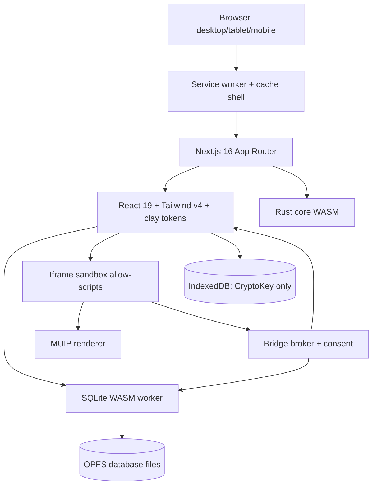

# Master PRD v3.0: MicroApp Studio Web

## §1. Visi dan Prinsip

**Masalah.** Membuat micro-app hari ini menuntut banyak langkah: memasang toolchain, memilih platform, mengonfigurasi server, membuat akun, lalu mempelajari model data dan deployment. Sebagian besar calon pembuat berhenti sebelum aplikasi pertama berjalan.

**Solusi.** Satu situs. Buka, buat, jalankan, bagikan. MicroApp Studio adalah PWA web-only yang menyimpan data di perangkat, bekerja offline setelah kunjungan pertama, dan tidak meminta akun.

Prinsip yang mengikat:

1. **Web-only.** Satu codebase Next.js untuk desktop, tablet, dan mobile browser. Tidak ada aplikasi native, server wajib, atau bundel desktop.
2. **Zero-account.** Tidak ada login, registrasi, atau verifikasi email. Identitas dibuat otomatis di perangkat.
3. **Offline-capable.** Shell dan app terpasang dapat dibuka tanpa jaringan setelah satu kunjungan.
4. **Local-first.** Data, kunci, dan package berada di perangkat. Tidak ada sinkronisasi cloud.
5. **Zero-telemetry.** Tidak ada analytics, beacon, atau pelacakan perilaku.
6. **Zero-privilege.** Micro-app tidak memiliki akses apa pun sampai pengguna memberi consent.
7. **Satu aksi utama per layar.** Setiap layar memiliki satu tujuan yang jelas.
8. **Claymorphism yang tenang.** Permukaan hangat, radius besar, bayangan lembut; tanpa glassmorphism dekoratif dan tanpa animasi yang mengganggu.

## §2. Ruang Lingkup

**In scope.**

- PWA host dan library micro-app.
- Identitas lokal otomatis dan recovery phrase opsional yang ditunda.
- Pembuatan app lewat template, Magic Create (BYOK), atau blank.
- Visual builder dengan palette 120 komponen (48 core clay default).
- Preview dan runner di iframe sandbox.
- Format package `.mapp` dengan signature, impor, instalasi, update, rollback.
- Backup dan restore terenkripsi `.mapp-backup`.
- Permission JIT, offline cage, audit lokal.
- Settings, aksesibilitas, i18n, dan DevTools lokal.

**Out of scope.**

- Aplikasi native Android/iOS, Flutter, atau bundel desktop.
- Self-host server, Go binary, container orchestrator, atau backend wajib.
- Akun, cloud sync, P2P, CRDT, atau kolaborasi real-time.
- Marketplace, publish pipeline, atau server registry.
- CLI dan SDK publik.
- Git integration, multiplayer, LAN hot reload.
- Workflow automation engine dan connector.
- AI lokal (Ollama/WebLLM) dan pemilihan provider multi-langkah.

## §3. Persona dan Jobs

| Persona | Job to be done | Jalur tiga langkah |
|---|---|---|
| **Maker** (non-teknis) | Mencatat dan menjalankan kebutuhan harian tanpa belajar pemrograman. | Pilih template → ubah teks/field → Pakai. |
| **Power User** | Mengontrol struktur, data, dan package secara presisi. | Mulai kosong → atur di inspector/JSON → ekspor `.mapp`. |
| **Template Author** | Membagikan app yang dapat dipercaya dan diverifikasi. | Bangun → Bagikan → kirim file bertanda tangan. |
| **Reviewer** | Memeriksa permission dan asal package sebelum memasang. | Impor → baca preview permission → Pasang/Tolak. |

Setiap persona harus dapat menyelesaikan job-nya tanpa akun, tanpa jaringan, dan tanpa membaca dokumentasi developer.

## §4. User Journey

1. **Buka.** Shell tampil, identitas lokal dibuat, Home langsung terlihat.
2. **Pilih cara membuat.** Template, Magic Create, atau Mulai kosong.
3. **Bangun.** Builder dengan canvas, palette, inspector, autosave.
4. **Uji.** Preview di sandbox yang sama dengan runtime.
5. **Bagikan.** Unduh `.mapp`, atau instal file dari orang lain.

Target: micro-app pertama berjalan dalam ≤ 3 menit dan ≤ 5 klik dari Home. Jalur terpendek (Template → Pakai template → Preview) adalah 3 klik.

## §5. Fitur

| Fitur | Outcome | Requirement |
|---|---|---|
| **F1 Shell/Library** | Home, pencarian, filter, pin, offline indicator, launcher state. | FR-SHELL-001…020 |
| **F2 Create** | Tiga jalur create tanpa wizard, auto-name, sample data. | FR-CREATE-001…012 |
| **F3 Visual Builder** | Canvas, palette 48/120, inspector token, autosave, undo/redo. | FR-STUDIO-001…020 |
| **F4 Preview/Run** | Iframe sandbox, MUIP, bridge, watchdog, crash boundary. | FR-RUN-001…014 |
| **F5 Package/Share** | `.mapp` bertanda tangan, impor, install, update, rollback, index statis opsional. | FR-PACK-001…012 |
| **F6 Backup/Restore** | Backup terenkripsi, checksum, merge/replace, pengingat. | FR-BACKUP-001…008 |
| **F7 Permissions/Security** | Zero privilege, consent JIT, revoke, offline cage, audit. | SEC-001…014 |
| **F8 Settings/A11y/DevTools** | Tema clay, locale, storage, BYOK, diagnostik lokal. | FR-SET-001…010, FR-DEV-001…006 |

## §6. UX dan Design

Sistem desain adalah **MADS v3 Clay**. Sumber visual kanonik ada di [DESIGN.md](../../DESIGN.md); kontrak token dan implementasi ada di [design-system.md](../02-design/design-system.md). PRD ini tidak menduplikasi nilai token.

Ringkasan yang mengikat:

- Permukaan clay: radius 14–36 px, highlight atas, bayangan dalam bawah, bayangan luar hangat.
- Palet hangat dengan aksi utama lavender tua; status memakai ikon + label, bukan warna saja.
- Tipografi Plus Jakarta Sans untuk UI, Fraunces untuk display, JetBrains Mono untuk kode; font dibundel lokal.
- Motion 120/180/240/320 ms dengan easing spring; `prefers-reduced-motion` menghapus transform.
- Satu aksi utama per layar; tidak ada dark pattern atau consent yang sudah tercentang.

## §7. Arsitektur Web

Prinsip arsitektur:

1. **Client-first.** Tidak ada backend wajib. Deploy dapat berupa Node host atau static export bila seluruh fitur client-side.
2. **Satu worker data.** SQLite WASM di OPFS hanya diakses lewat worker; main thread tidak memuat SQLite.
3. **Satu kanal app.** Iframe opaque origin berkomunikasi hanya lewat bridge.
4. **WASM untuk kripto dan package.** `packages/core-rust` dikompilasi ke `wasm32`; tidak ada FFI native.
5. **PWA.** Service worker menyajikan shell dan aset app terpasang dari cache.

## §8. Data dan Privasi

- Data berada di perangkat: host DB SQLite WASM di OPFS, satu DB per app per workspace.
- IndexedDB hanya menyimpan `CryptoKey` non-extractable dan metadata yang benar-benar perlu.
- Backup selalu terenkripsi AES-256-GCM dengan kunci Argon2id; checksum per section.
- Tidak ada telemetry, analytics, atau upload otomatis.
- Tidak ada request jaringan tanpa aksi pengguna, kecuali fetch yang diminta app dengan permission dan cage nonaktif.
- BYOK disimpan di vault lokal dan hanya dikirim ke endpoint yang dipilih pengguna.
- Browser dapat mengusir storage; produk menampilkan estimasi, meminta persistent storage, dan menawarkan ekspor. Tidak ada klaim bahwa data tidak dapat hilang.

## §9. Non-Functional

Target produk: cepat, aksesibel, dan dapat diandalkan offline. Angka final ada di [nfr.md](../03-specs/nfr.md); ringkasan:

| Kelas | Target |
|---|---|
| Performance | LCP < 2.0 s, INP < 200 ms, CLS < 0.1, initial JS < 250 KB gzip, builder < 50 ms/operasi. |
| Accessibility | WCAG 2.2 AA, keyboard-only untuk alur inti, reduced motion 0 ms. |
| i18n | `id-ID` dan `en-US`, RTL tanpa clipping. |
| Reliability | Shell dan app terpasang dapat dibuka offline setelah satu kunjungan. |
| Maintainability | `npm run docs:check` lulus tanpa warning. |
| Security | CSP ketat, COOP/COEP, sandbox opaque origin, signature package. |

## §10. Roadmap

| Fase | Fokus | Gate |
|---|---|---|
| **Fase 1 Foundation** | Shell, identitas lokal, host DB, sandbox, package import/install, backup. | Semua test dan E2E fase 1 lulus; tidak ada klaim builder. |
| **Fase 2 Builder** | Create (template/AI/blank), visual builder, preview, share `.mapp`. | Draft → preview → export berjalan end-to-end. |
| **Fase 3 Delight** | Clay UI menyeluruh, AI assist, galeri template, polish aksesibilitas. | Audit axe dan budget performa lulus. |

Status nyata per requirement ada di [implementation-status.md](../00-foundation/implementation-status.md) dan [prd-compliance-matrix.md](../00-foundation/prd-compliance-matrix.md). Roadmap bukan klaim bahwa fitur sudah ada.

## §11. Risiko

| Risiko | Dampak | Mitigasi |
|---|---|---|
| Package berbahaya | Eksekusi kode tidak tepercaya | Signature wajib, verifikasi digest, sandbox opaque origin, permission JIT, preview permission. |
| XSS / sandbox escape | Pencurian data lokal | CSP ketat, nonce, tanpa `allow-same-origin`, renderer `textContent`, tanpa `eval`/`innerHTML`. |
| Kehilangan data | Pekerjaan pengguna hilang | Autosave, snapshot migrasi, backup terenkripsi, ekspor, peringatan kuota. |
| Storage eviction | Data hilang oleh browser | `navigator.storage.persist()`, estimasi, peringatan 80%, pengingat backup. |
| AI hallucination | Draft tidak masuk akal | Rencana ditinjau sebelum apply, output dapat diedit, AI opsional. |
| Regresi aksesibilitas | Sebagian pengguna tidak dapat memakai produk | axe di CI, keyboard test, kontras token, reduced motion. |
| Supply chain npm | Build berbahaya | Lockfile, review dependency, overrides, audit berkala. |

## §12. Definisi Selesai

Produk dianggap selesai untuk suatu rilis bila:

- [ ] Seluruh requirement pada fase terkait berstatus `implemented` dengan bukti verifikasi.
- [ ] `node scripts/check-docs.mjs --strict` dan `node scripts/generate-catalog.mjs --check` lulus.
- [ ] `npm test`, `npm run typecheck`, `npm run lint`, `npm run build`, `npm run e2e` lulus.
- [ ] axe bersih pada 12 layar di tiga tema.
- [ ] Budget performa dan ukuran JS lulus.
- [ ] Tidak ada klaim platform yang tidak ada di dokumen maupun UI.
- [ ] Backup dan restore diuji round-trip.
- [ ] Release gate di [release-gates.md](../08-quality/release-gates.md) terpenuhi.

Detail per artefak ada di [definition-of-done.md](../08-quality/definition-of-done.md).
