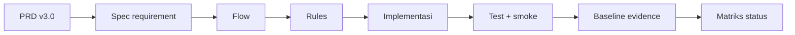

# SDD Workflow

## 1. Tujuan

Menetapkan alur Spec-Driven Development web-only: PRD → spec → flow → rules → kode → bukti. Dokumen adalah kontrak; kode menyusul. Tidak ada fase native, server, atau platform lain.

## 2. Urutan Artefak

Aturan:

1. Requirement harus ada di spec sebelum diimplementasikan.
2. Perilaku yang terlihat pengguna harus memiliki flow.
3. Aturan implementasi harus ada di rules sebelum review.
4. Status `implemented` hanya setelah test/smoke dan evidence.
5. Matriks diperbarui pada commit yang sama dengan perubahan status.

## 3. Langkah Kerja

| Langkah | Output | Gate |
|---|---|---|
| 1. Issue | Masalah, persona, dampak | Tidak ada duplikat |
| 2. PRD/spec | Perubahan requirement atau spec | ID unik, acceptance terukur |
| 3. Flow | Alur utama, cabang gagal, verifikasi | Minimal satu requirement |
| 4. Rules | Aturan yang terkena | Tidak menambah platform |
| 5. Branch | `docs/*`, `feat/*`, `fix/*` | Dari `development` |
| 6. Docs commit | Dokumen diperbarui lebih dulu | `docs:check` lulus |
| 7. Implementasi | Kode + test | Typecheck, lint |
| 8. Verifikasi | Test, build, E2E, a11y | Baseline dicatat |
| 9. PR | Deskripsi, bukti, risiko | Review dua orang untuk security |
| 10. Merge | Squash, changelog bila perlu | Gate rilis |

## 4. Docs-First

- Commit dokumen mendahului commit kode untuk perubahan kontrak.
- Satu commit satu tujuan; jangan mencampur refactor dokumen dengan perubahan runtime.
- Dokumen yang tidak lagi benar harus diperbaiki atau dihapus, bukan dibiarkan dengan label deprecated yang masih ditautkan.
- Git history adalah arsip; tidak ada folder arsip aktif.

## 5. Evidence

Setiap klaim status harus menunjuk:

- Perintah yang dijalankan.
- Waktu dan commit.
- Hasil (pass/fail/partial).
- Batasan (mis. E2E tidak dijalankan).

Baseline disimpan di [baseline.md](../08-quality/evidence/baseline.md). Tidak ada `implemented` tanpa bukti.

## 6. Review

| Jenis perubahan | Reviewer wajib |
|---|---|
| Spec/flow | product + owner teknis |
| Security, permission, crypto | security |
| Token/komponen | design + a11y |
| Skema/manifest/package | architecture + security |
| Docs tooling | dx |

## 7. Verifikasi

| Pemeriksaan | Cara |
|---|---|
| Docs gate | `node scripts/check-docs.mjs --strict` |
| Katalog | `node scripts/generate-catalog.mjs --check` |
| Kode | `npm test`, `npm run typecheck`, `npm run lint` |
| Build | `npm run build` |
| Bukti | `docs/08-quality/evidence/baseline.md` diperbarui |
