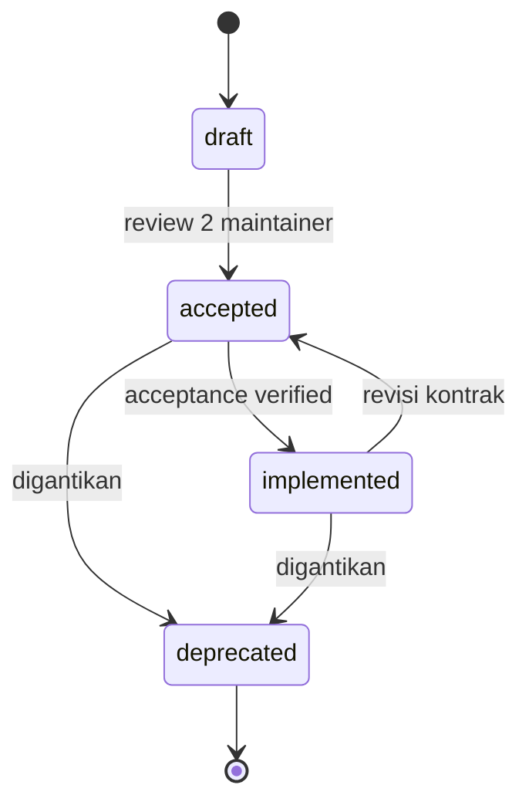

# Alur Kerja Spec-Driven Development

## 1. Definisi

Spec-Driven Development (SDD) berarti **dokumen adalah sumber kebenaran dan kode mengikutinya**. Perubahan perilaku apa pun dimulai dari perubahan spec, flow, atau acceptance criteria. Kode yang berperilaku berbeda dari dokumen dianggap bug, bukan inovasi.

SDD berlaku untuk semua artefak: spec fungsional, kontrak (`manifest`, `MUIP`, `host bridge`, `permissions`, `error codes`), skema database, flow, design, dan infra self-host.

## 2. Presedensi

```
PRD (niat produk)
  > ADR accepted (keputusan arsitektur)
    > spec (kontrak perilaku)
      > rules (cara menulis kode)
        > kode dan test
```

- ADR yang diterima **wajib dicerminkan ke spec pada PR yang sama atau PR lanjutan yang segera menyusul**. Selama spec belum diperbarui, ADR menang dan spec dianggap perlu revisi.
- PRD berubah menang atas ADR; ADR yang terdampak wajib disupersede.
- Bila kode dan spec berbeda tanpa ADR/RFC, kode diperbaiki.

## 3. Siklus Status Dokumen



| Transisi | Syarat |
|---|---|
| `draft → accepted` | Review minimal 2 maintainer; RFC bila menyentuh kontrak; link PRD valid. |
| `accepted → implemented` | Seluruh acceptance criteria dijalankan dan bukti dicatat pada `## 8. Verifikasi`. |
| `implemented → accepted` | Revisi kontrak baru; implementasi lama ditandai menyimpang di [implementation-status.md](implementation-status.md). |
| `accepted/implemented → deprecated` | Digantikan dokumen baru; tautan pengganti dicatat. |

Hanya [templates](../templates/spec.md) yang boleh berstatus `draft`. Checker `--strict` menggagalkan status `draft` di luar template dan arsip.

## 4. Kelas Perubahan

| Kelas | Contoh | Kewajiban dokumen | RFC |
|---|---|---|---|
| **A. Docs-only** | Typo, perbaikan tautan, klarifikasi tanpa mengubah perilaku | Edit langsung; checker lulus | Tidak |
| **B. Perilaku** | Menambah state UI, mengubah validasi form, menambah parameter non-kontrak | Spec/flow/acceptance dulu, lalu kode; matriks diperbarui | Tidak |
| **C. Kontrak** | Manifest, MUIP, host bridge, sync/CRDT, permission, crypto, registry, skema DB | RFC diterima + spec diperbarui + versi kontrak dinaikkan + fixture | Ya |

Kelas C wajib menyertakan analisis kompatibilitas: major/minor, dampak ke host lama, migrasi, dan rollback.

## 5. Urutan Kerja

```mermaid
flowchart LR
    A[Issue] --> B[Spec PR: docs:]
    B --> C[Review spec]
    C --> D[Branch feat/fix]
    D --> E[Implementasi]
    E --> F[Test dan verifikasi]
    F --> G[PR: feat/fix]
    G --> H[Review]
    H --> I[Merge squash]
    I --> J[docs(status): implemented]
    J --> K[Release gate]
```

Aturan yang mengikat:

1. **Commit pertama wajib `docs:`.** Satu PR boleh memuat `docs:` lalu `feat:`/`fix:`, tetapi tidak boleh sebaliknya.
2. PR implementasi wajib memuat baris `Spec: docs/<path>.md#FR-...` atau `Spec: docs-not-needed` beserta alasan.
3. Tanpa spec yang disetujui, agen dan engineer **tidak boleh menebak**; tulis spec atau RFC lebih dulu.
4. Status `implemented` hanya boleh dinaikkan setelah verifikasi dijalankan; bukan setelah kode ditulis.
5. Perubahan kontrak tanpa RFC ditolak reviewer.

## 6. Checklist PR

| Item | Bukti |
|---|---|
| Spec | Path + ID requirement, atau alasan `docs-not-needed` |
| Perubahan | Ringkasan perilaku, bukan daftar file |
| Verifikasi | Perintah yang dijalankan dan hasilnya |
| Risiko/Rollback | Dampak dan cara membalik |
| Docs check | `npm run docs:check` lulus |
| Acceptance | Setiap acceptance criterion yang terdampak disebut |
| Keamanan | Permission/crypto/sandbox terdampak atau tidak |
| a11y/i18n | Layar/string terdampak atau tidak |

Template PR ada di [.github/pull_request_template.md](../../.github/pull_request_template.md).

## 7. Pengecualian Hotfix

Hotfix keamanan atau data loss boleh mendahului dokumen dengan syarat:

1. Perbaikan dibatasi pada mitigasi minimal.
2. Dokumen retro (spec + matriks + catatan insiden) diselesaikan dalam **24 jam**.
3. PR retro menautkan PR hotfix dan insiden di [09-operations/incident-response.md](../09-operations/incident-response.md).
4. Bila perbaikan mengubah kontrak, RFC retro wajib diterima dalam **7 hari**.

## 8. Review Berkala

| Ritme | Pemilik | Fokus |
|---|---|---|
| Setiap PR | Reviewer modul | Kepatuhan spec, acceptance, link valid. |
| Setiap release | Owner dokumen | Klaim status, tautan usang, inkonsistensi spec vs kode. |
| Kuartalan | Maintainer council | ADR kedaluwarsa, cakupan PRD, glossary, prioritas fase. |

Hasil review dicatat sebagai PR `docs:` dan wajib lulus checker.

## 9. Konflik PRD, ADR, dan Kode

| Situasi | Tindakan |
|---|---|
| PRD vs ADR | PRD menang. ADR disupersede atau direvisi; spec mengikuti. |
| ADR vs spec | ADR menang sementara. Spec diperbaiki pada PR berikutnya; deviasi dicatat. |
| Spec vs kode | Spec menang. Kode diperbaiki atau spec direvisi lewat PR docs dengan alasan. |
| Kode vs test | Test mengikuti spec; test yang mengunci perilaku keliru dihapus. |
| Dua spec bertentangan | Requirement dengan ID lebih spesifik menang; spec lain diperbaiki. |

## 10. Larangan

- Menyatakan fitur belum ada sebagai "sudah selesai" pada README, dokumen, atau komentar.
- Menghapus requirement PRD karena sulit; gunakan status `blocked` pada matriks dan ADR deviasi.
- Menyimpan keputusan desain hanya di percakapan; keputusan wajib masuk ADR/spec.
- Mengubah PRD salinan tanpa memperbarui salinan dan matriks.
