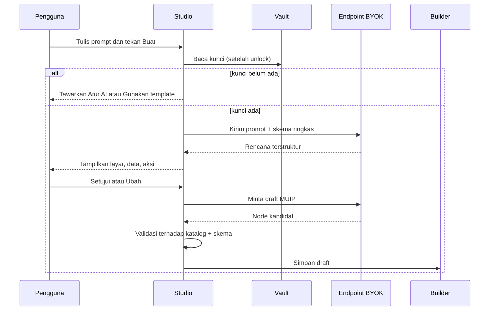

# AI Assist

## 1. Tujuan

Dokumen ini menetapkan peran AI opsional dalam pembuatan micro-app. AI membantu menerjemahkan satu prompt menjadi rencana aplikasi dan draft MUIP. AI bukan dependensi: template dan builder kosong harus tetap berfungsi penuh tanpa jaringan dan tanpa kunci API.

Kontrak create ada di [03-specs/02-studio.md](../03-specs/02-studio.md), alur pengguna di [04-flows/02-create-app.md](../04-flows/02-create-app.md), dan penyimpanan rahasia di [identity-crypto.md](identity-crypto.md).

## 2. Prinsip

1. **Opsional.** Tidak ada fitur inti yang bergantung pada AI.
2. **BYOK.** Pengguna menyediakan endpoint dan kunci sendiri; produk tidak menyediakan inference berbayar.
3. **Aksi eksplisit.** Tidak ada prompt yang dikirim tanpa tindakan pengguna.
4. **Tanpa telemetry.** Prompt, hasil, dan metrik tidak dikirim ke pihak lain selain endpoint pilihan pengguna.
5. **Tanpa perpindahan provider.** Kegagalan satu endpoint tidak dialihkan diam-diam ke endpoint lain.
6. **Output tidak dipercaya.** Rencana dan node AI divalidasi sebelum masuk draft.
7. **Rahasia tetap di vault.** Kunci API tidak pernah masuk manifest, dokumen draft, log, atau ekspor.

## 3. Ruang Lingkup

| Termasuk | Tidak termasuk |
|---|---|
| Magic Create dari satu prompt | Model lokal di browser |
| Ringkasan rencana sebelum apply | Pemilihan provider otomatis |
| Draft MUIP dari rencana | Eksekusi kode yang dihasilkan AI |
| Saran teks dan komponen | Workflow automation |
| Pemilihan model dari endpoint pengguna | Fine-tuning atau pelatihan model |

Tidak ada Ollama, WebLLM, llama.cpp, model yang diunduh ke OPFS, workflow engine, atau agen yang berjalan tanpa interaksi.

## 4. Konfigurasi

| Field | Aturan |
|---|---|
| Endpoint | URL OpenAI-compatible; HTTPS untuk host publik; loopback hanya dengan flag dev |
| Kunci | Disimpan di `vault_items` kind `api_key`; ditampilkan sebagai empat karakter terakhir |
| Model | Nama model yang didukung endpoint; tidak ada daftar model bawaan yang diunduh |
| Suhu | Default rendah untuk pembuatan terstruktur |
| Timeout | 30 detik untuk rencana, 60 detik untuk draft |
| Retry | Maksimal satu retry manual; tidak ada retry otomatis lintas provider |

Endpoint harus mengizinkan CORS dari origin aplikasi. Bila CORS gagal, aplikasi menampilkan pesan konfigurasi, bukan mencoba proxy server. Pengguna dapat menghapus kunci kapan saja; penghapusan langsung menghentikan fitur AI.

## 5. Alur Magic Create



Aturan:

- Prompt dikirim sebagai satu permintaan; tidak ada wizard multi-langkah.
- Rencana ditampilkan dalam bahasa manusia: layar, data, aksi, permission yang mungkin dibutuhkan.
- Pengguna dapat mengubah rencana sebelum draft dibuat.
- Draft yang dihasilkan selalu dapat diedit di builder dan tidak mengunci pengguna pada AI.
- `Cmd/Ctrl+Enter` memicu aksi utama; `Esc` kembali tanpa menghapus draft.
- Bila endpoint gagal, dua jalur fallback (template dan kosong) tetap tersedia.

## 6. Kontrak Output

Model harus mengembalikan JSON dengan bentuk yang dapat divalidasi:

```json
{
  "plan": {
    "screens": ["Daftar", "Form"],
    "data": ["item", "kategori"],
    "actions": ["tambah", "ubah", "hapus"]
  },
  "draft": {
    "version": 1,
    "root": "node-1",
    "nodes": []
  }
}
```

Validasi:

1. JSON harus parse dan sesuai skema.
2. Setiap tipe node harus ada di 120 komponen katalog.
3. Props harus dari allowlist komponen.
4. Kedalaman, jumlah node, dan ukuran harus dalam batas MUIP.
5. Permission yang disebut rencana harus ada di daftar permission web.
6. Node dengan HTML, CSS, atau JavaScript mentah ditolak.

Output yang gagal validasi tidak pernah disimpan sebagai draft final. Pengguna melihat ringkasan kesalahan dan dapat meminta ulang atau memakai template.

## 7. Prompt dan Privasi

| Data | Boleh dikirim | Aturan |
|---|---|---|
| Prompt pengguna | Ya | Hanya setelah aksi Buat |
| Nama project | Ya | Dapat diedit sebelum kirim |
| Skema data kosong | Ya | Tanpa nilai record |
| Isi record pengguna | Tidak | Tidak dikirim kecuali pengguna menempelkannya sendiri |
| Kunci API | Tidak | Hanya di header Authorization |
| Frasa pemulihan | Tidak | Tidak pernah masuk prompt |
| Audit dan log | Tidak | Tidak dikirim |

UI menampilkan endpoint tujuan dan model sebelum pengiriman pertama. Tidak ada pengiriman latar belakang, preflight ke provider, atau ping kesehatan otomatis.

## 8. Keamanan

- Kunci dibaca dari vault setelah unlock dan tidak disimpan di state global yang dapat diserialisasi.
- Endpoint divalidasi: skema, host, dan path; URL `javascript:`, `data:`, dan `file:` ditolak.
- Respons diperlakukan sebagai data. Tidak ada `eval`, `new Function`, atau rendering HTML dari respons.
- Prompt tidak ditulis ke log. Bila logging debug aktif, hanya metadata (model, durasi, ukuran) yang dicatat.
- Kesalahan HTTP dipetakan ke pesan yang tidak memuat kunci atau header.
- Endpoint pengguna dapat menyimpan prompt; ini risiko yang harus dijelaskan di UI, bukan disembunyikan.

## 9. Kegagalan dan Fallback

| Kegagalan | Perilaku |
|---|---|
| Kunci belum ada | Tawarkan Atur AI, Gunakan template, atau Mulai kosong |
| 401/403 | Minta periksa kunci; tidak retry otomatis |
| 429 | Tampilkan waktu tunggu; pengguna dapat mencoba lagi |
| Timeout | Tawarkan coba lagi atau fallback |
| CORS | Jelaskan bahwa endpoint harus mengizinkan origin aplikasi |
| Output invalid | Tampilkan alasan validasi; draft tidak berubah |
| Kuota token | Hentikan permintaan dan tampilkan sisa konteks bila tersedia |

Tidak ada perpindahan ke provider lain, model lain, atau mode lokal tanpa persetujuan eksplisit.

## 10. Yang Tidak Ada

Tidak ada inference lokal, model di browser, Ollama, WebLLM, provider otomatis, prompt marketplace, workflow engine, agen otonom, atau telemetry AI. Tidak ada server yang menerima prompt atau menyimpan kunci pengguna.

## 11. Status Implementasi

Konfigurasi BYOK di vault, panel Settings AI, dan alur Magic Create belum diimplementasikan. Entri bridge `ai.infer`, `ai.embed`, dan `ai.classify` saat ini ditandai phase-gated dan gagal tertutup; entri tersebut bukan kontrak target dan harus dihapus atau dipetakan ulang saat fitur dibangun. Bukti ada di [00-foundation/implementation-status.md](../00-foundation/implementation-status.md).
