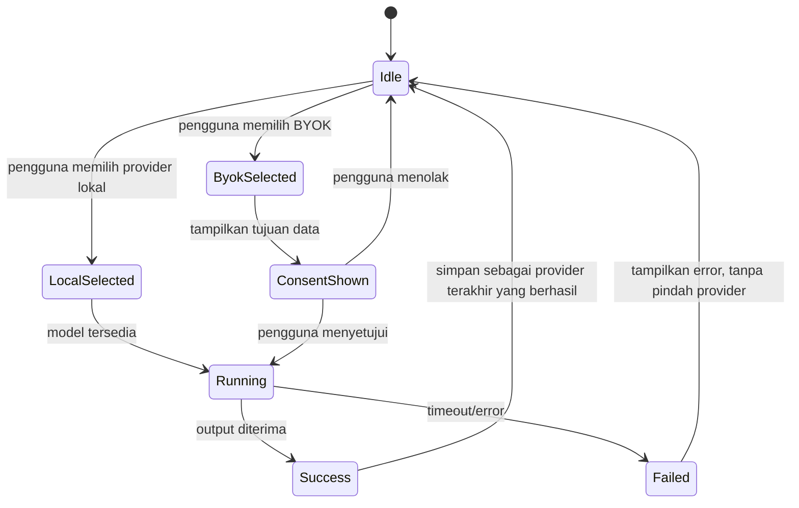
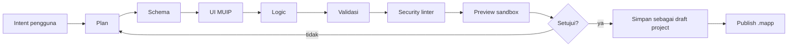
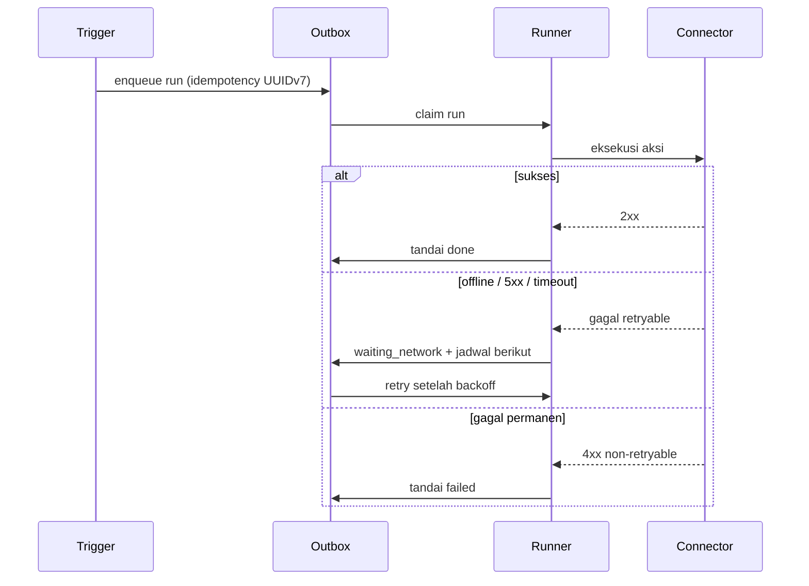

# AI dan Workflow

Dokumen ini menetapkan arsitektur AI lokal/BYOK dan mesin workflow. Kontrak normatif ada di [03-specs/02-studio-ide.md](../03-specs/02-studio-ide.md) dan [03-specs/04-data-automation.md](../03-specs/04-data-automation.md); alur pengguna ada di [04-flows/03-build-with-ai.md](../04-flows/03-build-with-ai.md) dan [04-flows/08-workflow-outbox.md](../04-flows/08-workflow-outbox.md).

## 1. Tujuan dan Ruang Lingkup

Ruang lingkup mencakup adapter model lokal, BYOK OpenAI-compatible, pipeline prompt-to-app, screenshot/Figma-to-canvas, self-healing, security linter, graf workflow, outbox, retry, human-in-the-loop (HITL), server runner, dan connector. Di luar ruang lingkup: pelatihan model dan hosting model milik proyek. Proyek **MUST NOT** menyediakan inference berbayar atau mengumpulkan telemetry prompt.

## 2. Prinsip yang Mengikat

1. **Lokal lebih dulu.** Default provider adalah provider lokal terakhir yang berhasil; cloud hanya jika pengguna memilihnya.
2. **Pilihan eksplisit.** Tidak ada silent switch antarprovider, termasuk saat timeout atau error.
3. **Kunci hanya di vault.** Kredensial BYOK **MUST NOT** masuk manifest, log, prompt, atau database micro-app.
4. **Tanpa telemetry.** Tidak ada pengiriman prompt, hasil, atau metrik AI ke pihak ketiga secara default.
5. **Sandbox wajib.** AI **MUST NOT** mengeksekusi kode di luar sandbox atau tanpa consent pengguna.
6. **Output tidak dipercaya.** Semua output AI diperlakukan sebagai input yang harus divalidasi.

## 3. Adapter AI

| Adapter | Tipe | Transport | Catatan |
|---|---|---|---|
| Ollama | Lokal | HTTP `127.0.0.1` | Deteksi model terpasang; load maksimal 300 detik |
| llama.cpp | Lokal | HTTP/stdio | Model GGUF lokal; tanpa unduhan otomatis |
| vLLM | Lokal/server privat | HTTP OpenAI-compatible | Untuk workstation/self-host dengan GPU |
| LM Studio | Lokal | HTTP OpenAI-compatible | Endpoint lokal yang dikonfigurasi pengguna |
| WebLLM | Lokal di browser | WebGPU/WASM | Status tidak tersedia bila WebGPU absen; tanpa fallback diam |
| BYOK OpenAI-compatible | Cloud/pihak ketiga | HTTPS | Kunci disimpan di vault; hanya aktif setelah pengguna memilih |

Aturan adapter:

- Adapter **MUST** mengimplementasikan antarmuka yang sama: daftar model, health check, streaming, cancellation, dan metrik token bila tersedia.
- Adapter lokal **MUST** diakses melalui loopback dan **MUST NOT** diekspos ke jaringan tanpa konfigurasi eksplisit.
- Adapter cloud **MUST** menampilkan nama provider, model, dan perkiraan data yang dikirim sebelum eksekusi pertama.
- Kegagalan adapter **MUST** dilaporkan sebagai status, bukan diganti provider lain secara otomatis.

## 4. Pemilihan Provider

Aturan:

- Urutan prioritas default: provider lokal terakhir yang berhasil → provider lokal lain yang tersedia → BYOK hanya jika dipilih pengguna.
- Timeout generasi **120 detik**. Setelah timeout, permintaan berhenti; tidak ada retry otomatis ke provider lain.
- Pembatalan pengguna **MUST** menghentikan stream dan **MUST NOT** memicu retry.
- Bila provider lokal tidak tersedia, UI menawarkan pilihan manual (BYOK, template, atau editor) dan **MUST NOT** beralih diam-diam.

## 5. Pipeline Prompt-to-App

| Tahap | Keluaran | Validasi | Gagal berarti |
|---|---|---|---|
| Intent | Ringkasan tujuan, aktor, data | Tidak kosong, bahasa jelas | Minta klarifikasi |
| Plan | Daftar layar, entitas, aksi, permission | Setiap permission punya justifikasi | Kembali ke intent |
| Schema | Tabel, kolom, tipe, index, relasi | Skema valid, migrasi dapat dibuat | Perbaiki schema |
| UI | Pohon MUIP v1 | Batas kedalaman 64/node 10.000/payload 1 MiB | Pecah atau sederhanakan |
| Logic | Fungsi sandbox dan workflow | Tanpa `eval`/`new Function`, tanpa ambient | Tolak dan regenerasi |
| Validasi | Laporan tipe, lint, schema | TS strict, schema cocok | Tampilkan error |
| Security linter | Temuan permission, jaringan, rahasia | Tidak ada rahasia di output | Blokir preview |
| Preview | Micro-app di sandbox | Isolasi aktif, consent siap | Fail closed |

Output tahap mana pun **MUST** dapat diedit manual. Pipeline **MUST NOT** menulis langsung ke database produksi; hasil disimpan sebagai draft project sampai pengguna menerima.

## 6. Screenshot dan Figma-to-Canvas

1. Pengguna mengunggah screenshot atau menghubungkan file Figma.
2. Sistem mengekstrak hierarki visual, teks, dan warna.
3. Ekstraksi dipetakan ke komponen MADS yang sudah ada; komponen baru **MUST NOT** dibuat otomatis.
4. Token warna dan spacing dinormalisasi ke token MADS, bukan nilai hardcoded.
5. Hasil ditampilkan sebagai canvas yang dapat diedit dan dipreview di sandbox.
6. Confidence rendah **MUST** ditandai agar pengguna meninjau.

Gambar dan metadata **MUST** diproses lokal bila provider lokal dipilih. Bila BYOK dipakai, pengguna **MUST** melihat bahwa gambar akan dikirim ke provider tersebut.

## 7. Self-Healing dan Security Linter

**Self-healing** hanya berlaku untuk error yang dapat direproduksi di sandbox:

- Sumber error: runtime error, gagal validasi schema, atau kegagalan build.
- Sistem mengusulkan patch terbatas, menampilkan diff, dan menjalankan ulang di sandbox.
- Jumlah percobaan per error dibatasi; setelah batas tercapai, pengguna harus turun tangan.
- Patch **MUST NOT** mengubah permission, kunci, atau konfigurasi keamanan tanpa consent.

**Security linter** memeriksa minimal:

| Pemeriksaan | Tindakan |
|---|---|
| `eval`, `new Function`, akses DOM induk | Blokir |
| Permission diminta tanpa penggunaan | Peringatkan dan tawarkan hapus |
| Endpoint jaringan di luar allowlist | Blokir sampai allowlist diperbarui |
| Kredensial atau token di kode/prompt | Blokir dan redaksi |
| Query DB lintas `app_id` | Blokir |
| HTML mentah di MUIP | Blokir |
| Dependency rentan | Peringatkan; blokir bila kritis |

## 8. Model Workflow

Workflow adalah graf asiklik berarah yang dieksekusi oleh runner lokal atau server.

| Elemen | Contoh | Aturan |
|---|---|---|
| Trigger | `db.insert`, `cron`, `cross-app.event`, `webhook` | Satu workflow **MUST** punya minimal satu trigger |
| Node aksi | `http.request`, `connector.call`, `transform`, `llm.generate`, `notify`, `branch`, `delay` | Node **MUST** punya skema input/output |
| Node HITL | `approval` | Menahan eksekusi sampai keputusan pengguna |
| Edge | Sukses, gagal, kondisional | Tanpa siklus tak terbatas |
| State | `queued`, `running`, `waiting_network`, `waiting_hitl`, `done`, `failed`, `dead` | Transisi disimpan di `outbox.state`; label UI seperti "berhasil"/"menunggu persetujuan" bukan nilai DB |

Node **MUST NOT** mengeksekusi kode arbitrer. Transformasi memakai operasi terdefinisi atau modul sandbox yang tervalidasi. LLM node **MUST** memakai aturan provider di bagian 4.

## 9. Outbox dan Retry

Ketentuan outbox:

| Aspek | Nilai |
|---|---|
| Maksimum attempt | **8** |
| Backoff | **1 detik × 2^n**, cap **1 jam** |
| Jitter | **20%** |
| Idempotency key | **UUIDv7**, dibuat saat enqueue dan tidak berubah saat retry |
| Durabilitas | Outbox persisten di tabel `outbox`; bertahan setelah restart/crash |
| Ordering | Per workflow dan per entitas; tidak ada eksekusi paralel untuk key yang sama |
| Deduplikasi | Key yang sama dalam status aktif **MUST NOT** membuat run baru |

Setelah 8 attempt, run berstatus `dead` dan **MUST** terlihat di UI bersama riwayat attempt. Pengguna dapat memicu ulang secara manual; percobaan manual memakai idempotency key baru. Riwayat run dibaca dari deret `outbox.state` dan trace node di `diagnostic_log`, bukan dari tabel run terpisah.

## 10. Human-in-the-Loop

- Node `approval` menahan run pada status `waiting_hitl`.
- Permintaan approval **MUST** menampilkan aksi, data yang dikirim, tujuan, dan risiko.
- Keputusan **MUST** tercatat dengan aktor dan waktu.
- Approval **MUST** kedaluwarsa setelah batas yang dikonfigurasi; setelah kedaluwarsa run berakhir `failed` dengan kode error timeout, bukan status di luar tujuh nilai kanonik.
- Aksi destruktif **MUST** memiliki konfirmasi eksplisit dan opsi undo 10 detik bila memungkinkan.

## 11. Server Runner

Server self-host **MAY** menjalankan workflow yang sama untuk trigger yang tidak dapat berjalan di perangkat (webhook, cron, cross-tenant event).

- Skema workflow, node, dan connector **MUST** identik antara runner lokal dan server; node/connector server diimplementasikan di Go dan function pengguna dijalankan sebagai WASM (`wazero`) dengan kontrak input/output yang sama.
- State, retry (8 attempt, backoff `1s × 2^n` cap 1 jam, jitter 20%), dan idempotency UUIDv7 **MUST** identik; fixture workflow yang sama menghasilkan output sama di kedua runner.
- Payload yang melewati server **MUST** mengikuti kebijakan data organisasi; data E2EE tetap ciphertext kecuali pengguna secara eksplisit mengizinkan dekripsi untuk workflow tersebut.
- Server runner **MUST** memakai outbox dan aturan retry yang sama.
- Isolasi tenant **MUST** diterapkan pada eksekusi, kredensial, dan log.
- Server **MUST NOT** menjalankan kode micro-app; eksekusi UI tetap di perangkat.

## 12. Connector

| Kategori | Connector | Transport | Catatan |
|---|---|---|---|
| HTTP generik | REST, GraphQL | HTTP/HTTPS | SSRF guard wajib |
| Realtime | WebSocket, MQTT | WS/TCP | Reconnect dengan backoff |
| Database | PostgreSQL, MySQL, SQLite | Native driver | Kredensial di vault; read/write terpisah |
| Object storage | S3-compatible | S3 API | Presigned URL bila memungkinkan |
| File | WebDAV | HTTP | Path traversal dicegah |
| Kalender/kontak | CalDAV, CardDAV | HTTP | Scope kredensial minimal |
| Otomasi | n8n | HTTP webhook | Payload divalidasi |
| Chat | Matrix, Telegram, Discord, Slack | HTTP/WS | Rate limit per platform |
| AI | LLM OpenAI-compatible | HTTP | Provider dipilih eksplisit |

Connector **MUST** dideklarasikan di manifest atau konfigurasi workflow beserta permission dan scope. Connector **MUST NOT** menerima kredensial dari output LLM.

## 13. SSRF Guard

Semua permintaan keluar dari node workflow dan connector **MUST** melewati guard yang sama:

1. Skema **MUST** dibatasi ke `https`; `http` hanya untuk host lokal yang dikonfigurasi eksplisit.
2. Resolusi DNS **MUST** dilakukan sebelum koneksi dan hasilnya dipakai untuk koneksi (mencegah DNS rebinding).
3. Alamat privat, loopback, link-local, multicast, dan metadata cloud **MUST** diblokir secara default.
4. Redirect **MUST** divalidasi ulang per hop; jumlah hop dibatasi.
5. `security.allowPrivateEgress` pada server **MUST** menjadi satu-satunya cara mengizinkan egress privat, dan **MUST** tercatat di audit.
6. Timeout koneksi dan ukuran respons **MUST** dibatasi.
7. Error **MUST NOT** membocorkan isi respons internal ke pengguna; hanya kode dan pesan umum.

## 14. Batas dan Kegagalan

| Kejadian | Perilaku |
|---|---|
| Model lokal gagal dimuat | Status tidak tersedia; tawarkan BYOK/manual |
| Generasi melewati 120 detik | Batalkan; tampilkan error; tanpa retry otomatis |
| WebGPU tidak tersedia | WebLLM dinonaktifkan dengan penjelasan |
| Provider BYOK menolak kredensial | Tampilkan error; kunci tidak dihapus otomatis |
| Workflow offline | `waiting_network`; retry sesuai backoff |
| Connector mengembalikan 4xx | `failed`, tanpa retry |
| Approval kedaluwarsa | `failed` dengan kode timeout |
| Server restart | Outbox dilanjutkan dari state persisten |

Tidak ada fallback yang mengorbankan isolasi atau consent. Bila sandbox tidak tersedia, preview **MUST** gagal tertutup.

## 15. Referensi

- [ai-workflow terkait: sandbox](sandbox-capabilities.md), [host bridge](host-bridge-intents.md), [data model](data-model.md)
- [03-specs/02-studio-ide.md](../03-specs/02-studio-ide.md), [03-specs/04-data-automation.md](../03-specs/04-data-automation.md)
- [03-specs/ui-protocol.md](../03-specs/ui-protocol.md), [03-specs/permissions.md](../03-specs/permissions.md)
- [04-flows/03-build-with-ai.md](../04-flows/03-build-with-ai.md), [04-flows/08-workflow-outbox.md](../04-flows/08-workflow-outbox.md)
- [08-quality/security-test-plan.md](../08-quality/security-test-plan.md)
