# Data Model

Dokumen ini menetapkan model data target untuk Host (web dan native), Studio, dan self-hosted server. Seluruh penyimpanan lokal memakai SQLite; tidak ada sumber data kedua. Status implementasi saat ini dicatat di `../00-foundation/implementation-status.md`; Dexie/IndexedDB hanya jembatan impor Phase 0 dan tidak menjadi bagian model ini.

## 1. Prinsip dan Konvensi

| Aspek | Ketetapan | Alasan |
|---|---|---|
| Primary key record | `TEXT` berisi UUIDv7 (36 karakter, lowercase) | Monoton per waktu, aman untuk penggabungan lintas perangkat, tidak membocorkan urutan bisnis. |
| App ID | Reverse-DNS, regex `^[a-z][a-z0-9]*(\.[a-z][a-z0-9-]*)+$` | Sama dengan `id` pada manifest; mencegah tabrakan antar-registry. |
| Site ID | `BLOB` 16 byte acak kriptografis, ditampilkan sebagai base32 tanpa padding (26 karakter) | Identitas perangkat stabil untuk HLC, pairing, dan deduplikasi mutation. |
| Timestamp | `INTEGER` epoch milidetik UTC | Urutan total, tanpa zona waktu, selaras dengan SQLite dan Postgres. |
| Boolean | `INTEGER` 0/1 dengan `CHECK (kolom IN (0,1))` | SQLite tidak memiliki tipe boolean asli. |
| JSON | `TEXT` berisi JSON kanonik (RFC 8785) dengan `CHECK (json_valid(kolom))` | Dapat diverifikasi hash-nya dan dipetakan ke `JSONB`. |
| Uang/desimal | `INTEGER` unit terkecil atau `TEXT` desimal | Menghindari galat pembulatan floating point. |
| Nama tabel/kolom | `snake_case`, Bahasa Inggris | Konsisten dengan SDK dan migration SQL. |
| Penghapusan | Soft delete (`deleted_at_ms`) untuk entitas pengguna; hard delete hanya untuk data turunan | Larangan menghapus data pengguna secara otomatis. |

Setiap database micro-app memisahkan tiga hal: data aplikasi (dikelola CRDT), state runtime host (tabel `*_state`), dan metadata instalasi pada database host.

## 2. ERD

```mermaid
erDiagram
    local_identity ||--o{ workspaces : owns
    local_identity ||--o{ sync_peers : pairs
    local_identity ||--o{ audit_log_chain : records
    workspaces ||--o{ workspace_state : "has state"
    workspaces ||--o{ folders : contains
    workspaces ||--o{ installed_microapps : hosts
    workspaces ||--o{ outbox : queues
    workspaces ||--o{ vault_items : stores
    installed_microapps ||--|| app_databases : has
    installed_microapps ||--o{ permission_grants : granted
    installed_microapps ||--o{ permission_sessions : "allow once"
    installed_microapps ||--|| app_policy : governed_by
    installed_microapps ||--o{ runtime_sessions : runs
    installed_microapps ||--o{ app_placements : placed
    installed_microapps ||--o{ dock_items : docked
    installed_microapps ||--o{ widgets : pinned
    installed_microapps ||--o{ crdt_change_log : emits
    installed_microapps ||--o{ conflict_history : records
    installed_microapps ||--o{ crdt_schema_staging : stages
    installed_microapps ||--o{ crash_incident : crashes
    installed_microapps ||--o{ db_snapshot : snapshots
    installed_microapps ||--o{ notifications : raises
    installed_microapps ||--o{ vault_grants : reads
    registry_sources ||--o{ installed_microapps : sources
    registry_sources ||--o{ registry_pins : pins
    vault_items ||--o{ vault_grants : shared
    vault_key_wraps ||--|| vault_items : unwraps
    crash_incident ||--o{ diagnostic_log : logs
    folders ||--o{ folders : nests
    folders ||--o{ app_placements : groups
    sync_peers ||--o{ sync_cursors : tracks
    server_users ||--o{ server_sessions : authenticates
    server_users ||--o{ server_tenants_rbac : granted
    server_registry_index ||--o{ server_blobs : points_to

    local_identity {
        text id PK
        blob site_id
        blob identity_pubkey
        blob key_agreement_pubkey
        blob hkdf_salt
    }
    workspaces {
        text id PK
        text name
        integer is_default
    }
    installed_microapps {
        text id PK
        text app_id
        text version
        blob content_hash
    }
    app_databases {
        text id PK
        text app_install_id FK
        integer schema_version
    }
    permission_grants {
        text id PK
        text permission_id
        text scope
    }
    crdt_change_log {
        text mutation_id PK
        blob hlc
        text table_name
        blob pk_hash
    }
    sync_peers {
        text id PK
        blob peer_site_id
        text trust_state
    }
    sync_cursors {
        text id PK
        text peer_id FK
        blob last_acked_hlc
    }
    outbox {
        text id PK
        text idempotency_key
        text state
        integer attempt
    }
```



## 3. Katalog Tabel

### 3.1 Tabel Lokal (Host dan Studio)

Kolom Cakupan menyatakan kewajiban `workspace_id`. Sesuai [ADR-0011](adr/0011-host-database-canonical.md), setiap tabel yang menyentuh data pengguna wajib memiliki `workspace_id`; hanya `local_identity`, `audit_log_chain`, `schema_migrations`, `migration_report`, `legacy_record_map`, `migration_backup`, dan `settings` yang bersifat per instalasi.

| Tabel | Fungsi | Cakupan |
|---|---|---|
| `local_identity` | Identitas pengguna, Site ID, kunci publik, salt HKDF, kunci perangkat | Per instalasi |
| `workspaces` | Ruang kerja terisolasi | Per instalasi |
| `workspace_state` | State launcher: `last_app_id`, `home_scroll`, `filters_json` | Per workspace |
| `folders` | Folder Home maksimal tiga level | Per workspace |
| `app_placements` | Urutan Home/folder, pin | Per workspace |
| `dock_items` | Dock maksimal delapan entri | Per workspace |
| `widgets` | Board widget: jenis, konfigurasi, urutan, interval refresh | Per workspace |
| `installed_microapps` | Instalasi micro-app: manifest, hash, signature, versi, state | Per workspace |
| `app_databases` | Registri database per micro-app dan versi skemanya | Per workspace |
| `permission_grants` | Grant permission aktif dan riwayat cabut | Per workspace |
| `permission_sessions` | Grant `Allow once` yang berakhir saat sesi app ditutup | Per workspace |
| `app_policy` | `offline_cage`, `mock_permissions_json`, kebijakan per app | Per workspace |
| `runtime_sessions` | Sesi runtime aktif per app | Per workspace |
| `audit_log_chain` | Rantai audit append-only ber-hash; `sandbox_audit` adalah VIEW | Per instalasi |
| `vault_items` | Item rahasia terenkripsi | Per workspace |
| `vault_grants` | Grant baca Vault per item per app | Per workspace |
| `vault_key_wraps` | Vault key terbalut KEK lokal (Argon2id + AES-256-GCM) | Per workspace |
| `notifications` | Pusat notifikasi lokal | Per workspace |
| `registry_sources` | Sumber registry terkonfigurasi dan kunci publiknya | Per workspace |
| `registry_pins` | Pin TOFU kunci author dan registry | Per workspace |
| `storage_pins` | Pin aset agar tidak dibersihkan | Per workspace |
| `outbox` | Antrean durable workflow dan sync dengan ciphertext payload | Per workspace |
| `crash_incident` | Insiden crash per app untuk error boundary | Per workspace |
| `diagnostic_log` | Log diagnostik append-only per insiden | Per workspace |
| `db_snapshot` | Snapshot database untuk rollback dan ekspor | Per workspace |
| `schema_migrations` | Ledger migrasi database host | Per database |
| `migration_report` | Ringkasan migrasi Phase 0 | Per instalasi |
| `legacy_record_map` | Peta ID lama ke ID baru saat migrasi | Per instalasi |
| `migration_backup` | Salinan read-only data Phase 0 sebelum impor | Per instalasi |
| `studio_project` | Project draft Studio (status awal `draft`) | Per workspace |
| `settings` | Preferensi instalasi (locale, tema, flag developer) | Per instalasi |
| `crdt_change_log` | Mutation log CRDT ber-HLC; dibuat pada migrasi fase 3 | Per workspace |
| `crdt_schema_staging` | Migrasi skema tertunda saat peer berbeda versi | Per workspace |
| `conflict_history` | Riwayat konflik kolom dan pemenangnya | Per workspace |
| `sync_peers` | Peer terpasang, sertifikat, trust state | Per instalasi |
| `sync_cursors` | Posisi HLC terakhir yang diakui per peer | Per instalasi |

Tabel `crdt_change_log`, `crdt_schema_staging`, `conflict_history`, `sync_peers`, dan `sync_cursors` sengaja tidak dibuat pada migrasi fase 1: skemanya ditetapkan pada fase 3 ([ADR-0015](adr/0015-backup-workflow-crdt-server.md)).

### 3.2 Tabel Server (Self-Hosted)

| Tabel | Fungsi |
|---|---|
| `server_users` | Akun dari OIDC/SAML/LDAP/passkey/magic link |
| `server_sessions` | Sesi dan refresh token per perangkat |
| `server_tenants_rbac` | Keanggotaan tenant, role, dan atribut ABAC |
| `server_registry_index` | Index registry yang dilayani server |
| `server_blobs` | Objek `.mapp`, artefak build, dan lampiran |
| `telemetry_events` | Metrik opt-in; tabel kosong selama opt-in mati |

Server menyimpan ciphertext payload sync. Kolom plaintext pada tabel server hanya metadata operasional (tenant, akun, ukuran, hash, status) dan tidak pernah berisi data micro-app pengguna.

### 3.3 Tabel Pendukung

`telemetry_events` hanya menerima baris jika `telemetry.optIn` bernilai benar pada `microapp.yaml`; tidak ada kolom PII dan tidak ada device fingerprint. `schema_migrations` mencatat `version`, `name`, `checksum`, dan `applied_at_ms`, dan menjadi sumber kebenaran migrasi di samping `PRAGMA user_version`.

### 3.4 Rincian Tabel Pendukung

`registry_sources`:

| Kolom | Tipe | Null | Keterangan |
|---|---|---|---|
| `id` | TEXT | NOT NULL | PK, UUIDv7 |
| `workspace_id` | TEXT | NOT NULL | FK `workspaces(id)` ON DELETE CASCADE |
| `name` | TEXT | NOT NULL | Nama sumber |
| `url` | TEXT | NOT NULL | UNIQUE; kanonis tanpa trailing slash |
| `kind` | TEXT | NOT NULL | `http`, `git`, `local`, `enterprise` |
| `trust_level` | TEXT | NOT NULL | `official`, `community`, `internal`, `local` |
| `public_signing_key` | BLOB(32) | NOT NULL | Ed25519 registry key |
| `key_fingerprint` | TEXT | NOT NULL | UNIQUE; SHA-256 hex |
| `cached_index_json` | TEXT | NULL | Salinan index terverifikasi |
| `last_fetched_at_ms` | INTEGER | NULL | Waktu fetch terakhir |
| `cache_ttl_s` | INTEGER | NOT NULL | Default 86400 (24 jam) |
| `priority` | INTEGER | NOT NULL | Urutan resolusi saat ID sama, kecil lebih dulu |
| `enabled` | INTEGER | NOT NULL | 0/1 |

Index: `UNIQUE(url)`, `UNIQUE(key_fingerprint)`, `INDEX(priority)`. Retensi: sampai pengguna menghapus; cache tetap dipakai offline tanpa kedaluwarsa, dan signature diverifikasi setiap load.

`registry_pins`:

| Kolom | Tipe | Null | Keterangan |
|---|---|---|---|
| `id` | TEXT | NOT NULL | PK, UUIDv7 |
| `scope` | TEXT | NOT NULL | `author` atau `registry` |
| `key_fingerprint` | TEXT | NOT NULL | Fingerprint yang dipin |
| `app_id` | TEXT | NULL | Terisi untuk pin author per aplikasi |
| `registry_id` | TEXT | NULL | FK `registry_sources(id)` ON DELETE SET NULL |
| `first_seen_at_ms` | INTEGER | NOT NULL | Waktu pin dibuat |
| `approved_at_ms` | INTEGER | NULL | Waktu pengguna menyetujui perubahan kunci |
| `approved_by` | TEXT | NULL | `user` atau `policy` |

Index: `UNIQUE(scope, key_fingerprint, app_id)`, `INDEX(app_id)`. Constraint: fingerprint tidak boleh diganti di tempat; perubahan kunci menghasilkan baris baru dan baris lama ditandai lewat `approved_at_ms` baru. Retensi: permanen sampai reset identitas.

`notifications`:

| Kolom | Tipe | Null | Keterangan |
|---|---|---|---|
| `id` | TEXT | NOT NULL | PK, UUIDv7 |
| `workspace_id` | TEXT | NOT NULL | FK `workspaces(id)` ON DELETE CASCADE |
| `app_install_id` | TEXT | NULL | FK `installed_microapps(id)` ON DELETE SET NULL |
| `title` | TEXT | NOT NULL | Judul terlokalisasi |
| `body` | TEXT | NOT NULL | Isi tanpa PII sensitif |
| `deep_link` | TEXT | NULL | `microapp://` bila ada |
| `scheduled_at_ms` | INTEGER | NULL | Jadwal |
| `fired_at_ms` | INTEGER | NULL | Waktu tampil |
| `state` | TEXT | NOT NULL | `scheduled`, `fired`, `cancelled` |
| `read_at_ms` | INTEGER | NULL | Waktu dibaca |
| `created_at_ms` | INTEGER | NOT NULL | Waktu dibuat |

Index: `INDEX(state, scheduled_at_ms)`, `INDEX(app_install_id)`. Constraint: `state = 'fired'` mewajibkan `fired_at_ms` terisi. Retensi: 30 hari setelah `fired_at_ms` atau `read_at_ms`, mana yang lebih dahulu.

## 4. Tabel Inti

Tabel berikut adalah kontrak minimum. DDL verbatim untuk seluruh tabel ada pada §5. Kolom bertipe `BLOB` selalu berisi byte mentah (bukan base64).

### 4.1 `local_identity`

| Kolom | Tipe | Null | Keterangan |
|---|---|---|---|
| `id` | TEXT | NOT NULL | PK, UUIDv7 |
| `site_id` | BLOB(16) | NOT NULL | UNIQUE; Site ID perangkat |
| `identity_pubkey` | BLOB(32) | NOT NULL | UNIQUE; Ed25519 |
| `key_agreement_pubkey` | BLOB(32) | NOT NULL | X25519 |
| `hkdf_salt` | BLOB(32) | NOT NULL | Salt HKDF untuk seluruh subkey; non-rahasia |
| `device_sign_pubkey` | BLOB(32) | NOT NULL | Ed25519 perangkat yang ditandatangani identity key |
| `device_ecdh_pubkey` | BLOB(32) | NOT NULL | X25519 perangkat untuk pairing dan transport |
| `device_cert` | BLOB | NULL | Sertifikat perangkat yang ditandatangani identity key |
| `device_cert_expires_ms` | INTEGER | NULL | Masa berlaku sertifikat |
| `display_name` | TEXT | NULL | Nama tampilan, boleh kosong |
| `recovery_hint` | TEXT | NULL | Pengingat non-rahasia; dilarang memuat kata mnemonic |
| `created_at_ms` | INTEGER | NOT NULL | Waktu pembuatan |
| `rotated_at_ms` | INTEGER | NULL | Waktu rotasi identitas |

Index: `UNIQUE(site_id)`, `UNIQUE(identity_pubkey)`. Constraint: tepat satu baris per instalasi; `recovery_hint` tidak boleh memuat lebih dari tiga kata wordlist BIP39 (diperiksa di lapisan aplikasi). Tidak ada kolom `recovery_key_hash`: verifikasi frasa dilakukan dengan menurunkan ulang `identity_pubkey` ([ADR-0012](adr/0012-local-identity-vault.md)). Retensi: selama instalasi hidup; hanya dihapus lewat reset identitas eksplisit yang lebih dulu meminta ekspor.

### 4.2 `workspaces`

| Kolom | Tipe | Null | Keterangan |
|---|---|---|---|
| `id` | TEXT | NOT NULL | PK, UUIDv7 |
| `name` | TEXT | NOT NULL | Nama tampilan |
| `slug` | TEXT | NOT NULL | UNIQUE, `^[a-z0-9-]{1,48}$` |
| `theme` | TEXT | NOT NULL | Default `studio`; nilai skin lain dicatat di sini |
| `locale` | TEXT | NOT NULL | BCP-47, default mengikuti OS |
| `is_default` | INTEGER | NOT NULL | 0/1; partial unique index `WHERE is_default = 1` |
| `created_at_ms` | INTEGER | NOT NULL | Waktu pembuatan |
| `updated_at_ms` | INTEGER | NOT NULL | Waktu perubahan |
| `last_opened_at_ms` | INTEGER | NULL | Dasar urutan Workspace Switcher |
| `deleted_at_ms` | INTEGER | NULL | Soft delete |

Index: `UNIQUE(slug)`, `UNIQUE(is_default) WHERE is_default = 1`, `INDEX(deleted_at_ms)`. Retensi: baris soft delete dipurge setelah 30 hari hanya bila seluruh micro-app di dalamnya sudah diekspor atau dihapus pengguna.

### 4.3 `installed_microapps`

| Kolom | Tipe | Null | Keterangan |
|---|---|---|---|
| `id` | TEXT | NOT NULL | PK, UUIDv7 |
| `workspace_id` | TEXT | NOT NULL | FK `workspaces(id)` ON DELETE CASCADE |
| `app_id` | TEXT | NOT NULL | Reverse-DNS dari manifest; unik per workspace |
| `version` | TEXT | NOT NULL | Semver |
| `manifest_json` | TEXT | NOT NULL | Manifest kanonik yang sudah diverifikasi |
| `content_hash` | BLOB(32) | NOT NULL | SHA-256 arsip `.mapp` kanonik |
| `signature` | BLOB(64) | NOT NULL | Ed25519 detached signature author |
| `author_key_fingerprint` | TEXT | NOT NULL | SHA-256 hex kunci author yang dipin |
| `registry_id` | TEXT | NULL | FK `registry_sources(id)` ON DELETE SET NULL |
| `install_source` | TEXT | NOT NULL | `registry`, `git`, `enterprise`, `local` |
| `bundle_path` | TEXT | NOT NULL | Direktori hasil ekstraksi `.mapp` di storage host |
| `state` | TEXT | NOT NULL | `installed`, `running`, `hibernated`, `disabled`, `quarantined` |
| `pinned_version` | TEXT | NULL | NULL berarti mengikuti kebijakan update; terisi berarti versi dikunci |
| `update_mode` | TEXT | NOT NULL | `auto`, `notify`, `manual`; default `notify` |
| `previous_version` | TEXT | NULL | Target rollback |
| `previous_content_hash` | BLOB(32) | NULL | Verifikasi rollback |
| `installed_at_ms` | INTEGER | NOT NULL | Waktu instalasi |
| `updated_at_ms` | INTEGER | NOT NULL | Waktu update |
| `last_launched_at_ms` | INTEGER | NULL | Untuk hibernasi dan LRU |

Index: `UNIQUE(workspace_id, app_id)`, `INDEX(state)`, `INDEX(registry_id)`, `INDEX(workspace_id, last_launched_at_ms)`. Constraint: `state = 'quarantined'` memaksa `pinned_version` terisi versi saat ini dan memblokir launch; `update_mode = 'auto'` tidak sah bila `pinned_version` terisi. Retensi: uninstall menandai `state = 'disabled'` sampai pengguna memilih hapus data; baris tidak dihapus otomatis.

Kolom `permission_grants_json` dan `offline_cage_enabled` dihapus dari tabel ini: grant tinggal di `permission_grants`/`permission_sessions`, sedangkan `offline_cage` dan `mock_permissions_json` tinggal di `app_policy` ([ADR-0011](adr/0011-host-database-canonical.md)).

### 4.4 `app_databases`

| Kolom | Tipe | Null | Keterangan |
|---|---|---|---|
| `id` | TEXT | NOT NULL | PK, UUIDv7 |
| `app_install_id` | TEXT | NOT NULL | FK `installed_microapps(id)` ON DELETE CASCADE |
| `workspace_id` | TEXT | NOT NULL | FK `workspaces(id)`; menjamin isolasi antar-workspace |
| `relative_path` | TEXT | NOT NULL | Path relatif di OPFS/sandbox, `^[a-z0-9_./-]{1,120}$`, tanpa `..` |
| `schema_version` | INTEGER | NOT NULL | Cermin `PRAGMA user_version` |
| `encryption` | TEXT | NOT NULL | `sqlcipher` (native), `field-aes-gcm` (web), `none` (data non-sensitif) |
| `size_bytes` | INTEGER | NOT NULL | Ukuran terakhir yang diukur |
| `created_at_ms` | INTEGER | NOT NULL | Waktu pembuatan |
| `updated_at_ms` | INTEGER | NOT NULL | Waktu perubahan |

Index: `UNIQUE(app_install_id, relative_path)`, `INDEX(workspace_id)`. Constraint: `encryption = 'sqlcipher'` hanya sah bila runtime melaporkan dukungan SQLCipher native. Retensi: mengikuti `installed_microapps`; file database tidak dihapus selama baris masih ada.

### 4.5 `crdt_change_log`

| Kolom | Tipe | Null | Keterangan |
|---|---|---|---|
| `mutation_id` | TEXT | NOT NULL | PK, UUIDv7; dipakai sebagai idempotency key |
| `app_install_id` | TEXT | NOT NULL | FK ke `installed_microapps(id)` |
| `table_name` | TEXT | NOT NULL | Tabel data micro-app |
| `row_id` | TEXT | NOT NULL | Primary key baris (UUIDv7) |
| `pk_hash` | BLOB(32) | NOT NULL | SHA-256(`table_name || row_id`) untuk log tanpa plaintext sensitif |
| `column_name` | TEXT | NOT NULL | Kolom yang berubah |
| `value_json` | TEXT | NULL | Nilai baru kanonik untuk kolom non-sensitif; NULL untuk tombstone |
| `value_ciphertext` | BLOB | NULL | Envelope AES-256-GCM untuk kolom sensitif; tepat satu dari `value_json`/`value_ciphertext` terisi |
| `hlc` | BLOB(24) | NOT NULL | 48-bit ms + 16-bit counter + 16 byte Site ID, big-endian |
| `site_id` | BLOB(16) | NOT NULL | Asal mutation |
| `origin` | TEXT | NOT NULL | `local`, `remote`, `workflow` |
| `schema_version` | INTEGER | NOT NULL | Versi skema saat mutation dibuat |
| `applied_at_ms` | INTEGER | NOT NULL | Waktu diterapkan lokal |
| `synced_at_ms` | INTEGER | NULL | Waktu semua peer dan server meng-ACK mutation |

Index: `UNIQUE(app_install_id, table_name, row_id, column_name, hlc)`, `INDEX(app_install_id, hlc)`, `INDEX(synced_at_ms)`, `INDEX(site_id)`. Constraint: tombstone wajib `value_json IS NULL`; baris tidak boleh diubah setelah ditulis (append-only). Retensi: dipadatkan (compaction) hanya setelah semua `sync_cursors` peer melewati HLC baris tersebut dan tidak lebih cepat dari 90 hari; salinan server disimpan 180 hari.

### 4.6 `crdt_schema_staging`

| Kolom | Tipe | Null | Keterangan |
|---|---|---|---|
| `id` | TEXT | NOT NULL | PK, UUIDv7 |
| `app_install_id` | TEXT | NOT NULL | FK ke `installed_microapps(id)` |
| `from_version` | INTEGER | NOT NULL | Versi skema lokal |
| `to_version` | INTEGER | NOT NULL | Versi skema dari peer atau manifest baru |
| `migration_sql` | TEXT | NOT NULL | Migrasi forward idempoten |
| `status` | TEXT | NOT NULL | `pending`, `applied`, `rejected` |
| `created_at_ms` | INTEGER | NOT NULL | Waktu staging |
| `applied_at_ms` | INTEGER | NULL | Waktu penerapan |

Index: `UNIQUE(app_install_id, to_version)`, `INDEX(status)`. Constraint: `to_version > from_version`; `status = 'applied'` mewajibkan `applied_at_ms` terisi. Retensi: 30 hari setelah `applied`, lalu dipurge; status `rejected` disimpan sampai pengguna mengonfirmasi.

### 4.7 `conflict_history`

| Kolom | Tipe | Null | Keterangan |
|---|---|---|---|
| `conflict_id` | TEXT | NOT NULL | PK, UUIDv7 |
| `app_install_id` | TEXT | NOT NULL | FK ke `installed_microapps(id)` |
| `table_name` | TEXT | NOT NULL | Tabel sumber konflik |
| `row_id` | TEXT | NOT NULL | Primary key baris |
| `column_name` | TEXT | NOT NULL | Kolom yang berkonflik |
| `losing_value_json` | TEXT | NOT NULL | Nilai yang tidak dipakai |
| `losing_hlc` | BLOB(24) | NOT NULL | HLC pihak yang kalah |
| `losing_site` | BLOB(16) | NOT NULL | Site ID pihak yang kalah |
| `winning_hlc` | BLOB(24) | NOT NULL | HLC pemenang |
| `winning_value_json` | TEXT | NOT NULL | Nilai pemenang saat konflik terdeteksi |
| `detected_at_ms` | INTEGER | NOT NULL | Waktu deteksi |
| `resolution` | TEXT | NOT NULL | `lww` atau `manual` |
| `resolved_by` | TEXT | NOT NULL | `system` atau Site ID pengguna |
| `resolved_at_ms` | INTEGER | NOT NULL | Waktu resolusi |

Index: `INDEX(app_install_id, detected_at_ms DESC)`, `INDEX(table_name, row_id)`. Retensi: 90 hari; pengguna dapat mengekspor lebih dulu. Baris tidak pernah dihapus sebelum UI konflik menandainya terbaca. Pemulihan nilai yang kalah menghasilkan mutation baru di `crdt_change_log`, bukan edit pada baris riwayat.

### 4.8 `outbox`

| Kolom | Tipe | Null | Keterangan |
|---|---|---|---|
| `id` | TEXT | NOT NULL | PK, UUIDv7 |
| `workspace_id` | TEXT | NOT NULL | FK `workspaces(id)` ON DELETE CASCADE |
| `workflow_id` | TEXT | NOT NULL | ID logis workflow dari manifest |
| `idempotency_key` | TEXT | NOT NULL | UNIQUE; UUIDv7 |
| `payload_ciphertext` | BLOB | NOT NULL | Envelope AES-256-GCM berisi input |
| `state` | TEXT | NOT NULL | `queued`, `running`, `waiting_network`, `waiting_hitl`, `done`, `failed`, `dead` |
| `attempt` | INTEGER | NOT NULL | 0 sampai 8 |
| `next_attempt_at_ms` | INTEGER | NULL | Jadwal retry (`1s × 2^n`, cap 1 jam, jitter 20%) |
| `last_error_code` | TEXT | NULL | Kode `E-*` terakhir |
| `created_at_ms` | INTEGER | NOT NULL | Waktu enqueue |
| `updated_at_ms` | INTEGER | NOT NULL | Waktu perubahan |

Index: `UNIQUE(idempotency_key)`, `INDEX(state, next_attempt_at_ms)`, `INDEX(workspace_id, state)`. Constraint: `attempt <= 8`; `state = 'dead'` hanya tercapai setelah delapan kegagalan. Retensi: `done` 7 hari; `dead` disimpan sampai pengguna menindaklanjuti, minimum 30 hari. Nama `workflow_outbox` dan tabel `workflow_runs` dihapus: riwayat eksekusi dibaca dari `outbox.state` ditambah `diagnostic_log` ([ADR-0015](adr/0015-backup-workflow-crdt-server.md)).

### 4.9 `crash_incident`, `diagnostic_log`, `db_snapshot`

| Tabel | Kolom Kunci | Constraint dan Retensi |
|---|---|---|
| `crash_incident` | `id` TEXT PK UUIDv7, `workspace_id` TEXT FK, `app_install_id` TEXT FK `ON DELETE SET NULL`, `error_code` TEXT, `signal` TEXT NULL, `created_at_ms` INTEGER, `resolved_by` TEXT NULL | Satu insiden per kegagalan isolate; `resolved_by` ∈ `user`, `restart`, `rollback`, `ignore`. Retensi 90 hari, lalu dipurge hanya bila sudah diekspor. |
| `diagnostic_log` | `incident_id` TEXT FK `ON DELETE CASCADE`, `seq_id` INTEGER, `level` TEXT (`debug`,`info`,`warn`,`error`), `message` TEXT, `stack_redacted` TEXT NULL | Append-only; PK gabungan `(incident_id, seq_id)`; tanpa PII, token, atau path absolut. Retensi mengikuti `crash_incident`. |
| `db_snapshot` | `snapshot_id` TEXT PK UUIDv7, `workspace_id` TEXT FK, `app_install_id` TEXT FK, `relative_path` TEXT, `hash` BLOB(32), `created_at_ms` INTEGER, `reason` TEXT (`pre-migration`,`pre-update`,`manual`,`pre-restore`) | Tiga generasi per app; hash SHA-256 wajib cocok sebelum restore; snapshot tanpa referensi dipurge setelah 30 hari. |

### 4.10 `sync_peers`

| Kolom | Tipe | Null | Keterangan |
|---|---|---|---|
| `id` | TEXT | NOT NULL | PK, UUIDv7 |
| `peer_site_id` | BLOB(16) | NOT NULL | UNIQUE |
| `peer_name` | TEXT | NULL | Nama tampilan yang diisi pengguna |
| `peer_identity_pubkey` | BLOB(32) | NOT NULL | Ed25519 peer |
| `device_cert` | BLOB | NOT NULL | Sertifikat perangkat peer |
| `transport` | TEXT | NOT NULL | `lan`, `webrtc`, `selfhost`, `byos` |
| `last_seen_lan_ip` | TEXT | NULL | Alamat LAN terakhir; hanya dipakai untuk reconnect |
| `sync_server_url` | TEXT | NULL | Endpoint self-host yang dipakai peer |
| `trust_state` | TEXT | NOT NULL | `tofu`, `verified`, `revoked` |
| `paired_at_ms` | INTEGER | NOT NULL | Waktu pairing |
| `last_seen_at_ms` | INTEGER | NULL | Aktivitas terakhir |
| `revoked_at_ms` | INTEGER | NULL | Waktu revokasi |

Index: `UNIQUE(peer_site_id)`, `INDEX(trust_state)`. Constraint: `trust_state = 'revoked'` mewajibkan `revoked_at_ms` terisi dan memblokir handshake; perubahan `peer_identity_pubkey` untuk `peer_site_id` yang sama ditolak sampai pairing ulang. Retensi: baris `revoked` disimpan 90 hari untuk mencegah re-pairing diam-diam, lalu dihapus.

### 4.11 `sync_cursors`

| Kolom | Tipe | Null | Keterangan |
|---|---|---|---|
| `id` | TEXT | NOT NULL | PK, UUIDv7 |
| `peer_id` | TEXT | NOT NULL | FK `sync_peers(id)` ON DELETE CASCADE |
| `app_install_id` | TEXT | NULL | NULL berarti cursor global instalasi |
| `last_acked_hlc` | BLOB(24) | NOT NULL | HLC tertinggi yang di-ACK peer |
| `last_batch_id` | TEXT | NULL | UUIDv7 batch terakhir |
| `updated_at_ms` | INTEGER | NOT NULL | Waktu pembaruan |

Index: `UNIQUE(peer_id, app_install_id)`, `INDEX(last_acked_hlc)`. Retensi: mengikuti `sync_peers`; cursor dipakai untuk menentukan aman-tidaknya compaction `crdt_change_log`.

### 4.12 `vault_items` dan `audit_log_chain`

`vault_items`:

| Kolom | Tipe | Null | Keterangan |
|---|---|---|---|
| `id` | TEXT | NOT NULL | PK, UUIDv7 |
| `kind` | TEXT | NOT NULL | `api_key`, `password`, `note`, `certificate` |
| `label` | TEXT | NOT NULL | Nama tampilan, bukan rahasia |
| `ciphertext` | BLOB | NOT NULL | Envelope `version, key_id, nonce, ciphertext, tag` |
| `key_id` | BLOB(16) | NOT NULL | Penunjuk subkey vault |
| `nonce` | BLOB(12) | NOT NULL | Nonce unik per enkripsi |
| `auto_lock_ms` | INTEGER | NOT NULL | Default 300000 (5 menit) |
| `created_at_ms` | INTEGER | NOT NULL | Waktu pembuatan |
| `updated_at_ms` | INTEGER | NOT NULL | Waktu perubahan |
| `deleted_at_ms` | INTEGER | NULL | Soft delete |

Index: `INDEX(kind)`, `INDEX(deleted_at_ms)`. Constraint: `nonce` tidak boleh berulang untuk `key_id` yang sama. Retensi: sampai pengguna menghapus; item terhapus dipurge setelah 30 hari.

`audit_log_chain`:

| Kolom | Tipe | Null | Keterangan |
|---|---|---|---|
| `id` | TEXT | NOT NULL | PK, UUIDv7 |
| `seq_id` | INTEGER | NOT NULL | UNIQUE; monoton naik tanpa gap |
| `prev_hash` | BLOB(32) | NOT NULL | Hash entri sebelumnya |
| `entry_hash` | BLOB(32) | NOT NULL | UNIQUE; SHA-256(`prev_hash`, payload kanonik, `seq_id`) |
| `actor` | TEXT | NOT NULL | `system`, `user`, atau Site ID |
| `action` | TEXT | NOT NULL | Misalnya `permission.grant`, `app.install`, `key.rotate` |
| `target` | TEXT | NULL | ID subjek, tanpa PII |
| `metadata_json` | TEXT | NOT NULL | Detail teredaksi |
| `created_at_ms` | INTEGER | NOT NULL | Waktu kejadian |

Index: `UNIQUE(seq_id)`, `UNIQUE(entry_hash)`, `INDEX(action, created_at_ms)`. Retensi: 400 hari lokal, 400 hari server, hanya boleh dipangkas setelah diekspor ke penyimpanan eksternal.

## 5. DDL Kanonik Host

SQL berikut adalah kontrak minimum migrasi host (fase 1). Migrasi di `apps/studio-web/src/db/migrations` wajib memuat DDL ini secara verbatim atau superset aditif; `scripts/test-migrations.mjs` menjalankan blok ini di `sqlite3` untuk membuktikan validitas dan rollback. Tabel sync/CRDT/peer ditambahkan pada migrasi fase 3.

```sql
PRAGMA foreign_keys = ON;

CREATE TABLE local_identity (
  id TEXT PRIMARY KEY,
  site_id BLOB NOT NULL UNIQUE CHECK (length(site_id) = 16),
  identity_pubkey BLOB NOT NULL UNIQUE CHECK (length(identity_pubkey) = 32),
  key_agreement_pubkey BLOB NOT NULL CHECK (length(key_agreement_pubkey) = 32),
  hkdf_salt BLOB NOT NULL CHECK (length(hkdf_salt) = 32),
  device_sign_pubkey BLOB NOT NULL CHECK (length(device_sign_pubkey) = 32),
  device_ecdh_pubkey BLOB NOT NULL CHECK (length(device_ecdh_pubkey) = 32),
  device_cert BLOB,
  device_cert_expires_ms INTEGER,
  display_name TEXT,
  recovery_hint TEXT,
  created_at_ms INTEGER NOT NULL,
  rotated_at_ms INTEGER,
  CHECK (rotated_at_ms IS NULL OR rotated_at_ms >= created_at_ms)
);
CREATE UNIQUE INDEX local_identity_singleton ON local_identity ((1));

CREATE TABLE workspaces (
  id TEXT PRIMARY KEY,
  name TEXT NOT NULL,
  slug TEXT NOT NULL UNIQUE CHECK (length(slug) BETWEEN 1 AND 48),
  theme TEXT NOT NULL DEFAULT 'studio',
  locale TEXT NOT NULL,
  is_default INTEGER NOT NULL DEFAULT 0 CHECK (is_default IN (0, 1)),
  created_at_ms INTEGER NOT NULL,
  updated_at_ms INTEGER NOT NULL,
  last_opened_at_ms INTEGER,
  deleted_at_ms INTEGER
);
CREATE UNIQUE INDEX workspaces_default_uq ON workspaces (is_default) WHERE is_default = 1;
CREATE INDEX workspaces_deleted_idx ON workspaces (deleted_at_ms);

CREATE TABLE workspace_state (
  workspace_id TEXT PRIMARY KEY REFERENCES workspaces(id) ON DELETE CASCADE,
  last_app_id TEXT,
  home_scroll REAL NOT NULL DEFAULT 0,
  filters_json TEXT NOT NULL DEFAULT '{}' CHECK (json_valid(filters_json)),
  updated_at_ms INTEGER NOT NULL
);

CREATE TABLE registry_sources (
  id TEXT PRIMARY KEY,
  workspace_id TEXT NOT NULL REFERENCES workspaces(id) ON DELETE CASCADE,
  name TEXT NOT NULL,
  url TEXT NOT NULL,
  kind TEXT NOT NULL CHECK (kind IN ('http', 'git', 'local', 'enterprise')),
  trust_level TEXT NOT NULL CHECK (trust_level IN ('official', 'community', 'internal', 'local')),
  public_signing_key BLOB NOT NULL CHECK (length(public_signing_key) = 32),
  key_fingerprint TEXT NOT NULL,
  cached_index_json TEXT CHECK (cached_index_json IS NULL OR json_valid(cached_index_json)),
  last_fetched_at_ms INTEGER,
  cache_ttl_s INTEGER NOT NULL DEFAULT 86400 CHECK (cache_ttl_s > 0),
  priority INTEGER NOT NULL DEFAULT 100,
  enabled INTEGER NOT NULL DEFAULT 1 CHECK (enabled IN (0, 1)),
  UNIQUE (workspace_id, url),
  UNIQUE (workspace_id, key_fingerprint)
);
CREATE INDEX registry_sources_priority_idx ON registry_sources (workspace_id, priority);

CREATE TABLE registry_pins (
  id TEXT PRIMARY KEY,
  workspace_id TEXT NOT NULL REFERENCES workspaces(id) ON DELETE CASCADE,
  scope TEXT NOT NULL CHECK (scope IN ('author', 'registry')),
  key_fingerprint TEXT NOT NULL,
  app_id TEXT,
  registry_id TEXT REFERENCES registry_sources(id) ON DELETE SET NULL,
  first_seen_at_ms INTEGER NOT NULL,
  approved_at_ms INTEGER,
  approved_by TEXT CHECK (approved_by IS NULL OR approved_by IN ('user', 'policy')),
  UNIQUE (workspace_id, scope, key_fingerprint, app_id)
);
CREATE INDEX registry_pins_app_idx ON registry_pins (workspace_id, app_id);

CREATE TABLE folders (
  id TEXT PRIMARY KEY,
  workspace_id TEXT NOT NULL REFERENCES workspaces(id) ON DELETE CASCADE,
  parent_id TEXT REFERENCES folders(id) ON DELETE CASCADE,
  name TEXT NOT NULL CHECK (length(name) BETWEEN 1 AND 64),
  depth INTEGER NOT NULL CHECK (depth BETWEEN 1 AND 3),
  sort_order INTEGER NOT NULL DEFAULT 0,
  created_at_ms INTEGER NOT NULL,
  updated_at_ms INTEGER NOT NULL,
  UNIQUE (workspace_id, parent_id, name)
);
CREATE INDEX folders_tree_idx ON folders (workspace_id, parent_id, sort_order);

CREATE TABLE installed_microapps (
  id TEXT PRIMARY KEY,
  workspace_id TEXT NOT NULL REFERENCES workspaces(id) ON DELETE CASCADE,
  app_id TEXT NOT NULL,
  version TEXT NOT NULL,
  manifest_json TEXT NOT NULL CHECK (json_valid(manifest_json)),
  content_hash BLOB NOT NULL CHECK (length(content_hash) = 32),
  signature BLOB NOT NULL CHECK (length(signature) = 64),
  author_key_fingerprint TEXT NOT NULL,
  registry_id TEXT REFERENCES registry_sources(id) ON DELETE SET NULL,
  install_source TEXT NOT NULL CHECK (install_source IN ('registry', 'git', 'enterprise', 'local')),
  bundle_path TEXT NOT NULL,
  state TEXT NOT NULL CHECK (state IN ('installed', 'running', 'hibernated', 'disabled', 'quarantined')),
  pinned_version TEXT,
  update_mode TEXT NOT NULL DEFAULT 'notify' CHECK (update_mode IN ('auto', 'notify', 'manual')),
  previous_version TEXT,
  previous_content_hash BLOB,
  installed_at_ms INTEGER NOT NULL,
  updated_at_ms INTEGER NOT NULL,
  last_launched_at_ms INTEGER,
  UNIQUE (workspace_id, app_id),
  CHECK (update_mode <> 'auto' OR pinned_version IS NULL),
  CHECK (state <> 'quarantined' OR pinned_version IS NOT NULL)
);
CREATE INDEX installed_microapps_state_idx ON installed_microapps (workspace_id, state);
CREATE INDEX installed_microapps_lru_idx ON installed_microapps (workspace_id, last_launched_at_ms);

CREATE TABLE app_placements (
  workspace_id TEXT NOT NULL REFERENCES workspaces(id) ON DELETE CASCADE,
  app_install_id TEXT NOT NULL REFERENCES installed_microapps(id) ON DELETE CASCADE,
  folder_id TEXT REFERENCES folders(id) ON DELETE SET NULL,
  sort_order INTEGER NOT NULL DEFAULT 0,
  pinned INTEGER NOT NULL DEFAULT 0 CHECK (pinned IN (0, 1)),
  PRIMARY KEY (workspace_id, app_install_id)
);
CREATE INDEX app_placements_order_idx ON app_placements (workspace_id, folder_id, sort_order);

CREATE TABLE dock_items (
  workspace_id TEXT NOT NULL REFERENCES workspaces(id) ON DELETE CASCADE,
  app_install_id TEXT NOT NULL REFERENCES installed_microapps(id) ON DELETE CASCADE,
  sort_order INTEGER NOT NULL DEFAULT 0,
  PRIMARY KEY (workspace_id, app_install_id)
);
CREATE TRIGGER dock_items_limit BEFORE INSERT ON dock_items
BEGIN
  SELECT CASE
    WHEN (SELECT COUNT(*) FROM dock_items WHERE workspace_id = NEW.workspace_id) >= 8
      THEN RAISE(ABORT, 'E-DATA-006 dock limit reached')
  END;
END;

CREATE TABLE widgets (
  id TEXT PRIMARY KEY,
  workspace_id TEXT NOT NULL REFERENCES workspaces(id) ON DELETE CASCADE,
  app_install_id TEXT NOT NULL REFERENCES installed_microapps(id) ON DELETE CASCADE,
  kind TEXT NOT NULL,
  config_json TEXT NOT NULL DEFAULT '{}' CHECK (json_valid(config_json)),
  sort_order INTEGER NOT NULL DEFAULT 0,
  refresh_interval_ms INTEGER NOT NULL DEFAULT 5000 CHECK (refresh_interval_ms >= 5000),
  UNIQUE (workspace_id, app_install_id, kind)
);
CREATE INDEX widgets_order_idx ON widgets (workspace_id, sort_order);

CREATE TABLE app_databases (
  id TEXT PRIMARY KEY,
  workspace_id TEXT NOT NULL REFERENCES workspaces(id) ON DELETE CASCADE,
  app_install_id TEXT NOT NULL REFERENCES installed_microapps(id) ON DELETE CASCADE,
  relative_path TEXT NOT NULL CHECK (relative_path NOT LIKE '%..%' AND relative_path NOT LIKE '/%'),
  schema_version INTEGER NOT NULL,
  encryption TEXT NOT NULL CHECK (encryption IN ('sqlcipher', 'field-aes-gcm', 'none')),
  size_bytes INTEGER NOT NULL DEFAULT 0,
  created_at_ms INTEGER NOT NULL,
  updated_at_ms INTEGER NOT NULL,
  UNIQUE (app_install_id, relative_path)
);
CREATE INDEX app_databases_ws_idx ON app_databases (workspace_id);

CREATE TABLE permission_grants (
  id TEXT PRIMARY KEY,
  workspace_id TEXT NOT NULL REFERENCES workspaces(id) ON DELETE CASCADE,
  app_install_id TEXT NOT NULL REFERENCES installed_microapps(id) ON DELETE CASCADE,
  permission_id TEXT NOT NULL,
  scope TEXT NOT NULL CHECK (scope IN ('persistent', 'session', 'once')),
  mocked INTEGER NOT NULL DEFAULT 0 CHECK (mocked IN (0, 1)),
  granted_at_ms INTEGER NOT NULL,
  revoked_at_ms INTEGER,
  CHECK (revoked_at_ms IS NULL OR revoked_at_ms >= granted_at_ms)
);
CREATE UNIQUE INDEX permission_grants_active_uq
  ON permission_grants (workspace_id, app_install_id, permission_id)
  WHERE revoked_at_ms IS NULL;

CREATE TABLE permission_sessions (
  session_id TEXT PRIMARY KEY,
  workspace_id TEXT NOT NULL REFERENCES workspaces(id) ON DELETE CASCADE,
  app_install_id TEXT NOT NULL REFERENCES installed_microapps(id) ON DELETE CASCADE,
  permission_id TEXT NOT NULL,
  granted_at_ms INTEGER NOT NULL,
  expires_at_ms INTEGER,
  CHECK (expires_at_ms IS NULL OR expires_at_ms > granted_at_ms)
);

CREATE TABLE app_policy (
  workspace_id TEXT NOT NULL REFERENCES workspaces(id) ON DELETE CASCADE,
  app_install_id TEXT NOT NULL REFERENCES installed_microapps(id) ON DELETE CASCADE,
  offline_cage INTEGER NOT NULL DEFAULT 1 CHECK (offline_cage IN (0, 1)),
  mock_permissions_json TEXT NOT NULL DEFAULT '[]' CHECK (json_valid(mock_permissions_json)),
  updated_at_ms INTEGER NOT NULL,
  PRIMARY KEY (workspace_id, app_install_id)
);

CREATE TABLE runtime_sessions (
  session_id TEXT PRIMARY KEY,
  workspace_id TEXT NOT NULL REFERENCES workspaces(id) ON DELETE CASCADE,
  app_install_id TEXT NOT NULL REFERENCES installed_microapps(id) ON DELETE CASCADE,
  engine TEXT NOT NULL CHECK (engine IN ('web-iframe', 'native-quickjs', 'native-wasmtime')),
  state TEXT NOT NULL CHECK (state IN ('starting', 'running', 'background', 'hibernated', 'crashed', 'stopped')),
  memory_bytes INTEGER NOT NULL DEFAULT 0,
  started_at_ms INTEGER NOT NULL,
  updated_at_ms INTEGER NOT NULL
);
CREATE UNIQUE INDEX runtime_sessions_active_uq
  ON runtime_sessions (workspace_id, app_install_id)
  WHERE state IN ('starting', 'running', 'background');

CREATE TABLE audit_log_chain (
  id TEXT PRIMARY KEY,
  seq_id INTEGER NOT NULL UNIQUE,
  prev_hash BLOB NOT NULL CHECK (length(prev_hash) = 32),
  entry_hash BLOB NOT NULL UNIQUE CHECK (length(entry_hash) = 32),
  actor TEXT NOT NULL,
  action TEXT NOT NULL,
  target TEXT,
  metadata_json TEXT NOT NULL DEFAULT '{}' CHECK (json_valid(metadata_json)),
  created_at_ms INTEGER NOT NULL
);
CREATE INDEX audit_log_chain_action_idx ON audit_log_chain (action, created_at_ms);
CREATE VIEW sandbox_audit AS
  SELECT id, seq_id, prev_hash, entry_hash, actor, action, target, metadata_json, created_at_ms
  FROM audit_log_chain
  WHERE action LIKE 'sandbox.%'
     OR action LIKE 'permission.%'
     OR action LIKE 'bridge.%'
     OR action LIKE 'network.%'
     OR action LIKE 'vault.%';

CREATE TABLE vault_items (
  id TEXT PRIMARY KEY,
  workspace_id TEXT NOT NULL REFERENCES workspaces(id) ON DELETE CASCADE,
  kind TEXT NOT NULL CHECK (kind IN ('api_key', 'password', 'note', 'certificate')),
  label TEXT NOT NULL,
  ciphertext BLOB NOT NULL,
  key_id BLOB NOT NULL CHECK (length(key_id) = 16),
  nonce BLOB NOT NULL CHECK (length(nonce) = 12),
  created_at_ms INTEGER NOT NULL,
  updated_at_ms INTEGER NOT NULL,
  deleted_at_ms INTEGER,
  UNIQUE (key_id, nonce)
);
CREATE INDEX vault_items_kind_idx ON vault_items (workspace_id, kind);

CREATE TABLE vault_grants (
  id TEXT PRIMARY KEY,
  workspace_id TEXT NOT NULL REFERENCES workspaces(id) ON DELETE CASCADE,
  vault_item_id TEXT NOT NULL REFERENCES vault_items(id) ON DELETE CASCADE,
  app_install_id TEXT NOT NULL REFERENCES installed_microapps(id) ON DELETE CASCADE,
  granted_at_ms INTEGER NOT NULL,
  revoked_at_ms INTEGER
);
CREATE UNIQUE INDEX vault_grants_active_uq
  ON vault_grants (workspace_id, vault_item_id, app_install_id)
  WHERE revoked_at_ms IS NULL;

CREATE TABLE vault_key_wraps (
  id TEXT PRIMARY KEY,
  workspace_id TEXT NOT NULL REFERENCES workspaces(id) ON DELETE CASCADE,
  kdf TEXT NOT NULL CHECK (kdf IN ('argon2id', 'master-hkdf')),
  salt BLOB NOT NULL CHECK (length(salt) = 16),
  memory_kib INTEGER NOT NULL DEFAULT 65536 CHECK (memory_kib >= 65536),
  iterations INTEGER NOT NULL DEFAULT 3 CHECK (iterations >= 3),
  parallelism INTEGER NOT NULL DEFAULT 1 CHECK (parallelism >= 1),
  nonce BLOB NOT NULL CHECK (length(nonce) = 12),
  wrapped_key BLOB NOT NULL,
  created_at_ms INTEGER NOT NULL,
  retired_at_ms INTEGER
);
CREATE UNIQUE INDEX vault_key_wraps_active_uq
  ON vault_key_wraps (workspace_id) WHERE retired_at_ms IS NULL;

CREATE TABLE notifications (
  id TEXT PRIMARY KEY,
  workspace_id TEXT NOT NULL REFERENCES workspaces(id) ON DELETE CASCADE,
  app_install_id TEXT REFERENCES installed_microapps(id) ON DELETE SET NULL,
  title TEXT NOT NULL,
  body TEXT NOT NULL,
  deep_link TEXT,
  scheduled_at_ms INTEGER,
  fired_at_ms INTEGER,
  state TEXT NOT NULL CHECK (state IN ('scheduled', 'fired', 'cancelled')),
  read_at_ms INTEGER,
  created_at_ms INTEGER NOT NULL,
  CHECK (state <> 'fired' OR fired_at_ms IS NOT NULL)
);
CREATE INDEX notifications_schedule_idx ON notifications (state, scheduled_at_ms);
CREATE INDEX notifications_app_idx ON notifications (workspace_id, app_install_id);

CREATE TABLE storage_pins (
  workspace_id TEXT NOT NULL REFERENCES workspaces(id) ON DELETE CASCADE,
  app_install_id TEXT NOT NULL REFERENCES installed_microapps(id) ON DELETE CASCADE,
  category TEXT NOT NULL CHECK (category IN ('bundle', 'database', 'media', 'cache')),
  relative_path TEXT NOT NULL,
  pinned_at_ms INTEGER NOT NULL,
  PRIMARY KEY (workspace_id, app_install_id, category, relative_path)
);

CREATE TABLE outbox (
  id TEXT PRIMARY KEY,
  workspace_id TEXT NOT NULL REFERENCES workspaces(id) ON DELETE CASCADE,
  workflow_id TEXT NOT NULL,
  idempotency_key TEXT NOT NULL UNIQUE,
  payload_ciphertext BLOB NOT NULL,
  state TEXT NOT NULL CHECK (state IN ('queued', 'running', 'waiting_network', 'waiting_hitl', 'done', 'failed', 'dead')),
  attempt INTEGER NOT NULL DEFAULT 0 CHECK (attempt BETWEEN 0 AND 8),
  next_attempt_at_ms INTEGER,
  last_error_code TEXT,
  created_at_ms INTEGER NOT NULL,
  updated_at_ms INTEGER NOT NULL,
  CHECK (state <> 'dead' OR attempt = 8)
);
CREATE INDEX outbox_schedule_idx ON outbox (state, next_attempt_at_ms);
CREATE INDEX outbox_ws_idx ON outbox (workspace_id, state);

CREATE TABLE crash_incident (
  id TEXT PRIMARY KEY,
  workspace_id TEXT NOT NULL REFERENCES workspaces(id) ON DELETE CASCADE,
  app_install_id TEXT REFERENCES installed_microapps(id) ON DELETE SET NULL,
  error_code TEXT NOT NULL,
  signal TEXT,
  created_at_ms INTEGER NOT NULL,
  resolved_by TEXT CHECK (resolved_by IS NULL OR resolved_by IN ('user', 'restart', 'rollback', 'ignore'))
);
CREATE INDEX crash_incident_idx ON crash_incident (workspace_id, created_at_ms);

CREATE TABLE diagnostic_log (
  incident_id TEXT NOT NULL REFERENCES crash_incident(id) ON DELETE CASCADE,
  seq_id INTEGER NOT NULL,
  level TEXT NOT NULL CHECK (level IN ('debug', 'info', 'warn', 'error')),
  message TEXT NOT NULL,
  stack_redacted TEXT,
  PRIMARY KEY (incident_id, seq_id)
);

CREATE TABLE db_snapshot (
  snapshot_id TEXT PRIMARY KEY,
  workspace_id TEXT NOT NULL REFERENCES workspaces(id) ON DELETE CASCADE,
  app_install_id TEXT NOT NULL REFERENCES installed_microapps(id) ON DELETE CASCADE,
  relative_path TEXT NOT NULL,
  hash BLOB NOT NULL CHECK (length(hash) = 32),
  created_at_ms INTEGER NOT NULL,
  reason TEXT NOT NULL CHECK (reason IN ('pre-migration', 'pre-update', 'manual', 'pre-restore'))
);
CREATE INDEX db_snapshot_app_idx ON db_snapshot (app_install_id, created_at_ms);

CREATE TABLE schema_migrations (
  version INTEGER PRIMARY KEY,
  name TEXT NOT NULL,
  checksum TEXT NOT NULL,
  applied_at_ms INTEGER NOT NULL,
  rollback_sql TEXT NOT NULL
);

CREATE TABLE migration_report (
  id TEXT PRIMARY KEY,
  source TEXT NOT NULL CHECK (source IN ('dexie-v6', 'json-v1')),
  started_at_ms INTEGER NOT NULL,
  finished_at_ms INTEGER,
  status TEXT NOT NULL CHECK (status IN ('running', 'done', 'failed')),
  counts_json TEXT NOT NULL DEFAULT '{}' CHECK (json_valid(counts_json)),
  checksum TEXT,
  notes TEXT
);

CREATE TABLE legacy_record_map (
  legacy_store TEXT NOT NULL,
  legacy_id TEXT NOT NULL,
  new_table TEXT NOT NULL,
  new_id TEXT NOT NULL,
  migrated_at_ms INTEGER NOT NULL,
  PRIMARY KEY (legacy_store, legacy_id)
);

CREATE TABLE migration_backup (
  id TEXT PRIMARY KEY,
  source TEXT NOT NULL,
  relative_path TEXT NOT NULL,
  hash BLOB NOT NULL CHECK (length(hash) = 32),
  created_at_ms INTEGER NOT NULL
);

CREATE TABLE studio_project (
  id TEXT PRIMARY KEY,
  workspace_id TEXT NOT NULL REFERENCES workspaces(id) ON DELETE CASCADE,
  name TEXT NOT NULL,
  status TEXT NOT NULL DEFAULT 'draft' CHECK (status IN ('draft', 'active', 'archived')),
  source_legacy_id TEXT,
  document_json TEXT NOT NULL DEFAULT '{}' CHECK (json_valid(document_json)),
  revision INTEGER NOT NULL DEFAULT 0,
  created_at_ms INTEGER NOT NULL,
  updated_at_ms INTEGER NOT NULL
);
CREATE INDEX studio_project_ws_idx ON studio_project (workspace_id, status);

CREATE TABLE settings (
  key TEXT PRIMARY KEY,
  value_json TEXT NOT NULL CHECK (json_valid(value_json)),
  updated_at_ms INTEGER NOT NULL
);
```

Aturan yang mengikat DDL ini:

1. **`workspace_id` wajib** pada seluruh tabel data pengguna; repository menambahkan filter `workspace_id` dan test isolasi menolak hasil lintas workspace dengan `E-HOST-007`.
2. **Audit tunggal.** `entry_hash = SHA-256(prev_hash || u64_be(seq_id) || JCS(payload))` dengan `payload = {actor, action, target, metadata, created_at_ms}` dan `prev_hash` 32 byte nol untuk entri genesis. `seq_id` dialokasikan di dalam `BEGIN IMMEDIATE`; celah atau hash tidak cocok menghasilkan `E-HOST-006`. `sandbox_audit` adalah VIEW, bukan tabel.
3. **Grant.** Partial unique index `permission_grants_active_uq` menjamin satu grant aktif per app dan permission; `Allow once` hidup di `permission_sessions` dan dihapus saat sesi app ditutup.
4. **Kuota.** Batas dock (8), interval widget (≥ 5 detik), kedalaman folder (≤ 3), dan `attempt` outbox (≤ 8) ditegakkan DDL dan trigger, bukan hanya di service.
5. **Envelope.** `vault_items.key_id`/`nonce` wajib cocok dengan envelope di `ciphertext`; ketidakcocokan menghasilkan `E-CRYPTO-001`.
6. **Migrasi.** `schema_migrations` menyimpan checksum dan `rollback_sql`; setiap migrasi wajib punya pasangan forward/rollback dan diuji di `sqlite3`.

## 6. Tabel Server Rinci

| Tabel | Kolom Kunci | Constraint dan Retensi |
|---|---|---|
| `server_users` | `id` UUID PK, `tenant_id` UUID FK, `subject` TEXT UNIQUE, `email` TEXT NULL, `display_name` TEXT, `status` TEXT (`active`,`suspended`,`deleted`), `created_at_ms`, `last_login_at_ms` | `subject` unik per tenant gabungan (`UNIQUE(tenant_id, subject)`); data akun dihapus 30 hari setelah status `deleted`. |
| `server_sessions` | `id` UUID PK, `user_id` UUID FK, `device_label` TEXT, `refresh_token_hash` BLOB(32) UNIQUE, `access_expires_ms`, `refresh_expires_ms`, `revoked_at_ms` | Access token 15 menit, refresh 30 hari; rotasi refresh token wajib; revoke per perangkat mengisi `revoked_at_ms`. Retensi 30 hari setelah revokasi. |
| `server_tenants_rbac` | `id` UUID PK, `tenant_id` UUID, `user_id` UUID, `role` TEXT (`owner`,`admin`,`maintainer`,`member`,`viewer`), `attributes_json` | `UNIQUE(tenant_id, user_id)`; minimal satu `owner` aktif per tenant; perubahan role masuk audit chain. |
| `server_registry_index` | `id` UUID PK, `registry_name`, `app_id`, `version`, `sha256`, `signature`, `manifest_json`, `published_at_ms`, `status` | `UNIQUE(app_id, version)`; status `active`, `deprecated`, `delisted`. Delisting tercatat di audit. |
| `server_blobs` | `id` UUID PK, `sha256` BLOB(32) UNIQUE, `size_bytes`, `storage_uri`, `ref_count`, `created_at_ms` | Blob tanpa referensi dipurge setelah 30 hari; blob yang direferensikan index tidak pernah dihapus otomatis. |
| `telemetry_events` | `id` UUID PK, `tenant_id`, `event_name`, `props_json`, `occurred_at_ms` | Hanya ditulis bila opt-in; tanpa PII; retensi 30 hari. |

## 7. HLC, Mutation Log, dan Konvergensi

HLC adalah `BLOB` 24 byte dengan urutan: 48-bit milidetik, 16-bit counter, 16 byte Site ID (big-endian). Nilai diurutkan secara leksikografis sehingga indeks SQLite langsung memberi urutan total. Aturan pembaruan: bila waktu fisik lebih besar dari HLC lokal, HLC baru memakai waktu fisik dan counter 0; bila sama atau lebih kecil, counter dinaikkan; overflow counter memaksa milidetik naik satu.

Resolusi konflik memakai last-writer-wins per kolom dengan perbandingan HLC; nilai yang kalah dicatat di `conflict_history` sebelum dibuang, sehingga UI dapat menampilkan pemulihan manual. Operasi delete direpresentasikan tombstone (`value_json IS NULL`), bukan penghapusan baris, agar propagasi tetap deterministik.

## 8. Migrasi dan Versioning

| Aturan | Ketetapan |
|---|---|
| Penanda versi | `PRAGMA user_version` per database (host maupun per micro-app) |
| Ledger | Tabel `schema_migrations` menyimpan `version`, `name`, `checksum`, `applied_at_ms`, `rollback_sql` |
| Arah | Setiap migrasi wajib menyediakan forward dan rollback; rollback diuji pada fixture versi lama |
| Transaksi | Migrasi dijalankan dalam satu transaksi; kegagalan menggulung penuh |
| Snapshot | Snapshot dibuat sebelum migrasi destruktif (rename/drop) |
| Larangan | Tidak ada drop tabel/kolom berisi data pengguna tanpa ekspor lebih dulu |
| Indeks turunan | FTS5 dan sqlite-vec dibangun ulang setelah migrasi yang mengubah kolom terindeks |
| Idempotensi | Migrasi aman dijalankan ulang setelah crash; `checksum` mencegah file migrasi diubah |

Skema data micro-app dimiliki manifest (`db/migrations/`) dan diverifikasi ulang sebelum diterapkan. Migrasi yang tidak kompatibel ditempatkan di `crdt_schema_staging` sampai semua peer mencapai versi yang sama.

## 9. Pencarian

| Kebutuhan | Implementasi |
|---|---|
| Pencarian teks | Tabel virtual FTS5 dengan `content=` menunjuk tabel sumber dan trigger sinkronisasi |
| Pencarian semantik | Tabel virtual `vec0` (sqlite-vec) menyimpan embedding; hanya aktif bila model embedding lokal tersedia |
| Rebuild | `INSERT INTO content_fts(content_fts) VALUES('rebuild')` setelah migrasi atau pemulihan backup |
| Isolasi | FTS dan vector index hidup di database micro-app masing-masing; omni-search host mengagregasi lintas database secara read-only |

Embedding tidak pernah dikirim ke jaringan tanpa aksi eksplisit pengguna dan izin `local_ai.inference`.

## 10. Enkripsi Data

| Platform | Mekanisme | Cakupan | Catatan |
|---|---|---|---|
| Android, iOS | SQLCipher full-file | Seluruh database micro-app dan host | Kunci SQLCipher diturunkan dari subkey vault perangkat dan disimpan di Keystore |
| Desktop native | SQLCipher full-file | Seluruh database | Kunci di OS keychain, dibuka saat unlock |
| Web | AES-256-GCM field-level | Kolom sensitif dan seluruh `vault_items` | Envelope per nilai; AAD mengikat tabel, baris, dan versi skema |

SQLCipher versi WASM **bukan** jalur yang didukung dan tidak boleh dijadwalkan sebagai pekerjaan: `@sqlite.org/sqlite-wasm` tidak menyediakan build SQLCipher resmi, dan efisiensi enkripsi halaman di OPFS belum terverifikasi. Karena itu host web tidak boleh mengklaim proteksi setara native. Data non-sensitif di web disimpan sebagai plaintext SQLite di OPFS yang dilindungi origin isolation dan CSP; data sensitif wajib melewati enkripsi field-level. Kunci field-level berasal dari subkey vault yang tidak dapat diekstrak (lihat `identity-crypto.md`).

Rotasi kunci mengenkripsi ulang nilai dengan `key_id` baru dalam transaksi, lalu menandai `key_id` lama sebagai pensiun; nilai lama tidak boleh didekripsi setelah rotasi selesai kecuali untuk rollback yang diotorisasi.

## 11. Pemetaan SQLite ke PostgreSQL

| SQLite | PostgreSQL | Aturan Konversi |
|---|---|---|
| `TEXT` UUIDv7 | `UUID` | Validasi regex sebelum insert; tanpa konversi byte |
| `INTEGER` epoch ms | `TIMESTAMPTZ` | `to_timestamp(ms / 1000.0)`; selalu UTC |
| `INTEGER` 0/1 | `BOOLEAN` | `ms <> 0` |
| `TEXT` JSON | `JSONB` | JSON kanonik dipertahankan untuk verifikasi hash |
| `BLOB` | `BYTEA` | Tanpa encoding |
| `REAL` | `DOUBLE PRECISION` | Hanya untuk metrik non-kritis |
| FTS5 | `tsvector` + GIN | Dibangun ulang saat migrasi atau impor |
| `vec0` | `pgvector` | Dimensi dan metrik harus sama dengan model yang dipakai |
| `PRAGMA user_version` | Tabel `schema_migrations` | Ledger server memakai goose dengan checksum yang sama |
| Partial unique index | Partial unique index | Didukung penuh |
| `AUTOINCREMENT` | `BIGSERIAL` | Tidak dipakai untuk ID domain |

Skema server tidak menyalin tabel lokal yang bersifat privat (misalnya `vault_items`, `local_identity`). Tabel server hanya menyimpan data tenant, index registry, blob, audit, dan metadata sync.

## 12. Backup dan Restore

| Langkah | Ketetapan |
|---|---|
| Snapshot lokal | `VACUUM INTO` dijalankan di DB worker agar konsisten tanpa memblokir UI |
| Format ekspor | SQLite mentah, JSONL, CSV, Markdown, atau encrypted snapshot (envelope AES-256-GCM dengan subkey backup) |
| Verifikasi | Hash konten dan `PRAGMA integrity_check` wajib lulus sebelum snapshot dianggap sah |
| Generasi | Tiga generasi snapshot lokal; yang lebih lama dipangkas hanya setelah generasi terbaru terverifikasi |
| Restore | Hanya ke `app_id` yang sama; verifikasi signature manifest dan `content_hash` sebelum menimpa |
| Kegagalan restore | Database aktif tidak disentuh sampai snapshot baru lulus verifikasi; tidak ada penghapusan data lama |
| Uji restore | Wajib diuji pada perangkat bersih sebelum rilis, dengan jumlah baris dan checksum dibandingkan |

Backup tidak pernah memuat mnemonic, kunci privat, atau token sesi. Backup terenkripsi hanya dapat dibuka dengan recovery phrase atau passkey PRF yang sah.

## 13. Retensi, Audit, dan Larangan Penghapusan

- Data yang dibuat pengguna (workspace, micro-app terpasang, isi database, vault, workflow, audit) **tidak boleh** dihapus oleh proses otomatis, pembersihan cache, atau kebijakan retensi.
- Yang boleh dipangkas otomatis hanya data turunan dan operasional: log perubahan CRDT yang sudah di-ACK semua peer, riwayat konflik kedaluwarsa, jejak run workflow, notifikasi, dan telemetri opt-in.
- Setiap aksi destruktif yang dipicu pengguna wajib memiliki pratinjau, konfirmasi eksplisit, dan jendela undo 10 detik; setelah itu aksi tercatat di `audit_log_chain`.
- Uninstall default menyimpan data micro-app; penghapusan data hanya terjadi setelah ekspor sukses atau konfirmasi kedua yang menyebutkan jumlah record.
- Pemadaman perangkat tidak boleh mengubah status retensi; cursor peer yang hilang diperlakukan sebagai peer baru dengan verifikasi ulang.

## 14. Referensi

- [system-overview.md](system-overview.md) — process model dan trust boundary.
- [identity-crypto.md](identity-crypto.md) — hierarki kunci dan envelope.
- [sync-crdt.md](sync-crdt.md) — handshake, batch, transport.
- [monorepo.md](monorepo.md) — lokasi paket pemilik skema.
- [../03-specs/04-data-automation.md](../03-specs/04-data-automation.md) — kontrak perilaku data dan workflow.
- [../03-specs/06-sync-backup.md](../03-specs/06-sync-backup.md) — format backup dan restore.
- [../03-specs/manifest-v2.md](../03-specs/manifest-v2.md) — skema manifest dan migrasi.
