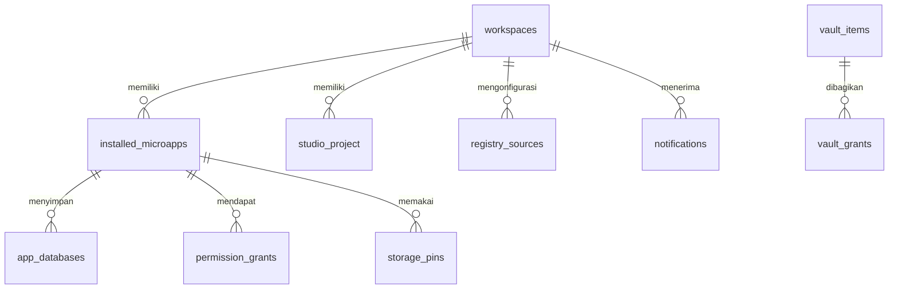

# Data Model

## 1. Tujuan

Dokumen ini menetapkan model data web-only: satu host DB SQLite WASM di OPFS, satu DB terisolasi per app, dan aturan migrasi. Tidak ada database jaringan, replikasi, CRDT, workflow, atau tabel server.

Kontrak perilaku ada di [03-specs/04-data.md](../03-specs/04-data.md); format backup ada di [03-specs/06-backup.md](../03-specs/06-backup.md). Keputusan penyimpanan dicatat di [ADR-0018](adr/0018-browser-local-first-data.md).

## 2. Prinsip

1. **Satu host DB.** Semua metadata host berada di satu file SQLite WASM yang diakses lewat worker.
2. **DB per app.** Setiap app terpasang mendapat file sendiri dengan path deterministik; app tidak dapat membuka DB app lain.
3. **Workspace sebagai scope.** Setiap tabel milik workspace membawa `workspace_id`; query tanpa scope ditolak oleh lapisan data.
4. **UUIDv7.** Primary key host memakai UUIDv7 agar terurut waktu dan stabil lintas reload.
5. **Forward-only untuk data pengguna.** Migrasi harus memiliki jalur rollback; drop data hanya setelah konfirmasi atau backup.

## 3. Lokasi Penyimpanan

| Data | Lokasi | Alasan |
|---|---|---|
| Host DB | OPFS `microapp-studio/host.db` melalui worker | Transaksi SQL, FTS5, ukuran besar |
| DB app | OPFS `workspaces/<slug>/apps/<app_install_id>.db` | Isolasi per app dan workspace |
| `CryptoKey` non-extractable | IndexedDB | Browser tidak mengizinkan key diekspor |
| Frasa pemulihan terenkripsi | IndexedDB | Hanya ciphertext; kunci AES non-extractable |
| Preferensi boot cepat | `localStorage` | Cermin non-otoritatif dari host DB |
| Package dan aset terpasang | OPFS | Dimuat oleh runner tanpa jaringan |

OPFS tidak dijamin tersedia di semua browser. Worker membuka DB dengan strategi: coba OPFS, lalu jatuh ke memori dan melaporkan `storage: 'memory'`. Mode memori bersifat sementara dan harus ditampilkan di UI; data tidak boleh diklaim persisten.

## 4. Tabel Host

Tabel berikut adalah kontrak model. Nama dan peran mengikat; detail kolom mengikuti migrasi `001_host` dan `002_search`.

| Tabel | Peran | Kunci utama | Catatan |
|---|---|---|---|
| `local_identity` | Satu baris identitas perangkat | `id` | Hanya material publik, salt, dan metadata; kunci privat tidak disimpan di sini |
| `workspaces` | Ruang kerja pengguna | `id` | Tepat satu baris `is_default = 1` |
| `installed_microapps` | App terpasang per workspace | `id` | Unik pada `(workspace_id, app_id)`; menyimpan manifest, hash, signature, versi |
| `app_databases` | Metadata file DB per app | `id` | `relative_path` deterministik; belum dibuka runner |
| `permission_grants` | Grant permission per app | `id` | Grant aktif unik per app+permission; `revoked_at_ms` menonaktifkan |
| `vault_items` | Item rahasia terenkripsi | `id` | Ciphertext AES-GCM; tidak ada plaintext |
| `audit_log_chain` | Rantai audit lokal | `id` | `prev_hash` + `entry_hash`; entri tidak dapat dihapus tanpa terdeteksi |
| `studio_project` | Draft project Studio | `id` | `document_json`, `revision`, status draft/active/archived |
| `registry_sources` | Sumber index paket | `id` | Target: index statis read-only; bukan server registry |
| `storage_pins` | Cache yang dipertahankan | komposit | Mencegah eviction untuk bundle, DB, media, dan cache pilihan pengguna |
| `notifications` | Notifikasi lokal | `id` | Dijadwalkan di perangkat; tidak ada push server |

Tabel pendukung yang tetap berada di host DB:

| Tabel | Peran |
|---|---|
| `workspace_state` | App terakhir, posisi scroll, filter Home |
| `registry_pins` | Fingerprint public key yang pernah disetujui |
| `folders`, `app_placements`, `dock_items`, `widgets` | Tata letak library dan Home |
| `permission_sessions` | Grant sementara untuk scope `once`/session |
| `app_policy` | Offline cage dan mock permission per app |
| `runtime_sessions` | Status sesi app untuk watchdog dan pemulihan |
| `vault_grants` | Akses item vault per app |
| `vault_key_wraps` | Parameter Argon2id dan wrapped vault key |
| `crash_incident`, `diagnostic_log` | Bukti crash teredaksi untuk DevTools |
| `db_snapshot` | Snapshot sebelum migrasi |
| `schema_migrations` | Versi skema yang sudah diterapkan |
| `migration_report`, `migration_backup`, `legacy_record_map` | Migrasi Phase 0 dari Dexie |
| `settings` | Preferensi global non-rahasia |

## 5. Tabel yang Tidak Ada

Model target **tidak memiliki** tabel CRDT, mutation log, sync peer, outbox workflow, workflow node, job queue, tenant, RBAC server, sesi server, atau cache cloud. Produk tidak menjalankan sinkronisasi dan tidak memiliki server aplikasi.

Migrasi `001_host` masih membawa tabel `outbox` sebagai sisa model lama. Tabel itu **bukan** bagian kontrak target, tidak dipakai jalur web-only, dan tidak boleh dipakai fitur baru. Penghapusannya dilakukan lewat migrasi bernomor dengan rollback, bukan dengan mengubah migrasi yang sudah diterapkan.

Kolom `runtime_sessions.engine` masih memiliki constraint lama yang mengizinkan nilai non-web. Hanya `web-iframe` yang valid untuk produk ini; constraint disempitkan melalui migrasi berikutnya.

## 6. Relasi Inti

Foreign key yang dideklarasikan memakai `ON DELETE CASCADE` dari workspace atau app induknya agar penghapusan tidak meninggalkan baris yatim. `audit_log_chain` sengaja tidak memiliki foreign key workspace: rantai audit bersifat global per instalasi dan tidak boleh ikut terhapus saat workspace dihapus. Penghapusan app harus lebih dulu menawarkan ekspor data.

## 7. Skema DB App

DB app tidak memuat tabel host. Setiap DB app memiliki:

| Objek | Wajib | Aturan |
|---|---|---|
| `schema_migrations` | Ya | Versi skema app |
| `app_meta` | Ya | `app_id`, `schema_version`, `created_at_ms` |
| Tabel domain | Ya | Dibuat oleh migrasi app; nama tidak boleh bertabrakan dengan tabel host |
| Indeks FTS5 | Opsional | Hanya untuk teks yang dicari app sendiri |

App tidak boleh menjalankan `ATTACH`, membuka path di luar DB-nya, atau mengakses tabel host. Broker menolak query yang menyebut `workspaces`, `local_identity`, `vault_items`, `audit_log_chain`, atau tabel host lain.

## 8. Migrasi

1. Worker membaca `schema_migrations` dan membandingkan dengan daftar migrasi yang dibundel.
2. Sebelum migrasi yang mengubah data, worker membuat snapshot atomik di `db_snapshot`.
3. Migrasi dijalankan dalam transaksi. Kegagalan membatalkan seluruh transaksi dan mempertahankan versi lama.
4. Setelah sukses, versi dicatat dan snapshot lama dibersihkan sesuai retensi.
5. Migrasi yang menghapus tabel atau kolom wajib memiliki rollback yang diuji dengan fixture.

Setiap migrasi memiliki pasangan `*.up.sql` dan `*.down.sql`; `index.generated.ts` dihasilkan dari file tersebut dan tidak boleh diedit manual. Migrasi yang sudah dirilis tidak boleh diubah; perbaikan dilakukan dengan migrasi baru.

## 9. FTS5

`search_index` adalah tabel virtual FTS5 dengan kolom `workspace_id`, `kind`, `ref_id`, `app_install_id`, `title`, dan `body`, menggunakan tokenizer `unicode61 remove_diacritics 2`. Aturan:

- Setiap baris membawa `workspace_id`; pencarian lintas workspace ditolak.
- Index dibangun ulang dari sumber kanonik, bukan menjadi sumber kebenaran.
- Isi rahasia (vault, BYOK, recovery) tidak pernah masuk index.
- Query kosong menampilkan riwayat terakhir, bukan seluruh isi database.

## 10. Kuota dan Eviction

Browser dapat mengusir storage tanpa persetujuan. Shell meminta `navigator.storage.persist()` setelah interaksi bermakna, menampilkan estimasi dari `navigator.storage.estimate()`, dan memberi peringatan pada 80%. Kegagalan tulis menghasilkan error yang menyebut tindakan pemulihan dan menawarkan ekspor. Tidak ada klaim bahwa data lokal tidak dapat dihapus oleh browser.

## 11. Status Implementasi

Migrasi 001 dan 002 sudah berjalan dan mencakup tabel di §4 serta FTS5. `app_databases` sudah menyimpan path deterministik, tetapi runner belum membuka DB per app; data app saat ini belum terisolasi secara runtime. Tabel `outbox` dan nilai engine warisan masih ada. Bukti dan daftar klaim yang dilarang ada di [00-foundation/implementation-status.md](../00-foundation/implementation-status.md).
