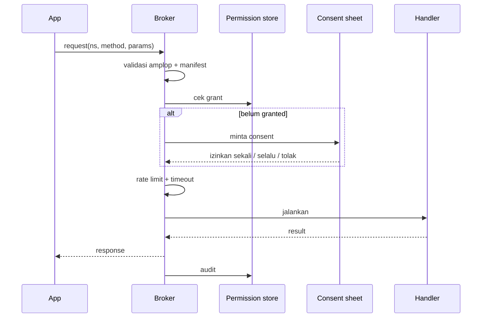

# Host Bridge dan Intent

## 1. Tujuan

Dokumen ini menetapkan satu kanal komunikasi antara micro-app di iframe dan host di halaman utama, serta cara satu app memanggil app lain lewat intent. Bridge adalah permukaan keamanan utama: tidak ada jalur lain dari kode pihak ketiga ke data pengguna.

Kontrak method, parameter, hasil, dan error ada di [03-specs/host-bridge.md](../03-specs/host-bridge.md); definisi izin di [03-specs/permissions.md](../03-specs/permissions.md); eksekusi sandbox di [03-specs/03-sandbox-runtime.md](../03-specs/03-sandbox-runtime.md).

## 2. Prinsip

1. **Satu kanal.** Semua akses app ke host melewati `postMessage` dengan amplop bridge. Tidak ada objek host yang diberikan ke iframe.
2. **Allowlist.** Method harus terdaftar di registry bridge dan dideklarasikan manifest.
3. **Per panggilan.** Permission diperiksa pada setiap panggilan, bukan hanya saat mount.
4. **Consent JIT.** Akses pertama ke permission yang belum granted memunculkan sheet consent.
5. **Minimal.** Parameter dan hasil berupa JSON polos; tidak ada fungsi, handle DOM, atau referensi memori.
6. **Fail closed.** Method tidak dikenal, parameter invalid, atau permission dicabut menghasilkan error, bukan fallback.

## 3. Transport

| Aspek | Aturan |
|---|---|
| Kanal | `window.postMessage` antara iframe dan host |
| Verifikasi asal | `event.source` harus iframe app; origin iframe opaque |
| Versi | `v: 1`; versi tidak didukung ditolak |
| Amplop | `{ v, id, ns, method, params }` |
| Respons | `{ v, id, ok: true, result }` atau `{ v, id, ok: false, error }` |
| `id` | Unik per app, maksimal 64 karakter, tidak boleh dipakai ulang |
| Ukuran | Maksimum 256 KB per frame |
| Timeout default | 10 detik; operasi transfer 30 detik |
| Rate limit | Token bucket per app; angka kontrak ada di spec bridge |
| Cancel | `cancel(id)` menghentikan request yang masih berjalan |

Host tidak menerima pesan dari iframe lain, popup, atau window yang tidak terdaftar sebagai sesi app aktif. Pesan yang gagal validasi asal dibuang tanpa respons yang membocorkan detail internal.

## 4. Namespace

| Namespace | Method | Permission | Hasil |
|---|---|---|---|
| `ui` | `ready`, `toast` | — | Status UI |
| `storage` | `get`, `set`, `remove`, `keys` | `storage.app` | Data milik app sendiri |
| `clipboard` | `read`, `write` | `clipboard.read`, `clipboard.write` | Teks |
| `notify` | `local` | `notifications.local` | Notifikasi terjadwal |
| `files` | `pick` | `files.pick` | File yang dipilih pengguna |
| `net` | `fetch` | `network.fetch` | Respons HTTP ke origin yang dideklarasikan |
| `vault` | `read` | `vault.read` | Item vault yang dipilih |
| `share` | `export` | `share.export` | File `.mapp` |
| `app` | `getInfo` | — | `id`, `version`, `workspace` |

Method di luar tabel ini tidak boleh ditambahkan tanpa memperbarui spec dan manifest allowlist. `ui.*` adalah namespace internal untuk kesiapan renderer dan toast; ia tidak memberi akses data.

## 5. Pemeriksaan Permission



Aturan:

- Grant `once` berlaku untuk satu panggilan atau satu sesi sesuai scope yang disimpan.
- Grant `always` tidak memunculkan dialog berulang.
- Revoke dari Settings langsung berlaku; panggilan berikutnya memicu consent lagi.
- Permission yang tidak dideklarasikan manifest ditolak sebelum consent.
- Offline cage memblokir `net.fetch` sebelum keluar dari browser.

## 6. Error

Error bridge memakai bentuk yang sama untuk semua namespace:

```json
{
  "v": 1,
  "id": "req_01HZ",
  "ok": false,
  "error": { "code": "E-RUN-003", "message": "permission denied", "retryable": false }
}
```

Kode yang dipakai berasal dari [03-specs/error-codes.md](../03-specs/error-codes.md). Pesan tidak memuat path absolut, token, isi vault, atau detail internal host. `retryable` hanya true untuk timeout idempoten dan gangguan sementara.

## 7. Intent Antar-App

Intent memungkinkan satu app membuka app lain dengan parameter tertentu, misalnya "buat catatan baru" atau "buka struk". Intent bukan panggilan fungsi langsung dan tidak memberi akses data lintas app.

| Langkah | Aturan |
|---|---|
| Deklarasi | App menyatakan intent yang dapat ditangani di manifest |
| Dispatch | App pengirim memanggil `intents.dispatch` dengan target dan parameter |
| Consent | Pengguna melihat app tujuan dan parameter sebelum intent dikirim |
| Routing | Host memilih app terpasang yang menangani intent; bila ada beberapa, pengguna memilih |
| Hasil | App tujuan dapat mengembalikan hasil ringkas; tidak ada akses database bersama |

Intent yang tidak memiliki handler menghasilkan error yang dapat ditampilkan pengguna. Tidak ada auto-install dari intent. Bila app tujuan belum terpasang, host hanya menawarkan pencarian atau impor manual.

## 8. Deep Link

Dua bentuk yang didukung:

| Bentuk | Contoh | Catatan |
|---|---|---|
| Skema | `microapp://local/app.example.notes/note/42?mode=edit` | Segmen: source, app id, route, query |
| Web | `/?target=local/app.example.notes/note/42%3Fmode%3Dedit` | Padanan untuk browser yang tidak membuka skema kustom |

Aturan:

- `app_id` harus cocok dengan pola `^[a-z][a-z0-9]*(\.[a-z][a-z0-9-]*)+$`.
- Deep link tidak pernah memasang app secara otomatis.
- Parameter tidak boleh memuat token, passphrase, atau isi vault.
- Route yang tidak dikenal ditolak dengan pesan, bukan diabaikan diam-diam.
- Deep link dari origin lain harus melewati konfirmasi pengguna sebelum membuka app.

## 9. Audit

Setiap panggilan dicatat di `audit_log_chain` dengan method, app, hasil, durasi, dan status permission. Parameter dan hasil tidak disimpan. Audit dapat difilter di DevTools; ekspor audit memakai redaksi yang sama.

## 10. Yang Tidak Ada

Tidak ada FFI, bridge native, akses DOM host, akses filesystem bebas, Bluetooth, NFC, sensor perangkat, atau panggilan jaringan langsung dari iframe. Tidak ada bridge server atau RPC ke backend.

## 11. Status Implementasi

Broker, amplop, rate limit, timeout, consent hook, audit, dan registry intent sudah ada di `packages/runtime-web`. Registry method aktual masih memuat namespace `db`, `fs`, `device`, `sync`, `log`, dan `ai` yang bukan bagian kontrak target; sebagian ditandai phase-gated dan gagal tertutup. Registry harus diselaraskan dengan tabel §4 sebelum bridge dianggap implemented. Deep link parser untuk `microapp://` dan `?target=` sudah ada. Bukti ada di [00-foundation/implementation-status.md](../00-foundation/implementation-status.md).
