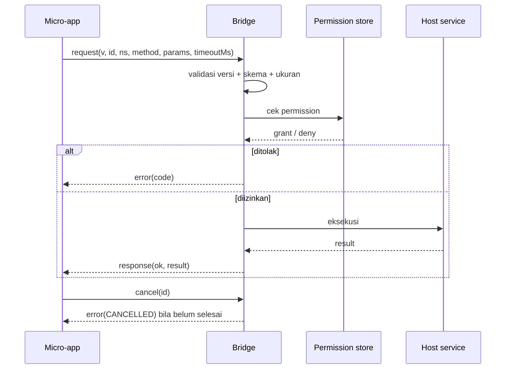
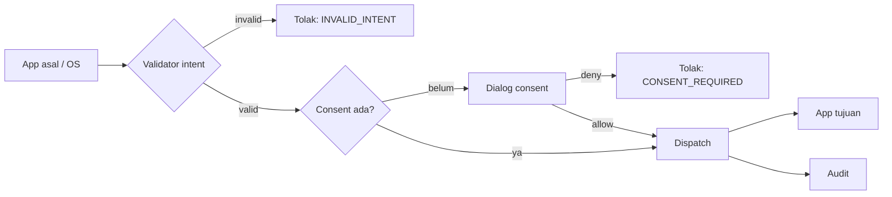

# Host Bridge dan Intent

Dokumen ini merangkum transport, envelope, namespace, dan skema intent antara micro-app dan Host. Kontrak normatif per method, termasuk parameter, hasil, dan kode error, ada di [03-specs/host-bridge.md](../03-specs/host-bridge.md); dokumen ini tidak menggantikannya.

## 1. Prinsip

- Micro-app tidak memiliki akses langsung ke database, filesystem, kamera, jaringan, atau objek Host; semua efek samping melalui bridge.
- Setiap method mendeklarasikan permission; broker memeriksa grant pada setiap panggilan.
- Envelope sama di web dan native; hanya transport yang berbeda.
- Request selalu punya `id`, selalu mendapat tepat satu respons (`ok` atau error), dan dapat dibatalkan.
- Tidak ada method yang mengeksekusi kode arbitrer atau mengembalikan handle mentah ke resource Host.

## 2. Transport

| Platform | Transport | Serialisasi | Catatan |
|---|---|---|---|
| Web | `postMessage` ke iframe opaque origin | Structured clone / JSON-safe | `event.source` dan origin diverifikasi |
| Native | FFI biner ke Host Flutter | Frame length-prefixed + pesan terstruktur | QuickJS/Wasmtime di isolate terpisah |

Aturan transport:

- Pesan web MUST melewati validasi `event.source === frame.contentWindow` dan `event.data.v` dikenal.
- Pesan native dibatasi ukuran frame 1 MiB; payload lebih besar memakai chunk biner dengan `transferId`.
- Tidak ada fallback ke `window.parent` langsung, `localStorage`, cookie, atau `document` Host.
- Kanal bridge ditutup saat micro-app blur ke background; request yang berjalan dibatalkan dengan status `cancelled`.

## 3. Envelope

Request:

```json
{
  "v": 1,
  "id": "0190f3a2-7c1e-7b3a-9d42-6f1b2c3d4e5f",
  "ns": "db",
  "method": "query",
  "params": { "sql": "SELECT * FROM notes WHERE id = ?", "args": ["n1"] },
  "timeoutMs": 10000
}
```

Respons sukses:

```json
{ "id": "0190f3a2-7c1e-7b3a-9d42-6f1b2c3d4e5f", "ok": true, "result": { "rows": [] } }
```

Respons gagal:

```json
{
  "id": "0190f3a2-7c1e-7b3a-9d42-6f1b2c3d4e5f",
  "ok": false,
  "error": {
    "code": "PERMISSION_DENIED",
    "message": "Permission storage.local.sqlite belum diberikan",
    "details": { "permission": "storage.local.sqlite" },
    "retryable": false
  }
}
```

| Field | Wajib | Aturan |
|---|---|---|
| `v` | Ya | Versi protokol; saat ini `1` |
| `id` | Ya | UUIDv7 unik per request; respons memakai `id` yang sama |
| `ns` | Ya | Salah satu namespace di §4 |
| `method` | Ya | Nama method dalam namespace, `lowerCamelCase` |
| `params` | Ya | Objek; divalidasi terhadap skema method |
| `timeoutMs` | Tidak | Override timeout; tidak boleh melebihi batas kelas method |

- `id` duplikat dalam satu sesi ditolak dengan `DUPLICATE_REQUEST`.
- `params` yang tidak sesuai skema ditolak dengan `INVALID_PARAMS` sebelum permission diperiksa.
- `message` pada error adalah kunci terjemahan atau teks yang aman; tidak memuat path, SQL, token, atau PII.

## 4. Namespace

| Namespace | Contoh method | Permission | Timeout kelas |
|---|---|---|---|
| `ui` | `setTitle`, `openSheet`, `close`, `toast` | — | default |
| `db` | `query`, `exec`, `transaction`, `migrate` | `storage.local.sqlite` | default |
| `storage` | `get`, `set`, `delete`, `list`, `quota` | `storage.local` | default |
| `fs` | `pickFile`, `pickDirectory`, `readFile`, `writeFile` | `filesystem.picker` | file |
| `camera` | `open`, `capture`, `close`, `scanQr` | `camera` / `camera.qr` | file |
| `notifications` | `schedule`, `cancel`, `list` | `notifications.local` | default |
| `ai` | `infer`, `embed`, `models` | `local_ai.inference` | AI |
| `network` | `fetch`, `download`, `upload` | `network.allowlist` | file |
| `intents` | `dispatch`, `canHandle`, `route` | consent per target | default |
| `device` | `info`, `locale`, `battery`, `orientation` | — | default |
| `sync` | `status`, `now`, `peers` | — | default |
| `log` | `debug`, `info`, `warn`, `error` | — | default |

Aturan namespace:

- `device` dan `sync` hanya mengembalikan metadata; `sync` tidak mengizinkan micro-app memicu transfer data lintas app.
- `db` hanya beroperasi pada file database milik `app_id`; `ATTACH` dan pragma sensitif ditolak.
- `fs` mengembalikan handle per file yang dipilih, bukan path absolut; handle kedaluwarsa setelah sesi berakhir.
- `network` tunduk pada allowlist dan tidak dapat memakai kredensial Host.
- `log` dibatasi 1.000 baris per menit per app dan diredaksi sebelum ditulis.
- Method yang tidak ada di skema MUST mengembalikan `METHOD_NOT_FOUND`; tidak ada method dinamis.

## 5. Penamaan dan Versi

- Nama method `lowerCamelCase`; nama parameter `lowerCamelCase`; event `on` + PascalCase (contoh `onFocus`) dikirim Host ke micro-app, bukan dipanggil micro-app.
- Setiap perubahan breaking pada method (hapus field, ubah tipe, ubah semantik permission) memerlukan versi major baru dan RFC.
- Host mendukung major saat ini dan major sebelumnya selama 12 bulan.
- Versi dinegosiasikan pada pesan pertama: micro-app mengirim `v`; Host membalas `HELLO` berisi `v`, `minSupported`, dan `capabilities`.
- `v` yang tidak didukung menghasilkan `UNSUPPORTED_VERSION` dan micro-app tidak dijalankan, bukan ditebak.
- Penambahan field opsional adalah perubahan minor; penerima MUST mengabaikan field yang tidak dikenal.

## 6. Siklus Request



- Setiap request berakhir dengan tepat satu respons; tidak ada respons ganda.
- `cancel` bersifat best-effort; operasi yang sudah tidak dapat dibatalkan menyelesaikan dengan `ok` lalu `cancel` diabaikan.
- Cancellation otomatis terjadi saat micro-app masuk background, kecuali method `ai.infer` yang sedang menulis hasil ke storage app.
- Streaming (contoh `ai.infer` token per token) memakai event `{ id, type: "chunk", data }` diikuti satu respons akhir.
- Transfer biner memakai `transferId`, `seq`, `chunk`, dan `final`; urutan wajib, chunk hilang memicu `TRANSFER_INCOMPLETE`.
- Rate limit default 100 request/detik dan 8 request konkuren per app; melebihi batas menghasilkan `RATE_LIMITED` dengan `retryable: true`.

## 7. Timeout

| Kelas | Default | Method |
|---|---|---|
| Default | 10 detik | `ui`, `db`, `storage`, `notifications`, `device`, `sync`, `log`, `intents` |
| File | 60 detik | `fs`, `camera.capture`, `network.download`, `network.upload` |
| AI | 120 detik | `ai.infer`, `ai.embed` |

- Timeout berjalan di Host, bukan hanya di micro-app; Host membatalkan pekerjaan dan membebaskan resource.
- `timeoutMs` dari micro-app tidak dapat memperpanjang batas kelas; nilai lebih besar dipotong ke batas kelas.
- Timeout menghasilkan `TIMEOUT` dengan `retryable` sesuai idempotensi method; method non-idempoten tidak di-retry otomatis.
- Timeout tidak membunuh isolate; micro-app menerima error dan dapat memilih strategi sendiri.

## 8. Pemeriksaan Permission

- Permission diperiksa di broker sebelum method dijalankan, dengan urutan: versi → skema → ukuran → rate limit → permission → eksekusi.
- Grant yang dicabut berlaku pada request berikutnya; request yang sedang berjalan dibatalkan bila method masih dapat dibatalkan.
- `intents.dispatch` memerlukan consent per pasangan (app asal, app tujuan, route), bukan grant global.
- Penolakan MUST NOT mengungkap apakah resource ada; pesan seragam untuk semua penolakan.
- Setiap penolakan high risk dicatat di audit dengan `app_id`, permission, dan method.

## 9. Intent dan Deep Link

Skema kanonik:

```text
microapp://<registry-or-local>/<app-id>/<route>?<params>
```

| Bagian | Aturan | Contoh |
|---|---|---|
| `registry-or-local` | ID registry terdaftar atau literal `local` | `official`, `local` |
| `app-id` | Reverse-DNS sesuai manifest; regex `^[a-z][a-z0-9]*(\.[a-z][a-z0-9-]*)+$` | `com.acme.notes` |
| `route` | Path internal, segmen `[a-z0-9-]`, tanpa `..` dan tanpa `%2f` | `note/42` |
| `params` | Query percent-encoded, maksimum 4 KiB | `mode=edit` |

Aturan intent:

- Intent divalidasi penuh sebelum dikirim: skema, ukuran, dan kepemilikan route. Route yang tidak dideklarasikan manifest ditolak.
- `intents.canHandle` memeriksa ketersediaan tanpa efek samping; `dispatch` mengirim payload ke app tujuan.
- Deep link eksternal (browser, QR, OS share) masuk lewat validator yang sama; URL tidak dikenal menampilkan pilihan, tidak pernah dieksekusi otomatis.
- Intent lintas app memerlukan consent pengguna yang menampilkan app asal, app tujuan, dan data yang dikirim. Consent disimpan per pasangan dan dapat dicabut.
- Payload intent maksimum 64 KiB; data lebih besar memakai referensi file lewat `fs`, bukan query string.
- Intent yang menargetkan app yang belum terpasang menawarkan instalasi dari registry; penolakan tidak memicu unduhan.
- Intent tidak boleh memuat token, kunci, atau path filesystem; pelanggaran ditolak dengan `INVALID_INTENT`.
- Offline: intent lokal dan antar-app terpasang tetap berfungsi; intent yang memerlukan registry atau server antre atau ditolak dengan alasan eksplisit.
- Setiap dispatch dicatat di audit (app asal, app tujuan, route, hasil) tanpa isi payload.



## 10. Audit dan Observability

- Dicatat: `bridge.call` untuk high risk, `bridge.deny`, `intent.dispatch`, `intent.deny`, dan `version.reject`.
- Tidak dicatat: isi `params`/`result`, token, kunci, path, atau PII.
- Metrik lokal: jumlah panggilan per namespace, latency p50/p95, error rate, dan rate-limit hits. Metrik tidak dikirim keluar tanpa opt-in.
- Log micro-app melalui `log` diberi prefix `app_id` dan dipangkas; log tidak boleh dipakai untuk menyimpan data sensitif.

## 11. Larangan

- Tidak ada method `eval`, `exec` kode arbitrer, atau akses ke `window`, `document`, atau refleksi objek Host.
- Tidak ada method yang mengembalikan kunci, Site ID, Recovery Phrase, atau token sesi.
- Tidak ada bypass permission melalui nama method alternatif atau alias.
- Tidak ada panggilan bridge sebelum `onMount` selesai atau setelah `onUninstall` dimulai.
- Tidak ada penanganan `postMessage` tanpa verifikasi sumber dan versi.

## 12. Referensi

- [system-overview.md](system-overview.md), [sandbox-capabilities.md](sandbox-capabilities.md), [sync-crdt.md](sync-crdt.md)
- [adr/0007-sandbox-strategy.md](adr/0007-sandbox-strategy.md)
- [03-specs/host-bridge.md](../03-specs/host-bridge.md), [03-specs/permissions.md](../03-specs/permissions.md), [03-specs/ui-protocol.md](../03-specs/ui-protocol.md), [03-specs/error-codes.md](../03-specs/error-codes.md)
- [04-flows/11-permission-consent.md](../04-flows/11-permission-consent.md)
- [05-agents/AGENTS.md](../05-agents/AGENTS.md)
