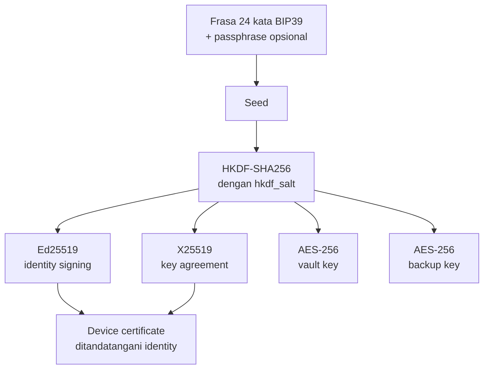

# Identity dan Kriptografi

## 1. Tujuan

Dokumen ini menetapkan identitas lokal tanpa akun: cara kunci dibuat, disimpan, dipakai untuk menandatangani package, dan dipulihkan. Tidak ada registrasi, login, pairing perangkat, sesi server, atau otorisasi jaringan. Identitas hanya berlaku di browser tempat ia dibuat, kecuali pengguna memulihkannya dari frasa dan backup.

Kontrak perilaku ada di [03-specs/01-app-shell.md](../03-specs/01-app-shell.md), [03-specs/06-backup.md](../03-specs/06-backup.md), dan [03-specs/permissions.md](../03-specs/permissions.md). Keputusan penundaan onboarding dicatat di [ADR-0022](adr/0022-deferred-recovery-onboarding.md).

## 2. Prinsip

1. **Otomatis.** Identitas dibuat pada first load tanpa modal, formulir, atau frasa wajib.
2. **Lokal.** Tidak ada kunci yang dikirim ke server. Tidak ada endpoint identitas.
3. **Non-extractable.** Kunci yang disimpan browser tidak dapat diekspor oleh JavaScript halaman.
4. **Satu sumber kripto.** Derivasi, signature, dan verifikasi memakai `packages/core-rust` yang dikompilasi ke WASM. Tidak ada implementasi kripto kedua di TypeScript.
5. **Ditunda, bukan dihilangkan.** Frasa pemulihan tetap tersedia, tetapi hanya diminta saat pengguna membuka backup, share, atau memilih "Amankan data".
6. **Gagal aman.** Bila WebCrypto atau IndexedDB tidak tersedia, shell berjalan dalam mode `ephemeral` dengan badge jelas, bukan menyimpan rahasia dalam plaintext.

## 3. Hierarki Kunci

| Material | Algoritma | Dipakai untuk | Disimpan di |
|---|---|---|---|
| Frasa pemulihan | BIP39 24 kata | Sumber seed | Ciphertext di IndexedDB |
| Identity signing key | Ed25519 | Menandatangani manifest dan `.mapp` | Worker kripto; tidak diekspor |
| Key agreement key | X25519 | Berbagi kunci untuk vault/backup | Worker kripto; tidak diekspor |
| Vault key | AES-256-GCM | Enkripsi item vault dan BYOK | Wrapped di `vault_key_wraps` |
| Backup key | AES-256-GCM | Enkripsi `.mapp-backup` | Diturunkan saat backup |
| Device certificate | Ed25519 signature | Mengikat perangkat ke identitas | `local_identity.device_cert` |

`site_id` adalah pengenal publik turunan kunci, bukan rahasia. `hkdf_salt` disimpan sebagai nilai non-rahasia di `local_identity`; ia mencegah dua instalasi dengan frasa sama menghasilkan material yang identik tanpa konteks.

## 4. Pembuatan Identitas

Alur first load:

1. Identity worker memuat modul WASM.
2. Worker memanggil `identity_create`, yang menghasilkan frasa 24 kata dan material turunan.
3. Material publik ditulis ke `local_identity`; frasa dienkripsi dan disimpan di IndexedDB.
4. Shell langsung menampilkan Home. Tidak ada dialog frasa dan tidak ada gate sebelum Home.
5. Banner "Amankan data" ditampilkan sebagai ajakan, bukan penghalang.

Frasa hanya ditampilkan ketika pengguna memilih banner, membuka Backup, atau akan mengekspor backup. Konfirmasi meminta tiga kata pada posisi acak. Frasa tidak pernah ditampilkan dua kali tanpa aksi pengguna dan tidak pernah masuk log.

Kompatibilitas: implementasi onboarding saat ini masih menampilkan frasa sebelum Home. Perilaku itu adalah gap terhadap kontrak ini dan dicatat di [00-foundation/implementation-status.md](../00-foundation/implementation-status.md).

## 5. Penyimpanan Rahasia

| Rahasia | Penyimpanan | Kunci | Aturan |
|---|---|---|---|
| Frasa pemulihan | IndexedDB `microapp-identity` | AES-GCM `CryptoKey` non-extractable | Tidak ada plaintext; degraded bila key tidak dapat dipersistenkan |
| Item vault | `vault_items.ciphertext` | Vault key | AES-256-GCM, nonce unik, AAD mengikat metadata |
| Vault key | `vault_key_wraps` | Argon2id dari passphrase | Parameter `m`, `t`, `p`, salt dicatat |
| BYOK | `vault_items` kind `api_key` | Vault key | Hanya empat karakter terakhir ditampilkan |
| Backup | File `.mapp-backup` | Passphrase + Argon2id | Header `MAPPBK01`, checksum per section |

Aturan tambahan:

- Kunci privat tidak boleh berada di `localStorage`, `sessionStorage`, cookie, URL, atau state React yang dapat diserialisasi.
- Worker kripto tidak menerima `window` atau `document`; ia hanya menerima perintah dan mengembalikan hasil.
- Vault auto-lock setelah 5 menit tanpa pemakaian. Setelah lock, operasi rahasia meminta passphrase lagi.
- Bila browser tidak mendukung penyimpanan `CryptoKey` non-extractable, rahasia hanya bertahan selama sesi dan status `degraded` dilaporkan.

## 6. Penandatanganan Package

1. Manifest dinormalkan secara kanonik (JSON Canonicalization Scheme) dan di-hash SHA-256.
2. `contentHash` dihitung atas ZIP deterministik tanpa direktori `signatures/` dan dengan placeholder hash.
3. Signature Ed25519 dibuat atas digest tersebut dan ditulis sebagai entri terpisah.
4. Verifikasi mengulang perhitungan yang sama dari byte package; perubahan satu byte menggagalkan verifikasi.

Public key yang belum dikenal menampilkan peringatan trust. Public key yang berubah untuk `app_id` yang sama memblokir impor sampai pengguna menyetujui key baru. Detail format ada di [03-specs/05-packages.md](../03-specs/05-packages.md) dan [03-specs/manifest.md](../03-specs/manifest.md).

## 7. Recovery

| Skenario | Perilaku |
|---|---|
| Pengguna ingat frasa | Derivasi ulang material, verifikasi public key, lalu buat device certificate baru |
| Frasa salah | Tidak ada perubahan data; pesan menyebut kata yang tidak cocok tanpa membocorkan frasa |
| Frasa benar, passphrase berbeda | Derivasi menghasilkan kunci berbeda dan verifikasi gagal; passphrase tidak ditebak otomatis |
| Backup tanpa frasa | Restore data dapat dilakukan dengan passphrase backup; signature package lama tetap dapat diverifikasi dengan public key tersimpan |
| Kehilangan semua salinan | Data tidak dapat dipulihkan; tidak ada escrow atau server pemulihan |

Verifikasi recovery membandingkan public key hasil derivasi dengan `identity_pubkey` yang tersimpan. Tidak ada hash frasa di disk, sehingga percobaan salah tidak dapat dipakai untuk menguji ruang frasa secara offline lebih cepat daripada derivasi normal.

## 8. Rotasi dan Pencabutan

- Rotasi identity key membuat `local_identity` baru dengan `rotated_at_ms` terisi dan menandatangani ulang device certificate.
- Package yang ditandatangani key lama tetap dapat dibaca, tetapi update dengan key baru memicu peringatan.
- Tidak ada certificate authority, revocation list jaringan, atau OCSP. Kepercayaan bersifat lokal dan berbasis fingerprint yang disetujui pengguna.
- Menghapus identitas lokal menghapus akses ke package yang ditandatangani key tersebut, kecuali frasa dipulihkan.

## 9. Yang Tidak Ada

Tidak ada akun, OAuth, sesi server, pairing perangkat, QR pairing, sinkronisasi kunci, key escrow, HSM, atau otentikasi jaringan. Tidak ada kriptografi yang dijalankan di server. Semua operasi terjadi di browser dan berhenti bila modul WASM tidak tersedia.

## 10. Verifikasi

| Pemeriksaan | Cara |
|---|---|
| Pembuatan otomatis | Muat `/` pada profil bersih; `local_identity` terisi tanpa dialog |
| Frasa ditunda | Tidak ada tampilan 24 kata sebelum Home |
| Non-extractable | Key yang disimpan tidak dapat diekspor; tidak ada plaintext di IndexedDB |
| Signature package | Ubah satu byte; verifikasi gagal |
| Recovery | Frasa benar memulihkan public key; frasa salah tidak mengubah data |
| Vault lock | Diam 5 menit; operasi rahasia meminta passphrase |

## 11. Status Implementasi

Pembuatan identitas, derivasi, device certificate, enkripsi frasa, vault wrap Argon2id, signature manifest, dan verifikasi `.mapp` sudah ada di kode. Onboarding masih memblokir dengan frasa 24 kata sebelum Home. Rincian bukti ada di [00-foundation/implementation-status.md](../00-foundation/implementation-status.md).
