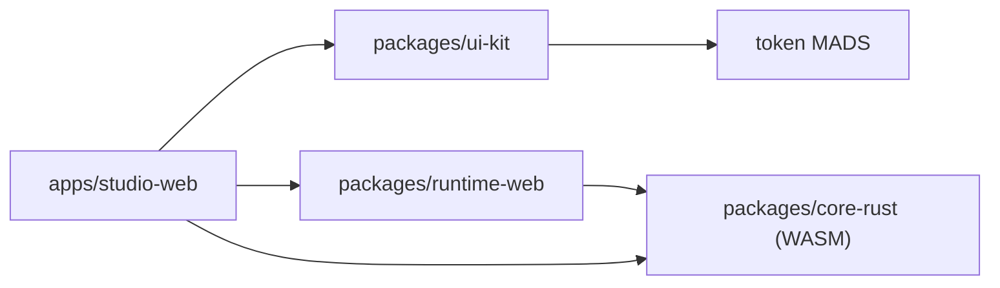

# Monorepo

## 1. Tujuan

Dokumen ini menetapkan struktur workspace nyata, nama paket, arah dependency, dan perintah build. Monorepo hanya berisi aplikasi web dan paket pendukungnya. Tidak ada workspace native, server, CLI, atau SDK.

## 2. Struktur

```text
microapp-studio/
├── apps/
│   └── studio-web/          # PWA Next.js 16 App Router, React 19, TypeScript, Tailwind v4
├── packages/
│   ├── runtime-web/         # iframe sandbox, MUIP renderer, bridge, watchdog, loader .mapp
│   ├── ui-kit/              # token MADS dan komponen UI bersama
│   └── core-rust/           # crate microapp-core, dikompilasi ke WASM
├── scripts/                 # build core, build sandbox, salin sqlite-wasm, checker docs
├── templates/               # sumber template bila diaktifkan; tidak wajib untuk build
├── docs/                    # dokumentasi kanonik
└── package.json             # npm workspaces
```

Tidak ada `apps/host-flutter`, `apps/selfhost-server`, `packages/runtime-native`, `packages/sdk`, `packages/ai-bridge`, `packages/cli`, atau `deploy/`. Path tersebut tidak boleh dibuat kembali tanpa ADR baru yang menggantikan [ADR-0017](adr/0017-web-only-nextjs-pwa.md).

## 3. Paket

| Path | Nama | Bahasa | Peran |
|---|---|---|---|
| `apps/studio-web` | `@microapp/studio-web` (private) | TypeScript | Shell, route, host provider, DB worker, identity worker, fitur produk |
| `packages/runtime-web` | `@microapp/runtime-web` (private) | TypeScript | Kontrak runtime yang dipakai shell dan Studio |
| `packages/ui-kit` | `@microapp/ui-kit` (private) | TypeScript + CSS | Token clay dan komponen presentasional |
| `packages/core-rust` | crate `microapp-core` | Rust → WASM | Kriptografi, signature, manifest, `.mapp`, guard |

Semua paket berlisensi Apache-2.0. `packages/ui-kit` membawa `LICENSE` sendiri karena dipublikasikan sebagai paket terpisah di masa depan; selama masih private, lisensi root tetap berlaku.

## 4. Arah Dependency



| Aturan | Penegakan |
|---|---|
| `apps/*` boleh bergantung pada `packages/*`; tidak sebaliknya | Review import dan `typecheck` |
| Tidak ada import antar-`apps/*` | Review wajib |
| `packages/runtime-web` tidak boleh mengimpor `apps/*` | Review dan lint boundary |
| `packages/ui-kit` tidak boleh memuat logika produk, fetch, atau akses DB | Review |
| `packages/core-rust` hanya diekspos lewat `wasm-bindgen`; tidak ada FFI | Build script dan review |
| Tidak ada dependency ke framework UI lain atau state manager global baru tanpa ADR | Review dependency |

`packages/core-rust` adalah **WASM-only**. Ia tidak membawa binding untuk platform lain, tidak dipanggil lewat proses eksternal, dan tidak boleh dijadikan server kripto. Permukaan yang diekspos ke TypeScript berada di `packages/core-rust/src/wasm.rs` dan dimuat oleh `packages/runtime-web/src/loader/wasm.ts`.

## 5. Workspace dan Perintah

- Manajer workspace: npm workspaces dengan `workspaces: ["apps/*", "packages/*", "templates/*"]`.
- Satu lockfile di root. Tidak ada lockfile per paket dan tidak ada manajer paket kedua.
- Perintah dari root:
  - `npm install`
  - `npm run dev`
  - `npm run build`
  - `npm test`
  - `npm run typecheck`
  - `npm run lint`
  - `npm run docs:check`
  - `npm run e2e`
- Build core dan aset browser: `npm run build:core`, `npm run build:sandbox`, `npm run build:sqlite`, atau `npm run dev:setup`.
- Perintah per paket memakai `-w`, misalnya `npm run test -w @microapp/runtime-web`.

`npm run build` menjalankan build sandbox, penyalinan SQLite WASM, lalu build seluruh workspace yang memiliki script `build`. Urutan ini mengikat karena shell membutuhkan `public/sandbox-bootstrap.js` dan `public/sqlite-wasm/` sebelum build produksi.

## 6. Batas TypeScript

| Aturan | Alasan |
|---|---|
| `strict: true` di `tsconfig.base.json` | Kesalahan tipe tidak boleh menjadi bug runtime |
| `paths` hanya untuk paket workspace | Mencegah import relatif menembus batas paket |
| `@microapp/runtime-web` dan `@microapp/ui-kit` ditranspile oleh Next.js | Sumber TypeScript dipakai langsung tanpa langkah publish |
| Tipe DOM hanya di modul yang memang berjalan di browser | Worker memakai tipe worker, bukan `Window` |
| Tidak ada `any` implisit atau `@ts-ignore` tanpa alasan tertulis | Review dan lint |

## 7. Build WASM

`packages/core-rust` dibangun dengan `wasm-bindgen` menjadi modul yang dimuat dari `apps/studio-web/public/wasm/`. Aturan:

1. Build harus deterministik untuk input yang sama.
2. Tidak ada panic yang menyeberang batas WASM; error dikembalikan sebagai nilai terstruktur.
3. Modul dimuat sebelum operasi kripto atau verifikasi package dijalankan.
4. Bila modul gagal dimuat, fitur package, identity recovery, dan backup gagal tertutup dengan pesan yang dapat ditindaklanjuti.

Perintah verifikasi Rust dijalankan dari root dengan `cargo test --manifest-path packages/core-rust/Cargo.toml` dan `cargo clippy --manifest-path packages/core-rust/Cargo.toml --all-targets -- -D warnings`.

## 8. Versioning

- Versi paket mengikuti `package.json` dan `Cargo.toml`; tidak ada versi terpisah untuk dokumen.
- Perubahan kontrak manifest, bridge, permission, atau token wajib melalui RFC di [10-contributing/rfc-process.md](../10-contributing/rfc-process.md) sebelum rilis.
- Perubahan yang memutus kompatibilitas `.mapp` menaikkan `schemaVersion` manifest dan memerlukan ADR baru.

## 9. Status Implementasi

Workspace yang ada sesuai daftar di §3. `packages/ui-kit` masih memakai token MADS lama dan belum memuat seluruh komponen clay; `packages/runtime-web` sudah memiliki sandbox, MUIP, broker, watchdog, dan loader. Shell belum memiliki visual builder, template gallery, atau AI. Status bukti ada di [00-foundation/implementation-status.md](../00-foundation/implementation-status.md).
