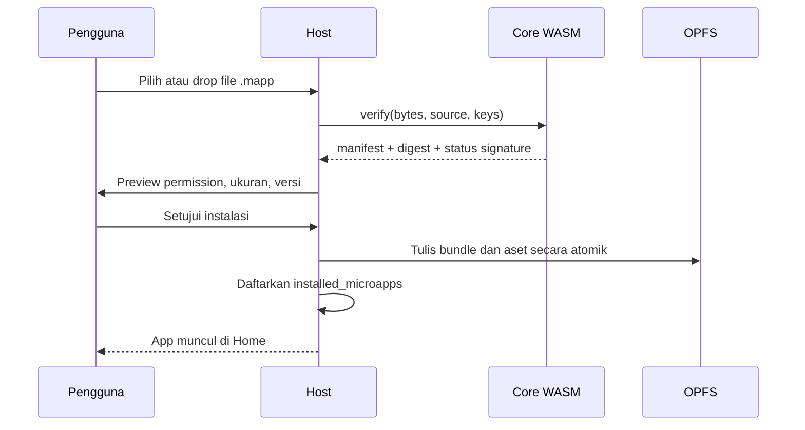

# Package Distribution

## 1. Tujuan

Dokumen ini menetapkan distribusi micro-app sebagai file `.mapp` bertanda tangan. Package dapat dibuat di Studio, diunduh, dibagikan sebagai file, dan diimpor kembali. Distribusi tidak memerlukan akun, server registry, atau pipeline publish.

Kontrak format dan verifikasi ada di [03-specs/05-packages.md](../03-specs/05-packages.md) dan [03-specs/manifest.md](../03-specs/manifest.md). Keputusan format dicatat di [ADR-0020](adr/0020-mapp-package-signing.md). Kebijakan komunitas ada di [10-contributing/package-policy.md](../10-contributing/package-policy.md).

## 2. Prinsip

1. **File, bukan unggahan.** Aksi utama adalah unduh dan impor file; tidak ada endpoint publish.
2. **Verifikasi sebelum eksekusi.** Tidak ada node app yang dijalankan sebelum manifest, digest, dan signature valid.
3. **Signature menunjukkan asal, bukan keamanan.** Package bertanda tangan tetap tidak dipercaya dan tetap berjalan di sandbox dengan permission terbatas.
4. **Read-only index.** Index statis hanya menyediakan tautan dan hash; tidak menerima tulisan, statistik, atau metadata pengguna.
5. **Deterministik.** Pack dari input yang sama menghasilkan byte dan hash yang sama.

## 3. Format `.mapp`

`.mapp` adalah arsip ZIP dengan layout tetap:

| Entri | Wajib | Aturan |
|---|---|---|
| `microapp.manifest.json` | Ya | Manifest v2; satu-satunya deklarasi yang dibaca host |
| `bundle/index.js` | Ya | Entry yang dideklarasikan manifest; tanpa import eksternal |
| `assets/` | Tidak | Aset statis; tidak ada HTML yang dieksekusi |
| `signatures/*.ed25519` | Ya | Signature detached penulis; signature index hanya bila lewat index |
| `LICENSE` | Tidak | Ditampilkan di detail package bila ada |

ZIP deterministik memakai urutan entri tetap, timestamp tetap `1980-01-01T00:00:00Z`, mode file konstan, tanpa komentar arsip, dan level deflate tetap. Path traversal, entri duplikat, symlink, dan entri di luar layout ditolak.

## 4. Manifest v2

Field kontrak: `schemaVersion`, `id`, `name`, `version`, `entry.bundle`, `assetsDir`, `integrity`, `signature`, `offline`, `permissions`, `capabilities`, dan `ui`. `assetsDir` dan `capabilities` opsional bila tidak dipakai; `ui.engine` harus `muip-web` dan `ui.protocol` harus `1`.

Field native atau server seperti `uiEngine: hybrid-native`, target Android/iOS/desktop, `ffi`, `quickjs`, atau `wasmtime` ditolak, bukan diabaikan. Penolakan eksplisit mencegah package lama berjalan dengan asumsi yang tidak berlaku.

Skema lengkap ada di [03-specs/schemas/microapp.manifest.v2.schema.json](../03-specs/schemas/microapp.manifest.v2.schema.json).

## 5. Digest dan Signature

1. ZIP kanonik dibangun tanpa manifest dan tanpa direktori `signatures/`, dengan `contentHash` diganti placeholder `sha256-` diikuti 64 nol.
2. SHA-256 atas ZIP kanonik menjadi digest package.
3. Signature Ed25519 dibuat atas digest tersebut. Manifest final memuat `contentHash` dan referensi public key penulis.
4. Verifikasi membangun ulang ZIP kanonik dari byte yang diterima, menghitung digest, lalu memverifikasi signature dengan public key yang disetujui.
5. `integrity.files` memetakan setiap file ke hash; perubahan satu byte menggagalkan verifikasi.

Verifikasi dijalankan oleh `packages/core-rust` lewat WASM. Tidak ada verifikasi alternatif di JavaScript yang lebih longgar. Bila modul WASM gagal dimuat, impor gagal tertutup.

## 6. Alur Impor dan Instalasi

| Langkah | Gagal berarti |
|---|---|
| Baca ZIP dan validasi layout | Tidak ada file yang ditulis |
| Validasi manifest | Tidak ada preview permission |
| Verifikasi digest | Package dianggap rusak |
| Verifikasi signature | Package tidak dapat dipasang |
| Preview permission | Pengguna dapat membatalkan |
| Tulis atomik | Instalasi lama tidak berubah |

Setiap kegagalan menampilkan kode dari [03-specs/error-codes.md](../03-specs/error-codes.md) dan aksi pemulihan yang sesuai.

## 7. Update dan Rollback

| Operasi | Aturan |
|---|---|
| Update | Versi baru harus lebih tinggi; downgrade meminta konfirmasi eksplisit |
| Signature berubah | Impor diblokir sampai pengguna menyetujui public key baru |
| Rollback | Dua versi terakhir disimpan lokal; rollback memakai manifest dan bundle sebelumnya |
| Uninstall | Menawarkan ekspor data sebelum menghapus bundle, DB, dan grant |

Update tidak berjalan otomatis dari jaringan. Shell hanya menampilkan prompt bila index statis menyebut versi lebih baru. Pengguna tetap harus mengunduh dan mengimpor atau menyetujui update.

## 8. Index Statis

Index adalah file JSON read-only dengan field `schemaVersion`, `name`, `updatedAt`, dan `apps[]` berisi `id`, `version`, `url`, `sha256`, `signature`, dan `permissions`. Skemanya ada di [03-specs/schemas/registry-index.v1.schema.json](../03-specs/schemas/registry-index.v1.schema.json).

Aturan:

- Menambahkan index hanya menambah sumber penjelajahan; tidak menambah kepercayaan.
- Setiap unduhan tetap diverifikasi lokal terhadap signature dan hash.
- Index tidak menerima unggahan, komentar, rating, atau metrik penggunaan.
- Bila index tidak dapat dijangkau, library lokal tetap berfungsi penuh.
- Satu index dapat dihapus kapan saja tanpa memengaruhi app terpasang.

## 9. Trust

| Kondisi | Perilaku |
|---|---|
| Public key belum dikenal | Tampilkan fingerprint dan minta persetujuan |
| Public key sama dengan yang tersimpan | Verifikasi normal |
| Public key berubah untuk `app_id` sama | Blokir, tampilkan peringatan keras, minta konfirmasi eksplisit |
| Signature tidak ada | Tolak instalasi |
| Signature valid tetapi permission berisiko | Consent tetap diminta saat runtime |

Signature tidak membuktikan bahwa package bebas malware. Ia hanya membuktikan bahwa byte package berasal dari pemegang kunci tertentu. Batas keamanan tetap berasal dari sandbox, permission, dan audit.

## 10. Yang Tidak Ada

Tidak ada server registry, publish pipeline, akun penerbit, federated registry, delta update, reproducible build service, marketplace, rating, atau metrik unduhan. Tidak ada endpoint yang menerima package dari browser. Distribusi sepenuhnya lewat file dan index statis opsional.

## 11. Status Implementasi

Loader `.mapp` sudah memverifikasi signature dan content hash lewat WASM serta menolak package sebelum ekstraksi. Instalasi lokal dan pendaftaran app sudah berjalan. Parser saat ini masih membaca `manifest.json`, sehingga penyesuaian ke nama kontrak `microapp.manifest.json` diperlukan sebelum format dianggap final. Index statis belum memiliki cache/install dari index. `registry_sources` masih menerima `kind` `git` dan `enterprise` serta trust level lama; kontrak target hanya mengenal index HTTP(S) read-only dan sumber lokal. `installed_microapps.install_source` juga masih memiliki nilai warisan yang harus disempitkan. Bukti ada di [00-foundation/implementation-status.md](../00-foundation/implementation-status.md).
