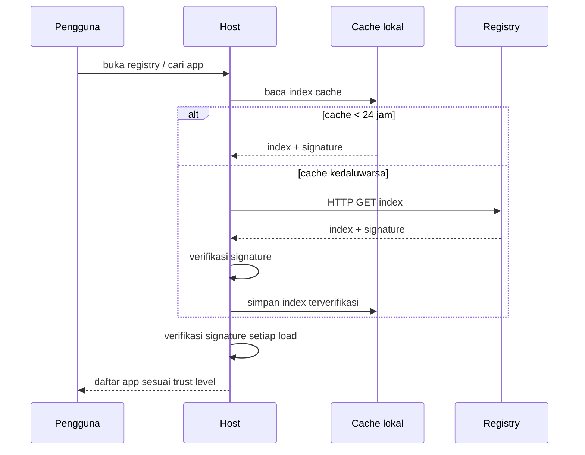
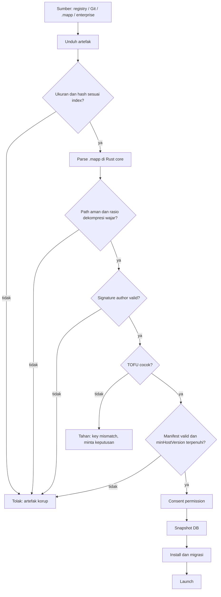

# Registry dan Supply Chain

Dokumen ini menetapkan arsitektur registry terfederasi dan rantai pasok paket `.mapp`. Kontrak normatif untuk instalasi, signature, dan update ada di [03-specs/05-registry.md](../03-specs/05-registry.md); kebijakan konten ada di [10-contributing/registry-policy.md](../10-contributing/registry-policy.md).

## 1. Tujuan dan Ruang Lingkup

Ruang lingkup mencakup penemuan paket, pengambilan index, verifikasi signature, cache offline, instalasi dari registry/Git/`.mapp`/enterprise push, pembaruan delta, pin, rollback, serta rotasi dan pencabutan kunci. Di luar ruang lingkup: hosting CDN komersial dan pembayaran; registry **MUST NOT** memiliki paywall atau pembatasan seat.

## 2. Prinsip

1. **Registry tidak dipercaya.** Setiap artefak diverifikasi secara kriptografis di klien.
2. **Index statis dan dapat di-cache.** Registry **MUST** menyajikan index yang dapat dilayani sebagai file statis.
3. **Kunci registry dan kunci author terpisah.** Registry menandatangani index; author menandatangani paket.
4. **Offline tetap berfungsi.** Index yang sudah di-cache **MUST** tetap dapat dipakai tanpa batas waktu.
5. **Tidak ada silent update.** Setiap perubahan permission atau kunci memerlukan keputusan pengguna.
6. **Reproducible.** Build yang dipublikasikan **MUST** dapat direproduksi dari commit dan builder image yang dinyatakan.

## 3. Trust Level

| Level | Siapa | Sumber kunci | Perilaku klien |
|---|---|---|---|
| `official` | Tim inti proyek | Kunci registry resmi yang dibundel | Ditampilkan sebagai official; tetap diverifikasi signature-nya |
| `community` | Author publik | Kunci author dengan TOFU | Peringatan bila kunci berubah; scanner wajib lulus |
| `internal` | Organisasi pada server self-host | Kunci registry internal | Hanya dari registry yang dikonfigurasi admin; kebijakan organisasi berlaku |
| `local` | Pengguna sendiri | Kunci author lokal | Dapat diinstal tanpa jaringan; tetap melalui consent permission |

Trust level **MUST** ditampilkan di UI sebelum instalasi dan **MUST NOT** dinaikkan otomatis oleh klien. Level `community` tidak boleh dipromosikan menjadi `official` hanya karena banyak diunduh.

## 4. Registry Index

Index adalah dokumen JSON statis dengan field minimum: `schemaVersion`, `name`, `url`, `publicKey`, `updatedAt`, dan `apps[]`. Setiap entri `apps[]` memuat `id`, `version`, `name`, `summary`, `icon`, `downloadUrl`, `size`, `sha256`, `signature`, `minHostVersion`, dan `permissions`. Skema resmi ada di [03-specs/schemas/registry-index.v1.schema.json](../03-specs/schemas/registry-index.v1.schema.json).

Contoh index valid:

```json
{
  "schemaVersion": 1,
  "name": "Official Community Registry",
  "url": "https://registry.microapp.dev",
  "publicKey": {
    "keyId": "0a1b2c3d4e5f6071",
    "fingerprint": "1f2e3d4c5b6a798807162534435261708192a3b4c5d6e7f8091a2b3c4d5e6f70",
    "algorithm": "ed25519"
  },
  "updatedAt": "2026-01-15T00:00:00Z",
  "revokedKeys": [],
  "apps": [
    {
      "id": "org.reinvy.kas-offline",
      "version": "1.3.0",
      "name": "KasLokal",
      "summary": "Pencatatan kas offline dengan laporan harian",
      "icon": "https://registry.microapp.dev/icons/kas-offline.png",
      "downloadUrl": "https://registry.microapp.dev/apps/org.reinvy.kas-offline/1.3.0.mapp",
      "size": 1843200,
      "sha256": "3f7a1c9d2e4b6a8c0d1e2f3a4b5c6d7e8f9a0b1c2d3e4f5a6b7c8d9e0f1a2b3c",
      "signature": { "keyId": "9f2c1d4e8a7b3c50", "value": "ed25519:MEUCIQ..." },
      "minHostVersion": "2.0.0",
      "permissions": ["storage.local.sqlite"],
      "trustLevel": "official",
      "reproducible": true,
      "contentHash": "sha256-3f7a1c9d2e4b6a8c0d1e2f3a4b5c6d7e8f9a0b1c2d3e4f5a6b7c8d9e0f1a2b3c"
    }
  ]
}
```

Aturan index:

- Index **MUST** ditandatangani dengan kunci registry; signature **MUST** mencakup seluruh isi index secara kanonik.
- `downloadUrl` **MUST** menggunakan HTTPS atau skema yang diizinkan registry internal.
- `sha256` **MUST** merujuk ke byte `.mapp` final, bukan ke wrapper transport.
- `permissions` **MUST** sama dengan manifest di dalam paket; perbedaan membuat paket ditolak.
- `minHostVersion` **MUST** dibandingkan sebelum unduh; versi host yang tidak memenuhi ditolak dengan pesan yang jelas.

## 5. Fetch, Cache, dan Offline



Aturan operasional:

| Aspek | Ketentuan |
|---|---|
| Masa cache | Index di-cache **24 jam** |
| Offline | Index cache **MUST** tetap dipakai tanpa kedaluwarsa selama belum ada index baru terverifikasi |
| Verifikasi | Signature **MUST** diverifikasi pada setiap load, termasuk dari cache |
| Kegagalan fetch | Gunakan cache; tampilkan status offline, bukan daftar kosong |
| Update index | Index baru menggantikan cache hanya setelah signature valid |
| Ukuran | Index **SHOULD** dipaginasi atau dipisah per kategori bila melebihi batas unduh yang wajar |

Klien **MUST NOT** menghapus cache secara otomatis hanya karena jaringan tidak tersedia. Penghapusan cache manual diperlakukan sebagai aksi pengguna dengan konfirmasi.

## 6. Kunci Registry dan Kunci Author

| Kunci | Penanda tangan | Cakupan | Lokasi verifikasi |
|---|---|---|---|
| Registry key | Operator registry | Index dan metadata registry | Bundled/di-pin di klien |
| Author key | Author paket | Manifest, `dist/`, `assets/`, `db/migrations/` | TOFU per author |
| Device key | Perangkat pengguna | Envelope sync dan pairing | Peer/server |

Aturan:

- Kunci registry **MUST NOT** menandatangani paket individual; kunci author **MUST NOT** menandatangani index.
- Klien **MUST** menyimpan pemetaan author → fingerprint (TOFU) dan membandingkan pada setiap versi baru.
- Perubahan kunci author **MUST** memicu peringatan keras yang menyebut fingerprint lama dan baru serta meminta konfirmasi eksplisit.
- Signature **MUST** detached dan memakai Ed25519; verifikasi dilakukan di `packages/core-rust`, bukan di TypeScript atau Dart.
- Fingerprint **SHOULD** ditampilkan dalam format yang dapat dibandingkan manusia (kelompok karakter) dan dapat disalin.

## 7. TOFU dan Penanganan Key Mismatch

1. Instalasi pertama sebuah author menetapkan fingerprint sebagai pin TOFU.
2. Versi berikutnya dengan fingerprint sama diverifikasi normal.
3. Fingerprint berbeda memicu status `key-mismatch`: unduhan ditahan, paket tidak dijalankan, dan pengguna harus memilih menolak atau menerima kunci baru secara eksplisit.
4. Menerima kunci baru **MUST** memperbarui pin dan mencatat audit event.
5. Penolakan **MUST** menghapus artefak yang gagal dan mempertahankan versi terpasang.

Key mismatch **MUST NOT** diselesaikan otomatis oleh update latar belakang. Bila registry menyediakan revocation list, fingerprint yang dicabut **MUST** ditolak tanpa opsi menerima.

## 8. Alur Instalasi dan Verifikasi



Verifikasi **MUST** terjadi sebelum konten paket disentuh oleh renderer atau runtime. Snapshot database **MUST** dibuat sebelum migrasi agar rollback tersedia.

## 9. Reproducible Build

Pipeline publish yang mengikat:

1. Author menandai commit sumber dan versi.
2. Builder image didokumentasikan dengan digest immutable.
3. Build dijalankan dengan input yang dinormalisasi (tanpa timestamp, urutan file deterministik).
4. Artefak `.mapp` dihasilkan sebagai ZIP deterministik: entry terurut, timestamp tetap `1980-01-01`, deflate level 9, tanpa extra field.
5. Hash SHA-256 dihitung dan dicatat pada index.
6. Signature Ed25519 author dibuat atas manifest dan hash konten.
7. Registry memverifikasi signature dan hash sebelum menerima publish.
8. Klien dapat membangun ulang dari commit yang dinyatakan dan membandingkan hash.

Bila hash hasil build ulang berbeda, klien **MUST** menandai paket sebagai tidak terverifikasi dan menampilkan peringatan; paket tidak boleh dianggap setara dengan build resmi. Wrapper Zstd hanya untuk transport dan **MUST NOT** mengubah format kanonik.

## 10. Scanner Supply Chain

| Scanner | Yang diperiksa | Tindakan bila gagal |
|---|---|---|
| SAST | Pola eksekusi berbahaya, `eval`, akses ambient, obfuscation mencurigakan | Tolak publish |
| SCA | Dependency rentan dan lisensi tidak kompatibel | Tolak atau minta perbaikan |
| Obfuscation | Minifikasi ekstrem, string terenkripsi, loader dinamis | Tinjauan manual |
| Permission | Permission diminta melebihi fungsi yang dinyatakan | Tolak atau minta justifikasi |
| CVE | Kecocokan dengan basis data kerentanan | Blokir versi terdampak |
| Signature | Validitas kunci dan rantai kepercayaan | Tolak |

Hasil scanner **MUST** disimpan bersama versi dan **SHOULD** dapat dilihat pengguna sebelum instalasi. Scanner bukan pengganti sandbox; micro-app tetap dijalankan dengan zero privilege.

## 11. Delta Update, Pin, dan Rollback

- **Delta update** **MAY** dipakai untuk mengirim perbedaan antarversi. Delta **MUST** diverifikasi terhadap hash versi target penuh; bila verifikasi gagal, klien **MUST** mengunduh paket penuh.
- **Auto-update** **MUST** dapat dimatikan per app. Permission baru atau kenaikan permission **MUST** memicu consent ulang.
- **Notify-only** adalah mode default untuk app dengan permission tinggi.
- **Pin** menahan versi tertentu; klien tetap memverifikasi signature dan hash pada setiap load.
- **Rollback** ke versi sebelumnya **MUST** memakai snapshot database yang dibuat sebelum migrasi. Bila migrasi tidak reversibel, rollback **MUST** memulihkan snapshot dan memberi tahu pengguna tentang kehilangan data baru.
- Downgrade tanpa persetujuan pengguna **MUST** ditolak untuk menghindari serangan rollback ke versi rentan.

## 12. Direct Git Install

Instalasi langsung dari Git **MUST**:

1. Mencatat URL repository dan commit SHA yang di-resolve.
2. Mengunduh pada commit tersebut, bukan pada branch yang bergerak.
3. Menjalankan build atau memakai artefak rilis yang ditandatangani.
4. Memverifikasi signature author dan hash bila tersedia.
5. Menampilkan bahwa sumber adalah Git, dengan trust level yang sesuai.

Bila repository tidak menyediakan signature, klien **MUST** menandai paket sebagai `unsigned` dan meminta konfirmasi tambahan. Direct Git install **MUST NOT** melewati consent permission.

## 13. Paket `.mapp`

Struktur minimum: `manifest.json`, `dist/`, `assets/`, `db/migrations/`, `signatures/`. Aturan:

- `manifest.json` **MUST** memakai skema versi yang didukung host.
- Path **MUST** relatif, tanpa `..`, tanpa path absolut, dan tanpa symlink.
- Ukuran total, jumlah entry, dan rasio dekompresi **MUST** dibatasi sebelum ekstraksi.
- Nama entry **MUST** unik setelah normalisasi case pada filesystem yang case-insensitive.
- Signature **MUST** mencakup manifest dan seluruh konten yang dieksekusi.
- Paket yang gagal verifikasi **MUST** dihapus dari cache unduhan dan tidak boleh dijalankan.

## 14. Enterprise Push

Server self-host **MAY** mendorong paket ke perangkat yang terdaftar. Aturan:

- Paket enterprise **MUST** ditandatangani oleh kunci author internal dan diverifikasi klien.
- Kebijakan organisasi **MAY** mewajibkan versi minimum dan melarang sumber lain.
- Push **MUST** tetap melalui consent permission kecuali kebijakan perangkat menyatakan sebaliknya secara eksplisit.
- Admin **MUST** dapat mencabut paket; pencabutan **MUST** mencegah update berikutnya tanpa menghapus data pengguna.
- Klien **MUST** menampilkan sumber `internal` dan tidak mencampurnya dengan `official`.

## 15. Rotasi dan Pencabutan Kunci

| Kejadian | Tindakan |
|---|---|
| Rotasi kunci author terjadwal | Publikasikan fingerprint baru, tanda tangani transisi, klien meminta konfirmasi TOFU |
| Kunci author dicurigai bocor | Cabut fingerprint, tandai semua versi setelah waktu kompromi, blokir instalasi |
| Rotasi kunci registry | Index baru ditandatangani kunci baru, distribusikan melalui rilis host |
| Kunci registry dicabut | Klien menolak index bertanda tangan kunci itu dan memakai cache terverifikasi terakhir |
| Kunci perangkat dicabut | Server menolak sync dari device tersebut dan menghapus sesi |

Pencabutan **MUST** dipropagasikan melalui index atau mekanisme revocation yang ditandatangani. Klien **MUST NOT** menerima instruksi pencabutan dari sumber tanpa signature.

## 16. Kegagalan dan Pemulihan

| Kegagalan | Perilaku | Pemulihan |
|---|---|---|
| Registry tidak dapat dijangkau | Gunakan cache; tampilkan status offline | Fetch ulang saat jaringan tersedia |
| Signature index tidak valid | Tolak index; gunakan cache valid terakhir | Periksa konfigurasi registry |
| Signature paket tidak valid | Tolak dan hapus artefak | Unduh ulang dari sumber sah |
| Key mismatch | Tahan instalasi | Keputusan pengguna; audit |
| Hash tidak cocok | Tolak paket | Laporkan ke registry |
| Delta gagal | Unduh paket penuh | Lanjutkan instalasi setelah verifikasi |
| Migrasi gagal | Rollback ke snapshot | Perbaiki manifest/migrasi |

## 17. Referensi

- [registry policy](../10-contributing/registry-policy.md), [threat model](threat-model.md), [monorepo](monorepo.md)
- [03-specs/05-registry.md](../03-specs/05-registry.md), [03-specs/manifest-v2.md](../03-specs/manifest-v2.md)
- [03-specs/schemas/registry-index.v1.schema.json](../03-specs/schemas/registry-index.v1.schema.json)
- [04-flows/02-install-update-rollback.md](../04-flows/02-install-update-rollback.md), [04-flows/09-publish-verify.md](../04-flows/09-publish-verify.md)
- [08-quality/security-test-plan.md](../08-quality/security-test-plan.md)
