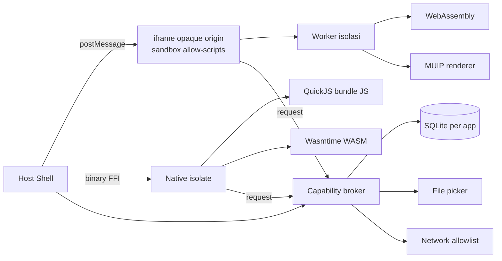
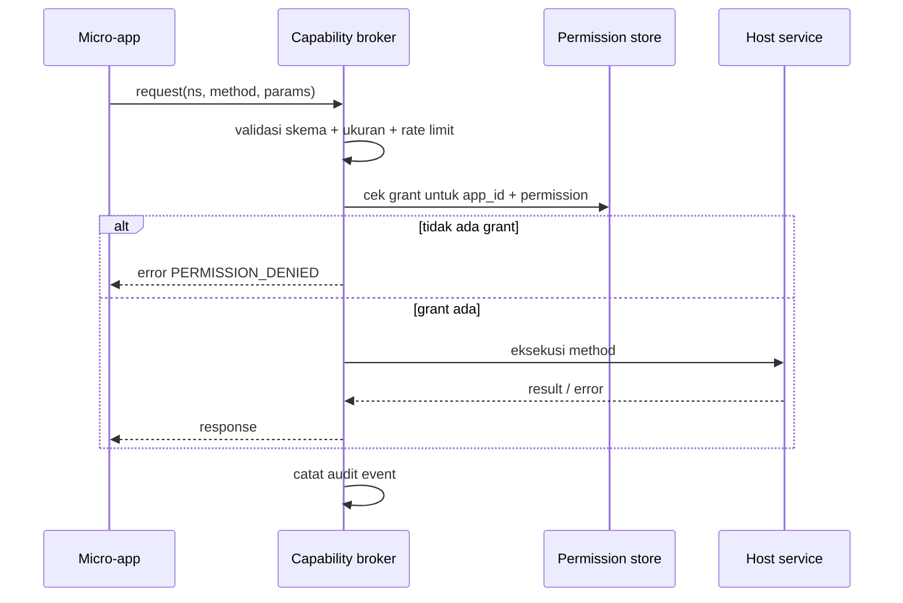

# Sandbox dan Capability

Dokumen ini menetapkan bagaimana kode micro-app dijalankan, dibatasi, dan diberi izin. Kontrak normatif ada di [03-specs/03-sandbox-runtime.md](../03-specs/03-sandbox-runtime.md) dan [03-specs/permissions.md](../03-specs/permissions.md); dokumen ini menjelaskan keputusan arsitektur yang mengikat keduanya.

## 1. Prinsip

- **Zero privilege.** Micro-app tidak memiliki akses ambient ke DOM, filesystem, jaringan, kamera, database, atau proses. Semua akses melewati capability broker.
- **Dua engine, satu semantik.** Web dan native memakai mekanisme isolasi berbeda tetapi perilaku, lifecycle, permission, dan error yang sama.
- **Fail closed.** Bila isolate tidak tersedia atau tidak dapat dijamin, micro-app MUST NOT dijalankan. Tidak ada fallback ke eksekusi tanpa sandbox.
- **Host tidak pernah mengeksekusi kode micro-app.** Tidak ada `new Function`, `eval`, `innerHTML` dari konten micro-app, atau injeksi node ke dokumen Host.
- **Kegagalan terkurung.** Crash, freeze, atau pelanggaran memori hanya mematikan satu micro-app.

## 2. Dual Engine

| Aspek | Web (`@microapp/runtime-web`) | Native (`@microapp/runtime-native`) |
|---|---|---|
| Isolasi | `iframe` dengan `sandbox="allow-scripts"` **tanpa** `allow-same-origin`, opaque origin, plus `Worker` khusus | Proses/isolate terpisah di Host Flutter |
| Engine JS | Engine browser di dalam iframe dan Worker | **QuickJS** untuk bundle JavaScript |
| Engine WASM | `WebAssembly` di Worker; modul dimuat via `blob:` URL | **Wasmtime** untuk modul WASM |
| Kebijakan konten | CSP `default-src 'none'`; hanya `script-src 'self' blob:`, `connect-src 'none'`, `img-src 'self' data:` | Tidak ada akses jaringan/berkas langsung dari engine |
| Bridge | `postMessage` dengan structured clone | Frame biner length-prefixed via FFI |
| Penegakan memori | Akuntansi heap di Worker + kill oleh Host | Batas heap QuickJS/Wasmtime + RSS proses |
| Watchdog | Timer Host + heartbeat Worker | Thread watchdog terpisah |
| Renderer | MUIP dirender di dalam iframe | MUIP dirender oleh Flutter di dalam surface milik Host |

Aturan teknis yang MUST dipatuhi:

1. Atribut iframe tepat `sandbox="allow-scripts"`. Menambahkan `allow-same-origin`, `allow-top-navigation`, `allow-popups`, atau `allow-forms` dilarang karena membatalkan isolasi origin.
2. iframe tidak memiliki akses ke cookie, `localStorage`, IndexedDB, atau sesi Host karena origin-nya opaque.
3. Bundle micro-app dimuat dari `blob:` URL yang dibuat Host setelah verifikasi signature dan hash; URL dicabut saat micro-app berhenti.
4. Komunikasi hanya lewat `postMessage` dengan `targetOrigin` eksplisit dan validasi `event.source`; Host MUST mengabaikan pesan dari frame lain.
5. Native MUST menjalankan QuickJS dan Wasmtime tanpa host function ambient; setiap host function adalah method bridge yang diperiksa broker.
6. Modul WASM yang meminta import di luar daftar yang diizinkan ditolak sebelum instansiasi.

## 3. Batas Kepercayaan

| Objek | Dipercaya | Bukti yang diperiksa |
|---|---|---|
| Host Shell | Ya | — |
| Manifest dan signature | Ya setelah verifikasi | Ed25519 author + registry, hash konten |
| Bundle micro-app | Tidak | Dijalankan hanya di dalam isolate |
| Pesan bridge | Tidak | Skema, permission, rate limit, ukuran |
| Nilai MUIP | Tidak | Divalidasi terhadap `ui-node.v1.schema.json` |
| Respons jaringan | Tidak | Allowlist, ukuran, timeout, redaksi |

Micro-app tidak boleh mengetahui Site ID, kunci, path filesystem, atau identitas pengguna kecuali dinyatakan oleh method bridge yang berizin.

## 4. Capability Broker

Broker adalah satu-satunya jalur efek samping. Alurnya:

Aturan broker:

- Micro-app MUST NOT memegang handle langsung ke objek Host; hanya ID buram berumur terbatas.
- Setiap method mendeklarasikan permission yang dibutuhkan; method tanpa deklarasi ditolak.
- Permission diperiksa **setiap panggilan**, bukan hanya saat mount, sehingga pencabutan berlaku seketika.
- Parameter dan hasil divalidasi terhadap skema; ukuran maksimum per pesan 1 MiB, chunk biner dipakai untuk transfer lebih besar.
- Semua penolakan mengembalikan error terstruktur yang tidak membocorkan keberadaan resource.
- Audit event ditulis untuk grant, deny, dan setiap method berisiko tinggi.

### 4.1 Permission ID

| Permission ID | Risk tier | Efek yang diizinkan | Catatan penegakan |
|---|---|---|---|
| `storage.local` | low | Key-value milik `app_id` | Kuota per app; tidak dapat dibaca app lain |
| `storage.local.sqlite` | low | Database SQLite milik `app_id` | Query hanya pada file DB app tersebut |
| `notifications.local` | low | Notifikasi lokal | Tanpa push server; rate limit |
| `camera` | medium | Akses kamera | Preview eksplisit, indikator aktif |
| `camera.qr` | medium | Pemindaian QR | Frame tidak dipersistensi |
| `microphone` | medium | Rekaman audio | Indikator aktif, file di storage app |
| `location` | medium | Lokasi perkiraan/presisi | Tidak ada background tracking |
| `biometrics` | medium | Verifikasi biometrik via Host | Hasil boolean; data biometrik tidak keluar dari OS |
| `filesystem.picker` | medium | Baca/tulis file yang dipilih pengguna | Handle per file, bukan path direktori |
| `bluetooth` | medium | Perangkat BLE | Pairing lewat Host |
| `nfc` | medium | Baca/tulis NFC | Hanya saat foreground |
| `local_ai.inference` | medium | Inferensi model lokal | Tanpa unggah data; timeout 120 detik |
| `network.allowlist` | high | HTTP ke domain di manifest | Allowlist per app; tanpa IP privat secara default |

Permission yang tidak tercantum di manifest MUST ditolak. Permission opsional ditampilkan sebagai pilihan saat consent; penolakan tidak boleh membuat app crash, melainkan menonaktifkan fitur terkait.

## 5. Network Allowlist dan Offline Cage

- `network.allowlist` berisi entri domain exact atau wildcard `*.example.com`; skema, port, path, IP literal, dan CIDR MUST NOT dipakai (ditolak validator manifest).
- Alamat IP literal dan hostname privat (`localhost`, `*.local`, rentang RFC 1918, link-local) MUST ditolak tanpa pengecualian pengembangan; bila target pengembangan memakai IP, pengembang MUST memakai hostname yang di-resolve dan mendaftarkannya di allowlist.
- Setiap request diperiksa setelah resolusi DNS dan pada setiap redirect; redirect ke host di luar allowlist ditolak.
- Header kredensial Host tidak pernah diteruskan; cookie jar micro-app terpisah dan kosong saat mount.
- **Offline cage** adalah mode di mana namespace `network` mengembalikan kegagalan deterministik dan seluruh permintaan dicatat. Mock respons dikonfigurasi pengguna melalui DevTools (bukan field manifest) dan MUST ditandai di UI serta audit sehingga tidak dapat disalahartikan sebagai data nyata.
- Saat perangkat offline, request yang tidak di-mock gagal cepat dengan status `OFFLINE`, bukan menunggu timeout jaringan.
- Respons dibatasi ukuran dan waktu (default 10 detik; transfer file 60 detik); konten tidak pernah dieksekusi sebagai kode.

## 6. Lifecycle

Urutan lifecycle mengikat kedua engine. Setiap transisi menghasilkan audit event.

| Event | Kapan | Kontrak |
|---|---|---|
| `onInstall` | Sekali setelah verifikasi paket dan migrasi DB | Menyiapkan storage; tidak boleh meminta permission baru di luar manifest |
| `onMount` | Saat micro-app pertama kali dirender pada sesi | Isolate dibuat, MUIP root dikirim, state awal dipulihkan |
| `onFocus` | Micro-app menjadi aktif | Timer dan langganan boleh dimulai; state hibernasi dipulihkan |
| `onBlur` | Micro-app kehilangan fokus tetapi tetap terlihat | Hentikan animasi berat dan polling; jangan hapus state |
| `onBackground` | Micro-app tidak terlihat | Semua timer/stream dijeda; batas waktu hibernasi dimulai |
| `onSync` | Setelah batch CRDT diterapkan pada DB app | Muat ulang view yang terpengaruh; tidak boleh menulis balik data sync |
| `onMemoryWarning` | Pemakaian mencapai 80% kuota | Dipanggil **sekali per siklus**; app melepas cache; siklus direset setelah pemakaian turun di bawah 60% |
| `onUpdate` | Paket versi baru dipasang | Migrasi skema sudah selesai sebelum event; app menyesuaikan state |
| `onUninstall` | Sebelum data dihapus | Kesempatan terakhir mengekspor; tidak ada network kecuali diizinkan |

Aturan tambahan:

- `onMount` dan `onFocus` tidak boleh berjalan paralel untuk micro-app yang sama.
- Event lifecycle dikirim berurutan dan di-ack; event yang tidak di-ack dalam 2 detik tidak menghalangi Host mematikan isolate.
- Micro-app tidak dapat memanggil lifecycle secara manual.

## 7. Kuota, Watchdog, dan Hibernasi

| Parameter | Mobile | Desktop | Perilaku |
|---|---|---|---|
| Kuota memori | 128 MB | 512 MB | Melebihi kuota → kill isolate |
| Ambang peringatan | 80% | 80% | `onMemoryWarning` sekali per siklus |
| Deteksi freeze | 5 detik | 5 detik | Heartbeat tidak diterima → kill |
| Hibernasi | 30 detik tanpa interaksi | 30 detik tanpa interaksi | Snapshot state, lepas isolate |
| Transfer file | 60 detik | 60 detik | Batalkan dan laporkan |
| Bridge default | 10 detik | 10 detik | Timeout terstruktur |
| AI inference | 120 detik | 120 detik | Dibatalkan saat app background |

- Watchdog mengirim ping setiap 1 detik; tiga ping berturut-turut tanpa pong dianggap freeze dan isolate dibunuh segera setelah ambang 5 detik.
- Freeze yang disebabkan loop tak berujung tidak boleh diubah menjadi pengulangan restart otomatis tanpa batas; maksimum dua restart otomatis, lalu error boundary persisten.
- Hibernasi menyimpan snapshot state yang dideklarasikan micro-app (bukan heap), mencabut semua timer dan bridge handle, dan mempertahankan DB.
- `onFocus` berikutnya memulihkan snapshot; jika versi paket berubah selama hibernasi, snapshot dibuang dan `onMount` dijalankan.
- Kuota memori dihitung per micro-app, bukan agregat; micro-app background yang hibernasi tidak memakan kuota.

## 8. Rendering MUIP

- UI micro-app dinyatakan sebagai pohon MUIP v1, bukan HTML atau widget Host. Spesifikasi ada di [03-specs/ui-protocol.md](../03-specs/ui-protocol.md).
- Pada web, renderer MUIP berjalan **di dalam iframe** yang sama dengan logika micro-app; Host hanya menerima event dan tidak menyisipkan node ke dokumen induk.
- Pada native, renderer MUIP adalah implementasi Flutter yang memetakan node ke widget MADS; micro-app tidak memegang referensi widget.
- Renderer MUST menolak node dengan tipe tidak dikenal, atribut di luar skema, HTML mentah, atau handler yang bukan nama event.
- Batas divalidasi sebelum render: kedalaman 64, 10.000 node, payload 1 MiB, string 64 KiB.
- Patch dikirim sebagai batch dan diterapkan atomik; patch yang gagal validasi ditolak seluruhnya tanpa merusak tampilan terakhir yang valid.
- Gaya hanya berasal dari token MADS yang diizinkan; nilai warna/ukuran arbitrer ditolak.

## 9. Error Boundary, Restart, Rollback, Export

1. Watchdog atau runtime mendeteksi kegagalan (freeze, pelanggaran memori, exception fatal, pelanggaran permission berulang).
2. Isolate dibunuh; Host menampilkan error boundary milik micro-app, bukan crash layar penuh.
3. Diagnostik dikumpulkan: kode error, event terakhir, versi paket, cuplikan log dengan redaksi.
4. Pengguna memilih **Restart**, **Rollback** ke versi sebelumnya, atau **Export** data.
5. Restart membuat isolate baru dan memulai dari `onMount`; state hibernasi yang rusak dibuang.
6. Rollback memakai snapshot DB yang diambil sebelum update dan memasang kembali versi paket sebelumnya.
7. Export menghasilkan arsip data milik app; tidak pernah menyertakan kunci atau data app lain.
8. Kegagalan satu micro-app MUST NOT menjatuhkan Host, micro-app lain, DB worker, atau sync worker.

Crash loop (tiga kegagalan dalam 60 detik) menonaktifkan auto-restart dan menampilkan opsi rollback/export.

## 10. Audit

| Event | Data minimum | Retensi |
|---|---|---|
| `sandbox.launch` | `app_id`, versi, engine, hash paket | 30 hari |
| `sandbox.kill` | `app_id`, alasan, metrik memori | 30 hari |
| `sandbox.hibernate` | `app_id`, durasi | 30 hari |
| `permission.request` | `app_id`, permission, tier | 90 hari |
| `permission.grant` / `permission.revoke` | `app_id`, permission, aktor | Sampai dihapus pengguna |
| `permission.deny` | `app_id`, permission, method | 90 hari |
| `bridge.call` (high risk) | namespace, method, hasil | 30 hari |
| `network.blocked` | host tujuan, alasan | 30 hari |

Audit tidak memuat isi payload, rahasia, token, atau PII. Audit lokal tidak dikirim ke mana pun tanpa opt-in eksplisit.

## 11. Larangan Implementasi

- `new Function`, `eval`, `Function` constructor, `setTimeout(string)`, dan `import()` terhadap URL non-blob dilarang di runtime produksi, baik di Host maupun di isolate.
- DOM Host tidak boleh menerima markup dari micro-app; tidak ada `innerHTML`/`dangerouslySetInnerHTML` untuk konten micro-app.
- Tidak ada akses langsung ke SQLite, filesystem, kamera, atau jaringan dari bundle micro-app; semua lewat bridge.
- Tidak ada isolate bersama antar micro-app; satu isolate untuk satu `app_id` dan satu versi.
- Tidak ada mode "unsafe" yang menonaktifkan sandbox untuk kenyamanan pengembangan di build produksi.

**Celah Phase 0.** Prototipe saat ini mengevaluasi logika dengan `new Function` di `src/engine/evaluator.ts` dan menyimpan sesi di `localStorage` lewat `src/lib/auth.ts`. Keduanya adalah utang yang MUST dihapus pada Phase 1: logika dipindahkan ke bundle yang berjalan di isolate, dan autentikasi diganti Local Identity. Lihat [00-foundation/implementation-status.md](../00-foundation/implementation-status.md).

## 12. Fail-Closed Matrix

| Kondisi | Perilaku | Pesan pengguna |
|---|---|---|
| iframe sandbox tidak didukung | Micro-app tidak dijalankan | Sandbox tidak tersedia |
| WebAssembly tidak tersedia | Bundle WASM ditolak; bundle JS murni tetap diizinkan | Fitur WASM tidak tersedia |
| QuickJS gagal init (native) | Micro-app tidak dijalankan | Sandbox native gagal dimulai |
| Wasmtime gagal init (native) | Modul WASM ditolak | Runtime WASM tidak tersedia |
| CSP melaporkan pelanggaran | Resource diblokir dan dicatat | Konten diblokir kebijakan keamanan |
| Kuota memori tidak dapat ditegakkan | Micro-app tidak dijalankan pada platform tersebut | Batas memori tidak dapat dijamin |
| Permission store tidak terbaca | Semua permintaan efek samping ditolak | Izin tidak dapat diverifikasi |

Tidak ada kondisi di mana eksekusi tanpa sandbox dipilih sebagai alternatif.

## 13. Referensi

- [system-overview.md](system-overview.md), [host-bridge-intents.md](host-bridge-intents.md), [threat-model.md](threat-model.md)
- [adr/0007-sandbox-strategy.md](adr/0007-sandbox-strategy.md), [adr/0003-rust-shared-core.md](adr/0003-rust-shared-core.md)
- [03-specs/03-sandbox-runtime.md](../03-specs/03-sandbox-runtime.md), [03-specs/permissions.md](../03-specs/permissions.md), [03-specs/ui-protocol.md](../03-specs/ui-protocol.md), [03-specs/host-bridge.md](../03-specs/host-bridge.md)
- [04-flows/11-permission-consent.md](../04-flows/11-permission-consent.md), [04-flows/12-crash-recovery.md](../04-flows/12-crash-recovery.md)
- [08-quality/security-test-plan.md](../08-quality/security-test-plan.md)
