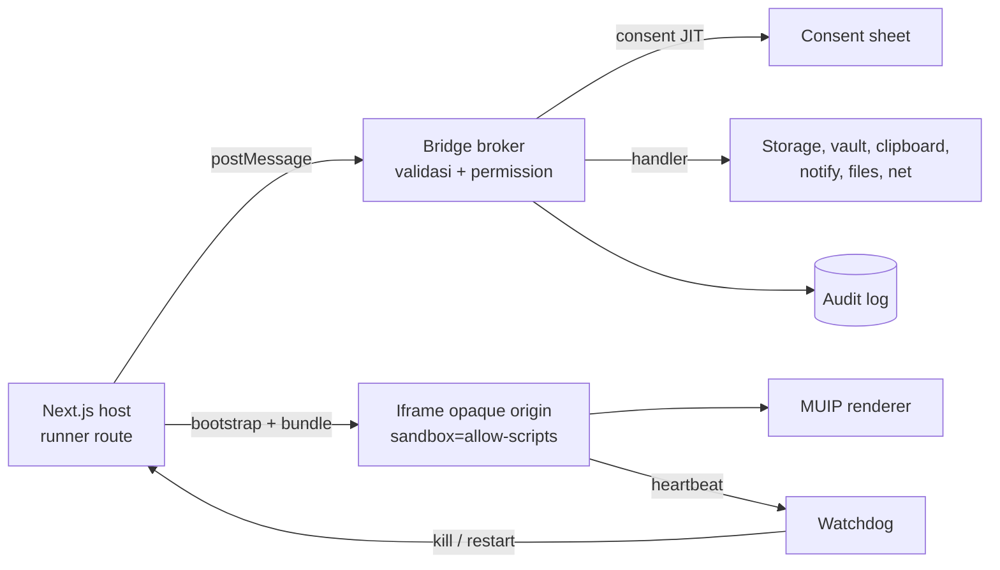

# Sandbox Runtime

## 1. Tujuan

Dokumen ini menetapkan cara kode micro-app dijalankan dan dibatasi di browser. Runtime adalah satu-satunya tempat kode pihak ketiga dieksekusi. Isolasi utama adalah iframe dengan origin opaque, CSP ketat, renderer MUIP, dan satu kanal bridge yang diperiksa per panggilan.

Kontrak perilaku ada di [03-specs/03-sandbox-runtime.md](../03-specs/03-sandbox-runtime.md), definisi izin di [03-specs/permissions.md](../03-specs/permissions.md), dan protokol UI di [03-specs/ui-protocol.md](../03-specs/ui-protocol.md). Keputusan desain dicatat di [ADR-0019](adr/0019-iframe-sandbox-muip.md).

## 2. Model Eksekusi



| Lapisan | Berjalan di | Tanggung jawab |
|---|---|---|
| Runner | Main thread host | Membuat iframe, memasang bootstrap, memantau heartbeat, menampilkan boundary |
| Bootstrap | Dalam iframe | Menerima bundle, menjalankan app, mengirim pesan bridge, mengirim heartbeat |
| Renderer MUIP | Dalam iframe | Memvalidasi node dan membangun DOM dengan `textContent` |
| Broker | Main thread host | Validasi amplop, permission, rate limit, timeout, audit |
| Handler | Main thread host | Menjalankan operasi yang diizinkan dan mengembalikan JSON |

Bootstrap adalah satu-satunya script yang berjalan di iframe. Bundle app diimpor setelah bootstrap siap. Host tidak pernah menyentuh DOM iframe dan iframe tidak pernah menerima objek host, hanya pesan JSON.

## 3. Atribut Iframe

| Atribut | Nilai | Alasan |
|---|---|---|
| `sandbox` | `allow-scripts` | Tidak ada akses same-origin, form, popup, atau navigasi atas |
| `referrerpolicy` | `no-referrer` | Tidak membocorkan URL host |
| `allow` | kosong | Tidak ada akses kamera, mikrofon, atau sensor dari iframe |
| `src` | `srcdoc` dengan bootstrap | Tidak memuat origin lain |
| `allow-same-origin` | tidak pernah | Origin harus opaque |

Iframe opaque origin mencegah akses cookie, storage host, dan DOM induk. Ini bukan isolasi proses: app tetap berbagi renderer process dengan host. Dokumen dan UI tidak boleh mengklaim isolasi memori tingkat sistem operasi.

## 4. CSP

Dokumen sandbox memakai kebijakan berikut:

```text
default-src 'none';
script-src 'nonce-<nonce>' blob: 'wasm-unsafe-eval';
worker-src blob:;
style-src blob: 'unsafe-inline';
img-src blob: data:;
media-src blob:;
font-src blob:;
connect-src 'none';
frame-src 'none';
object-src 'none';
base-uri 'none';
form-action 'none'
```

Aturan:

- Nonce dibuat per dokumen dan divalidasi sebelum disisipkan.
- `'wasm-unsafe-eval'` hanya mengizinkan kompilasi WebAssembly, bukan `eval` JavaScript.
- Tidak ada `eval`, `new Function`, `document.write`, atau `innerHTML` di host maupun renderer.
- `connect-src 'none'` memblokir jaringan dari iframe; akses jaringan hanya lewat broker dan permission.
- Bila browser tidak mendukung iframe sandbox, runtime gagal tertutup dan menampilkan error; tidak ada fallback ke eksekusi di halaman host.

## 5. MUIP

MUIP adalah satu-satunya bahasa UI micro-app: array node dengan satu root, tipe dari 120 komponen katalog, props dari allowlist, dan event terbatas. Renderer menolak:

- HTML, CSS, atau JavaScript mentah di dalam node.
- Tipe komponen yang tidak ada di katalog.
- Prop asing atau tipe nilai yang salah.
- Kedalaman lebih dari 32 atau lebih dari 2000 node.
- Dokumen lebih dari 512 KB.

Teks dirender dengan `textContent`. Atribut yang berpotensi mengeksekusi kode ditolak. Detail skema ada di [03-specs/ui-protocol.md](../03-specs/ui-protocol.md) dan [03-specs/schemas/ui-node.v1.schema.json](../03-specs/schemas/ui-node.v1.schema.json).

## 6. Bridge

Bridge adalah satu-satunya kanal app ke host. Setiap pesan memakai amplop:

```json
{ "v": 1, "id": "req_01HZ", "ns": "clipboard", "method": "read", "params": {} }
```

Urutan validasi broker:

1. Cocokkan `event.source` dengan iframe app dan pastikan origin opaque.
2. Validasi bentuk amplop, versi, ukuran frame, dan `id` unik.
3. Pastikan method ada di allowlist manifest dan registry bridge.
4. Periksa permission; bila belum granted, jalankan consent JIT.
5. Terapkan rate limit dan timeout.
6. Jalankan handler, audit hasil, lalu kirim respons dengan bentuk yang sama.

Kegagalan langkah 1–5 menghasilkan error terstruktur dan tidak menjalankan handler. Rate limit dan timeout final mengikuti [03-specs/host-bridge.md](../03-specs/host-bridge.md). Implementasi broker saat ini memakai token bucket yang dapat dikonfigurasi dan mencatat audit per panggilan.

## 7. Watchdog dan Lifecycle

| Parameter | Nilai kontrak | Perilaku |
|---|---|---|
| Heartbeat | 1 detik | Bootstrap mengirim ping; host menjawab pong |
| Freeze | 5 detik tanpa heartbeat | Iframe dihentikan, boundary ditampilkan |
| Restart | 3 kali per 5 menit per app | Percobaan berikutnya dinonaktifkan dengan penjelasan |
| Hibernasi | 30 detik tanpa interaksi | Loop app dihentikan; state dipulihkan saat kembali |
| Memory warning | 80% kuota | Satu peringatan per siklus; reset di bawah 60% |

Lifecycle yang dikirim ke app: `onInstall`, `onMount`, `onFocus`, `onBlur`, `onBackground`, `onUpdate`, `onUninstall`, ditambah `onSync` dan `onMemoryWarning` untuk siklus. Event transisi terjadi tepat sekali per perubahan; `onFocus`/`onBlur` tidak berjalan bersamaan karena dispatcher menyerialkan antrean.

Catatan implementasi: konstanta watchdog saat ini adalah 2 restart per 60 detik, bukan 3 per 5 menit. Angka pada tabel adalah kontrak target; penyesuaian konstanta dicatat sebagai gap di [00-foundation/implementation-status.md](../00-foundation/implementation-status.md).

## 8. Error Boundary

Saat freeze, crash, atau pelanggaran fatal:

1. Runtime menghentikan iframe dan worker terkait.
2. Boundary menampilkan kode error, ringkasan aman, dan tiga aksi: muat ulang app, ekspor data, kembali ke Home.
3. Draft builder dan app lain tetap berjalan.
4. Log disimpan teredaksi di `crash_incident` dan `diagnostic_log`; tidak ada payload rahasia.
5. Bila budget restart habis, tombol reload dinonaktifkan dan pengguna diarahkan ke ekspor atau Home.

Kode error yang mengikat ada di [03-specs/error-codes.md](../03-specs/error-codes.md). Flow pemulihan ada di [04-flows/07-crash-recovery.md](../04-flows/07-crash-recovery.md).

## 9. Batas Sumber Daya

| Sumber | Batas | Penanganan |
|---|---|---|
| Payload bridge | 256 KB per panggilan | Ditolak sebelum handler |
| Dokumen MUIP | 512 KB, 2000 node, depth 32 | Ditolak sebelum render |
| Request bersamaan | Dibatasi broker per app | Antrean atau penolakan terstruktur |
| Memori | Kuota browser | Peringatan 80%, hibernasi saat idle |
| Waktu CPU | Watchdog | Freeze memicu restart atau boundary |

Tidak ada kuota CPU atau memori yang dapat dijamin oleh browser. Runtime hanya dapat mendeteksi dan membatasi dampak; dokumen tidak boleh menjanjikan kuota keras.

## 10. Audit

Audit mencatat panggilan bridge yang diizinkan dan ditolak, grant/revoke permission, crash, restart, dan perubahan lifecycle. Entri memuat waktu, app, method, hasil, dan durasi; tidak memuat parameter atau hasil yang sensitif. Rantai hash di `audit_log_chain` membuat penghapusan entri terdeteksi.

## 11. Yang Tidak Ada

Tidak ada QuickJS, Wasmtime, interpreter JavaScript eksternal, native sandbox, FFI, akses filesystem bebas, Bluetooth, NFC, sensor perangkat, atau eksekusi kode di server. Tidak ada `eval` atau `new Function` di jalur mana pun.

## 12. Status Implementasi

Iframe opaque origin, CSP, MUIP renderer, broker, watchdog, lifecycle, dan crash boundary sudah ada di `packages/runtime-web`. Bundle saat ini dijalankan di iframe, bukan di worker terpisah. Angka restart dan rate limit perlu diselaraskan dengan spec. Status bukti ada di [00-foundation/implementation-status.md](../00-foundation/implementation-status.md).
