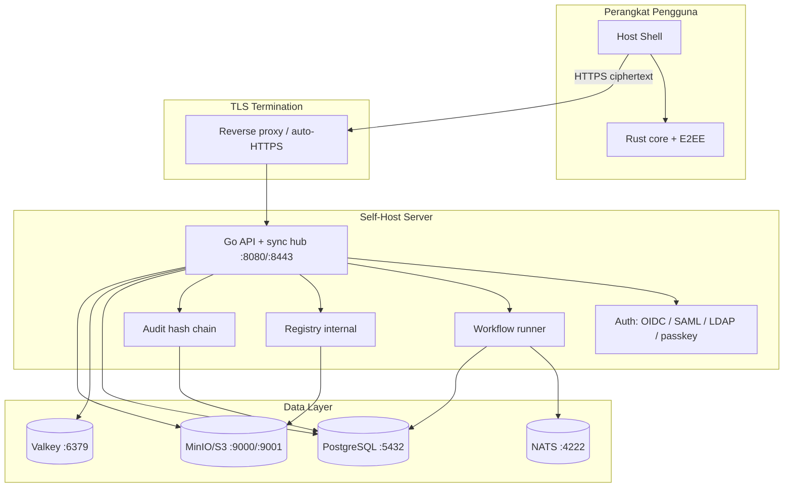

# Self-Host Server

Dokumen ini menetapkan arsitektur server self-host MicroApp Studio. Kontrak normatif ada di [03-specs/07-selfhost.md](../03-specs/07-selfhost.md); prosedur operasional ada di [09-operations/selfhost-runbook.md](../09-operations/selfhost-runbook.md) dan [09-operations/airgap-runbook.md](../09-operations/airgap-runbook.md).

## 1. Tujuan dan Ruang Lingkup

Server adalah komponen **opsional** yang menyediakan relay sync E2EE, registry internal, workflow runner, identitas organisasi, dan audit. Semua fitur inti **MUST** tetap berfungsi tanpanya. Server **MUST NOT** menjadi syarat untuk membuat, menjalankan, atau menyimpan micro-app.

Di luar ruang lingkup: billing, metering berbayar, paywall, dan seat berbayar. Server **MUST NOT** memiliki tabel billing atau pembatasan jumlah pengguna.

## 2. Profil Deployment

| Profil | Target | Database | Komponen tambahan | Skala |
|---|---|---|---|---|
| Lite | Perorangan, tim kecil, perangkat tunggal | SQLite WAL | Tidak ada | 1 proses, 1 vCPU/512 MB |
| Standard | Organisasi kecil/menengah | PostgreSQL 16 + pgvector | MinIO/S3 opsional, Valkey opsional | 1–3 replika API |
| Cluster | Organisasi besar, multi-node | PostgreSQL HA | NATS JetStream, MinIO/S3, Valkey, OTel | Horizontal, HPA |

Profil **MUST** dapat ditingkatkan tanpa mengubah format data pengguna. Migrasi Lite → Standard **MUST** menyediakan jalur ekspor/impor yang terdokumentasi dan diuji.

## 3. Komponen dan Port

| Komponen | Wajib pada | Port default | Protokol | Catatan |
|---|---|---|---|---|
| HTTP server | Lite/Standard/Cluster | **8080** | HTTP | Redirect ke HTTPS bila TLS aktif |
| HTTPS server | Lite/Standard/Cluster | **8443** | HTTPS | Auto-HTTPS pada Lite |
| Sync hub | Lite/Standard/Cluster | 8443 | WebSocket/HTTP2 | Hanya ciphertext |
| PostgreSQL | Standard/Cluster | **5432** | PostgreSQL wire | pgvector untuk embedding |
| Valkey/Redis | Standard/Cluster | **6379** | RESP | Cache, rate limit, session opsional |
| MinIO/S3 | Standard/Cluster | **9000** (API), **9001** (console) | S3 API | Blob registry, backup |
| NATS JetStream | Cluster | **4222** | NATS | Job queue dan event |
| OTLP HTTP | Cluster | **4318** | HTTP | Observability opt-in |
| Registry internal | Lite/Standard/Cluster | 8080/8443 | HTTP/HTTPS | Index dan blob bertanda tangan |

Semua port **MUST** dapat dikonfigurasi. Port default di atas adalah nilai yang dipakai dokumentasi, image, dan Helm chart; perubahan default memerlukan RFC.

## 4. Diagram Deployment

Aturan: server **MUST NOT** menerima kunci E2EE pengguna. Data yang tersimpan di PostgreSQL dan object storage untuk data pengguna **MUST** berupa ciphertext atau artefak yang tidak dapat dibaca operator.

## 5. Konfigurasi `microapp.yaml`

| Field | Tipe | Default | Wajib | Keterangan |
|---|---|---|---|---|
| `listen` | string | `:8080` | Ya | Alamat dan port HTTP |
| `dataDir` | string | `/var/lib/microapp` | Ya | Direktori data persisten |
| `database.url` | string | `sqlite:///data/microapp.db` | Ya | SQLite atau PostgreSQL DSN |
| `storage` | object | filesystem lokal | Ya | `type`, `endpoint`, `bucket`, `region`, kredensial via env |
| `auth` | object | disabled | Ya | Provider, issuer, client ID, pemetaan role |
| `registry` | object | internal | Ya | `name`, `url`, `publicKey`, `policy` |
| `workflow` | object | lokal | Ya | `enabled`, `concurrency`, `timeout`, `runner` |
| `security.allowPrivateEgress` | boolean | `false` | Ya | Mengizinkan workflow mengakses IP privat |
| `tls` | object | auto | Ya | `mode` (`auto`/`manual`/`off`), `cert`, `key`, `domain` |
| `branding` | string | `branding.yaml` | Ya | Path file branding |
| `telemetry.optIn` | boolean | `false` | Ya | Analytics hanya jika diaktifkan eksplisit |

Aturan konfigurasi:

- Nilai rahasia **MUST** berasal dari environment variable atau secret file, bukan ditulis langsung di YAML.
- Perubahan `database.url` **MUST** melalui prosedur migrasi, bukan swap langsung.
- `tls.mode: auto` **MUST** memakai ACME dan **MUST** gagal tertutup bila sertifikat tidak dapat diperoleh.
- Konfigurasi yang tidak valid **MUST** menggagalkan startup dengan pesan field yang salah; server **MUST NOT** berjalan dengan nilai fallback diam-diam.
- `security.allowPrivateEgress: true` **MUST** tercatat di audit setiap kali diubah.

## 6. Database dan Storage

| Profil | Database | Catatan |
|---|---|---|
| Lite | SQLite WAL | Satu file; backup dengan snapshot konsisten; tanpa replika |
| Standard | PostgreSQL 16 + pgvector | Replika baca opsional; migrasi lewat migration ledger |
| Cluster | PostgreSQL HA | Failover otomatis; connection pooling; backup PITR |

Aturan data:

- Skema server **MUST** memakai migration bernomor dan ledger versi.
- Timestamp **MUST** disimpan sebagai UTC; JSON kompleks **MUST** memakai `JSONB` pada PostgreSQL.
- Data pengguna yang disinkronkan **MUST** berupa ciphertext; metadata minimum yang dibutuhkan untuk routing boleh plaintext.
- Penghapusan data pengguna **MUST** melalui prosedur eksplisit dengan konfirmasi; server **MUST NOT** menghapus data karena kuota atau retensi otomatis tanpa pemberitahuan.
- Object storage **MUST** memakai bucket privat; URL publik hanya untuk artefak registry yang memang publik.
- Backup **MUST** terenkripsi dan diuji restore secara berkala; lihat [09-operations/backup-restore.md](../09-operations/backup-restore.md).

## 7. Autentikasi

| Metode | Profil | Catatan |
|---|---|---|
| OIDC | Standard/Cluster | Discovery, PKCE, pemetaan klaim ke role |
| OAuth2 | Standard/Cluster | Provider yang tidak menyediakan OIDC penuh |
| SAML 2.0 | Standard/Cluster | Metadata XML, signed assertion |
| LDAP | Standard/Cluster | Bind service account, grup → role |
| Passkey | Semua | WebAuthn; disarankan untuk admin |
| Magic link | Semua | Sekali pakai, kedaluwarsa singkat, rate limit |

Aturan sesi:

- Access token **15 menit**; refresh/session **30 hari**.
- Refresh token **MUST** dirotasi pada setiap penggunaan dan **MUST** dapat dicabut per device.
- Revocation **MUST** berlaku pada sesi aktif berikutnya, bukan hanya pada login baru.
- Admin **SHOULD** mewajibkan passkey atau MFA; login password saja **MUST NOT** menjadi satu-satunya faktor untuk role admin.
- Auth **MUST** gagal tertutup: provider tidak tersedia berarti login ditolak, bukan bypass.

Identitas pengguna akhir pada perangkat tetap Local Identity; akun server hanya untuk akses layanan organisasi. Server **MUST NOT** memaksa pengguna membuat akun untuk memakai fitur lokal.

## 8. RBAC dan ABAC

| Role bawaan | Kemampuan |
|---|---|
| `owner` | Semua konfigurasi, termasuk kunci signing dan penghapusan tenant |
| `admin` | Kelola pengguna, registry internal, kebijakan, audit |
| `operator` | Operasi harian, backup, melihat health; tanpa perubahan keamanan |
| `auditor` | Baca audit dan konfigurasi; tanpa perubahan data |
| `member` | Sync, workflow, dan registry internal sesuai kebijakan |
| `guest` | Akses terbatas yang ditetapkan kebijakan |

Aturan:

- RBAC menentukan aksi; ABAC menentukan cakupan resource (tenant, workspace, tag, sensitivitas).
- Setiap endpoint **MUST** memeriksa role dan atribut resource sebelum eksekusi.
- Prinsip least privilege **MUST** berlaku; role default anggota **MUST NOT** memiliki akses admin.
- Perubahan role **MUST** dicatat di audit dan **MUST** mencabut sesi yang tidak lagi memenuhi syarat bila perlu.
- Tenant isolation **MUST** ditegakkan di lapisan query, bukan hanya di UI.

## 9. Audit Hash Chain

- Setiap aksi sensitif **MUST** menghasilkan event audit: login, perubahan role, perubahan konfigurasi, akses registry, publish, workflow manual, pencabutan device, dan perubahan kunci.
- Event **MUST** dirantai dengan hash: `entry_hash = H(prev_hash || canonical_event)`.
- Penghapusan atau perubahan event lama **MUST** terdeteksi saat verifikasi rantai.
- Audit **MUST** append-only dari sudut pandang API; tidak ada endpoint edit/hapus.
- Ekspor SIEM **MAY** disediakan melalui syslog/OTLP; ekspor **MUST NOT** menyertakan rahasia atau payload pengguna.
- Retensi audit **MUST** dapat dikonfigurasi; penghapusan hanya oleh `owner` dengan audit baru.

## 10. Branding

Branding dimuat dari `branding.yaml` dan **MUST** memengaruhi UI server serta halaman login.

| Field | Tipe | Wajib | Keterangan |
|---|---|---|---|
| `appName` | string | Ya | Nama tampilan organisasi |
| `shortName` | string | Ya | Nama pendek untuk ikon/PWA |
| `logo` | string | Ya | Path/URL logo; di-host lokal |
| `favicon` | string | Ya | Path favicon |
| `colors` | object | Ya | `primary`, `accent`, `background`, `foreground`; kontras diverifikasi |
| `domain` | string | Ya | Domain publik server |
| `defaultRegistry` | string | Ya | URL registry internal default |
| `featureFlags` | object | Tidak | Menyalakan/mematikan fitur server |
| `legal` | object | Ya | `privacyUrl`, `termsUrl`, `imprint` |
| `supportUrl` | string | Ya | Kontak dukungan |
| `locale` | string | Ya | Locale default `id-ID` atau `en-US` |

Aturan branding: aset **MUST** dilayani dari server sendiri (tanpa CDN pihak ketiga), warna **MUST** memenuhi kontras WCAG 2.2 AA, dan branding **MUST NOT** mengubah alur consent atau menyembunyikan informasi keamanan.

## 11. Air-Gap

Instalasi air-gapped **MUST** beroperasi tanpa egress:

1. Bundle offline berisi binary/image, Helm chart, SBOM, checksum, dan signature.
2. Checksum dan signature **MUST** diverifikasi sebelum instalasi.
3. Registry internal, model AI, font, Monaco, dan language server **MUST** tersedia di dalam bundle atau mirror lokal.
4. `tls.mode: auto` **MUST** diganti sertifikat internal yang sudah disediakan.
5. Update **MUST** memakai bundle baru yang diverifikasi; tidak ada phone-home.
6. `telemetry.optIn` **MUST** tetap `false` dan tidak boleh diubah oleh update.

Detail prosedur ada di [09-operations/airgap-runbook.md](../09-operations/airgap-runbook.md).

## 12. High Availability

| Aspek | Lite | Standard | Cluster |
|---|---|---|---|
| Replika API | 1 | 2–3 | HPA |
| Database | SQLite tunggal | PostgreSQL + replika baca | PostgreSQL HA + failover |
| Object storage | Filesystem | MinIO/S3 | MinIO/S3 terdistribusi |
| Queue | In-process | In-process/Valkey | NATS JetStream |
| Session | Stateless + DB | Shared Valkey/DB | Shared |
| Health check | `/healthz`, `/readyz` | Sama | Sama + readiness gate |

Aturan HA:

- API **MUST** stateless kecuali data persisten di database/object storage.
- Graceful shutdown **MUST** menyelesaikan request aktif dan mengembalikan job ke queue.
- Cluster **MUST** menolak startup bila komponen wajib (PostgreSQL, NATS) tidak sehat.
- Split-brain **MUST** dicegah dengan leader election untuk job scheduler.

## 13. Backup dan Upgrade

- Backup **MUST** mencakup database, object storage, konfigurasi non-rahasia, dan audit.
- Backup **MUST** terenkripsi dan **MUST** diuji restore minimal sekali per siklus rilis.
- RPO/RTO ditetapkan per profil di [09-operations/backup-restore.md](../09-operations/backup-restore.md).
- Upgrade **MUST** menjalankan migrasi ke depan secara otomatis dengan backup pra-migrasi.
- Upgrade **MUST** mendukung rollback ke versi sebelumnya selama migrasi reversibel; bila tidak, rollback memakai restore backup.
- Downgrade **MUST** ditolak bila skema database lebih baru dari binary.
- Upgrade **MUST** menjaga sesi dan data pengguna; downtime **SHOULD** kurang dari dua menit untuk Lite.

## 14. Anggaran Sumber Daya

| Profil | CPU | RAM | Disk | Catatan |
|---|---|---|---|---|
| Lite | 1 vCPU | 512 MB | 1 GB + data | Target minimum yang diuji |
| Standard | 2–4 vCPU | 4 GB | 20 GB + data | Termasuk PostgreSQL/MinIO (PRD §3 Modul 7) |
| Cluster | 4 vCPU per node | 8 GB per node | Sesuai data | Minimal 3 node |

Anggaran Lite adalah gate rilis: server **MUST** tetap sehat pada 1 vCPU/512 MB dengan sync dan registry internal aktif. Melebihi anggaran tanpa penurunan fungsi **MUST** dianggap regresi.

## 15. Tanpa Billing

Server **MUST NOT** memiliki tabel billing, meter penggunaan berbayar, paywall, atau pembatasan seat. Tidak ada fitur yang dikunci di balik lisensi berbayar. Biaya operasional sepenuhnya milik operator; proyek tidak mengumpulkan pembayaran.

## 16. Referensi

- [system-overview.md](system-overview.md), [sync-crdt.md](sync-crdt.md), [registry-supply-chain.md](registry-supply-chain.md)
- [threat-model.md](threat-model.md), [ai-workflow.md](ai-workflow.md)
- [03-specs/07-selfhost.md](../03-specs/07-selfhost.md), [03-specs/06-sync-backup.md](../03-specs/06-sync-backup.md)
- [09-operations/selfhost-runbook.md](../09-operations/selfhost-runbook.md), [09-operations/airgap-runbook.md](../09-operations/airgap-runbook.md)
- [09-operations/backup-restore.md](../09-operations/backup-restore.md), [09-operations/incident-response.md](../09-operations/incident-response.md)
