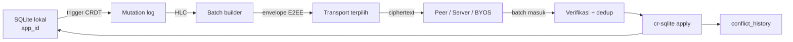
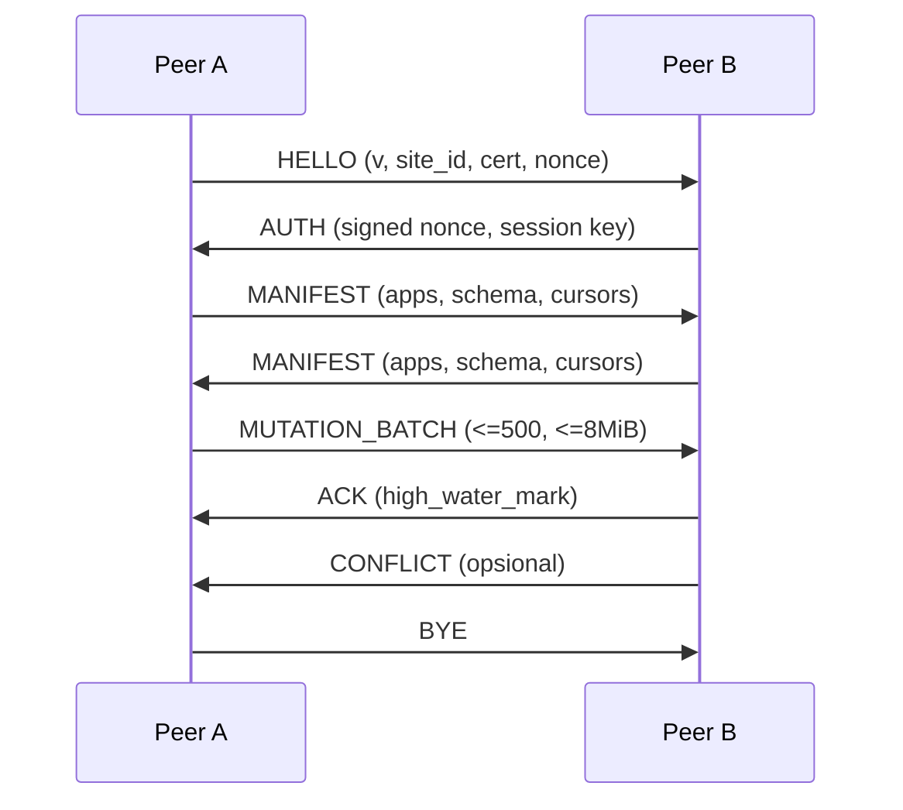
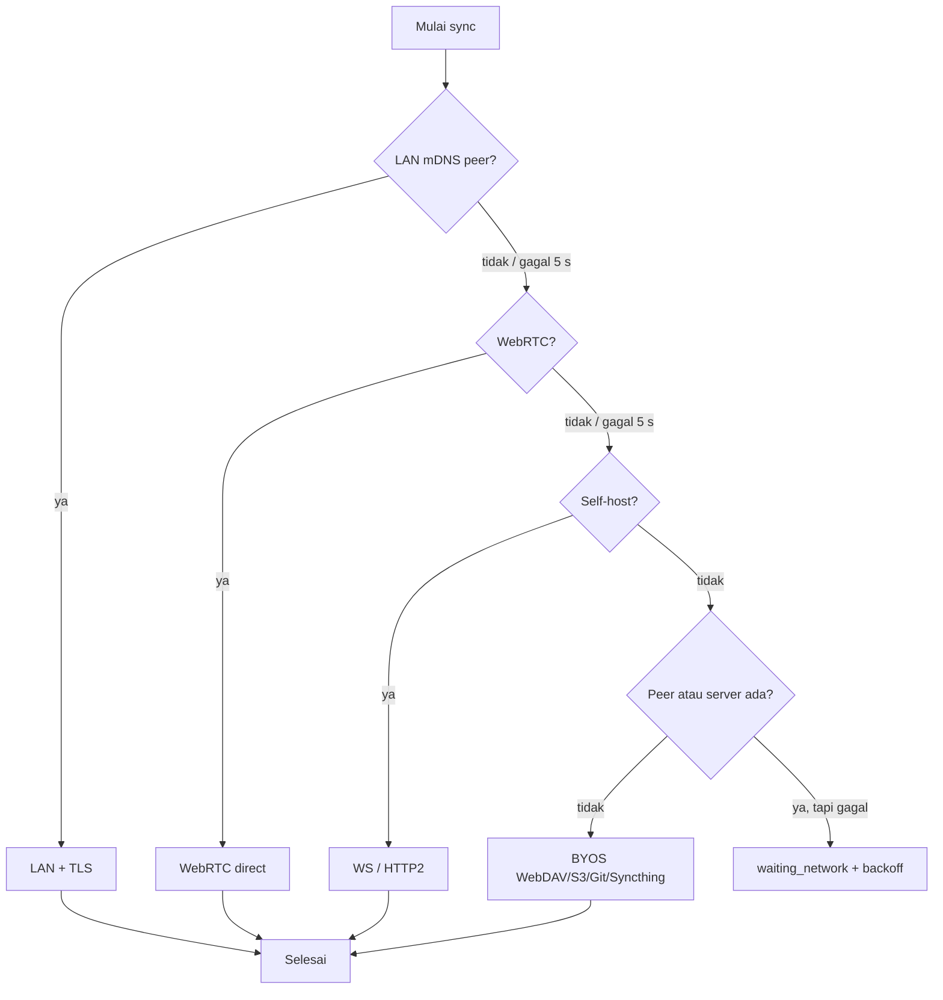

# Sinkronisasi CRDT

Dokumen ini menetapkan model replikasi, urutan transport, dan perilaku gagal sinkronisasi. Kontrak normatif ada di [03-specs/06-sync-backup.md](../03-specs/06-sync-backup.md); detail kriptografi ada di [identity-crypto.md](identity-crypto.md).

## 1. Prinsip

- **Local-first.** Setiap perangkat menulis ke SQLite lokal tanpa menunggu jaringan. Sinkronisasi adalah pertukaran mutasi, bukan operasi tulis terpusat.
- **E2EE penuh.** Payload dienkripsi di perangkat; server, BYOS, dan relay hanya melihat ciphertext serta metadata minimum.
- **Konvergen tanpa jam dinding.** Urutan ditentukan HLC, bukan waktu sistem yang bisa salah.
- **Dapat dilanjutkan.** Handshake dan batch selalu dapat di-resume setelah putus koneksi tanpa duplikasi.
- **Tidak ada kehilangan data diam-diam.** Nilai yang kalah disimpan di `conflict_history`, bukan dibuang.

## 2. Model Replikasi

### 2.1 HLC

| Field | Ukuran | Aturan |
|---|---|---|
| `physical_ms` | 48 bit | Milidetik Unix; wajib dimajukan ke `max(local, remote)` saat menerima |
| `counter` | 16 bit | Naik bila `physical_ms` sama atau jam mundur; overflow → tunggu 1 ms |
| `site_id` | 16 byte | Base32; dibuat sekali per instalasi dan tidak pernah berubah |

- HLC dihasilkan oleh `packages/core-rust`; TypeScript/Dart tidak mengimplementasikan ulang.
- Representasi biner HLC adalah **24 byte** (6 byte `physical_ms` + 2 byte `counter` + 16 byte `site_id`, big-endian), sama dengan kolom `crdt_change_log.hlc` di [data-model.md](data-model.md).
- Pembandingan leksikografis `(physical_ms, counter, site_id)` menentukan urutan total.
- Jam yang mundur lebih dari 5 menit memicu peringatan; HLC tetap monoton karena `counter` dan `physical_ms` maksimum.
- Timestamp aplikasi (`created_at`, `updated_at`) adalah integer milidetik UTC dan **bukan** dasar resolusi konflik.

### 2.2 Mutation log

Setiap baris `crdt_change_log` mencatat satu perubahan tingkat kolom:

| Kolom | Tipe | Keterangan |
|---|---|---|
| `mutation_id` | UUIDv7 | Unik global; dipakai idempotency |
| `app_id` | TEXT | Namespace aplikasi |
| `table_name` | TEXT | Tabel dalam DB app |
| `row_id` | TEXT/UUIDv7 | Primary key baris |
| `column_name` | TEXT | Kolom yang berubah |
| `value_json` | BLOB/TEXT | Nilai baru (sudah dienkripsi di envelope saat dikirim) |
| `hlc` | BLOB 24 byte | Urutan perubahan; 6 byte `physical_ms` + 2 byte `counter` + 16 byte `site_id`, big-endian |
| `site_id` | BLOB 16 byte | Asal perubahan |
| `schema_version` | INTEGER | Versi skema saat mutasi dibuat |
| `synced_at` | INTEGER NULL | Null selama belum di-ack |

- Mutasi ditulis dalam transaksi yang sama dengan perubahan data; tidak ada mutasi tanpa perubahan.
- Log dipangkas setelah semua peer dan server meng-ack sampai `high_water_mark`, dengan retensi minimum 30 hari.
- Delete direpresentasikan sebagai tombstone dengan `deleted = 1`; tombstone dipertahankan minimal 90 hari agar peer lama tidak menghidupkan kembali baris.

## 3. Resolusi Konflik

- **Column-level LWW.** Untuk setiap `(app_id, table, row, column)`, mutasi dengan HLC terbesar menang. Dua mutasi pada kolom berbeda tidak saling menimpa.
- Mutasi dengan HLC identik (kasus langka) dipecah berdasarkan `site_id` secara leksikografis agar semua node memilih pemenang yang sama.
- Nilai yang kalah disimpan sebagai baris `conflict_history`:

| Kolom | Isi |
|---|---|
| `conflict_id` | UUIDv7 |
| `app_id`, `table_name`, `row_id`, `column_name` | Lokasi konflik |
| `losing_value` | Nilai yang tidak dipakai |
| `losing_hlc`, `losing_site` | Metadata pihak yang kalah |
| `winning_hlc` | Pemenang |
| `detected_at` | Waktu deteksi |
| `resolution` | `lww` atau `manual` |
| `resolved_by` | `system` atau Site ID pengguna |

- Riwayat konflik dapat dilihat dan dipulihkan pengguna dari UI konflik; pemulihan menghasilkan mutasi baru.
- Konflik pada kolom kunci relasi diselesaikan LWW, tetapi baris anak yang menjadi yatim ditandai dan ditampilkan, bukan dihapus.

## 4. Handshake

Setiap sesi memakai header versi `v` (saat ini `1`) dan urutan pesan tetap:

| Langkah | Pengirim | Payload | Aturan |
|---|---|---|---|
| `HELLO` | Inisiator | `v`, `site_id`, `device_cert`, `supported_versions`, `nonce` | Versi major tidak dikenal → `BYE` dengan alasan |
| `AUTH` | Responden | `nonce` bertanda tangan, `session_key_id`, `proof` | Nonce sekali pakai; replay ditolak |
| `MANIFEST` | Kedua pihak | daftar `app_id`, `schema_version`, `high_water_mark` per app | Schema major tidak kompatibel → app ditandai staging |
| `MUTATION_BATCH` | Kedua pihak | batch terenkripsi + `batch_id` (UUIDv7) + `first_hlc`/`last_hlc` | Maksimum 500 mutasi atau 8 MiB |
| `ACK` | Penerima | `batch_id`, `high_water_mark` baru, `applied`/`skipped` | Idempoten terhadap `batch_id` duplikat |
| `CONFLICT` | Penerima | ringkasan konflik + referensi `conflict_id` | Tidak memblokir batch berikutnya |
| `BYE` | Kedua pihak | alasan, `retry_after` opsional | Menutup sesi dengan rapi |

Aturan:

- `batch_id` dan `mutation_id` bersifat idempotent: penerima yang sudah menerapkan batch mengembalikan `ACK` yang sama tanpa menerapkan ulang.
- Batch diproses atomik per transaksi SQLite; batch yang gagal validasi ditolak seluruhnya dan di-`ACK` dengan `skipped`.
- Setelah `ACK`, pengirim boleh memangkas log sampai `high_water_mark` yang di-ack semua lawan bicara.
- `MANIFEST` wajib dikirim ulang bila schema berubah di tengah sesi; perubahan skema tidak dikirim sebagai mutasi data.
- Sesi idle lebih dari 60 detik ditutup dengan `BYE`; reconnect memulai handshake baru.

## 5. Batching dan Resumability

- Batas batch: **500 mutation** atau **8 MiB ciphertext**, mana yang lebih dulu tercapai.
- Cursor disimpan per `(peer_id, app_id)` di `sync_cursors` dengan `last_acked_hlc` dan `last_batch_id`.
- Putus koneksi di tengah batch: batch tidak dianggap terkirim sampai `ACK`; pengiriman ulang memakai `batch_id` yang sama.
- Batch besar dipecah dengan tetap mempertahankan urutan HLC per `(table,row)` agar hasil akhir sama.
- Backpressure: bila antrean keluar melebihi 4 batch, pengiriman berhenti sampai `ACK` masuk; mutasi baru tetap tercatat lokal.

## 6. Pemilihan Transport

Urutan bersifat deterministik dan tidak boleh diubah implementasi:

| Prioritas | Transport | Syarat aktif | Gagal → |
|---|---|---|---|
| 1 | LAN mDNS + TLS | Peer ditemukan di jaringan lokal dan pairing valid | Lanjut ke 2 dalam 5 detik |
| 2 | WebRTC direct | Signaling tersedia dan NAT dapat ditembus | Lanjut ke 3 dalam 5 detik |
| 3 | Self-host WS/HTTP2 | Server dikonfigurasi dan dapat dijangkau | Lanjut ke 4 hanya bila tidak ada peer/server |
| 4 | BYOS WebDAV/S3/Git/Syncthing | Tidak ada peer maupun server yang tersedia | Berhenti, status `waiting_network` |

- Transport yang gagal MUST dicatat beserta alasannya; tidak ada perpindahan acak antar transport.
- LAN memakai mDNS untuk discovery dan TLS dengan sertifikat perangkat yang di-pin saat pairing; mDNS tanpa TLS ditolak.
- WebRTC memakai data channel terenkripsi DTLS; signaling tidak pernah memuat kunci konten.
- BYOS tidak dipakai selama masih ada peer atau server yang dapat dijangkau, karena semantik antreannya berbeda.
- Server sync menerima WebSocket dan HTTP/2 dengan envelope yang sama; tidak ada jalur tanpa enkripsi.

### 6.1 Reconnect

| Percobaan | Jeda dasar | Jitter | Jeda efektif |
|---|---|---|---|
| 1 | 1 detik | ±20% | 0,8–1,2 detik |
| 2 | 2 detik | ±20% | 1,6–2,4 detik |
| 3 | 5 detik | ±20% | 4–6 detik |
| 4 | 10 detik | ±20% | 8–12 detik |
| 5 | 30 detik | ±20% | 24–36 detik |
| 6+ | 60 detik | ±20% | 48–72 detik |

- Backoff di-reset setelah satu batch berhasil di-ack.
- Saat perangkat kembali online atau peer ditemukan, backoff dipercepat ke percobaan 1.
- Kegagalan autentikasi tidak di-retry otomatis; status menjadi `action_required` dan pengguna diberi tahu.

## 7. Envelope E2EE

- Setiap batch dibungkus envelope `version(1) | key_id(16) | nonce(12) | ciphertext | tag(16)` dengan AES-256-GCM.
- Kunci konten diturunkan dari hierarki identity (subkey `sync`) dan dirotasi sesuai [identity-crypto.md](identity-crypto.md).
- AAD memuat header kanonik: versi protokol, `app_id`, `batch_id`, `site_id` pengirim, dan penghitung batch. AAD yang tidak cocok menggagalkan dekripsi.
- Nonce MUST unik per kunci; pengulangan nonce adalah kegagalan fatal dan memicu rotasi kunci.
- Server dan BYOS hanya menyimpan ciphertext, `batch_id`, ukuran, dan waktu terima. Nama tabel, nama kolom, dan nilai tidak terlihat.
- Metadata yang tetap terlihat (ukuran, waktu, `site_id` pseudonim) dinyatakan di [threat-model.md](threat-model.md).

## 8. Schema Staging

- Setiap app memiliki `schema_version`; `MANIFEST` membandingkan versi antar peer.
- Migrasi kecil dan kompatibel diterapkan sebelum batch; migrasi yang memerlukan perubahan tipe dijalankan sebagai langkah staging.
- Baris `crdt_schema_staging` menyimpan mutasi untuk skema yang belum dipahami node penerima; mutasi tidak diterapkan ke tabel aktif.
- Setelah paket versi yang sesuai dipasang, staging direkonsiliasi dan baris staging dihapus.
- Schema major yang tidak didukung MUST NOT diterapkan sebagian; app ditandai `schema_pending` dan sinkronisasi app tersebut dijeda.

## 9. Pairing dan Kepercayaan Perangkat

- Pairing dimulai dari salah satu perangkat yang menampilkan QR berisi `site_id`, kunci publik perangkat, dan nonce berumur pendek (maksimum 120 detik).
- Perangkat kedua memindai, menampilkan **SAS 6 digit** yang harus sama di kedua layar, lalu menandatangani nonce dengan kunci perangkatnya.
- Kepercayaan bersifat TOFU: kunci perangkat pertama yang dipasangkan di-pin. Perubahan kunci untuk `site_id` yang sama memicu peringatan keras dan memblokir sync sampai pengguna menerima ulang.
- Device certificate ditandatangani identity key; sertifikat yang kedaluwarsa atau dicabut ditolak pada `AUTH`.
- Pairing tidak memerlukan server; pada mode self-host, server hanya meneruskan ciphertext.

## 10. Pencabutan Perangkat

- Pencabutan menghasilkan record bertanda tangan yang mencatat `site_id`, `device_key_id`, alasan, dan waktu.
- Record disebarkan ke peer dan server pada sesi berikutnya; penerima menolak `AUTH` dari perangkat tercabut.
- Kunci konten yang dibagikan ke perangkat tercabut dianggap terkompromi untuk ke depan: rotasi subkey `sync` dijalankan dan batch baru memakai `key_id` baru.
- Perangkat tercabut MUST NOT dapat membaca batch baru; batch lama yang sudah tersimpan di perangkat tersebut tidak dapat ditarik kembali, dan fakta ini disampaikan saat konfirmasi pencabutan.
- Pencabutan perangkat jarak jauh dicatat di audit dan tidak menghapus data lokal perangkat tersebut.

## 11. UI Konflik

- Konflik yang terdeteksi muncul di pusat konflik dan sebagai badge pada record terkait.
- Tampilan membandingkan nilai menang dan nilai kalah per kolom, dengan opsi **Pertahankan**, **Ganti**, atau **Gabungkan** bila tipe mendukung.
- Pemilihan pengguna menulis mutasi baru dengan HLC baru dan menandai `resolution = manual`.
- Konflik yang tidak ditangani tetap tersimpan; tidak ada auto-resolve yang menghapus riwayat.
- Konflik pada dokumen Studio (Yjs) ditampilkan sebagai perbedaan blok, bukan per kolom.

## 12. Mesin CRDT

| Domain | Mesin | Alasan |
|---|---|---|
| Data micro-app | `cr-sqlite` | Replikasi tabel SQLite native, column-level, dapat diaudit lewat SQL |
| Dokumen Studio/multiplayer | Yjs | Struktur dokumen kaya, presence, undo terdistribusi |
| Antrean workflow | Outbox transaksional | Bukan CRDT; urutan dan idempotency eksplisit |

- `cr-sqlite` dijalankan di DB worker yang sama dengan SQLite; tidak ada replika kedua.
- Yjs hanya untuk dokumen Studio; data micro-app MUST NOT disimpan sebagai dokumen Yjs.
- Server tidak menjalankan CRDT untuk data pengguna; server hanya menyimpan ciphertext.
- Konvergensi diuji dengan properti komutatif, asosiatif, dan idempoten pada urutan batch acak.

## 13. Kegagalan dan Pemulihan

| Kegagalan | Perilaku | Pemulihan |
|---|---|---|
| Jaringan putus | Status `waiting_network`; data lokal tetap dapat ditulis | Backoff lalu resume dari cursor |
| Batch korup / tag gagal | Batch ditolak, tidak diterapkan | Minta ulang; bila berulang, tandai peer |
| Nonce berulang | Sesi dihentikan, kunci dirotasi | Pairing ulang |
| Schema tidak kompatibel | App dijeda, staging | Pasang versi paket yang sesuai |
| Kunci perangkat berubah | Sync diblokir | Verifikasi ulang SAS |
| Server menolak `AUTH` | Status `action_required` | Periksa pencabutan/rotasi kunci |
| Cursor hilang | Kirim ulang dari `high_water_mark` terakhir yang diketahui | Idempotency mencegah duplikasi |
| Disk penuh saat apply | Batch di-ack `skipped`, tidak diterapkan | Bebaskan ruang, minta ulang batch |

## 14. Referensi

- [system-overview.md](system-overview.md), [data-model.md](data-model.md), [identity-crypto.md](identity-crypto.md), [threat-model.md](threat-model.md)
- [adr/0004-crdt-strategy.md](adr/0004-crdt-strategy.md), [adr/0002-sqlite-wasm-opfs.md](adr/0002-sqlite-wasm-opfs.md)
- [03-specs/06-sync-backup.md](../03-specs/06-sync-backup.md), [03-specs/permissions.md](../03-specs/permissions.md)
- [04-flows/06-p2p-sync.md](../04-flows/06-p2p-sync.md), [04-flows/07-backup-recovery.md](../04-flows/07-backup-recovery.md)
- [selfhost.md](selfhost.md)
