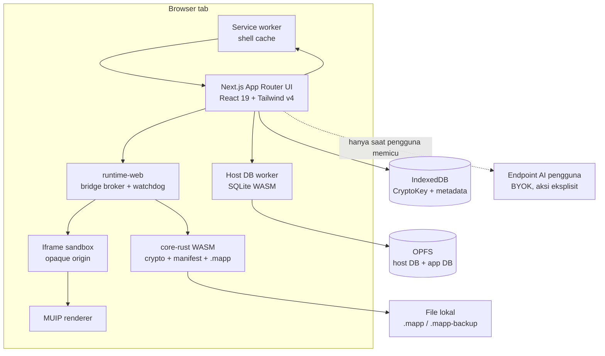

# System Overview

## 1. Tujuan

Dokumen ini memetakan arsitektur MicroApp Studio sebagai satu aplikasi web: PWA Next.js yang berjalan di browser desktop, tablet, dan mobile. Tidak ada aplikasi native, server wajib, akun, atau sinkronisasi. Semua data produk disimpan di perangkat pengguna.

Peta ini menjadi titik masuk sebelum membaca spec modul. Kontrak rinci ada di [03-specs/01-app-shell.md](../03-specs/01-app-shell.md), [03-specs/03-sandbox-runtime.md](../03-specs/03-sandbox-runtime.md), dan [03-specs/04-data.md](../03-specs/04-data.md). Keputusan yang mengikat dicatat di [ADR-0017](adr/0017-web-only-nextjs-pwa.md) dan [ADR-0018](adr/0018-browser-local-first-data.md).

## 2. Prinsip Arsitektur

1. **Satu origin, satu aplikasi.** Shell, Studio, runner, Packages, dan Settings berada dalam satu Next.js App Router. Tidak ada aplikasi pendamping.
2. **Client-first.** Tidak ada backend wajib. Deployment dapat berupa Node host atau static export selama seluruh fitur berjalan di browser.
3. **Local-first.** Host DB dan data app berada di OPFS. Tidak ada unggahan otomatis dan tidak ada cloud sync.
4. **Zero privilege.** Micro-app dimulai tanpa izin; akses hanya lewat bridge setelah consent.
5. **Fail closed.** Bila sandbox, WebCrypto, atau OPFS tidak tersedia, fitur yang bergantung padanya berhenti dengan pesan jelas, bukan memakai jalur alternatif yang lebih longgar.
6. **WASM untuk kriptografi dan format.** `packages/core-rust` dikompilasi ke WebAssembly untuk signature, derivasi kunci, verifikasi manifest, dan format `.mapp`. Tidak ada binding native.

## 3. Konteks Browser

Tidak ada kotak server, container, atau peer jaringan. Hosting hanya menyajikan aset statis dan, bila dipilih, route server Next.js untuk rendering awal; keduanya tidak menyimpan data pengguna.

## 4. Komponen

| Komponen | Lokasi | Tanggung jawab | Batas |
|---|---|---|---|
| Shell | `apps/studio-web/src/app` | Route, layout, navigasi, i18n, error surface | Tidak menyentuh data app secara langsung |
| Host provider | `apps/studio-web/src/features/host` | Boot, workspace aktif, koneksi DB, audit, install | Satu-satunya pemilik state host |
| Host DB worker | `apps/studio-web/src/db/worker` | SQLite WASM, migrasi, query, FTS5 | Tidak ada akses SQLite dari main thread |
| Identity worker | `apps/studio-web/src/features/identity` | Pembuatan kunci, derivasi, vault, recovery | Kunci privat tidak keluar dari worker |
| Runtime | `packages/runtime-web` | Sandbox, MUIP, broker, watchdog, loader `.mapp` | Tidak mempercayai kode app |
| Core | `packages/core-rust` | Kriptografi, signature, manifest, ZIP deterministik | Hanya dipanggil lewat WASM |
| UI kit | `packages/ui-kit` | Token clay dan komponen MADS | Tidak memuat logika produk |
| Service worker | `apps/studio-web/public/sw.js` | Cache shell dan aset statis | Tidak menyimpan respons API pengguna |

## 5. Route

Route yang ada saat ini:

| Route | Isi |
|---|---|
| `/` | Home/Library, pencarian, empty state, entry install |
| `/app/[appId]` | Runner app terpasang di sandbox |
| `/studio` | Daftar draft project |
| `/studio/[projectId]` | Detail draft dan, pada target, visual builder |
| `/registry` | Sumber paket yang dikonfigurasi pengguna |
| `/settings/{permissions,storage,vault,sync,backup,notifications}` | Settings lama |
| `/dev/tools` | Diagnostik lokal |
| `/admin` | Status internal dan feature flag lokal |

Route target menambahkan `/templates`, `/create`, `/packages`, `/packages/import`, dan mengganti Settings lama dengan `/settings/{general,ai,about,dev,data}`. Route Settings lama tetap dialihkan agar tautan yang sudah beredar tidak rusak. Peta layar lengkap ada di [02-design/information-architecture.md](../02-design/information-architecture.md).

## 6. Alur Boot dan Eksekusi

Boot shell:

1. Service worker menyajikan dokumen shell dari cache.
2. Host DB worker membuka SQLite WASM di OPFS. Bila OPFS tidak tersedia, worker memakai memori dan melaporkan `storage: 'memory'`.
3. Identity worker memuat `local_identity`. Bila kosong, identitas lokal dibuat otomatis tanpa modal.
4. Shell merender Home dari data lokal.
5. Bila langkah 2 atau 3 gagal, Home tetap tampil dalam mode `ephemeral` dengan badge dan aksi ekspor.

Eksekusi micro-app:

1. Runner memuat manifest terverifikasi dan menulis bundle ke iframe dengan `sandbox="allow-scripts"`.
2. Iframe memakai origin opaque dan CSP ketat; renderer MUIP membangun DOM dari node tervalidasi.
3. Setiap panggilan ke host melewati broker: validasi amplop, method, permission, rate limit, lalu audit.
4. Watchdog memantau heartbeat. Freeze 5 detik memicu penghentian dan error boundary.
5. App lain dan shell tidak terkena kegagalan satu app.

## 7. Batas Kepercayaan

| Batas | Sisi dipercaya | Sisi tidak dipercaya | Kontrol |
|---|---|---|---|
| Shell ↔ micro-app | Shell dan broker | Bundle app, dokumen MUIP | Iframe opaque origin, CSP, bridge allowlist |
| Shell ↔ package | Host | File `.mapp` dari mana pun | Manifest, signature, digest, preview permission |
| Shell ↔ endpoint AI | Pengguna | Endpoint BYOK dan output model | Aksi eksplisit, kunci di vault, validasi output |
| Shell ↔ penyimpanan | Worker DB | Isi record app | Isolasi per app, query ber-scope workspace |
| Browser ↔ hosting | Browser | Aset yang disajikan hosting | HTTPS, CSP, integritas deployment, tanpa secret di bundle |

## 8. Deployment

| Mode | Kapan | Konsekuensi |
|---|---|---|
| Node host (Vercel atau setara) | Default; route server untuk rendering awal | Tidak menyimpan data pengguna; header keamanan wajib |
| Static export | Bila seluruh fitur client-side tersedia | Tidak ada route server; PWA cache menjadi jalur utama |

Keduanya menyajikan origin yang sama untuk shell dan app. Cross-origin isolation (`COOP: same-origin`, `COEP: require-corp`) diperlukan agar VFS OPFS SQLite dapat memakai `SharedArrayBuffer`. Header ini bukan pengganti CSP sandbox; iframe app tetap memakai origin opaque dan kebijakan sendiri.

## 9. Yang Tidak Ada

Tidak ada server aplikasi, database jaringan, akun, cloud sync, CRDT, P2P, workflow engine, CLI, SDK, marketplace, publish pipeline, atau bundel desktop. Ketiadaan ini bukan utang teknis, melainkan batas produk. Permintaan yang membutuhkan salah satunya harus melalui ADR baru dan tidak boleh menyelundup ke dokumen aktif.

## 10. Status Implementasi

Kode saat ini sudah memiliki shell PWA, host DB worker dengan migrasi 001/002 dan FTS5, identitas lokal, iframe sandbox, broker, watchdog, loader `.mapp`, backup terenkripsi, dan draft project. Visual builder, template gallery, Magic Create, tema clay penuh, dan pembukaan DB per app di runner belum ada. Rincian bukti dan daftar klaim yang dilarang ada di [00-foundation/implementation-status.md](../00-foundation/implementation-status.md).

## 11. Dokumen Terkait

- [monorepo.md](monorepo.md) untuk batas paket dan perintah.
- [data-model.md](data-model.md) untuk tabel host dan aturan migrasi.
- [identity-crypto.md](identity-crypto.md) untuk kunci dan penyimpanan rahasia.
- [sandbox-runtime.md](sandbox-runtime.md) untuk isolasi dan watchdog.
- [package-distribution.md](package-distribution.md) untuk `.mapp`.
- [host-bridge-intents.md](host-bridge-intents.md) untuk bridge dan intent.
- [threat-model.md](threat-model.md) untuk ancaman dan mitigasi.
- [ai-assist.md](ai-assist.md) untuk BYOK.
