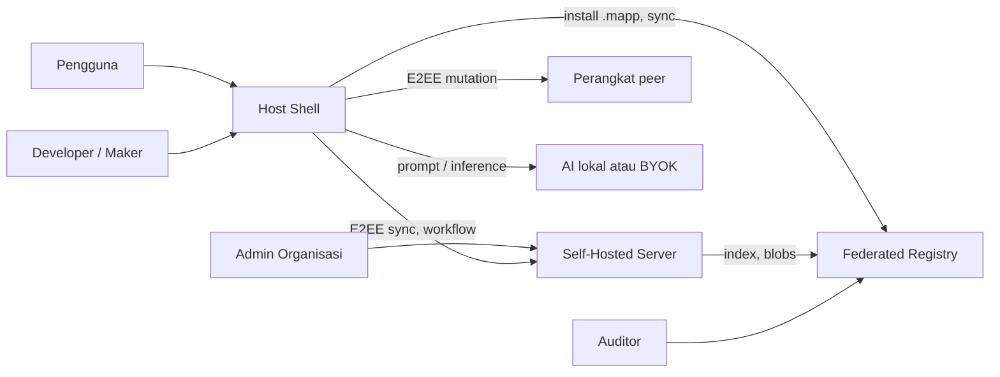
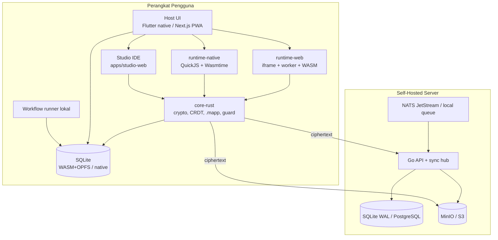
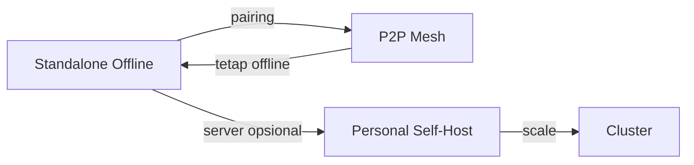

# Ringkasan Sistem

MicroApp Studio adalah satu ekosistem dengan empat mode operasi yang berbagi kontrak yang sama. Dokumen ini memberi peta arsitektur; keputusan rinci ada pada ADR dan spec.

## 1. Konteks (C4 Level 1)

Aktor eksternal yang tidak dipercaya: micro-app pihak ketiga, registry yang dikompromikan, perangkat peer di jaringan yang sama, operator server (untuk data E2EE), dan penyedia AI BYOK (hanya menerima prompt yang dikirim pengguna secara eksplisit).

## 2. Container (C4 Level 2)

Aturan yang mengikat:

- **Hanya `packages/core-rust`** yang mengimplementasikan crypto, verifikasi signature, parser `.mapp`, CRDT/HLC, dan sandbox guard. Tidak ada duplikasi di TypeScript atau Dart.
- **Hanya `apps/studio-web`** yang memuat UI Studio. Desktop Flutter memuat build Studio lokal yang dibundel; mobile tidak memuat Studio.
- Server **tidak pernah** mendekripsi payload sinkronisasi.

## 3. Mode Runtime

| Mode | Komponen aktif | Jaringan | Sumber kebenaran |
|---|---|---|---|
| Standalone Offline | Host, Studio, sandbox, SQLite lokal, workflow lokal | Tidak ada | SQLite lokal |
| P2P Mesh | Standalone + sync peer + BYOS | LAN/WebRTC/BYOS | CRDT antar peer |
| Personal Self-Host | Standalone + server Lite/Standard + auth | HTTPS ke server sendiri | CRDT + server sebagai relay ciphertext |
| Cluster | + HA Postgres, NATS, S3, OTel, SSO | HTTPS | CRDT + server cluster |

Perpindahan mode tidak mengubah format data. Semua mode memakai skema lokal, manifest, MUIP, dan envelope yang sama.

## 4. Process Model

| Proses | Tanggung jawab | Isolasi | Gagal berarti |
|---|---|---|---|
| UI thread | Render Host/Studio, input, routing | Tidak ada akses ke isolate micro-app | UI error boundary; micro-app tetap aman |
| DB worker | SQLite WASM, query, migrasi, FTS/vector index | Worker terpisah; pesan terstruktur | Query gagal; Host menampilkan `E-DATA-*` |
| Sync worker | Handshake, batch mutation, retry, cursor | Worker terpisah, hanya ciphertext | Sync berhenti; data lokal tetap utuh |
| Sandbox isolate | Eksekusi bundle micro-app dan MUIP | Opaque origin + worker/QuickJS/Wasmtime | `E-SBX-*`; isolate dibunuh, Host hidup |
| Workflow runner | Eksekusi graph, outbox, retry | Worker; akses hanya lewat bridge | Run `failed`; outbox tetap persisten |
| Native bridge | FFI ke Rust/QuickJS/SQLite | Proses host Flutter | Fail closed; micro-app tidak dijalankan |

Batas proses ini yang menjamin prinsip zero-crash: kegagalan pada satu baris tidak boleh menjatuhkan baris lain.

## 5. Trust Boundary

| Boundary | Dipercaya | Tidak dipercaya | Kontrol |
|---|---|---|---|
| Host ↔ micro-app | Host | Semua kode micro-app | Sandbox opaque origin, capability broker, MUIP tanpa HTML/JS mentah |
| Micro-app ↔ data | Hanya DB milik `app_id` | Akses lintas app | Isolasi database per `app_id`, query scope |
| Client ↔ server | Kunci di perangkat | Server dan operatornya | E2EE, server hanya ciphertext |
| Client ↔ registry | Kunci registry/authors yang di-pin | Registry host | Verifikasi Ed25519, TOFU, reproducible build |
| Client ↔ AI provider | Provider yang dipilih eksplisit | Prompt injection dari konten | Tidak ada silent switch, redaksi rahasia, consent per provider |
| Admin ↔ server | Admin terautentikasi | Jaringan internal | RBAC/ABAC, audit chain, SSRF guard |

## 6. Port dan Protokol

| Kanal | Protokol | Port default | Catatan |
|---|---|---|---|
| Host web | HTTPS | 443 | PWA; CSP ketat |
| Server HTTP | HTTP | 8080 | Redirect ke HTTPS bila TLS aktif |
| Server HTTPS | HTTPS | 8443 | Auto-HTTPS pada Lite |
| Sync server | WebSocket/HTTP2 | 8443 | Envelope E2EE, batch 500 |
| PostgreSQL | PostgreSQL wire | 5432 | Standard/Cluster |
| Valkey/Redis | RESP | 6379 | Standard/Cluster |
| MinIO/S3 | S3 API | 9000 (API), 9001 (console) | Standard/Cluster |
| NATS | NATS | 4222 | Cluster |
| OTLP HTTP | HTTP | 4318 | Observability opt-in |
| LAN sync | mDNS + TLS | ephemeral | Pairing wajib |
| WebRTC | DTLS/SRTP data channel | ephemeral | Signaling minimal |
| Dev server | HTTP | 5173 | `microapp dev` |
| Hot reload | WebSocket lokal | ephemeral | QR pairing |

## 7. Perilaku Offline

| Operasi | Offline | Bukti |
|---|---|---|
| Buka micro-app | Ya, dari cache/DB lokal | Cold start < 150 ms |
| Baca/tulis data | Ya | SQLite lokal |
| Pencarian | Ya, FTS5; vector opsional | Index lokal |
| Install dari registry | Hanya dari cache index dan `.mapp` lokal | Cache 24 jam, tanpa kedaluwarsa |
| Workflow dengan HTTP | Antre di outbox `waiting_network` | Retry backoff |
| AI lokal | Ya bila model tersedia | WebLLM/Ollama |
| AI BYOK | Tidak | Status tidak tersedia, tanpa fallback diam |
| Sync | Ditunda, lalu dikirim saat koneksi kembali | Mutation log persisten |

Tidak ada operasi inti yang bergantung pada jaringan. Bila sebuah fitur tidak dapat berjalan offline, UI wajib menyatakannya sebelum aksi.

## 8. Failure Domain

| Kegagalan | Dampak maksimum | Pemulihan |
|---|---|---|
| Isolate micro-app crash/freeze | Satu micro-app | Error boundary, restart, rollback, export |
| DB worker crash | Sesi baca/tulis sementara | Restart worker, WAL recovery |
| Disk penuh | Tulis baru gagal | Pembersihan cache saja; DB tidak dihapus |
| Server mati | Sync tertunda | Outbox dan cursor; lanjut saat hidup |
| Registry mati | Install baru gagal | Cache index dan `.mapp` lokal |
| AI provider mati | Fitur AI gagal | Status eksplisit; tanpa pindah provider otomatis |
| Kunci hilang | Data E2EE tidak terbaca | Recovery Phrase/passkey |

## 9. Alur yang Diukur

Cold start dan warm switch adalah alur yang diinstrumentasi, bukan klaim:

1. **Cold start** — dari tap ikon sampai frame pertama micro-app. Target < 150 ms; diukur pada perangkat referensi di [08-quality/performance-budgets.md](../08-quality/performance-budgets.md).
2. **Warm switch** — dari app switcher sampai micro-app terlihat, termasuk restore state. Target < 50 ms.
3. **First render Host** — dari launch sampai frame Home pertama. Target < 500 ms.

Setiap regresi > 10% dari baseline wajib diselidiki sebelum release; lihat gate di [08-quality/release-gates.md](../08-quality/release-gates.md).

## 10. Referensi

- [monorepo.md](monorepo.md), [data-model.md](data-model.md), [identity-crypto.md](identity-crypto.md)
- [sandbox-capabilities.md](sandbox-capabilities.md), [sync-crdt.md](sync-crdt.md), [threat-model.md](threat-model.md)
- [03-specs/01-host-shell.md](../03-specs/01-host-shell.md), [03-specs/03-sandbox-runtime.md](../03-specs/03-sandbox-runtime.md)
