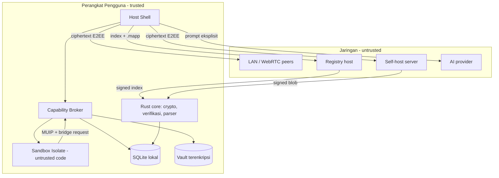

# Threat Model

Dokumen ini menetapkan model ancaman normatif untuk seluruh ekosistem MicroApp Studio. Setiap kontrol yang disebut di sini wajib tercermin pada spec terkait; setiap baris risiko wajib memiliki suite pengujian di [security test plan](../08-quality/security-test-plan.md).

## 1. Ruang Lingkup dan Metode

Model ancaman mencakup Host Shell web dan native, sandbox runtime, host bridge, penyimpanan lokal, sinkronisasi E2EE, registry, self-host server, pipeline AI/workflow, serta pipeline rilis dan publish. Metode yang dipakai:

1. Inventaris aset dan aktor.
2. Pemetaan trust boundary dan aliran data lintas boundary.
3. Analisis STRIDE per komponen.
4. Register risiko dengan mitigasi, residual risk, dan bukti uji.
5. Peninjauan ulang setiap perubahan kontrak (manifest, bridge, sync, permission, crypto, registry) dan setiap release.

Ancaman di luar cakupan: physical access tanpa kunci perangkat, side-channel hardware, dan kompromi compiler tingkat lanjut. Keduanya dicatat sebagai residual risk yang tidak dimitigasi oleh perangkat lunak.

## 2. Aset

| Aset | Lokasi | Dampak bila kompromi | Klasifikasi |
|---|---|---|---|
| Seed identitas dan subkey | Keychain/Keystore/WebCrypto non-extractable | Pemalsuan identitas, dekripsi data E2EE | Kritis |
| Recovery Phrase 24 kata | Hanya ditampilkan saat setup, tidak disimpan | Kehilangan total akses data bila bocor | Kritis |
| Data micro-app | SQLite lokal per `app_id` | Kebocoran data pribadi/organisasi | Tinggi |
| Vault item dan kredensial BYOK | Tabel `vault_items`, envelope AES-256-GCM | Akses tidak sah ke layanan pihak ketiga | Kritis |
| Manifest dan signature `.mapp` | Registry, cache lokal, file impor | Eksekusi kode jahat | Tinggi |
| Mutation log dan cursor sync | SQLite lokal, transport E2EE | Kebocoran metadata aktivitas | Sedang |
| Audit log chain | Server dan perangkat | Hilangnya bukti forensik | Tinggi |
| Konfigurasi server dan kunci TLS | `microapp.yaml`, volume server | Pengambilalihan server | Kritis |
| Kunci signing registry/author | Offline signing environment | Distribusi malware bersignature sah | Kritis |
| Model AI dan prompt | Penyimpanan lokal, provider BYOK | Kebocoran data ke pihak ketiga | Tinggi |

Aturan umum: aset kritis tidak pernah keluar dari perangkat dalam bentuk plaintext. Server hanya menerima ciphertext untuk data pengguna.

## 3. Aktor dan Kemampuan

| Aktor | Kemampuan | Kepercayaan | Tujuan |
|---|---|---|---|
| Pengguna sah | Akses perangkat, kunci, dan UI | Dipercaya | Menggunakan dan membangun micro-app |
| Micro-app pihak ketiga | Menjalankan kode di dalam sandbox | Tidak dipercaya | Bisa jadi jahat atau rentan |
| Author jahat/terkompromi | Menerbitkan `.mapp` bersignature | Tidak dipercaya | Menyisipkan malware atau mencuri data |
| Registry terkompromi | Mengubah index dan blob | Tidak dipercaya | Menyajikan paket palsu |
| Penyerang LAN | Sniffing, ARP spoofing, evil twin AP | Tidak dipercaya | Menyadap atau menyamar sebagai peer/server |
| Penyerang server | Akses ke host/DB server | Tidak dipercaya untuk plaintext | Mencuri metadata, melakukan DoS |
| Insider operator | Akses administratif terbatas | Dipercaya secara operasional, tidak untuk plaintext | Penyalahgunaan wewenang |
| Penyedia AI BYOK | Menerima prompt yang dikirim eksplisit | Tidak dipercaya | Retensi atau penyalahgunaan prompt |
| Plugin/driver pihak ketiga | Kode di sisi server atau host | Tidak dipercaya | Supply chain compromise |

## 4. Trust Boundary

Aturan boundary:

- Kode micro-app **MUST** berada di sisi tidak dipercaya dan hanya berkomunikasi via bridge terstruktur.
- Data yang melintasi jaringan **MUST** berupa ciphertext atau artefak bersignature; tidak ada plaintext data pengguna.
- Verifikasi signature **MUST** terjadi di `core-rust` sebelum parsing lebih lanjut.
- Server dan registry **MUST NOT** dianggap sebagai otoritas kebenaran data pengguna.

## 5. STRIDE per Komponen

### 5.1 Host Shell dan UI

| Kategori | Ancaman | Kontrol |
|---|---|---|
| Spoofing | UI palsu menyerupai dialog permission | Dialog dirender Host, bukan micro-app; origin dan label app selalu terlihat |
| Tampering | Manipulasi state UI via devtools | State otoritatif di DB/broker; UI hanya proyeksi |
| Repudiation | Aksi destruktif tanpa jejak | Audit lokal dan toast undo 10 detik |
| Information disclosure | Data app A terlihat di app B | Isolasi workspace dan renderer per app |
| Denial of service | Render loop atau payload besar | Batas MUIP 10.000 node/1 MiB, watchdog |
| Elevation of privilege | Shortcut menembus broker | Tidak ada API host langsung dari renderer |

### 5.2 Sandbox Runtime

| Kategori | Ancaman | Kontrol |
|---|---|---|
| Spoofing | Micro-app mengaku sebagai app lain | `app_id` dan capability diikat saat mount, bukan dari klaim runtime |
| Tampering | Escape dari iframe/isolate | Opaque origin, tanpa `allow-same-origin`, CSP `default-src 'none'`, QuickJS/Wasmtime tanpa ambient |
| Repudiation | Aktivitas sensitif tanpa bukti | Audit event bridge dan lifecycle |
| Information disclosure | Membaca DOM induk atau storage host | Tidak ada akses DOM induk; storage hanya via bridge |
| Denial of service | Infinite loop atau alokasi memori besar | Watchdog 5 detik, kuota 128 MB mobile/512 MB desktop |
| Elevation of privilege | Memanggil capability tanpa grant | Broker zero-privilege memeriksa manifest dan grant |

### 5.3 Host Bridge dan MUIP

| Kategori | Ancaman | Kontrol |
|---|---|---|
| Spoofing | Request atas nama app lain | Envelope membawa `app_id` dari sesi isolate, bukan dari payload |
| Tampering | Method confusion atau parameter tambahan | Skema method tertutup, `additionalProperties: false` |
| Repudiation | Request tanpa korelasi | `id` request unik, audit log |
| Information disclosure | Streaming data lintas app | Scope per `app_id`, validasi permission |
| Denial of service | Flood request | Rate limit per app dan timeout 10 detik |
| Elevation of privilege | Raw HTML/JS di MUIP | Tipe node whitelist, tanpa HTML/JS mentah |

### 5.4 Data dan Vault Lokal

| Kategori | Ancaman | Kontrol |
|---|---|---|
| Spoofing | Akses DB memakai identitas app lain | Nama database diturunkan dari `app_id` |
| Tampering | Modifikasi file DB langsung | SQLCipher native; web field-level encryption + integritas GCM |
| Repudiation | Perubahan tanpa audit | Audit event untuk operasi sensitif |
| Information disclosure | Backup atau file DB dicuri | Enkripsi, passphrase, auto-lock vault 5 menit |
| Denial of service | DB korup | WAL, snapshot sebelum migrasi, export |
| Elevation of privilege | Query lintas database | Koneksi terpisah per app, tanpa `ATTACH` dari sandbox |

### 5.5 Sync dan Jaringan

| Kategori | Ancaman | Kontrol |
|---|---|---|
| Spoofing | Peer palsu atau evil twin | Pairing QR + SAS 6 digit, TLS pinning per device |
| Tampering | Mutation diubah di transit | AES-256-GCM envelope dengan AAD |
| Repudiation | Batch tanpa pengirim | Signature device certificate |
| Information disclosure | Metadata aktivitas | Minimisasi metadata; server hanya ciphertext |
| Denial of service | Reconnect storm | Backoff 1/2/5/10/30/60 detik + jitter 20% |
| Elevation of privilege | Device yang dicabut tetap sync | Revocation dan penolakan cursor lama |

### 5.6 Registry dan Supply Chain

| Kategori | Ancaman | Kontrol |
|---|---|---|
| Spoofing | Registry atau author palsu | Kunci registry dan author terpisah, TOFU per author |
| Tampering | Paket diganti setelah publish | Detached Ed25519 signature, `contentHash`, reproducible build |
| Repudiation | Author menyangkal rilis | Log publish dan signature yang dapat diverifikasi |
| Information disclosure | Index membocorkan data internal | Index statis publik tanpa data pengguna |
| Denial of service | Index/blob tidak tersedia | Cache 24 jam, pakai offline tanpa kedaluwarsa |
| Elevation of privilege | Auto-update membawa permission baru | Consent ulang untuk permission baru, pin opsional |

### 5.7 Self-Host Server

| Kategori | Ancaman | Kontrol |
|---|---|---|
| Spoofing | Sesi atau token palsu | OIDC/OAuth2/SAML/LDAP, passkey, magic link; access token 15 menit |
| Tampering | Perubahan konfigurasi tanpa izin | RBAC/ABAC, audit hash chain |
| Repudiation | Admin menyangkal aksi | Audit append-only dengan hash chain |
| Information disclosure | Operator membaca data pengguna | E2EE; server tidak memiliki kunci |
| Denial of service | Banjir request | Rate limit, graceful shutdown, resource budget |
| Elevation of privilege | Eskalasi role | Pemisahan role, least privilege, revoke per device |

### 5.8 AI dan Workflow

| Kategori | Ancaman | Kontrol |
|---|---|---|
| Spoofing | Provider AI palsu di endpoint lokal | Konfigurasi eksplisit pengguna, TLS, verifikasi endpoint |
| Tampering | Prompt injection mengubah rencana | Validasi skema, preview sandbox, consent |
| Repudiation | Eksekusi workflow tanpa jejak | `workflow_runs` dan audit |
| Information disclosure | Kunci BYOK bocor ke log | Kunci hanya di vault, redaksi log |
| Denial of service | Retry tak terbatas | Maksimal 8 attempt, cap 1 jam |
| Elevation of privilege | Workflow menjalankan kode di luar sandbox | Runner hanya memanggil connector/bridge; tidak ada eval |

## 6. Register Risiko

Setiap baris wajib diverifikasi oleh suite di [security test plan](../08-quality/security-test-plan.md). Kolom Test menyebut nama suite, bukan anchor.

| # | Ancaman | Dampak | Mitigasi | Residual risk | Test |
|---|---|---|---|---|---|
| R-01 | Micro-app jahat mencoba escape sandbox dan membaca data host | Pencurian data seluruh perangkat | Opaque origin, QuickJS/Wasmtime isolate, broker zero-privilege, tanpa ambient API, CSP ketat | Celah 0-day pada engine sandbox | [security test plan](../08-quality/security-test-plan.md) — sandbox escape |
| R-02 | Registry hijacking: index atau blob diganti penyerang | Instalasi malware | Signature registry dan author terpisah, TOFU, verifikasi setiap load, reproducible build | Kunci author dicuri sebelum TOFU terbentuk | [security test plan](../08-quality/security-test-plan.md) — registry signature |
| R-03 | Kompromi server self-host | Kebocoran metadata, DoS, perubahan index internal | E2EE ciphertext-only, RBAC, audit chain, rotasi kunci, least privilege | Metadata timing dan ukuran tetap terlihat | [security test plan](../08-quality/security-test-plan.md) — server compromise |
| R-04 | Evil twin/LAN attacker menyamar sebagai peer atau server | Penyadapan, injeksi mutation | Pairing QR + SAS, TLS, pinning device, handshake versi, tolak peer tak dikenal | Penyerang dengan akses fisik ke jaringan dan perangkat | [security test plan](../08-quality/security-test-plan.md) — LAN adversary |
| R-05 | SSRF melalui node workflow HTTP | Akses layanan internal/cloud metadata | Allowlist skema dan host, blokir IP privat secara default, resolusi DNS aman, `security.allowPrivateEgress` eksplisit | Redirect tak terduga pada host yang diizinkan | [security test plan](../08-quality/security-test-plan.md) — SSRF |
| R-06 | XSS/MUIP injection: node atau props berisi HTML/JS mentah | Eksekusi skrip di konteks Host | MUIP hanya tipe node whitelist, tanpa `innerHTML`, renderer di iframe, CSP | Bug renderer pada props teks | [security test plan](../08-quality/security-test-plan.md) — MUIP injection |
| R-07 | Path traversal atau zip bomb pada `.mapp` | Tulis file di luar direktori, kehabisan disk/memori | Normalisasi path tanpa `..`, batas ukuran entry dan total, decompression ratio limit, parse di `core-rust` | Arsip valid tetapi sangat besar | [security test plan](../08-quality/security-test-plan.md) — archive parsing |
| R-08 | Bridge method confusion: memanggil method namespace lain dengan parameter yang salah | Akses capability tanpa izin | Skema per method, validasi namespace dan `app_id`, `additionalProperties: false`, permission check sebelum eksekusi | Kombinasi method yang sah disalahgunakan | [security test plan](../08-quality/security-test-plan.md) — bridge fuzzing |
| R-09 | Replay/nonce reuse pada sync atau bridge | Aksi ganda, kebocoran data | Nonce unik per envelope, idempotency key UUIDv7, window replay, cursor monotonik | Rollback state lokal oleh penyerang dengan akses disk | [security test plan](../08-quality/security-test-plan.md) — replay |
| R-10 | Key exfiltration dari penyimpanan | Pemalsuan identitas dan dekripsi data | Non-extractable WebCrypto, Keychain/Keystore, zeroize, tanpa log kunci, signing di Rust core | Malware dengan kontrol OS-level | [security test plan](../08-quality/security-test-plan.md) — key handling |
| R-11 | Brute force backup terenkripsi | Dekripsi snapshot | KDF memory-hard, passphrase kuat, rate limit percobaan, tanpa verifier offline yang bocor | Passphrase lemah yang dipilih pengguna | [security test plan](../08-quality/security-test-plan.md) — backup crypto |
| R-12 | Admin takeover pada self-host | Kontrol penuh server | Passkey/MFA, session 15 menit, rotasi refresh, revoke per device, audit, least privilege | Phishing kredensial SSO | [security test plan](../08-quality/security-test-plan.md) — authz matrix |
| R-13 | Audit tampering | Hilangnya bukti dan penyangkalan aksi | Hash chain append-only, ekspor SIEM, verifikasi rantai | Penyerang dengan kontrol penuh host | [security test plan](../08-quality/security-test-plan.md) — audit integrity |
| R-14 | Plugin/driver supply chain | Eksekusi kode di server atau host | Plugin ditandatangani, permission eksplisit, isolasi proses, review registry policy | Plugin sah dengan bug | [security test plan](../08-quality/security-test-plan.md) — dependency scan |
| R-15 | DoS via payload, loop, atau request flood | App/servis tidak tersedia | Batas MUIP, watchdog 5 detik, kuota memori, rate limit, timeout bridge, graceful degradation | Serangan volumetrik di luar kendali aplikasi | [security test plan](../08-quality/security-test-plan.md) — resource exhaustion |
| R-16 | Prompt injection dari konten micro-app ke AI | AI menghasilkan kode berbahaya | Prompt diperlakukan sebagai data, validasi output, security linter, preview sandbox, consent | Model tetap bisa menghasilkan output tidak aman | [security test plan](../08-quality/security-test-plan.md) — AI pipeline |
| R-17 | Dependency confusion pada paket npm/crate/Go | Build berisi kode jahat | Registry internal, lockfile, SBOM, signature artefak, review dependency | Paket upstream yang sah namun rentan | [security test plan](../08-quality/security-test-plan.md) — supply chain |
| R-18 | Rollback/stale cache menyajikan versi rentan | Regresi ke versi dengan CVE | Pin versi, penolakan downgrade tanpa consent, cache tetap diverifikasi signature | Pengguna memilih pin versi rentan secara sadar | [security test plan](../08-quality/security-test-plan.md) — update integrity |
| R-19 | Kebocoran metadata sync | Inferensi aktivitas pengguna | Minimisasi field, padding opsional, server ciphertext-only | Pola waktu koneksi | [security test plan](../08-quality/security-test-plan.md) — metadata leak |
| R-20 | Data lokal dibaca malware setelah perangkat terbuka | Kebocoran data | SQLCipher native, enkripsi field-level web, auto-lock vault, kunci non-extractable | Malware dengan hak root | [security test plan](../08-quality/security-test-plan.md) — at-rest encryption |

## 7. Mitigasi Lintas Potong

| Kontrol | Cakupan | Aturan |
|---|---|---|
| Zero trust | Semua boundary | Tidak ada komponen yang dipercaya hanya karena berada di jaringan atau proses yang sama |
| Least privilege | Sandbox, bridge, server | Capability harus diminta di manifest dan disetujui pengguna |
| Fail closed | Sandbox, crypto, sync | Bila isolasi atau verifikasi tidak tersedia, hentikan operasi; jangan fallback ke mode tidak aman |
| Defense in depth | Registry, server, update | Signature, hash, reproducible build, dan review diterapkan sekaligus |
| Minimisasi data | Sync, AI, telemetry | Hanya field yang dibutuhkan; AI tidak menerima data tanpa aksi pengguna |
| Auditability | Semua aksi sensitif | Audit lokal dan server, hash chain, ekspor |
| Redaksi log | Semua komponen | Tidak ada kunci, token, atau PII di log |

## 8. Residual Risk dan Review

Residual risk yang diterima:

1. Penyerang dengan kontrol penuh OS dapat membaca memori proses dan mengalahkan enkripsi at-rest.
2. Metadata timing dan ukuran payload pada server tidak sepenuhnya dapat disembunyikan.
3. Model AI dapat menghasilkan output tidak aman meskipun validasi dan linter dijalankan; preview sandbox dan consent tetap wajib.
4. Kunci signing yang dicuri sebelum TOFU terbentuk tidak dapat dideteksi secara kriptografis; deteksi bergantung pada transparency dan laporan komunitas.

Review wajib dilakukan pada setiap perubahan kontrak (manifest, bridge, sync, permission, crypto, registry), setiap temuan insiden, dan minimal sekali per release. Temuan baru **MUST** masuk register ini dengan pemilik dan tenggat perbaikan sesuai SLA di [security test plan](../08-quality/security-test-plan.md).

## 9. Referensi

- [system-overview.md](system-overview.md), [identity-crypto.md](identity-crypto.md), [sandbox-capabilities.md](sandbox-capabilities.md)
- [sync-crdt.md](sync-crdt.md), [registry-supply-chain.md](registry-supply-chain.md), [host-bridge-intents.md](host-bridge-intents.md)
- [ai-workflow.md](ai-workflow.md), [selfhost.md](selfhost.md)
- [03-specs/permissions.md](../03-specs/permissions.md), [03-specs/error-codes.md](../03-specs/error-codes.md)
- [08-quality/security-test-plan.md](../08-quality/security-test-plan.md)
