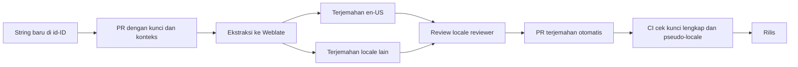

# Konten dan Internasionalisasi

## 1. Tujuan dan Ruang Lingkup

Dokumen ini menetapkan voice, tone, struktur berkas locale, format data, dan alur terjemahan untuk seluruh string Host Shell, Studio, micro-app bawaan, pesan error, dan dokumentasi bantuan. Target normatif ada di [nfr.md](../03-specs/nfr.md) pada NFR-I18N-001 dan NFR-I18N-002.

Cakupan: string web (PWA) dan Flutter, pesan error sesuai [error-codes.md](../03-specs/error-codes.md), label aksesibilitas ([accessibility.md](accessibility.md)), serta copy pada 22 layar ([screen-specs.md](screen-specs.md)).

Di luar cakupan: penerjemahan dokumentasi pemasaran dan isi micro-app pihak ketiga; keduanya mengikuti aturan yang sama bila dibundel sebagai bagian produk.

## 2. Prinsip

| Prinsip | Ketentuan |
|---|---|
| Dua locale first-class | `id-ID` dan `en-US` MUST lengkap 100% pada setiap rilis; tidak ada string yang hanya ada di salah satunya. |
| Sumber tunggal | Semua string UI MUST berasal dari berkas locale; string hardcoded di komponen dilarang. |
| Tanpa jaringan | Berkas locale MUST dibundel di aplikasi; tidak ada pemuatan string dari CDN atau server saat runtime. |
| Tanpa telemetry | Tidak ada pengiriman teks yang diketik pengguna ke layanan terjemahan otomatis. |
| Makna di atas kata | Terjemahan MUST menyampaikan maksud dan tindakan, bukan terjemahan kata per kata. |
| Konteks eksplisit | Setiap kunci MUST memiliki konteks (layar, komponen, state) yang cukup bagi penerjemah tanpa membaca kode. |

## 3. Voice dan Tone

| Aspek | `id-ID` | `en-US` |
|---|---|---|
| Sapaan | "Anda" untuk pengguna; hindari "kamu" dan "kalian". | "you" huruf kecil di tengah kalimat. |
| Nada | Tenang, langsung, membantu; tidak menyalahkan pengguna. | Calm, direct, helpful; tidak menyalahkan pengguna. |
| Kalimat aksi | Imperatif: "Simpan perubahan", "Pilih berkas". | Imperative: "Save changes", "Choose a file". |
| Kapitalisasi | Sentence case untuk judul, label, dan tombol. | Sentence case; title case hanya untuk nama produk. |
| Tanda baca | Titik pada kalimat penuh; tanpa titik pada label dan tombol. | Sama; tanpa tanda seru. |
| Istilah teknis | Pakai istilah kanonik dari [glossary.md](../00-foundation/glossary.md). | Pakai istilah kanonik yang sama, bukan sinonim. |
| Angka dalam kalimat | "5 detik", "128 MB", "24 kata". | "5 seconds", "128 MB", "24 words". |
| Larangan | Sarkasme, humor pada error, ancaman, dan "silakan" berulang. | Sama. |

Contoh penerapan:

| Konteks | `id-ID` | `en-US` |
|---|---|---|
| Tombol simpan | Simpan perubahan | Save changes |
| Konfirmasi hapus | Hapus micro-app ini? Data lokalnya juga dihapus. | Delete this micro-app? Its local data will also be deleted. |
| Status sinkronisasi | Tersinkron 2 menit lalu | Synced 2 minutes ago |
| Offline | Anda sedang offline. Perubahan disimpan dan dikirim saat koneksi kembali. | You are offline. Changes are saved and sent when the connection returns. |
| Izin kamera | Izinkan akses kamera untuk memindai kode QR. | Allow camera access to scan QR codes. |

## 4. Formula Pesan Error

Setiap pesan error MUST terdiri dari tiga bagian berurutan: **[apa yang terjadi] + [mengapa] + [langkah berikut]**. Bagian kedua boleh diringkas bila penyebab tidak diketahui pengguna, tetapi tidak boleh dihilangkan tanpa alasan.

| Aturan | Ketentuan |
|---|---|
| Struktur | `message` memuat apa yang terjadi dan mengapa; `recovery` memuat langkah berikut. |
| Panjang | Maksimal 2 kalimat untuk `message` dan 1 kalimat untuk `recovery`. |
| Kode | Kode `E-<DOMAIN>-<NNN>` ditampilkan terpisah, tidak disisipkan ke dalam kalimat. |
| Larangan | PII, token, path internal, stack trace, dan nama tabel database MUST NOT muncul. |
| Nada | Netral dan Tidak menyalahkan; hindari "kesalahan Anda" dan "invalid input" tanpa penjelasan. |
| Aksi | Setiap error MUST memiliki minimal satu aksi yang dapat dijalankan pengguna. |
| Lokalisasi | Pesan ditulis ulang per locale, bukan diterjemahkan kata per kata. |

Contoh pemetaan ke kode terdaftar:

| Kode | Kunci pesan | `id-ID` | `en-US` |
|---|---|---|---|
| E-REG-001 | `error.registry.signature_invalid` | "Aplikasi tidak dapat dipasang karena tanda tangan paket tidak valid. Paket mungkin berubah setelah dipublikasikan. Unduh ulang dari sumber resmi atau hubungi penerbit." | "The app can't be installed because the package signature is invalid. The package may have changed after it was published. Download it again from the official source or contact the publisher." |
| E-SBX-003 | `error.sandbox.frozen` | "Aplikasi dihentikan karena tidak merespons selama 5 detik. Terjadi perulangan tanpa akhir di dalam sandbox. Muat ulang aplikasi atau ekspor datanya." | "The app was stopped because it didn't respond for 5 seconds. An endless loop ran inside the sandbox. Reload the app or export its data." |
| E-NET-003 | `error.net.server_unreachable` | "Server tidak dapat dijangkau. Jaringan terputus atau server sedang tidak aktif. Perubahan disimpan dan dikirim otomatis saat server tersedia." | "The server can't be reached. The network is down or the server is offline. Changes are saved and sent automatically when the server is available." |
| E-AUTH-002 | `error.auth.recovery_phrase_invalid` | "Frasa pemulihan tidak cocok. Satu atau beberapa kata mungkin salah urutan. Periksa kembali 24 kata Anda; setelah 5 percobaan gagal, tunggu 1 menit." | "The recovery phrase doesn't match. One or more words may be out of order. Check your 24 words again; after 5 failed attempts, wait 1 minute." |
| E-DATA-002 | `error.data.migration_failed` | "Migrasi database gagal. Skema versi baru tidak dapat diterapkan pada data Anda. Data dikembalikan ke snapshot sebelumnya; laporkan kode ini agar diperiksa." | "The database migration failed. The new schema couldn't be applied to your data. Your data was restored to the previous snapshot; report this code so it can be investigated." |

Aturan tambahan untuk error yang dapat dicoba ulang: sebutkan bahwa percobaan ulang otomatis berjalan dan berapa lama, tanpa menyuruh pengguna menekan tombol yang sama berulang kali. Error kritis yang memblokir akses MUST menampilkan aksi pemulihan, bukan hanya kode.

## 5. Terminologi

| Istilah kanonik | Terjemahan `id-ID` | Catatan |
|---|---|---|
| micro-app | micro-app | Tidak diterjemahkan; tidak memakai "mikro aplikasi". |
| Host Shell | Host Shell | Nama produk. |
| Studio | Studio | Nama produk. |
| Workspace | Workspace | Tidak diterjemahkan pada UI. |
| Registry | Registry | Tidak diterjemahkan. |
| Vault | Vault | Tidak diterjemahkan. |
| Outbox | Outbox | Tidak diterjemahkan pada pesan teknis. |
| Permission | izin | Pada UI pengguna; "permission" hanya di dokumen teknis. |
| Local Identity | Identitas Lokal | Pada UI. |
| Recovery Phrase | Frasa Pemulihan | Pada UI; "recovery phrase" hanya di dokumen teknis. |
| Sandbox | sandbox | Huruf kecil di tengah kalimat. |
| micro-app id | ID micro-app | "ID" kapital. |
| Sync | sinkronisasi | Kata kerja "menyinkronkan". |
| Update | pembaruan | Bukan "update" pada UI. |
| Install | pasang | Bukan "instalasi" pada tombol. |

Sinonim terlarang mengikuti [glossary.md](../00-foundation/glossary.md); "store", "mini app", "akun lokal", dan "seed phrase" MUST NOT muncul pada UI.

## 6. Struktur Berkas Locale

Web memakai JSON per namespace; Flutter memakai ARB per locale. Keduanya berbagi kunci dan urutan namespace.

```text
apps/studio-web/src/locales/
  id-ID/
    common.json
    host.json
    studio.json
    sandbox.json
    data.json
    registry.json
    sync.json
    server.json
    errors.json
    devtools.json
    a11y.json
  en-US/
    (namespace yang sama, lengkap)

apps/host-flutter/lib/l10n/
  app_id.arb
  app_en.arb
  l10n.yaml
```

| Namespace | Isi | Contoh kunci |
|---|---|---|
| `common` | Aksi umum, satuan, status navigasi | `common.action.save` |
| `host` | Home, workspace, pencarian, vault | `host.home.empty.title` |
| `studio` | Canvas, editor, AI copilot, publish | `studio.canvas.palette.title` |
| `sandbox` | Error boundary, permission, lifecycle | `sandbox.boundary.restart` |
| `data` | Database, migrasi, workflow | `data.migration.pending.body` |
| `registry` | Registry, install, update | `registry.install.consent.title` |
| `sync` | Pairing, konflik, transport | `sync.conflict.review.title` |
| `server` | Self-host, admin, audit | `server.audit.export.title` |
| `errors` | Pesan error per kode | `error.registry.signature_invalid` |
| `devtools` | Profiler, log, inspector | `devtools.profiler.memory.title` |
| `a11y` | Label khusus screen reader dan live region | `a11y.host.grid.itemCount` |

Aturan berkas:

1. Setiap namespace MUST ada di setiap locale dengan struktur identik; kunci yang hilang MUST gagal pada pemeriksaan build.
2. Nilai MUST berupa string tunggal atau objek datar berisi `title`, `body`, `recovery`, atau `label`; objek bersarang lebih dari satu tingkat ditolak.
3. Kunci `errors` MUST sama persis dengan *Message key* di [error-codes.md](../03-specs/error-codes.md); tidak ada alias.
4. Setiap entri MAY memiliki metadata konteks (`.meta.json` per namespace) berisi deskripsi, batas panjang, dan tangkapan layar; metadata tidak disimpan di dalam nilai terjemahan.
5. ARB Flutter memakai `@@locale`, `@key` untuk `description` dan `placeholders`; nilai `description` MUST diisi agar penerjemah memahami konteks.
6. Berkas locale MUST diurutkan berdasarkan kunci agar diff stabil dan tidak menimbulkan konflik palsu.

Contoh JSON web:

```json
{
  "registry.install.consent.title": "Izinkan akses berikut?",
  "registry.install.consent.body": "{appName} meminta {count} izin. Anda dapat mencabutnya kapan saja di Pengaturan.",
  "registry.install.action": "Pasang"
}
```

Contoh ARB Flutter:

```json
{
  "@@locale": "id",
  "syncConflictTitle": "Ada konflik data",
  "@syncConflictTitle": {
    "description": "Judul dialog saat dua perangkat mengubah kolom yang sama.",
    "placeholders": {
      "appName": { "type": "String" }
    }
  },
  "syncConflictBody": "{appName} punya {count, plural, other{{count} perubahan yang perlu ditinjau}}."
}
```

## 7. Penamaan Kunci

Pola: `<namespace>.<area>.<komponen>[.<state>][.<bagian>]`, segmen `lowerCamelCase`, maksimal lima segmen.

| Aturan | Ketentuan | Contoh benar | Contoh salah |
|---|---|---|---|
| Namespace | Segmen pertama sama dengan nama berkas | `host.home.empty.title` | `home.empty.title` |
| Segmen | Huruf kecil, tanpa spasi, tanpa strip | `studio.canvas.palette.title` | `studio.canvas-palette.Title` |
| State | `title`, `body`, `action`, `hint`, `error`, `empty`, `loading` | `registry.install.error.title` | `registry.install.errorText` |
| Placeholder | Nama deskriptif, tidak disingkat | `{appName}`, `{count}`, `{retryAfterSeconds}` | `{a}`, `{n}`, `{x}` |
| Dilarang | Nomor urut, teks asli, dan nama pengembang | `host.home.title` | `host.text42`, `host.judulBaru` |
| Stabilitas | Kunci tidak diubah setelah rilis; perubahan kunci MUST memperbarui semua locale dan test | — | Mengganti kunci hanya di satu locale |

Kunci yang tidak lagi dipakai MUST dihapus pada PR yang sama; kunci yatim menggagalkan pemeriksaan.

## 8. Pluralisasi, Seleksi, dan ICU

| Kasus | Aturan | Contoh `id-ID` | Contoh `en-US` |
|---|---|---|---|
| Jumlah | Wajib memakai `plural` ICU; tidak boleh menyambung angka dan kata | `{count, plural, other{{count} berkas}}` | `{count, plural, =0{No files} one{{count} file} other{{count} files}}` |
| Nol khusus | Gunakan `=0` bila makna berubah | `=0{Tidak ada berkas}` | `=0{No files}` |
| Gender | Hindari; gunakan `select` hanya bila diperlukan | — | — |
| Status | `select` untuk enumerasi yang berubah bentuk kalimat | `{mode, select, offline{Offline} syncing{Menyinkronkan} other{Siap}}` | Sama dengan nilai Inggris |
| Rentang | Gunakan dua placeholder bertipe number, bukan plural | `{from}–{to} menit` | `{from}–{to} minutes` |
| Daftar | Gabungkan dengan `Intl.ListFormat`/`toBeginningOfSentenceCase`; jangan menyambung manual | "A, B, dan C" | "A, B, and C" |
| Pilihan pengguna | Jangan membangun kalimat dengan konkatenasi; seluruh varian harus menjadi pesan utuh | — | — |

`id-ID` hanya memiliki kategori plural `other` di CLDR; karena itu nilai `one` MUST NOT ditambahkan untuk locale ini meskipun terjemahan Inggris membutuhkannya. Test MUST memverifikasi bahwa pemanggilan `plural` pada `id-ID` tidak menampilkan bentuk yang salah.

## 9. Tanggal, Angka, Mata Uang, dan Satuan

| Jenis | Aturan | `id-ID` | `en-US` |
|---|---|---|---|
| Tanggal pendek | `Intl.DateTimeFormat` sesuai locale | 20/11/2026 | 11/20/2026 |
| Tanggal panjang | Bulan ditulis penuh | 20 November 2026 | November 20, 2026 |
| Waktu | 24 jam untuk `id-ID`, 12 jam untuk `en-US` | 14.05 | 2:05 PM |
| Zona waktu | Ditampilkan bila relevan dan berbeda dari perangkat | WIB (UTC+7) | GMT+7 |
| Angka | Pemisah ribuan dan desimal per locale | 1.200.000,5 | 1,200,000.5 |
| Persentase | Simbol mengikuti locale | 12,5% | 12.5% |
| Mata uang | Simbol dan posisi mengikuti locale; nilai asli tidak dibulatkan diam-diam | Rp1.200.000 | IDR 1,200,000 |
| Ukuran berkas | Satuan biner `KiB`/`MiB`/`GiB`, satu desimal maksimal | 8,0 MiB | 8.0 MiB |
| Durasi | Kata satuan diterjemahkan, angka mengikuti locale | 5 detik | 5 seconds |
| Rentang tanggal | Pemisah en dash tanpa spasi ganda | 1–7 Desember 2026 | December 1–7, 2026 |

Nilai teknis berikut MUST NOT dilokalisasi: versi (`2.4.0`), hash, `Site ID`, `HLC`, ID micro-app, nama field JSON, kode error, dan path berkas.

## 10. RTL dan Teks Campuran

| Aspek | Ketentuan |
|---|---|
| Arah | `dir`/`Directionality` diatur dari locale; komponen tidak menetapkan arah sendiri. |
| Layout | Properti logis wajib; padding dan margin fisik dilarang. |
| Ikon | Ikon arah dicerminkan; ikon merek, jam, play, dan media tidak dicerminkan. |
| Teks campuran | Nama micro-app, ID, dan path dibungkus isolasi bidi agar tidak mengubah urutan kalimat. |
| Angka | Angka tetap memakai digit Barat; tidak diubah ke digit Arab kecuali locale secara eksplisit meminta. |
| Pemenggalan | Gunakan pemenggalan per kata (`overflow-wrap: anywhere` hanya untuk ID dan path), bukan `word-break: break-all` pada prosa. |
| Cermin dialog | Tombol aksi utama tetap di sisi end; urutan aksi tidak dibalik secara manual. |
| Uji | Pseudo-locale RTL dan locale `ar` diuji pada 22 layar. |

## 11. Resolusi Locale dan Fallback

Urutan resolusi MUST deterministik:

1. Override manual pengguna di Pengaturan, bila ada.
2. Locale sistem yang cocok persis (`id-ID`, `en-US`).
3. Locale sistem yang cocok pada tingkat bahasa (`id`, `en`).
4. Fallback `en`.

Aturan:

| Aturan | Ketentuan |
|---|---|
| Default | Mengikuti locale sistem operasi pada peluncuran pertama. |
| Persistensi | Override disimpan lokal per profil Host, bukan di server. |
| Perubahan | Mengubah locale MUST langsung memperbarui string tanpa restart; konten dinamis dimuat ulang. |
| Format | Tanggal, angka, dan mata uang mengikuti locale aktif, bukan locale sistem. |
| Fallback kunci | Kunci yang tidak ada di locale aktif MUST jatuh ke `en-US` dan dicatat sebagai kegagalan build, bukan ditampilkan sebagai kunci mentah. |
| Bahasa dokumen | `lang`/`Locale` root selalu sama dengan locale aktif. |
| Tanpa campuran | Satu layar MUST NOT menampilkan dua bahasa sekaligus kecuali nama produk dan istilah kanonik. |

## 12. Pseudo-locale dan Pengujian Ekspansi

| Item | Ketentuan |
|---|---|
| Nama | `en-XA` untuk ekspansi teks, `ar-XB` untuk RTL semu. |
| Isi | Setiap karakter diberi aksen dan panjang ditambah sekitar 30%; placeholder dipertahankan. |
| Build | Hanya tersedia pada build development dan test; MUST NOT dikirim pada rilis. |
| Tujuan | Mengungkap teks terpotong, layout kaku, dan string hardcoded. |
| Gate | Snapshot 22 layar pada `en-XA` dan `ar-XB` wajib lulus tanpa overflow sebelum rilis. |

## 13. Alur Terjemahan



| Tahap | Ketentuan |
|---|---|
| Sumber | `id-ID` adalah bahasa sumber untuk penulisan copy baru. |
| Ekstraksi | Kunci baru dan metadata konteks diekstrak otomatis; tidak ada pengeditan langsung di platform terjemahan untuk kunci sumber. |
| Platform | Weblate dipakai untuk `en-US` dan locale tambahan; string beku selama masa rilis. |
| Review | Setiap locale memiliki minimal satu reviewer; `en-US` direview oleh penutur asli atau editor teknis. |
| Kualitas | Terjemahan mesin tanpa review MUST NOT dirilis. |
| Sinkronisasi | Terjemahan masuk sebagai PR terpisah; PR fitur tidak mencampur terjemahan baru kecuali `id-ID` dan `en-US` lengkap. |
| Rilis | `id-ID` dan `en-US` wajib 100%; locale lain boleh kurang dan akan fallback ke `en-US`. |
| Perubahan makna | Bila string sumber berubah makna, kunci baru dibuat dan kunci lama dihapus; jangan mengubah nilai sumber di tempat tanpa penanda. |

## 14. Larangan String Hardcoded dan Enforcement

| Lapisan | Ketentuan |
|---|---|
| Web | Semua teks melalui fungsi terjemahan; ESLint `no-literal-string` pada komponen UI. |
| Flutter | Semua teks melalui `AppLocalizations`; `custom_lint` menolak `Text('...')` literal pada widget UI. |
| Pesan error | Hanya kunci dari `errors` yang dipakai; tidak ada string error di kode. |
| Label a11y | Label screen reader berasal dari namespace `a11y` dan dihubungkan ke komponen terkait. |
| Pemeriksaan | CI memverifikasi kunci lengkap, tidak ada kunci yatim, tidak ada nilai kosong, dan placeholder identik antar locale. |
| Exception | Nama produk, istilah kanonik yang tidak diterjemahkan, dan nilai teknis (§9) boleh literal dan MUST tercatat di allowlist. |

## 15. Checklist Review Copy

| No | Butir | Wajib |
|---|---|---|
| 1 | Mengikuti voice dan tone §3 pada kedua locale | Ya |
| 2 | Error memenuhi formula §4 dan memiliki aksi | Ya |
| 3 | Istilah sesuai glosarium; tidak ada sinonim terlarang | Ya |
| 4 | Kunci mengikuti pola §7 dan unik | Ya |
| 5 | Placeholder dan plural identik antar locale | Ya |
| 6 | Tanggal dan angka diformat lewat API locale | Ya |
| 7 | Tidak ada konkatenasi kalimat | Ya |
| 8 | Label aksesibilitas jelas di luar konteks | Ya |
| 9 | Panjang teks muat pada target layar dan pseudo-locale | Ya |
| 10 | Tidak ada PII, token, atau path internal pada pesan | Ya |
| 11 | Konteks untuk penerjemah tersedia di metadata | Ya |
| 12 | Tidak ada string yang hanya ada di satu locale | Ya |

## 16. Acceptance Criteria

| ID | Given | When | Then |
|---|---|---|---|
| AC-I18N-01 | Aplikasi dijalankan dengan locale `id-ID` atau `en-US` | Membuka 22 layar | Tidak ada string hardcoded dan tidak ada kunci mentah |
| AC-I18N-02 | String sumber berubah | Menjalankan pemeriksaan build | Kunci hilang atau placeholder berbeda menggagalkan build |
| AC-I18N-03 | Pesan error ditampilkan | Membaca pesan | Memuat apa yang terjadi, penyebab, dan langkah berikut |
| AC-I18N-04 | Daftar berisi 0, 1, dan banyak item | Merender pada kedua locale | Bentuk plural benar sesuai aturan CLDR locale |
| AC-I18N-05 | Locale RTL dipilih | Membuka 22 layar | Layout tercermin dan tidak ada teks terpotong |
| AC-I18N-06 | Build development memakai `en-XA` | Membuka 22 layar | Tidak ada overflow atau teks terpotong |
| AC-I18N-07 | Pengguna mengganti locale di Pengaturan | Kembali ke layar sebelumnya | String dan format langsung berubah tanpa restart |
| AC-I18N-08 | Kunci ada di `id-ID` tetapi tidak di `en-US` | Menjalankan CI | CI gagal dengan daftar kunci yang hilang |

## 17. Verifikasi

1. Jalankan pemeriksaan kunci locale pada CI untuk kedua locale wajib; tidak ada kunci hilang, yatim, atau placeholder berbeda.
2. Jalankan uji snapshot `en-XA` dan `ar-XB` pada 22 layar.
3. Uji pluralisasi dan format tanggal/angka dengan nilai 0, 1, 2, dan 1.000.000 pada kedua locale.
4. Jalankan uji lint string hardcoded pada web dan Flutter.
5. Tinjau 10 pesan error acak terhadap formula §4 dan [error-codes.md](../03-specs/error-codes.md).
6. Perbarui [prd-compliance-matrix.md](../00-foundation/prd-compliance-matrix.md) untuk NFR-I18N bila cakupan berubah.

## 18. Referensi

- [nfr.md](../03-specs/nfr.md) — NFR-I18N-001 dan NFR-I18N-002
- [error-codes.md](../03-specs/error-codes.md) — Message key dan pemulihan error
- [accessibility.md](accessibility.md) — label screen reader, RTL, dan zoom
- [design-system.md](design-system.md) — token tipografi dan breakpoint
- [screen-specs.md](screen-specs.md) — copy per layar
- [interaction-patterns.md](interaction-patterns.md) — durasi toast dan dialog
- [glossary.md](../00-foundation/glossary.md) — istilah kanonik
- [component-catalog.md](component-catalog.md) — label dan state komponen MADS
