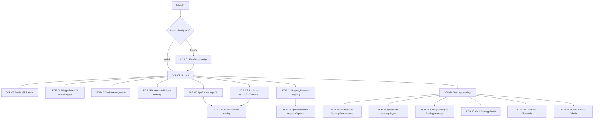

# Arsitektur Informasi

## 1. Tujuan dan Ruang Lingkup

Dokumen ini menetapkan struktur navigasi Host dan Studio: peta situs, route web, pemetaan deep link, model workspace, pola navigasi desktop dan mobile, inventaris 22 layar, matriks responsif, mode jendela, state global, dan cakupan pencarian. Semua layar dirinci di [screen-specs.md](screen-specs.md); token visual mengikuti [design-system.md](design-system.md).

Di luar lingkup: isi wireframe per layar (screen-specs), perilaku mikro per kontrol ([interaction-patterns.md](interaction-patterns.md)), dan kontrak render micro-app ([ui-protocol.md](../03-specs/ui-protocol.md)).

## 2. Prinsip

| Prinsip | Konsekuensi |
|---|---|
| Satu jalur pulang | Setiap layar dapat kembali ke Home maksimum dua aksi; `Esc` menutup lapisan teratas. |
| Tanpa login | Tidak ada route autentikasi; identitas lokal sudah ada sebelum layar pertama dirender (FR-HOST-001). |
| Konteks workspace terlihat | Workspace aktif selalu tampil di header/sidebar; tidak ada pencarian lintas workspace tanpa perpindahan eksplisit. |
| State dapat dipulihkan | Route, filter, posisi scroll, dan panel yang terbuka dipulihkan setelah restart (FR-HOST-024). |
| Offline adalah normal | Navigasi inti MUST NOT menampilkan spinner jaringan atau halaman error koneksi. |
| Satu layar, satu tujuan | Layar baru hanya dibuat bila memiliki tujuan, state, dan acceptance yang berbeda. |

## 3. Peta Situs

## 4. Route Web

Web memakai satu entry point Host Shell `/` dengan state turunan melalui query param; router internal memakai hash (`/#` → `/`) agar tetap berfungsi saat dibuka sebagai PWA dari filesystem, static host, atau webview desktop. Kedua bentuk MUST memetakan ke state yang sama dan MUST NOT menjadi dua model navigasi berbeda.

| Route | Layar | Konten | Guard |
|---|---|---|---|
| `/` (state `first-run`) | SCR-01 | Gate first-run; tanpa identity, onboarding mengambil alih seluruh viewport | Hanya bila belum ada identity |
| `/` | SCR-02 | Home: grid, folder, dock, search bar, status offline | Workspace aktif wajib ada |
| `/?folder=<id>` | SCR-03 | Isi folder, breadcrumb, aksi folder | `folder` milik workspace aktif |
| `/?view=widgets` | SCR-04 | Widget board dan penataan widget | Minimal satu widget atau empty state |
| `/app/:id` | SCR-06 | Runtime micro-app dalam iframe sandbox | App terpasang; route internal diteruskan ke app |
| `/studio/:id` | SCR-07 | Dashboard project: status, preview, aksi build | Project draft ada |
| `/studio/:id?panel=visual` | SCR-08 | Visual builder | Project draft ada |
| `/studio/:id?panel=code` | SCR-09 | Editor kode dan panel masalah | Project draft ada |
| `/studio/:id?panel=data` | SCR-10 | Schema dan data designer | Project draft ada |
| `/studio/:id?panel=workflow` | SCR-11 | Editor workflow | Project draft ada |
| `/studio/:id?panel=ai` | SCR-12 | AI copilot dan riwayat generasi | Provider AI dipilih eksplisit |
| `/registry` | SCR-13 | Daftar sumber registry dan katalog | Registry lokal atau cache offline |
| `/registry?app=<id>` | SCR-14 | Detail app, permission, tombol install/update; state terpilih, bukan route baru | Entri index valid |
| `/settings` | SCR-18 | Indeks pengaturan | — |
| `/settings/permissions` | SCR-15 | Daftar app dan grant | — |
| `/settings/permissions?app=<id>` | SCR-15 | Grant per app | App terpasang |
| `/settings/sync` | SCR-16 | Peer, transport, status sync | — |
| `/settings/vault` | SCR-17 | Daftar item Vault; terkunci sampai unlock | Identitas ada |
| `/settings/storage` | SCR-19 | Pemakaian per app dan pembersihan cache | — |
| `/settings/general` | SCR-18 | Tema, bahasa, densitas, tentang | — |
| `/dev/tools` | SCR-20 | Profiler, log, bridge monitor | Build dev/internal saja; flag developer |
| `/admin` | SCR-21 | Ringkasan instance self-host | Hanya saat terhubung ke server |
| `/admin/users`, `/admin/registry`, `/admin/audit`, `/admin/branding`, `/admin/health` | SCR-21 | Subtab konsol admin | Role admin server |
| Overlay global | SCR-05, SCR-22, consent | Command palette, crash recovery, consent | Lapisan di atas route mana pun, tanpa mengubah URL |

Aturan route:

- Hash hosting (`/#`) MUST memakai struktur query yang identik; perpindahan antara `/` dan `/#` MUST mempertahankan state.
- Route yang tidak cocok MUST menampilkan layar "tidak ditemukan" di dalam shell, dengan tautan Home; MUST NOT memuat ulang aplikasi.
- Route `/studio/*` MUST memaksa simpan otomatis sebelum pindah panel; perubahan yang belum tersimpan ditandai di judul.
- Route `/app/:id` MUST memakai `id` dari manifest yang terpasang, bukan nama tampilan.
- Route `/admin/*` MUST gagal tertutup (fail closed) tanpa sesi server yang valid.
- Tidak ada route yang membutuhkan jaringan untuk merender kerangka layar.
- Detail app dan detail grant adalah state terpilih, bukan route baru, agar tombol kembali tidak melintasi dialog.

## 5. Deep Link

Format kanonik: `microapp://<registry-or-local>/<app-id>/<route>?params=...` (FR-HOST-015). `registry-or-local` adalah nama registry terdaftar atau literal `local` untuk app yang belum dipublikasikan.

| Skenario | Perilaku |
|---|---|
| App terpasang | Buka `/app/:id`, teruskan `<route>` dan `params` ke router internal app setelah `onMount` |
| App tidak terpasang, paket ada di registry cache | Tampilkan SCR-14 dengan penawaran install; setelah install, lanjutkan ke tujuan |
| App tidak terpasang, tidak ada jaringan | Tampilkan penawaran install dengan status "paket tidak tersedia offline"; aksi salin tautan |
| Registry tidak dikenal | Tampilkan dialog pemilihan sumber; MUST NOT otomatis menambah registry |
| Param tidak valid | Buang param, buka route dasar, tampilkan toast peringatan |

Web memakai padanan `https://<host>/?target=<encoded microapp URL>` (atau `https://<host>/#/?target=<encoded>` pada hash hosting); micro-app MUST NOT menerima URL mentah, hanya route dan param yang sudah divalidasi Host. Deep link lintas app MUST melewati dialog consent (FR-HOST-014), bukan langsung membuka.

## 6. Model Workspace

| Konsep | Definisi | Invariant |
|---|---|---|
| Workspace | Konteks terisolasi berisi app, folder tree, widget board, database, registry cache, grant permission, dan peer sync | Tidak ada query lintas workspace (FR-HOST-007) |
| Workspace aktif | Satu workspace per jendela; tersimpan di launcher state | Dipulihkan setelah cold start (FR-HOST-024) |
| Nav stack | Riwayat route per workspace | Berpindah workspace menyimpan stack lama dan memulihkannya saat kembali |
| Folder tree | Struktur maksimum tiga level; folder tidak dapat memuat workspace | Folder lintas workspace ditolak |
| Dock | Maksimum 8 app yang di-pin | Urutan persisten per workspace |
| Scratch | Area kerja sementara untuk draft Studio | Tidak disinkronkan sampai dipromosikan menjadi project |

Pembuatan workspace baru MUST memulai dari kondisi kosong (tanpa app, tanpa grant) dan MUST NOT menyalin Vault. Penghapusan workspace MUST menawarkan ekspor `.mapp-backup` dan konfirmasi eksplisit (FR-HOST-008).

## 7. Navigasi

### 7.1 Desktop dan tablet

| Breakpoint | Struktur | Perilaku |
|---|---|---|
| large (≥ 1440) | Sidebar 280 + konten + panel kanan opsional | Sidebar dapat diciutkan menjadi rail; panel kanan menampung properti/inspektur |
| expanded (1024–1439) | Sidebar 280 + konten | Panel kanan menjadi overlay |
| medium (600–1023) | Rail 72 + konten | Rail hanya ikon dengan tooltip dan label aksesibel; panel menjadi sheet |
| compact (< 600) | Header + tab bar bawah | Empat tab tetap; pencarian memakai field header |

Urutan item sidebar tetap: Home, Studio, Registry, Settings; daftar workspace berada di atas item tetap. Widget board dibuka dari Home (`?view=widgets`) dan Vault dari dock atau Settings. Studio memakai sidebar sekunder berisi project, file, dan komponen; sidebar sekunder MUST NOT menggantikan sidebar utama.

### 7.2 Mobile

Tab bar bawah: Home, Studio, Registry, Settings. Field pencarian di header membuka SCR-05 sebagai layar penuh. Vault diakses dari Home (dock) dan Settings. Split view tidak tersedia; PiP video tetap tersedia. Gesture kembali mengikuti OS dan MUST memetakan ke aksi `Esc` yang sama.

## 8. Inventaris Layar

| ID | Nama | Route/Overlay | Tujuan utama | Entry point |
|---|---|---|---|---|
| SCR-01 | FirstRun/Identity | `/` state `first-run` | Membuat Local Identity, Recovery Phrase, dan workspace default | Launch tanpa identity |
| SCR-02 | Home | `/` | Meluncurkan app, folder, widget, pencarian | Launch, breadcrumb |
| SCR-03 | Folder | `/?folder=<id>` | Mengelola isi folder dan subfolder | Home |
| SCR-04 | WidgetBoard | `/?view=widgets` | Menata live widget per workspace | Home |
| SCR-05 | CommandPalette | Overlay | Menjalankan aksi dan navigasi dari keyboard | `Cmd/Ctrl+K`, Search |
| SCR-06 | AppRunner | `/app/:id` | Menjalankan micro-app dan menampilkan error boundary | Home, deep link |
| SCR-07 | StudioDashboard | `/studio/:id` | Status project, preview, build, publish | Sidebar, Home |
| SCR-08 | VisualBuilder | `/studio/:id?panel=visual` | Menyusun UI visual dan mengedit properti | StudioDashboard |
| SCR-09 | CodeEditor | `/studio/:id?panel=code` | Mengedit kode, melihat diagnostik dan AST | StudioDashboard |
| SCR-10 | DataDesigner | `/studio/:id?panel=data` | Merancang schema, migrasi, dan data | StudioDashboard |
| SCR-11 | WorkflowEditor | `/studio/:id?panel=workflow` | Menyusun graph workflow dan trigger | StudioDashboard |
| SCR-12 | AICopilot | `/studio/:id?panel=ai` | Prompt-to-app, saran, dan riwayat generasi | StudioDashboard |
| SCR-13 | RegistryBrowser | `/registry` | Menjelajah sumber dan katalog app | Sidebar, Home |
| SCR-14 | AppDetailInstall | `/registry?app=<id>` | Meninjau permission, signature, dan install/update | SCR-13, deep link |
| SCR-15 | Permissions | `/settings/permissions` | Mengelola grant, mock, dan offline cage | Settings, dialog consent |
| SCR-16 | SyncPeers | `/settings/sync` | Pairing peer, transport, status, revoke | Settings, status sync |
| SCR-17 | Vault | `/settings/vault` | Menyimpan dan membagikan item rahasia | Settings, dock |
| SCR-18 | Settings | `/settings` | Indeks pengaturan umum, tema, bahasa | Sidebar |
| SCR-19 | StorageManager | `/settings/storage` | Melihat pemakaian dan membersihkan cache | Settings, error penyimpanan |
| SCR-20 | DevTools | `/dev/tools` | Profiler, log, bridge, sync queue | Settings (build dev) |
| SCR-21 | AdminConsole | `/admin/*` | Mengelola instance self-host | Settings, URL admin |
| SCR-22 | CrashRecovery | Overlay global | Memulihkan setelah crash/freeze | Watchdog, launch setelah crash |

Setiap layar MUST memiliki state loading, empty, error, dan offline yang eksplisit. Layar tanpa data MUST menampilkan empty state dengan aksi berikutnya (FR-HOST-025), bukan area kosong.

## 9. Matriks Responsif

| Layar | compact | medium | expanded | large |
|---|---|---|---|---|
| SCR-01 | Satu kolom, langkah penuh | Kolom 480 px di tengah | Kolom 480 px + ilustrasi | Kolom 560 px + ilustrasi |
| SCR-02 | Grid 2 kolom, tab bar | Grid 6 kolom, rail | Grid 8 kolom, sidebar | Grid 10 kolom, sidebar + panel |
| SCR-03 | Daftar satu kolom | Grid 6 kolom | Grid 8 kolom | Grid 10 kolom |
| SCR-04 | Widget satu kolom | Widget 2 kolom | Widget 3 kolom | Widget 4 kolom |
| SCR-05 | Layar penuh | Dialog 640 px | Dialog 640 px | Dialog 640 px |
| SCR-06 | Penuh, header ringkas | Penuh + rail | Penuh + sidebar | Split dengan panel inspektur |
| SCR-07 | Kartu bertumpuk | 2 kolom kartu | 3 kolom kartu | 3 kolom + panel aktivitas |
| SCR-08 | Canvas + sheet properti | Canvas + panel bawah | Canvas + panel kanan | Canvas + panel kanan + layer tree |
| SCR-09 | Editor penuh, tab file sheet | Editor + tab file | Editor + file tree | Editor + file tree + panel masalah |
| SCR-10 | Tabel horizontal scroll | Tabel + detail sheet | Tabel + detail panel | Tabel + detail + schema tree |
| SCR-11 | Graph pan/zoom, toolbar bawah | Graph + palette sheet | Graph + palette kiri | Graph + palette + inspektur |
| SCR-12 | Chat penuh | Chat + riwayat sheet | Chat + riwayat | Chat + riwayat + diff |
| SCR-13 | Kartu satu kolom | Kartu 2 kolom | Kartu 3 kolom | Kartu 4 kolom + filter samping |
| SCR-14 | Penuh, aksi sticky bawah | 2 kolom | 2 kolom + sidebar | 2 kolom + sidebar + riwayat versi |
| SCR-15 | Daftar + sheet detail | Daftar + detail | Daftar + detail | Daftar + detail + audit |
| SCR-16 | Daftar peer | Daftar + detail | Daftar + detail | Daftar + detail + transport |
| SCR-17 | Daftar item, unlock sheet | Daftar + detail | Daftar + detail | Daftar + detail + audit |
| SCR-18 | Daftar grup | Daftar + panel | Sidebar grup + panel | Sidebar + panel + pencarian |
| SCR-19 | Meter bertumpuk | Meter + tabel | Tabel + detail | Tabel + detail + grafik |
| SCR-20 | Tab (perf/log/network) | Tab + filter | Panel ganda | Panel ganda + timeline |
| SCR-21 | Kartu ringkas | Tabel ringkas | Tabel + filter | Tabel + filter + detail |
| SCR-22 | Kartu diagnostik penuh | Kartu + log | Kartu + log | Kartu + log + aksi pemulihan |

## 10. Mode Jendela

| Mode | Ketersediaan | Aturan state | Batas |
|---|---|---|---|
| Single | Semua platform | Satu instance per app | — |
| Split | expanded dan large | Dua pane, satu instance state per app (FR-HOST-013) | Maksimum 2 pane; pane minimum 360 px |
| Tab | expanded dan large | Satu tab aktif per pane; tab menyimpan scroll dan filter | Maksimum 12 tab per jendela |
| PiP | desktop dan tablet | Floating di atas shell, tidak fokus input kecuali diklik | Maksimum 1 PiP; ukuran 320 × 180 minimum |
| Widget | Home | Render read-only, query ≤ 1 per 5 detik (FR-HOST-006) | Tidak menerima input keyboard |

Menutup pane, tab, atau PiP MUST NOT menghentikan micro-app; state tetap hidup sampai app dihentikan eksplisit atau hibernasi 30 detik berlaku. Layar yang sama pada dua pane MUST memakai satu sumber state, bukan dua salinan.

## 11. State Global

| State | Pemicu | Tampilan | Perilaku |
|---|---|---|---|
| Loading awal | Render pertama | Skeleton dengan bentuk layout final | Tidak menampilkan spinner layar penuh > 300 ms |
| Loading data | Query lokal lambat | Skeleton baris/tabel | Tetap dapat dibatalkan dengan `Esc` |
| Empty | Tidak ada data | Ilustrasi + penjelasan + satu aksi utama | Aksi fokus otomatis |
| Error terbatas | Satu widget/panel gagal | Inline error dengan kode `E-*` dan retry | Bagian lain tetap berfungsi |
| Error fatal | Shell/DB worker gagal | Error surface layar penuh (FR-HOST-027) | Data tidak dihapus; tombol restart |
| Offline | Jaringan hilang | Banner offline global + jumlah operasi tertunda (FR-HOST-026) | Tidak menghalangi navigasi |
| Permission denied | Broker menolak | Badge dan pesan di app, bukan dialog berulang | Tautan ke SCR-15 |
| Sync degraded | Peer/server tidak tersedia | Indikator status sync kuning | Antrean tetap berjalan lokal |
| Read-only | Server/backup dalam mode pemulihan | Banner read-only | Aksi tulis dinonaktifkan dengan alasan |

Semua state MUST diumumkan melalui live region dan MUST NOT bergantung pada warna saja (NFR-A11Y-003).

## 12. Cakupan Pencarian

| Cakupan | Sumber | Ketersediaan | Catatan |
|---|---|---|---|
| Micro-app | Nama, deskripsi manifest, tag | Lokal | Hasil pertama untuk pencocokan nama |
| Folder dan workspace | Nama folder, nama workspace | Lokal | Workspace lain hanya muncul sebagai saran pindah, bukan hasil data |
| Record | FTS5 judul, isi catatan, nilai formulir (FR-HOST-009) | Lokal | Dibatasi ke app dengan grant baca |
| Aksi dan pengaturan | Command registry, label pengaturan | Lokal | Hasil diberi label "Aksi" |
| Registry | Nama dan ringkasan app pada index cache (FR-HOST-010 untuk vektor) | Cache offline | Tidak memicu fetch saat query |
| Vault | Label item saat Vault terbuka | Lokal | Item terkunci MUST NOT masuk indeks |
| File | Nama berkas di storage app | Lokal | Tanpa membaca isi biner |

Pencarian MUST memakai satu kotak dengan filter cepat (Semua, App, Record, Aksi, Registry). Pencarian MUST NOT mengakses jaringan, tidak mengindeks isi Vault yang terkunci, dan tidak mencampur hasil antar workspace. Target latensi: < 100 ms untuk 100.000 record pada perangkat referensi; hasil kosong menampilkan saran aksi, bukan halaman kosong.

## 13. Referensi

- [screen-specs.md](screen-specs.md)
- [design-system.md](design-system.md)
- [interaction-patterns.md](interaction-patterns.md)
- [component-catalog.md](component-catalog.md)
- [01-host-shell.md](../03-specs/01-host-shell.md)
- [02-studio-ide.md](../03-specs/02-studio-ide.md)
- [host-bridge.md](../03-specs/host-bridge.md)
- [permissions.md](../03-specs/permissions.md)
