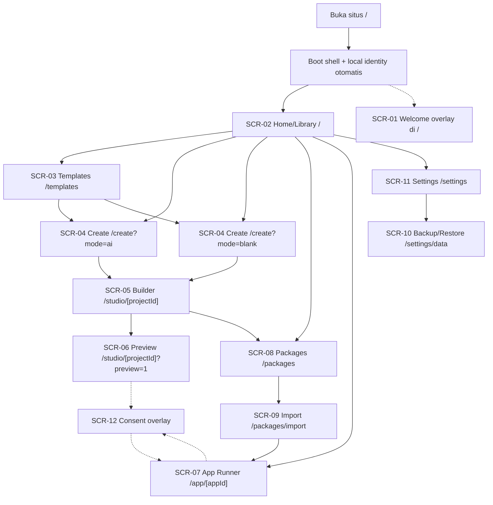

# Arsitektur Informasi

## 1. Tujuan dan Ruang Lingkup

Dokumen ini menetapkan peta situs, route, model layar, pola navigasi, dan state global untuk MicroApp Studio versi web. Semua layar dirinci di [screen-specs.md](screen-specs.md); token visual mengikuti [design-system.md](design-system.md), dengan `DESIGN.md` di root repo sebagai sumber visual kanonik.

Di dalam: 12 layar kanonik `SCR-01` sampai `SCR-12`, route Next.js App Router, navigasi desktop/tablet/mobile, state global, state layar, pencarian, dan deep link. Di luar: wireframe per layar ([screen-specs.md](screen-specs.md)), perilaku mikro kontrol ([interaction-patterns.md](interaction-patterns.md)), dan kontrak render micro-app ([ui-protocol.md](../03-specs/ui-protocol.md)).

## 2. Prinsip

| Prinsip | Konsekuensi |
|---|---|
| Satu jalur pulang | Setiap layar kembali ke Home maksimum dua aksi; `Esc` menutup lapisan teratas. |
| Tanpa akun dan tanpa gate | Tidak ada route login, registrasi, atau onboarding yang memblokir Home (FR-SHELL-002). |
| Satu aksi utama per layar | Hanya satu tombol `primary` per layar; aksi sekunder memakai `secondary` atau `ghost`. |
| Offline adalah normal | Kerangka layar, navigasi, dan app terpasang tidak pernah menunggu jaringan (FR-SHELL-003, NFR-REL-001). |
| State dapat dipulihkan | Route, filter, device frame, dan posisi scroll dipulihkan setelah reload (FR-SHELL-016). |
| Layar punya tujuan tunggal | Layar baru hanya dibuat bila tujuan, state, dan acceptance berbeda. |

## 3. Peta Situs

Tidak ada node terpisah untuk riwayat, akun, atau konsol admin. Semua tujuan dapat dicapai dari Home, sidebar, atau command palette.

## 4. Route Web

| Route | Layar | Surface | Guard |
|---|---|---|---|
| `/` | SCR-02 Home/Library, dengan SCR-01 sebagai overlay sekali tampil | Halaman | Workspace default selalu ada (FR-SHELL-015) |
| `/templates` | SCR-03 Templates | Halaman | — |
| `/create?mode=ai` | SCR-04 Create jalur AI | Halaman | Provider opsional; tanpa key tetap dapat memakai fallback |
| `/create?mode=blank` | SCR-04 Create jalur kosong | Halaman | — |
| `/studio/[projectId]` | SCR-05 Builder | Halaman tanpa sidebar | `projectId` milik workspace aktif |
| `/studio/[projectId]?preview=1` | SCR-06 Preview | State dari SCR-05 | Draft dapat dibuka |
| `/app/[appId]` | SCR-07 App Runner | Halaman sandbox | App terpasang dan manifest valid |
| `/packages` | SCR-08 Packages/Share | Halaman | — |
| `/packages/import` | SCR-09 Import/Install | Modal di atas `/packages`, dapat dimuat langsung | File atau URL index dipilih pengguna |
| `/settings` | SCR-11 Settings | Halaman | — |
| `/settings/general` | SCR-11 Settings — tema, locale, gerak | Halaman | — |
| `/settings/permissions` | SCR-11 Settings — grant dan revoke | Halaman | — |
| `/settings/ai` | SCR-11 Settings — BYOK | Halaman | — |
| `/settings/data` | SCR-10 Backup/Restore, storage, reset | Halaman | — |
| `/settings/about` | SCR-11 Settings — versi dan lisensi | Halaman | — |
| `/settings/dev` | SCR-11 Settings — DevTools lokal | Halaman | Flag DevTools aktif (FR-SET-010) |
| Overlay global | SCR-12 Permission Consent | Lapisan di atas route mana pun | Panggilan bridge belum di-grant |

Aturan route:

- Route tidak dikenal menampilkan surface "Tidak ditemukan" di dalam shell dengan tautan Home; tidak memuat ulang aplikasi.
- `/studio/[projectId]` dan `/app/[appId]` memakai ID stabil, bukan nama tampilan.
- Query `?preview=1` tidak membuat dokumen baru; ia hanya mengganti surface kanvas dengan sandbox.
- `/packages/import` selalu dapat ditutup dengan `Esc`; penutupan membatalkan verifikasi yang belum selesai.
- Tidak ada route yang membutuhkan jaringan untuk merender kerangka layar.
- Route lama `/registry`, `/settings/vault`, `/settings/sync`, dan `/settings/storage` dialihkan ke route di atas tanpa kehilangan data ([07-settings.md](../03-specs/07-settings.md)).

## 5. Model Layar

| ID | Nama | Route | Tujuan | Entry point |
|---|---|---|---|---|
| SCR-01 | Welcome/First Run | Overlay di `/` | Menyambut pengguna baru, menyatakan identitas lokal sudah dibuat, menawarkan CTA create | First load setelah identitas dibuat |
| SCR-02 | Home/Library | `/` | Meluncurkan app, mencari, melihat draft terbaru, impor package | Boot, sidebar, Home |
| SCR-03 | Templates | `/templates` | Menjelajah template per kategori dan melihat preview | Home, sidebar |
| SCR-04 | Create | `/create?mode=ai` atau `?mode=blank` | Membuat draft dari prompt AI atau layout kosong | Home, Templates |
| SCR-05 | Builder | `/studio/[projectId]` | Menyusun UI dengan palette, kanvas, dan inspector | Create, Home |
| SCR-06 | Preview | `/studio/[projectId]?preview=1` | Menguji draft di sandbox dan device frame | Builder |
| SCR-07 | App Runner | `/app/[appId]` | Menjalankan app terpasang dengan permission JIT dan boundary | Home, Import, deep link |
| SCR-08 | Packages/Share | `/packages` | Melihat package terpasang, mengekspor `.mapp`, mengelola sumber index | Sidebar, Builder |
| SCR-09 | Import/Install | `/packages/import` | Memverifikasi file `.mapp`, meninjau permission, memasang | Home, Packages |
| SCR-10 | Backup/Restore | `/settings/data` | Membuat backup terenkripsi, restore, storage, reset | Settings, pengingat backup |
| SCR-11 | Settings | `/settings` dan subroute | Tema, locale, permission, BYOK, recovery, about, DevTools | Sidebar |
| SCR-12 | Permission Consent | Overlay global | Meminta consent JIT dengan default tolak | Bridge call pertama |

## 6. Navigasi

### 6.1 Desktop (≥ 1024 px)

Sidebar tetap selebar **264 px** berisi:

1. Wordmark dan workspace switcher (hanya tampil bila ada lebih dari satu workspace).
2. Item utama: **Home**, **Templates**, **Packages**, **Settings**.
3. Tombol `primary` **Buat** yang membuka SCR-04 dengan mode terakhir dipakai.
4. Footer: badge penyimpanan, indikator offline, dan status identitas.

Konten memakai lebar maksimum 1200 px pada breakpoint `xl` (≥ 1280 px). Sidebar dapat diciutkan menjadi rail 80 px; status ciut disimpan di preferensi lokal.

### 6.2 Tablet (768–1023 px)

Rail **80 px** hanya ikon dengan tooltip dan `aria-label`. Empat item yang sama; tombol **Buat** menjadi FAB bulat 56 px di kanan bawah konten. Panel inspector atau detail menjadi sheet samping selebar 360 px.

### 6.3 Mobile (< 768 px)

Bottom dock berisi empat item: **Home**, **Templates**, **Packages**, **Settings**, ditambah FAB **Buat** di atas dock. Header hanya memuat judul layar, tombol kembali, dan aksi kontekstual. Pencarian dibuka sebagai overlay penuh dari ikon search. Tidak ada sidebar, split view, picture-in-picture, atau window manager.

### 6.4 Builder

SCR-05 menyembunyikan sidebar utama dan memakai:

- **Top bar**: kembali, nama project inline, status simpan, undo/redo, device switcher, **Preview**, **Bagikan**.
- **Desktop**: palette kiri 280 px, kanvas tengah, inspector kanan 320 px.
- **Tablet**: palette menjadi sheet kiri 320 px; inspector sheet kanan.
- **Mobile**: kanvas penuh; panel bawah memakai tab **Tambah**, **Layer**, **Atur** dan dapat ditarik setinggi 50% atau 90%.

## 7. State Global

| State | Nilai | Sumber | Tampilan |
|---|---|---|---|
| Workspace | ID dan nama workspace aktif; default tunggal | SQLite `workspaces` | Switcher hanya muncul bila jumlah > 1 |
| Tema | `light`, `dark`, `high-contrast` dengan komponen clay | Settings; `prefers-color-scheme` hanya memilih light/dark | `data-theme` pada `<html>`; token berubah tanpa reload (FR-SET-001) |
| Locale | `id-ID` atau `en-US`; arah teks `ltr`/`rtl` | Settings + `navigator.language` | Semua string dari kamus; `dir` pada `<html>` (FR-SET-002) |
| Offline | `online`, `offline`, `cache-only` | `navigator.onLine` + service worker | `OfflineBanner` global, tidak menghalangi navigasi (FR-SHELL-011) |
| Storage | Estimasi pemakaian, kuota, status kritis | `navigator.storage.estimate()` | Badge di sidebar/footer; peringatan > 80% (FR-SHELL-012) |
| Active app | `appId`, lifecycle, focus, consent scope | Router + runtime | Menentukan header runner, audit, dan binding consent |
| Save status | `saved`, `saving`, `dirty`, `error` | Builder | Teks status di top bar; tidak ada tombol Save wajib (FR-STUDIO-011) |
| Consent queue | Daftar permintaan bridge yang menunggu | Broker | Satu sheet pada satu waktu; sisanya antre (SEC-003) |
| Install job | File, tahap verifikasi, hasil | Package service | Progress di SCR-09; dapat dibatalkan |

State global MUST disimpan secara lokal. Tidak ada state yang dikirim ke host lain, dan tidak ada telemetry (SEC-013).

## 8. State Layar

| State | Aturan | Contoh |
|---|---|---|
| Loading | Skeleton berbentuk layout final; tidak ada spinner layar penuh > 300 ms | Kartu library, baris tabel, kerangka builder |
| Empty | Ilustrasi clay ringan, satu kalimat penjelas, satu aksi utama | Home tanpa app: tiga kartu create |
| Error | Kode `E-*`, ringkasan aman, satu aksi pemulihan, retry | `E-PACK-001` pada impor |
| Offline | Tetap menampilkan data lokal; banner tipis; aksi yang butuh jaringan diberi label | Import dari URL index saat offline |
| Partial | Bagian yang gagal menampilkan inline error; bagian lain tetap berfungsi | Satu kartu preview gagal dimuat |
| Read-only | Banner alasan; kontrol tulis `disabled` dengan tooltip | Restore sedang berjalan |

Setiap state MUST diumumkan lewat live region dan MUST NOT bergantung pada warna saja ([accessibility.md](accessibility.md)).

## 9. Pencarian dan Command Palette

- Satu kolom pencarian di Home dan header mobile, dengan hasil terkelompok: **App**, **Project**, **Record**, **Aksi**.
- Pencarian memakai FTS5 lokal; target < 100 ms untuk 100.000 record (FR-SHELL-005).
- `Cmd/Ctrl+K` membuka command palette dari layar mana pun, termasuk builder; hasil mencakup navigasi, aksi builder, dan app.
- Pencarian tidak pernah memicu jaringan dan tidak mencampur hasil antar workspace.
- Hasil kosong menampilkan saran aksi, bukan halaman kosong.

## 10. Deep Link

Format kanonik: `microapp://<source>/<appId>/<route>?<params>`. Padanan web: `https://<host>/?target=<encoded microapp URL>`.

| Skenario | Perilaku |
|---|---|
| App terpasang | Buka `/app/[appId]` dan teruskan route setelah `onMount` |
| App belum terpasang, file tersedia lokal | Buka SCR-09 dengan penawaran pasang, lalu lanjutkan |
| App belum terpasang, tidak ada file | Tampilkan penjelasan offline dan aksi salin tautan |
| Route atau param tidak valid | Buang param, buka route dasar, tampilkan toast |
| Target berasal dari app lain | Wajib melewati consent (SCR-12) sebelum diteruskan |

Host hanya meneruskan route dan param yang lolos validasi; URL mentah tidak pernah diberikan ke micro-app ([host-bridge.md](../03-specs/host-bridge.md)).

## 11. Referensi

- [screen-specs.md](screen-specs.md)
- [interaction-patterns.md](interaction-patterns.md)
- [accessibility.md](accessibility.md)
- [design-system.md](design-system.md)
- [component-catalog.md](component-catalog.md)
- [01-app-shell.md](../03-specs/01-app-shell.md)
- [02-studio.md](../03-specs/02-studio.md)
- [07-settings.md](../03-specs/07-settings.md)
- [host-bridge.md](../03-specs/host-bridge.md)
- [FLOW-01 First Run](../04-flows/01-first-run.md)
- [FLOW-02 Create App](../04-flows/02-create-app.md)
