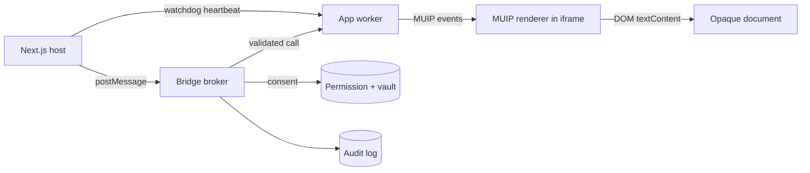

# Sandbox Runtime

## 1. Tujuan

Menetapkan kontrak eksekusi micro-app di browser: iframe opaque origin, CSP ketat, worker logika, renderer MUIP, satu kanal bridge, pemeriksaan permission per panggilan, watchdog, batas crash, dan fail-closed. Runtime adalah satu-satunya tempat kode pihak ketiga berjalan.

## 2. Ruang Lingkup

Di dalam: iframe sandbox, CSP, worker, bridge broker, watchdog, lifecycle, restart budget, audit runtime. Di luar: format package ([05-packages.md](05-packages.md)), definisi permission ([permissions.md](permissions.md)), kontrak UI ([ui-protocol.md](ui-protocol.md)).

## 3. Requirement

| ID | Level | Requirement | Acceptance |
|---|---|---|---|
| FR-RUN-001 | MUST | Setiap app berjalan di iframe dengan `sandbox="allow-scripts"` dan tanpa `allow-same-origin`. | `iframe.sandbox` tepat `allow-scripts`; `contentWindow.origin` opaque. |
| FR-RUN-002 | MUST | Dokumen iframe memakai CSP `default-src 'none'` dengan nonce untuk bootstrap. | Header meta CSP ada; script tanpa nonce diblokir. |
| FR-RUN-003 | MUST | Logika app dieksekusi di worker tanpa akses DOM host. | Worker tidak menerima `window`/`document`; bundle berjalan di worker atau iframe. |
| FR-RUN-004 | MUST | Renderer MUIP memvalidasi setiap node dan menolak HTML, CSS, atau JS arbitrer. | Node di luar skema ditolak; `innerHTML` tidak dipakai. |
| FR-RUN-005 | MUST | Bridge adalah satu-satunya kanal app ke host. | Tidak ada `postMessage` ad-hoc di luar namespace bridge. |
| FR-RUN-006 | MUST | Setiap panggilan bridge memeriksa permission pada saat panggilan. | Grant yang dicabut langsung menggagalkan panggilan berikutnya. |
| FR-RUN-007 | MUST | Consent JIT diminta sebelum akses pertama ke permission yang belum granted. | Panggilan pertama memicu sheet consent; hasil allow/deny dihormati. |
| FR-RUN-008 | MUST | Watchdog 5 detik tanpa heartbeat menghentikan eksekusi app. | Freeze/infinite loop menghasilkan `E-RUN-001` dan boundary. |
| FR-RUN-009 | MUST | Error boundary menyediakan muat ulang, ekspor data, dan kembali ke Home. | Ketiga aksi terlihat; app lain tidak terpengaruh. |
| FR-RUN-010 | MUST | Restart dibatasi 3 kali per 5 menit per app. | Percobaan keempat menonaktifkan tombol dengan penjelasan. |
| FR-RUN-011 | MUST | Lifecycle memanggil `onMount`, `onFocus`, `onBlur`, `onBackground`, `onUnmount` tepat sekali per transisi. | Urutan terverifikasi pada buka, pindah tab, dan tutup. |
| FR-RUN-012 | MUST | App di background dihentikan atau dihibernasi setelah 30 detik. | Timer berhenti; state dipulihkan saat kembali. |
| FR-RUN-013 | MUST | Jika sandbox tidak tersedia, runtime gagal tertutup tanpa eksekusi alternatif. | Browser tanpa iframe sandbox menampilkan `E-RUN-002`; tidak ada fallback eval. |
| FR-RUN-014 | MUST | Panggilan bridge, permission, dan crash dicatat di audit lokal. | Audit memuat waktu, app, method, hasil; tanpa secret. |

Error yang mengikat: `E-RUN-001` untuk watchdog timeout, `E-RUN-002` untuk sandbox tidak tersedia, `E-RUN-003` untuk pelanggaran bridge/permission, `E-RUN-004` untuk crash renderer.

## 4. Arsitektur Eksekusi

Urutan validasi panggilan bridge yang mengikat:

1. Cek asal pesan dan `event.source` cocok dengan iframe app.
2. Cek bentuk pesan terhadap skema bridge.
3. Cek method ada di allowlist manifest.
4. Cek permission granted; jika belum, jalankan consent JIT.
5. Cek rate limit dan ukuran payload.
6. Jalankan handler host, lalu audit hasil.

Kegagalan pada langkah 1–5 menghasilkan `E-RUN-003` dan tidak menjalankan handler.

## 5. Batas Isolasi

Iframe opaque origin mencegah akses cookie, storage host, dan DOM induk. Ini bukan isolasi proses: app tetap berbagi renderer process dengan host. Dokumen dan UI MUST NOT mengklaim isolasi memori tingkat OS atau sandbox native. Worker dipakai untuk memisahkan loop logika dari thread UI, bukan sebagai batas keamanan tambahan.

## 6. Watchdog dan Budget

Heartbeat dikirim app setiap 1 detik. Tiga heartbeat hilang berturut-turut memicu penghentian. Setelah penghentian, runtime mencatat `E-RUN-001`, menampilkan boundary, dan membekukan restart selama 30 detik pertama. Budget 3 restart per 5 menit dihitung per app per sesi.

## 7. Acceptance Criteria

1. Iframe hanya memiliki `allow-scripts`; tidak ada akses `parent`/`top`.
2. Script tanpa nonce tidak berjalan; `fetch` eksternal diblokir CSP.
3. Permission yang dicabut menggagalkan panggilan berikutnya tanpa reload.
4. Freeze loop menghasilkan boundary dalam ≤ 8 detik.
5. Restart keempat dalam 5 menit ditolak.
6. Audit memuat seluruh panggilan yang diizinkan dan ditolak.

## 8. Verifikasi

| Pemeriksaan | Cara |
|---|---|
| Atribut sandbox | Vitest: render runner, cek `sandbox` dan tidak ada `allow-same-origin`. |
| CSP | Playwright: eval injeksi script tanpa nonce, pastikan diblokir. |
| Permission per call | Vitest: grant lalu revoke, panggilan kedua gagal `E-RUN-003`. |
| Watchdog | Vitest: worker mock tanpa heartbeat, fake timer 5 s. |
| Restart budget | Vitest: empat restart, keempat ditolak. |
| Audit | Vitest: dua panggilan, dua entri tanpa payload sensitif. |
