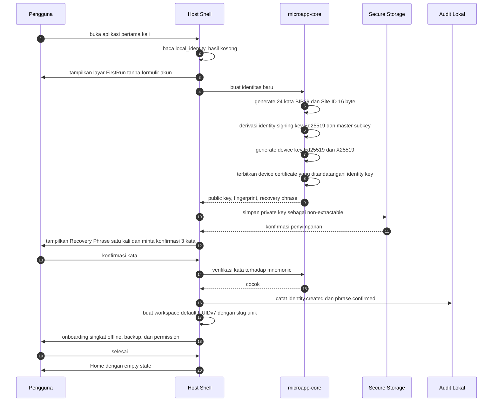

# FLOW-01 First Run

Alur ini menjelaskan launch pertama pada perangkat tanpa Local Identity: pembuatan identitas, penyimpanan kunci, konfirmasi Recovery Phrase, workspace default, dan onboarding sampai Home tampil. Seluruh alur MUST selesai tanpa akun, tanpa server, dan tanpa jaringan.

## Trigger

- Host dibuka untuk pertama kali dan tabel `local_identity` kosong.
- Pengguna memilih "Mulai tanpa akun" pada layar sambutan.
- Instalasi ulang memakai storage baru sehingga identitas lama tidak ditemukan, sementara berkas backup tersedia terpisah.
- Migrasi Phase 0 menghapus sesi auth lama dan tidak menemukan Local Identity pengganti.

## Aktor

| Aktor | Peran |
|---|---|
| Pengguna | Menyimpan Recovery Phrase, mengonfirmasi tiga kata, menamai workspace |
| Host Shell | Orkestrasi first run, layar onboarding, pembuatan workspace default |
| `microapp-core` | Pembuatan mnemonic, derivasi kunci, sertifikat perangkat, penandatanganan |
| Secure storage | Keychain, Keystore, atau WebCrypto non-extractable untuk private key |
| Vault | Dibuat saat data sensitif pertama disimpan, bukan saat first run |
| Audit lokal | Mencatat pembuatan identitas dan konfirmasi frasa tanpa material rahasia |

## Prasyarat

- Aplikasi Host terpasang dan aset shell tersedia lokal agar onboarding berjalan offline.
- Secure storage dapat diakses; OPFS tersedia atau degradasi `ephemeral` sudah diketahui pengguna.
- Tidak ada akun, email, nomor telepon, atau sesi server yang diperlukan.
- Waktu perangkat wajar; pergeseran jam lebih dari 5 menit hanya memengaruhi peringatan HLC, bukan pembuatan identitas.
- Ruang penyimpanan cukup untuk database host, workspace default, dan arsip kunci.

## Alur Utama

1. Host MUST memeriksa `local_identity` sebelum merender Home, MUST membuat pasangan kunci Ed25519/X25519 di perangkat, dan MUST NOT memanggil jaringan pada alur ini (FR-HOST-001).
2. `microapp-core` MUST membuat mnemonic 24 kata dan Site ID 16 byte; implementasi kriptografi MUST berada di core Rust, bukan TypeScript atau Dart.
3. Identity signing key MUST diturunkan dari Recovery Phrase; device key Ed25519 dan X25519 MUST dibuat acak per perangkat dan disertifikasi identity key.
4. Private key MUST disimpan melalui secure storage sebagai non-extractable dan MUST NOT ditulis ke localStorage, IndexedDB biasa, log, atau backup plaintext (FR-HOST-002).
5. Recovery Phrase MUST ditampilkan satu kali dan konfirmasi tiga kata acak MUST berhasil sebelum data sensitif pertama disimpan (FR-HOST-003).
6. Workspace default MUST dibuat dengan UUIDv7 dan slug unik; minimal satu workspace MUST ada sebelum Home dirender (FR-HOST-007).
7. Onboarding SHOULD menjelaskan mode offline, cara menyimpan frasa, dan bahwa server bersifat opsional.
8. Launcher MUST berpindah `cold → restoring → ready`; kegagalan restore MUST jatuh ke `ready` dengan state default, bukan crash (FR-HOST-024).
9. Seluruh layar first run MUST dapat diselesaikan dengan keyboard dan mengumumkan perubahan status melalui live region (FR-HOST-028).

## Cabang Gagal

| Kondisi | Deteksi | Kode | Perilaku sistem |
|---|---|---|---|
| Secure storage tidak tersedia atau menolak penulisan kunci | Keychain/Keystore/WebCrypto gagal | E-HOST-001 | Tawarkan kunci turunan passphrase dengan peringatan; blokir data sensitif sampai berhasil; jangan menyimpan kunci di storage longgar |
| OPFS tidak tersedia, misalnya private mode | Probe OPFS gagal | E-HOST-002 | Jalankan mode `ephemeral`, tampilkan status permanen, izinkan ekspor saja |
| Konfirmasi tiga kata salah | Perbandingan mnemonic gagal | E-AUTH-002 | Tolak tanpa menyebut kata yang salah, batasi percobaan, tawarkan tampilan frasa ulang satu kali |
| Sertifikat perangkat gagal diverifikasi | Verifikasi Ed25519 internal gagal | E-AUTH-001 | Batalkan pembuatan identitas, regenerasi device key, catat audit |
| Vault diminta sebelum konfirmasi frasa | Pemanggilan Vault tanpa prasyarat | E-HOST-004 | Tolak pembukaan Vault, arahkan kembali ke konfirmasi frasa |
| Pembuatan workspace default gagal | Constraint slug atau tulis database gagal | E-DATA-001 | Jangan buat database kosong diam-diam; tampilkan panel error dengan retry |

## Data dan State

| Entitas | Field kunci | Invariant |
|---|---|---|
| `local_identity` | `id`, `site_id`, `identity_pubkey`, `key_agreement_pubkey`, `hkdf_salt`, `created_at_ms` | Satu baris per instalasi; private key tidak pernah ada di tabel |
| `workspaces` | `id` (UUIDv7), `name`, `slug`, `is_default`, `created_at_ms` | Minimal satu workspace; tepat satu `is_default = 1` |
| `vault_items` | `id`, `ciphertext`, `nonce`, `key_id` | Tidak dibuat sebelum konfirmasi frasa |
| `audit_log_chain` | `seq_id`, `actor`, `action`, `target`, `prev_hash`, `entry_hash` | Mencatat `identity.created` dan `phrase.confirmed` tanpa isi frasa |

State onboarding: `welcome → identity_created → phrase_shown → phrase_confirmed → workspace_ready → home`.

- Recovery Phrase MUST NOT disimpan di database, berkas, atau log; hanya tampilan sekali dan hash turunan untuk verifikasi.
- Site ID MUST dibuat sekali dan tidak berubah setelahnya.
- `hkdf_salt` disimpan sebagai nilai non-rahasia dan dipakai untuk semua derivasi subkey.

## Izin dan Keamanan

- Alur ini MUST NOT meminta permission micro-app apa pun; belum ada micro-app yang berjalan dan zero privilege berlaku sejak awal (SEC-014).
- Private key MUST tetap di secure storage dan MUST NOT pernah diteruskan ke UI, micro-app, atau bridge.
- Vault MUST memerlukan biometrik, PIN, atau passphrase saat dibuka, dan terkunci otomatis setelah 5 menit tanpa interaksi (FR-HOST-016).
- Audit lokal MUST mencatat pembuatan identitas, konfirmasi frasa, dan kegagalan secure storage tanpa PII.
- Tidak ada telemetry; tidak ada permintaan jaringan pada alur ini, termasuk saat menampilkan katalog atau saran.
- Passphrase BIP39 opsional MUST NOT dipromosikan sebagai pengganti entropy frasa.

## Perilaku Offline

- Seluruh alur MUST berjalan penuh offline, termasuk PWA yang sudah pernah dimuat dan aplikasi native.
- Tidak ada pengecekan versi, unduhan model, atau sinkronisasi selama first run.
- Bila jaringan tersedia, Host MUST tetap tidak memakainya; penawaran sync dan backup muncul setelah Home.
- Pada perangkat tanpa OPFS, mode `ephemeral` MUST memberi tahu bahwa data hilang saat aplikasi ditutup dan hanya ekspor yang dijamin.

## Acceptance Criteria

- **Given** perangkat kosong tanpa jaringan **When** aplikasi dibuka pertama kali **Then** `local_identity` berisi `site_id`, `identity_pubkey`, dan `key_agreement_pubkey`, workspace default dibuat, dan Home tampil tanpa satu pun request jaringan.
- **Given** secure storage tidak tersedia **When** pembuatan identitas dijalankan **Then** `E-HOST-001` ditampilkan, kunci turunan passphrase ditawarkan, dan data sensitif tetap diblokir sampai kunci tersimpan.
- **Given** Recovery Phrase ditampilkan **When** pengguna memasukkan tiga kata yang salah **Then** konfirmasi ditolak tanpa membocorkan kata yang salah dan percobaan dibatasi.
- **Given** OPFS tidak tersedia **When** first run selesai **Then** mode `ephemeral` aktif, status terlihat permanen, dan ekspor tetap tersedia.
- **Given** pengguna hanya memakai keyboard **When** menyelesaikan first run **Then** seluruh langkah dapat diselesaikan dan fokus tidak terperangkap.
- **Given** proses dihentikan paksa setelah frasa dikonfirmasi **When** aplikasi dibuka lagi **Then** identitas dan workspace yang sama dipulihkan tanpa menampilkan frasa ulang.

## Verifikasi

| Bukti | Prosedur |
|---|---|
| Kriptografi | Test vector mnemonic, derivasi HKDF, dan verifikasi sertifikat perangkat di `microapp-core` |
| Offline | E2E dengan jaringan dimatikan total: launch, konfirmasi frasa, Home |
| Penyimpanan kunci | Pemindaian localStorage, IndexedDB, log, dan crash report tidak menemukan material private key |
| Fallback | Simulasi secure storage tidak tersedia; pastikan `E-HOST-001` dan pemblokiran data sensitif |
| Degradasi | Simulasi OPFS tidak tersedia; pastikan mode `ephemeral` dan ekspor |
| Aksesibilitas | Uji keyboard-only dan screen reader untuk layar first run dan dialog konfirmasi |

## Referensi

- [README.md](README.md)
- [03-specs/01-host-shell.md](../03-specs/01-host-shell.md)
- [03-specs/permissions.md](../03-specs/permissions.md)
- [03-specs/error-codes.md](../03-specs/error-codes.md)
- [01-architecture/identity-crypto.md](../01-architecture/identity-crypto.md)
- [13-phase0-migration.md](13-phase0-migration.md)
