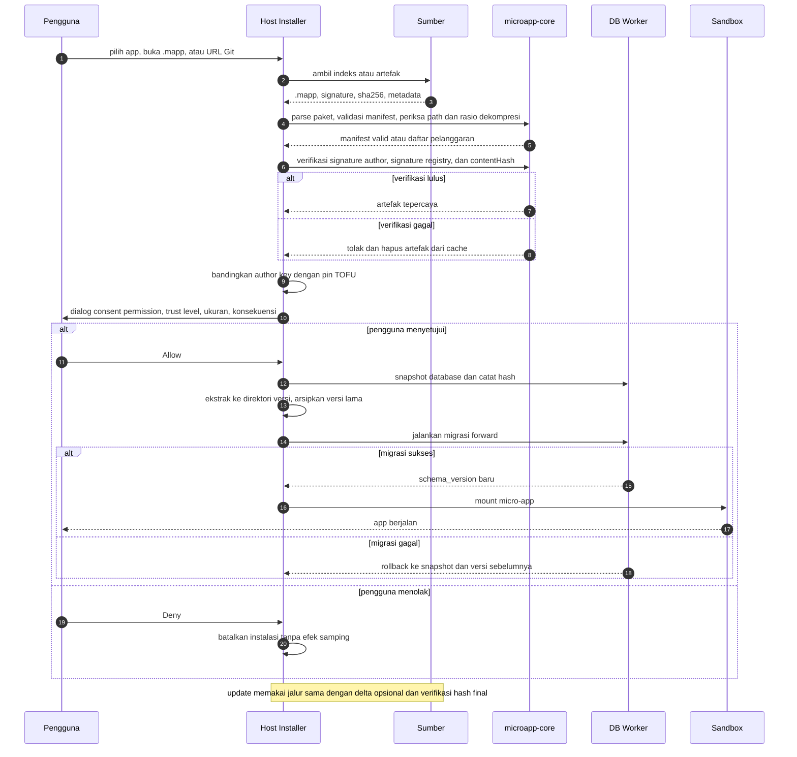

# FLOW-02 Instalasi, Update, dan Rollback

Alur ini menjelaskan perpindahan artefak dari sumber tepercaya ke micro-app yang berjalan: verifikasi manifest, signature, dan hash, consent permission, snapshot database, migrasi, launch, serta jalur update, pin, dan rollback. Tidak ada byte paket yang dieksekusi sebelum verifikasi selesai.

## Trigger

- Pengguna membuka berkas `.mapp` melalui file picker atau tautan `microapp://`.
- Pengguna menekan Install pada detail app di registry.
- Pengguna memasang dari URL repository Git atau tag tertentu.
- Pemeriksaan update menemukan versi baru untuk app dengan mode `auto` atau `notify`.
- Admin organisasi mendorong paket internal ke perangkat yang terdaftar.
- Pengguna menekan Rollback pada detail app atau pada error boundary.

## Aktor

| Aktor | Peran |
|---|---|
| Pengguna | Memilih sumber, menyetujui atau menolak permission, memilih mode update |
| Host Installer | Orkestrasi unduhan, consent, snapshot, ekstraksi, dan launch |
| `microapp-core` | Parse `.mapp`, verifikasi signature dan hash, validasi manifest |
| Sumber | Registry, repository Git, berkas lokal, atau server self-host |
| DB Worker | Snapshot, migrasi, dan rollback database micro-app |
| Sandbox runtime | Mount micro-app setelah verifikasi dan consent |
| Audit lokal | Mencatat sumber, versi, hasil verifikasi, dan keputusan pengguna |

## Prasyarat

- Local Identity dan workspace aktif tersedia.
- Manifest lolos JSON Schema dan aturan `manifest-v2.md`: regex `id`, semver, path relatif tanpa `..`.
- `minHostVersion` sudah dibandingkan dengan versi Host sebelum unduhan dimulai.
- Ruang penyimpanan cukup untuk paket, arsip versi sebelumnya, dan snapshot database.
- Kunci registry dan kunci author tersedia untuk verifikasi; pin TOFU author sudah ada atau akan dibuat pada instalasi pertama.
- Batas ukuran total, jumlah entry, dan rasio dekompresi `.mapp` diketahui sebelum ekstraksi.

## Alur Utama

1. Host MUST memverifikasi manifest, signature author, signature registry, dan `contentHash` sebelum dialog consent dirender; artefak yang diubah MUST gagal sebelum consent (FR-REG-007).
2. Manifest MUST divalidasi terhadap JSON Schema; `id` yang tidak sesuai regex, semver tidak valid, atau path dengan `..` MUST ditolak (FR-REG-011).
3. `minHostVersion` MUST dibandingkan sebelum unduh; Host yang terlalu lama MUST menolak dengan pesan yang menyebut versi minimum.
4. Client MUST menerapkan TOFU: fingerprint author dipin pada instalasi pertama dan dibandingkan pada setiap update; perbedaan kunci MUST memblokir update sampai persetujuan eksplisit (FR-REG-013).
5. Dialog consent MUST memuat permission required/optional, risk tier, ukuran unduhan, sumber, trust level, dan konsekuensi Offline Cage (FR-REG-016).
6. Snapshot database atomic beserta hash MUST dibuat sebelum migrasi; snapshot inilah yang dipakai rollback (FR-DATA-010).
7. Migrasi MUST dijalankan sebagai forward migration bernomor dari `db/migrations/`; kegagalan MUST mengembalikan database dan versi app sebelumnya tanpa kehilangan data (FR-DATA-011).
8. Update dengan mode `pin` MUST NOT mengubah versi, delta MUST NOT diterapkan, dan hanya notifikasi yang boleh muncul (FR-REG-019).
9. Update dengan delta MUST memverifikasi hash artefak final terhadap hash versi target penuh; kegagalan MUST jatuh ke unduhan penuh atau pembatalan (FR-REG-017).
10. Rollback MUST memverifikasi signature versi lama, membuat snapshot sebelum menerapkan, dan memulihkan skema sesuai snapshot (FR-REG-020).
11. Setiap operasi fetch, verifikasi, install, update, rollback, dan penolakan MUST dicatat di audit lokal tanpa payload sensitif (FR-REG-025).

## Cabang Gagal

| Kondisi | Deteksi | Kode | Perilaku sistem |
|---|---|---|---|
| Signature author atau signature registry tidak valid | Verifikasi Ed25519 gagal | E-REG-001 | Instalasi diblokir, artefak dihapus dari cache unduhan |
| Author key berbeda dari pin TOFU | Fingerprint tidak cocok dengan `registry_pins` | E-REG-002 | Update ditahan sampai pengguna menerima kunci baru secara eksplisit; penolakan mempertahankan versi terpasang |
| Isi artefak berubah setelah publikasi | `sha256` tidak cocok dengan indeks | E-REG-003 | Artefak ditolak dan dihapus; unduhan ulang dari sumber sah ditawarkan |
| Scanner menolak artefak | SAST, SCA, obfuscation, atau audit permission melampaui ambang | E-REG-004 | Instalasi diblokir dan temuan dengan severity ditampilkan |
| Patch delta gagal | Hash hasil patch tidak cocok | E-REG-005 | Unduh paket penuh ditawarkan; update dibatalkan bila verifikasi tetap gagal |
| Migrasi database gagal | Migrasi error atau constraint dilanggar | E-DATA-002 | Database dikembalikan ke snapshot, versi app sebelumnya dipulihkan, pengguna diberi tahu |
| Database tidak dapat dibuka setelah migrasi | `PRAGMA user_version` atau integritas gagal | E-DATA-001 | Jangan membuat database kosong; tawarkan restore snapshot dan ekspor data |
| Signature versi lama rusak saat rollback | Verifikasi arsip gagal | E-CRYPTO-005 | Rollback dibatalkan, versi sekarang tetap berjalan |
| Kredensial Git ditolak | Autentikasi repository gagal | E-AUTH-004 | Minta ulang kredensial dari Vault, hapus dari memori, jangan tulis ke config |
| Registry tidak terjangkau | DNS atau timeout | E-NET-003 | Gunakan indeks cache; tampilkan status offline dan antrekan percobaan |
| Rate limit atau kuota sumber terlampaui | HTTP 429 atau kuota terlampaui | E-NET-005 | Backoff, kecilkan permintaan, catat audit |
| Isolate tidak dapat dibuat saat launch | Inisialisasi sandbox gagal | E-SBX-001 | Fail closed, tampilkan error boundary; app terpasang tetapi tidak dijalankan |
| Startup micro-app melewati watchdog | Watchdog 5 detik | E-SBX-004 | Batalkan mount, tawarkan restart atau rollback |

## Data dan State

| Entitas | Field kunci | Invariant |
|---|---|---|
| `registries` | `id`, `url`, `trust_level`, `priority`, `public_key` | Satu `public_key` aktif per sumber |
| `registry_pins` | `app_id`, `author_key_id`, `fingerprint`, `approved_at_ms` | Pin unik per app dan author; berubah hanya lewat persetujuan |
| `installed_microapps` | `id`, `app_id`, `version`, `content_hash`, `update_mode`, `source_id`, `pinned`, `installed_at_ms` | `content_hash` sama dengan indeks saat instalasi |
| `app_databases` | `id`, `app_install_id`, `schema_version`, `snapshot_hash` | Snapshot terakhir dapat diverifikasi |
| `schema_migrations` | `version`, `name`, `checksum`, `applied_at_ms` | Ledger sesuai `PRAGMA user_version` |
| `audit_log_chain` | `seq_id`, `action`, `target`, `metadata_json` | Setiap operasi registry tercatat |

State instalasi: `fetched → verified → consented → snapshotted → extracted → migrated → mounted`.

- Mode update MUST salah satu dari `auto`, `notify`, atau `pin` dan MUST bertahan per app setelah restart.
- Host MUST menyimpan arsip minimal satu versi sebelumnya per app selama batas penyimpanan belum terlampaui.
- Artefak yang gagal verifikasi MUST NOT masuk direktori eksekusi, meskipun sudah diunduh penuh.

## Izin dan Keamanan

- Consent permission MUST mengikuti katalog [03-specs/permissions.md](../03-specs/permissions.md); permission di luar manifest MUST ditolak tanpa dialog (SEC-014).
- Permission baru atau kenaikan risk tier pada update MUST memerlukan consent ulang; penurunan izin MUST mencabut grant yang tidak lagi dideklarasikan (SEC-020).
- Zero privilege berlaku sejak mount: micro-app tanpa grant tidak dapat mengakses resource apa pun meskipun manifest menyebutkannya.
- Kunci registry dan kunci author MUST terpisah; index yang ditandatangani kunci author MUST ditolak.
- Artefak yang ditandatangani kunci pada `revokedKeys` MUST ditolak meskipun signature valid.
- Eksekusi paket MUST terjadi di sandbox; `eval`, `new Function`, dan WebView tanpa sandbox MUST NOT dipakai sebagai fallback.
- Audit MUST mencatat grant, deny, revoke, key mismatch, dan hasil rollback tanpa isi payload.

## Perilaku Offline

- Instalasi dari `.mapp` lokal MUST berjalan penuh offline dengan verifikasi signature dan hash yang sama seperti registry.
- Katalog dari index cache MUST tetap dapat dibuka tanpa batas waktu; signature tetap diverifikasi setiap kali cache dimuat.
- Update dengan mode `auto` atau `notify` MUST ditunda saat offline dan dilanjutkan saat jaringan kembali atau saat paket tersedia lokal.
- Rollback dan uninstall MUST berjalan offline karena arsip versi dan snapshot berada di perangkat.
- Direct Git install offline hanya dapat memakai commit yang sudah diunduh; Host MUST NOT mengklaim berhasil tanpa artefak terverifikasi.

## Acceptance Criteria

- **Given** artefak diubah satu byte setelah indeks diterbitkan **When** klien mengunduh **Then** instalasi ditolak dengan `E-REG-003` sebelum dialog consent muncul.
- **Given** manifest memuat `id` tidak valid atau path `../` **When** divalidasi **Then** paket ditolak dan field bermasalah ditampilkan.
- **Given** author key berubah pada update **When** verifikasi TOFU dijalankan **Then** update diblokir dengan `E-REG-002` sampai pengguna menerima kunci baru.
- **Given** migrasi sengaja dirusak **When** update dijalankan **Then** database kembali ke snapshot, versi lama berjalan, dan jumlah record tidak berubah.
- **Given** mode `pin` aktif **When** versi baru tersedia **Then** versi tidak berubah dan hanya notifikasi yang muncul.
- **Given** patch delta korup **When** diterapkan **Then** unduhan penuh ditawarkan atau update dibatalkan tanpa merusak instalasi berjalan.
- **Given** pengguna menolak consent **When** dialog ditutup **Then** tidak ada berkas paket yang dieksekusi dan tidak ada perubahan pada database.
- **Given** rollback dipilih **When** dijalankan **Then** signature versi lama diverifikasi, snapshot dibuat, dan bundle serta skema kembali ke versi tersebut.

## Verifikasi

| Bukti | Prosedur |
|---|---|
| Verifikasi artefak | Fixture `.mapp` valid, signature rusak, hash tidak cocok, dan path traversal; pastikan kode yang muncul |
| TOFU | Ganti author key pada versi baru dan periksa blokir, audit, serta alur persetujuan |
| Migrasi | Fixture database versi lama, migrasi sukses, dan migrasi gagal; bandingkan jumlah record |
| Delta | Terapkan patch valid dan patch korup; pastikan hash final sama dengan unduhan penuh atau update dibatalkan |
| Pin dan rollback | Uji mode `auto`, `notify`, `pin`, lalu rollback satu klik dan verifikasi snapshot |
| Offline | Instal dari `.mapp` lokal dengan jaringan dimatikan, termasuk verifikasi signature |
| Sandbox | Pastikan app yang gagal mount menampilkan `E-SBX-001` dan tidak dieksekusi di luar sandbox |

## Referensi

- [README.md](README.md)
- [03-specs/05-registry.md](../03-specs/05-registry.md)
- [03-specs/04-data-automation.md](../03-specs/04-data-automation.md)
- [03-specs/manifest-v2.md](../03-specs/manifest-v2.md)
- [03-specs/error-codes.md](../03-specs/error-codes.md)
- [01-architecture/registry-supply-chain.md](../01-architecture/registry-supply-chain.md)
- [12-crash-recovery.md](12-crash-recovery.md)
