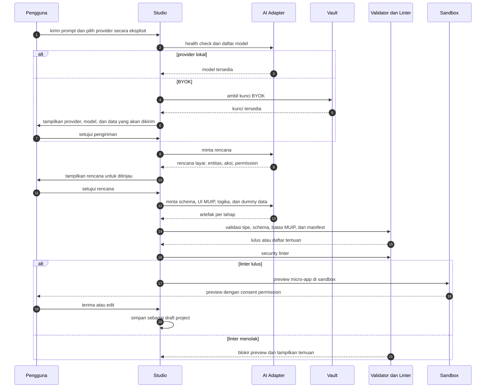

# FLOW-03 Build dengan AI

Alur ini menjelaskan pembangunan micro-app dari prompt sampai draft project yang tervalidasi: pemilihan provider eksplisit, perencanaan, generasi skema dan UI MUIP serta logika, validasi, security linter, preview di sandbox, lalu penerimaan atau pengeditan manual. Output model diperlakukan sebagai input yang tidak dipercaya.

## Trigger

- Pengguna mengirim prompt pada panel AI copilot di Studio.
- Pengguna memilih "Buat micro-app" dari empty state workspace atau Command Palette.
- Pengguna meminta regenerasi sebagian setelah menolak rencana atau hasil preview.
- Pengguna mengimpor screenshot atau berkas Figma sebagai referensi canvas.

## Aktor

| Aktor | Peran |
|---|---|
| Pengguna | Menulis prompt, memilih provider, meninjau rencana, menerima atau mengedit hasil |
| Studio | Menyusun rencana, memanggil adapter, menampilkan diff, menyimpan draft |
| AI adapter | Ollama, llama.cpp, vLLM, LM Studio, WebLLM, atau BYOK OpenAI-compatible |
| Vault | Menyimpan kunci BYOK dan kredensial; tidak pernah meneruskannya ke project |
| Validator dan linter | Memeriksa tipe, schema, MUIP, permission, dan pola berbahaya |
| Sandbox runtime | Menjalankan preview dengan isolasi dan consent |
| Audit lokal | Mencatat provider, model, hasil generasi, dan penolakan tanpa isi prompt |

## Prasyarat

- Project draft aktif di workspace; belum ada penulisan langsung ke database produksi.
- Provider dipilih eksplisit oleh pengguna; provider lokal terakhir yang berhasil menjadi default.
- Model lokal tersedia dan health check lulus, atau kunci BYOK tersedia di Vault.
- Permission `local_ai.inference` disetujui untuk inferensi lokal pada perangkat.
- Batas waktu diketahui: generasi 120 detik, pemuatan model lokal maksimal 300 detik.

## Alur Utama

1. Studio MUST meminta pilihan provider secara eksplisit pada sesi pertama dan MUST NOT berpindah provider otomatis karena timeout, error, atau offline (FR-STU-015).
2. Adapter lokal MUST diakses melalui loopback; adapter cloud MUST menampilkan nama provider, model, dan perkiraan data yang dikirim sebelum eksekusi pertama.
3. Kunci BYOK MUST dibaca dari Vault dan MUST NOT muncul di project, log, source control, atau prompt (FR-STU-016).
4. Rencana MUST memuat layar, entitas data, aksi, dan permission beserta justifikasi; pengguna MUST dapat menolak rencana sebelum generasi artefak.
5. Generasi MUST menghasilkan UI MUIP v1, skema database, validasi, logika sandbox, dan dummy data; setiap tahap MUST dapat diedit manual (FR-STU-017).
6. Validator MUST menolak `eval`, `new Function`, akses ambient, HTML mentah, dan pelanggaran batas MUIP sebelum preview.
7. Security linter MUST memblokir preview bila menemukan permission berisiko tinggi tanpa justifikasi atau rahasia di output.
8. Preview MUST berjalan di sandbox dengan zero privilege dan consent permission; kegagalan isolasi MUST fail closed.
9. Pembatalan pengguna MUST menghentikan stream dan MUST NOT memicu retry otomatis ke provider mana pun.
10. Hasil yang diterima MUST disimpan sebagai draft project; publikasi `.mapp` baru terjadi setelah lulus linter dan pack.

## Cabang Gagal

| Kondisi | Deteksi | Kode | Perilaku sistem |
|---|---|---|---|
| Provider lokal tidak tersedia atau health check gagal | Koneksi loopback ditolak atau model tidak dimuat | E-STU-002 | Tampilkan status dan tawarkan pilihan manual: provider lain, template, atau editor; tanpa perpindahan otomatis |
| Kunci BYOK tidak ada atau ditolak provider | Vault kosong atau HTTP 401/403 | E-STU-003 | Arahkan ke Vault, hentikan permintaan, jangan ulangi otomatis |
| Vault terkunci saat kunci BYOK dibutuhkan | Unlock gagal atau kedaluwarsa 5 menit | E-HOST-004 | Minta biometrik, PIN, atau passphrase; tetap terkunci bila gagal |
| Generasi melewati batas waktu | Timer 120 detik | E-STU-002 | Hentikan stream, tampilkan timeout, tanpa retry otomatis |
| Kode hasil generasi tidak dapat diparse | Parser Rust gagal | E-STU-001 | Tampilkan lokasi error, tawarkan regenerasi atau edit manual, jangan menerapkan artefak |
| Preview gagal karena isolate tidak tersedia | Inisialisasi sandbox gagal | E-SBX-001 | Fail closed; preview dan penerimaan diblokir, tidak ada eksekusi alternatif |
| Preview melewati kuota memori | Pemakaian melewati 128 MB mobile atau 512 MB desktop | E-SBX-002 | Hentikan isolate, tampilkan error boundary, pertahankan draft |
| Preview mengalami infinite loop | Watchdog 5 detik | E-SBX-003 | Hentikan isolate, tampilkan error boundary, tawarkan perbaikan atau regenerasi |
| Output meminta permission di luar manifest draft | Broker menolak panggilan | E-SBX-005 | Tolak panggilan, tampilkan permission yang diminta, minta pengguna memperbaiki rencana |
| Linter menemukan pola berbahaya | `eval`, `new Function`, atau rahasia di output | E-STU-005 | Blokir preview dan pack, tampilkan daftar temuan yang harus diperbaiki |

## Data dan State

| Entitas | Field kunci | Invariant |
|---|---|---|
| Draft project | `project_id`, `revision`, `provider_id`, `model`, `status` | Draft tidak menulis ke database produksi sampai diterima |
| Rencana generasi | `plan_id`, `screens[]`, `entities[]`, `permissions[]` | Setiap permission memiliki justifikasi |
| Artefak generasi | `schema`, `ui_tree`, `logic_module`, `dummy_data` | Setiap artefak lolos validasi sebelum preview |
| Sesi inferensi | `session_id`, `provider_id`, `model`, `started_at_ms`, `status` | Metadata saja; prompt dan output tidak dicatat di log |
| Audit lokal | `action`, `provider_id`, `result` | Mencatat generasi, penolakan linter, dan pembatalan tanpa isi prompt |

State sesi: `idle → provider_selected → planning → plan_approved → generating → validating → linting → previewing → accepted` dengan `* → cancelled` dan `* → failed`.

- Provider terakhir yang berhasil MUST disimpan sebagai default pada preferensi lokal, bukan pada project.
- Model yang gagal dimuat MUST NOT dicoba ulang otomatis; pengguna memilih model lain atau menunggu.
- Prompt, output mentah, dan kunci MUST NOT masuk crash report atau log.

## Izin dan Keamanan

- Inferensi lokal MUST memerlukan `local_ai.inference` dan MUST berjalan tanpa mengirim data keluar perangkat (SEC-012); linter MUST memblokir `eval`, `new Function`, dan HTML mentah sebelum export (FR-STU-020).
- BYOK MUST hanya aktif setelah pengguna memilih provider dan menyetujui tujuan pengiriman data.
- Kunci MUST disimpan di Vault dengan AES-256-GCM; menghapus item Vault MUST memutus akses berikutnya.
- Output AI MUST NOT dieksekusi di luar sandbox dan MUST NOT mengubah permission, kunci, atau konfigurasi keamanan tanpa consent.
- Linter MUST memeriksa permission berisiko tinggi dan network allowlist kosong yang tidak sesuai sebelum pack.
- Tidak ada telemetry prompt; metrik hanya lokal dan dapat diekspor manual oleh pengguna.

## Perilaku Offline

- Provider lokal MUST berfungsi penuh offline, termasuk pemuatan model yang sudah terpasang.
- BYOK MUST dinonaktifkan saat offline dan MUST NOT diganti provider lokal tanpa persetujuan.
- Bila tidak ada provider yang tersedia, Studio MUST menawarkan template, impor project, atau editor manual; alur tidak boleh berhenti tanpa jalan keluar.
- WebLLM yang membutuhkan WebGPU MUST menampilkan status tidak tersedia bila WebGPU absen, tanpa fallback diam ke cloud.
- Preview dan validasi MUST berjalan offline karena seluruh artefak berada di perangkat.

## Acceptance Criteria

- **Given** provider lokal dimatikan di tengah sesi **When** generasi berikutnya dijalankan **Then** `E-STU-002` muncul dan tidak ada perpindahan otomatis ke BYOK atau cloud.
- **Given** kunci BYOK dihapus dari Vault **When** pengguna meminta generasi **Then** `E-STU-003` muncul dan permintaan tidak dikirim.
- **Given** prompt pengguna **When** rencana dihasilkan **Then** rencana memuat permission beserta justifikasi dan dapat ditolak sebelum artefak dibuat.
- **Given** output memuat `new Function` **When** linter berjalan **Then** preview dan pack diblokir sampai kode diperbaiki.
- **Given** preview berjalan **When** micro-app melakukan infinite loop **Then** isolate dihentikan dalam 5 detik dengan `E-SBX-003` dan draft tetap utuh.
- **Given** pengguna membatalkan generasi **When** stream dihentikan **Then** tidak ada retry otomatis dan draft tidak berubah.
- **Given** perangkat offline dengan model lokal terpasang **When** prompt dijalankan **Then** generasi selesai tanpa trafik keluar.

## Verifikasi

| Bukti | Prosedur |
|---|---|
| Provider | Matikan adapter lokal saat sesi aktif; pastikan `E-STU-002` dan tidak ada switch provider |
| BYOK | Hapus item Vault lalu jalankan generasi; pastikan `E-STU-003` dan tidak ada request keluar |
| Validasi | Fixture output dengan tipe salah, MUIP melebihi batas, dan `eval`; pastikan ditolak sebelum preview |
| Sandbox | Fixture loop tak terbatas dan alokasi memori berlebih; pastikan `E-SBX-003` dan `E-SBX-002` |
| Timeout | Simulasikan generasi lebih dari 120 detik; pastikan stream berhenti tanpa retry |
| Offline | Jalankan prompt dengan jaringan dimatikan dan model lokal terpasang; ukur trafik keluar nol |
| Audit | Periksa audit tidak memuat prompt, output, atau kunci |

## Referensi

- [README.md](README.md)
- [03-specs/02-studio-ide.md](../03-specs/02-studio-ide.md)
- [03-specs/permissions.md](../03-specs/permissions.md)
- [03-specs/ui-protocol.md](../03-specs/ui-protocol.md)
- [03-specs/error-codes.md](../03-specs/error-codes.md)
- [01-architecture/ai-workflow.md](../01-architecture/ai-workflow.md)
- [04-visual-code-sync.md](04-visual-code-sync.md)
