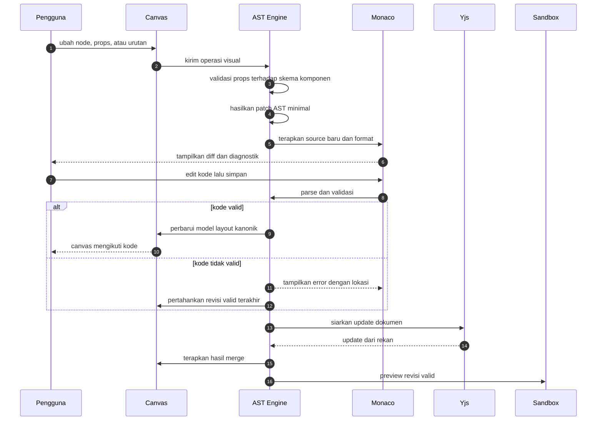

# FLOW-04 Sinkronisasi Visual dan Kode

Alur ini menjelaskan dua arah edit yang harus tetap konsisten: perubahan di canvas menghasilkan patch AST dan source code, sedangkan perubahan kode yang valid tercermin kembali di canvas. Revisi terakhir yang valid tidak boleh hilang karena input yang rusak.

## Trigger

- Pengguna menambah, menghapus, memindahkan, atau mengubah props node di canvas.
- Pengguna mengedit source code di Monaco lalu menyimpan.
- Pengguna menekan Undo atau Redo.
- Rekan multiplayer mengirim update dokumen Yjs.
- Pengguna berpindah antara canvas, AST inspector, dan baris kode.

## Aktor

| Aktor | Peran |
|---|---|
| Pengguna | Mengedit visual atau kode dan meninjau diff |
| Canvas | Menampilkan model layout kanonik dan menerima operasi node |
| AST engine | Menghasilkan patch AST deterministik dan memvalidasi bentuk pohon |
| Monaco | Menyediakan edit kode, diagnostik, dan format on save |
| Yjs | Menyinkronkan dokumen project antar instance multiplayer |
| Sandbox runtime | Menjalankan preview setelah revisi valid |

## Prasyarat

- Project draft aktif dengan revisi valid terakhir tersimpan.
- Komponen yang dipakai berasal dari katalog MADS dan props sesuai skema komponen.
- Formatter dan konfigurasi lint project tersedia lokal.
- Untuk multiplayer, sesi Yjs aktif melalui WebRTC P2P atau server self-host.

## Alur Utama

1. Perubahan visual MUST menghasilkan patch AST dan source code bersih tanpa node duplikat; untuk 200 node, patch MUST selesai dalam < 100 ms (FR-STU-011).
2. Patch visual MUST NOT menulis ulang seluruh berkas; diff MUST minimal dan format MUST stabil (FR-STU-010).
3. Perubahan kode yang valid MUST tercermin di canvas tanpa menghapus formatting (FR-STU-012).
4. Kode yang tidak valid MUST menampilkan error dengan lokasi dan MUST NOT merusak canvas maupun source tersimpan (FR-STU-012).
5. Undo dan redo MUST mencakup edit visual dan kode dalam satu riwayat, minimal 100 langkah, dengan label aksi (FR-STU-014).
6. AST inspector MUST menyediakan navigasi dua arah antara node canvas, node AST, dan baris kode (FR-STU-013).
7. Update Yjs MUST digabung ke dokumen yang sama; konflik yang tidak dapat digabung MUST ditampilkan sebagai diff, bukan ditimpa diam-diam (FR-STU-023).
8. Preview MUST dijalankan di sandbox dan MUST NOT mengeksekusi kode di luar isolasi.
9. Format on save MUST deterministik; dua kali format pada input yang sama MUST menghasilkan output identik.

## Cabang Gagal

| Kondisi | Deteksi | Kode | Perilaku sistem |
|---|---|---|---|
| Kode tidak dapat diparse | Parser gagal atau sintaks rusak | E-STU-001 | Tampilkan lokasi error, pertahankan canvas pada revisi valid terakhir, jangan simpan source rusak |
| Dua rekan mengubah bagian yang sama dan tidak dapat digabung otomatis | Konflik Yjs pada rentang yang tumpang tindih | E-STU-004 | Tampilkan diff dua versi dan minta pengguna memilih atau menggabungkan; tidak menimpa |
| Preview gagal karena isolate tidak tersedia | Inisialisasi sandbox gagal | E-SBX-001 | Fail closed; preview dinonaktifkan dan error boundary ditampilkan |
| Startup preview melewati watchdog | Watchdog 5 detik saat mount | E-SBX-004 | Batalkan mount dan tawarkan restart atau rollback ke revisi valid |
| Props di luar skema komponen | Validasi enum atau tipe gagal | E-STU-001 | Tolak nilai, sorot field, pertahankan nilai lain dan revisi valid |
| Komponen di luar katalog MADS | Palette atau AST menerima tipe tak dikenal | E-STU-005 | Tolak penyisipan dan tampilkan pesan validasi sebelum export |

## Data dan State

| Entitas | Field kunci | Invariant |
|---|---|---|
| Draft project | `project_id`, `revision_id`, `ast_hash`, `source_hash` | `ast_hash` dan `source_hash` berasal dari revisi yang sama |
| Riwayat edit | `undo_stack`, `redo_stack`, `label` | Minimal 100 langkah; satu entri per aksi pengguna |
| Dokumen Yjs | `doc_id`, `update`, `client_id` | Update idempoten dan dapat digabung ulang |
| Preview state | `preview_revision_id`, `status` | Preview hanya untuk revisi valid |

State editor: `clean → editing_visual → patching → formatting → clean` dan `clean → editing_code → parsing → valid` atau `invalid`.

- Revisi valid terakhir MUST tetap tersedia sebagai rollback saat parse atau validasi gagal.
- Undo stack MUST dibersihkan hanya setelah simpan permanen disetujui pengguna.
- Update Yjs MUST NOT menulis langsung ke file project; semua perubahan melewati AST engine.

## Izin dan Keamanan

- Edit kode dan canvas MUST NOT memerlukan permission perangkat.
- Kode micro-app MUST NOT dieksekusi di thread UI, `eval`, atau `new Function`; eksekusi hanya di sandbox.
- Preview MUST berjalan dengan zero privilege dan consent permission yang sama seperti runtime normal (SEC-014).
- Multiplayer MUST memakai dokumen terenkripsi; server self-host MUST NOT mendekripsi isi dokumen.
- Audit MUST mencatat pembukaan preview, penolakan komponen, dan konflik yang diselesaikan pengguna tanpa isi kode.

## Perilaku Offline

- Canvas, editor, format, lint, dan AST inspector MUST berfungsi penuh offline; Monaco MUST dibundel lokal.
- Multiplayer Yjs MUST berfungsi melalui WebRTC P2P tanpa server; tanpa peer, dokumen tetap dapat diedit lokal.
- Konflik yang tertunda MUST disimpan lokal dan diselesaikan saat peer kembali, bukan dibuang.
- Preview offline MUST berjalan di sandbox lokal tanpa memuat aset eksternal.

## Acceptance Criteria

- **Given** canvas dengan 200 node **When** satu props diubah **Then** patch AST dan source selesai dalam < 100 ms dan diff hanya menyentuh properti tersebut.
- **Given** canvas valid **When** pengguna mengetik kode dengan sintaks rusak lalu menyimpan **Then** `E-STU-001` muncul dan canvas tetap pada revisi valid terakhir.
- **Given** edit visual lalu edit kode **When** Undo ditekan dua kali **Then** kedua perubahan dibatalkan dalam urutan terbalik yang benar.
- **Given** dua rekan mengedit rentang sama **When** update Yjs digabung **Then** diff konflik tampil dengan `E-STU-004` dan tidak ada versi yang hilang.
- **Given** klik node di canvas **When** AST inspector dibuka **Then** baris kode yang sesuai tersorot dan sebaliknya.
- **Given** format dijalankan dua kali **When** output dibandingkan **Then** hasilnya identik byte per byte.
- **Given** kode memuat `new Function` **When** preview dijalankan **Then** eksekusi diblokir atau dijalankan hanya di sandbox, bukan di thread UI.

## Verifikasi

| Bukti | Prosedur |
|---|---|
| Round-trip AST | Property test: visual ke kode ke visual menghasilkan model identik untuk 1.000 operasi acak |
| Input rusak | Fuzz parser dengan source tidak valid; pastikan canvas dan revisi tersimpan tidak berubah |
| Latensi | Benchmark patch 200 node; catat p95 dan bandingkan dengan anggaran 100 ms |
| Konflik | Simulasi dua klien Yjs mengedit rentang sama; pastikan diff dan resolusi manual |
| Undo | Uji 100 langkah campuran visual dan kode lalu undo/redo penuh |
| Preview | Fixture loop tak terbatas dan isolate gagal; pastikan kode error dan data utuh |

## Referensi

- [README.md](README.md)
- [03-specs/02-studio-ide.md](../03-specs/02-studio-ide.md)
- [03-specs/ui-protocol.md](../03-specs/ui-protocol.md)
- [03-specs/error-codes.md](../03-specs/error-codes.md)
- [01-architecture/sandbox-capabilities.md](../01-architecture/sandbox-capabilities.md)
- [03-build-with-ai.md](03-build-with-ai.md)
