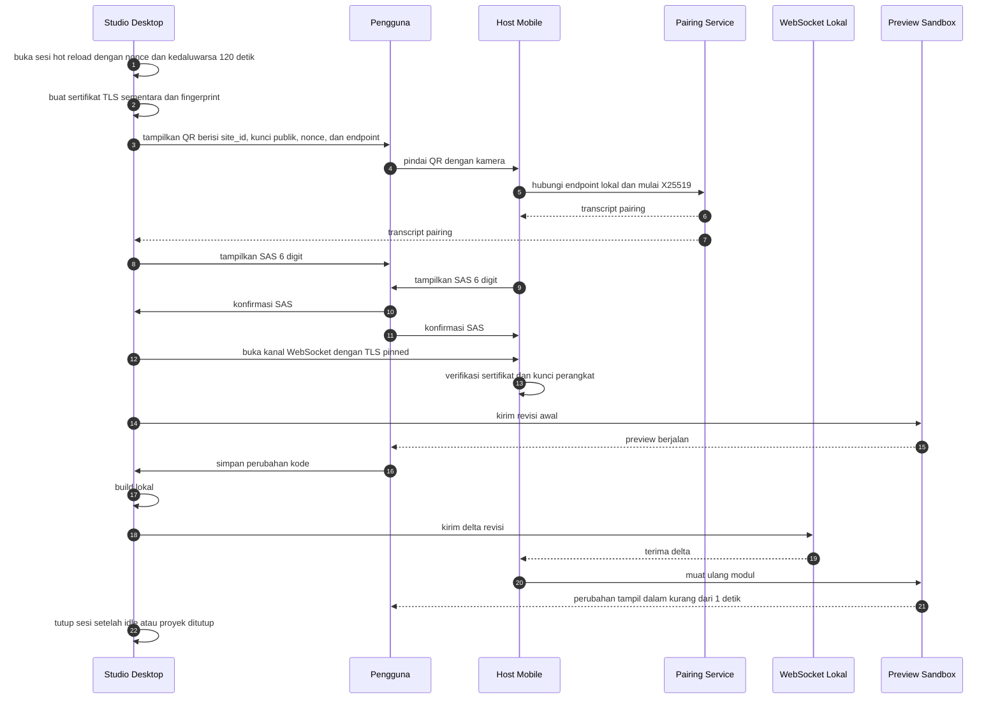

# FLOW-05 LAN Hot Reload

Alur ini menjelaskan hot reload dari Studio desktop ke Host mobile melalui jaringan lokal: pembuatan QR berumur pendek, pemindaian, pairing TLS dengan SAS, sesi terbatas waktu, dan pengiriman perubahan kode sampai perangkat menampilkan hasilnya tanpa menyentuh internet.

## Trigger

- Pengembang menekan "Hot Reload di Perangkat" pada Studio desktop.
- Pengguna memindai QR yang ditampilkan untuk menghubungkan Host mobile.
- Sesi hot reload yang aktif menerima perubahan kode yang disimpan.
- Sesi berakhir karena kedaluwarsa, perangkat keluar, atau proyek ditutup.

## Aktor

| Aktor | Peran |
|---|---|
| Studio desktop | Menyajikan sesi, membangun ulang perubahan, mengirim update |
| Host mobile | Memindai QR, menyetujui SAS, menjalankan preview |
| Pairing service | Menukar kunci X25519, menurunkan kunci sesi, memverifikasi nonce |
| WebSocket lokal | Kanal pengiriman perubahan dengan TLS dan pinning fingerprint |
| Audit lokal | Mencatat pembukaan sesi, pasangan perangkat, dan penolakan |

## Prasyarat

- Kedua perangkat berada di jaringan lokal yang sama dan dapat saling menjangkau.
- Studio desktop memiliki project draft yang valid dan proses build lokal berjalan.
- Host mobile memiliki permission `camera.qr` yang disetujui untuk pemindaian.
- Firewall mengizinkan mDNS dan port WebSocket sementara yang dibuka sesi.
- Kedua host mendukung versi protokol hot reload yang sama.

## Alur Utama

1. Studio MUST membuat nonce satu kali pakai dan menolak QR yang sudah kedaluwarsa setelah 120 detik (FR-STU-025).
2. QR MUST memuat `site_id`, kunci publik perangkat, nonce, endpoint, dan `expires_at_ms`; QR MUST NOT memuat materi rahasia jangka panjang.
3. Pairing MUST menampilkan SAS 6 digit pada kedua perangkat dan MUST membatalkan sesi bila salah satu pihak tidak mengonfirmasi atau nilai SAS berbeda.
4. Kanal MUST memakai TLS dengan sertifikat sementara yang dipin pada tingkat fingerprint, bukan CA publik.
5. Host mobile MUST memverifikasi sertifikat perangkat dan kunci peer sebelum menerima update.
6. Setiap perubahan kode yang disimpan MUST dibangun lokal lalu dikirim sebagai delta; perangkat target MUST menampilkan perubahan dalam < 1 detik pada LAN yang sama dan MUST NOT mengunggah kode ke internet (FR-STU-026).
7. Seluruh trafik MUST tetap di LAN; kode MUST NOT diunggah ke internet atau layanan pihak ketiga.
8. Sesi MUST berbatas waktu dan MUST ditutup saat proyek ditutup, perangkat keluar, atau tidak ada aktivitas sesuai batas sesi.
9. Update yang gagal dimuat MUST mempertahankan preview terakhir yang valid dan menampilkan error boundary.

## Cabang Gagal

| Kondisi | Deteksi | Kode | Perilaku sistem |
|---|---|---|---|
| Perangkat tidak ditemukan di LAN, atau berbeda jaringan | mDNS tidak menemukan endpoint | E-NET-001 | Tampilkan status, minta periksa jaringan, tawarkan ekspor project sebagai jalur alternatif |
| WebSocket tidak dapat dijangkau karena firewall, atau sesi pairing sudah kedaluwarsa setelah 120 detik | Koneksi ditolak atau timeout; endpoint sementara sudah ditutup | E-NET-003 | Tampilkan alasan, buka sesi baru dengan QR baru, jangan membuka kanal tanpa TLS |
| Fingerprint TLS tidak cocok dengan pin | Verifikasi pinning gagal | E-NET-002 | Batalkan koneksi, hapus sesi, jangan turunkan ke kanal tanpa enkripsi |
| Sertifikat perangkat tidak valid | Verifikasi Ed25519 gagal | E-AUTH-001 | Tolak sesi dan minta pairing ulang dari awal |
| Kunci perangkat berbeda dari yang dipin | Perbandingan fingerprint gagal | E-AUTH-005 | Tolak sesi, tampilkan fingerprint lama dan baru, jangan menerima update |
| Preview gagal dimuat setelah delta | Startup watchdog melewati 5 detik | E-SBX-004 | Batalkan mount, pertahankan preview valid terakhir, tawarkan restart |
| Isolate preview tidak tersedia | Inisialisasi sandbox gagal | E-SBX-001 | Fail closed; hot reload dihentikan tanpa menjalankan kode di luar sandbox |

## Data dan State

| Entitas | Field kunci | Invariant |
|---|---|---|
| Sesi hot reload | `session_id`, `project_id`, `nonce`, `expires_at_ms`, `state` | Satu sesi aktif per project dan peer; nonce tidak dipakai ulang |
| Peer sementara | `peer_site_id`, `device_cert`, `fingerprint`, `sas_confirmed` | Hanya peer dengan SAS terkonfirmasi dapat menerima delta |
| Revisi preview | `revision_id`, `source_hash`, `status` | Revisi valid terakhir dipertahankan saat reload gagal |
| Audit lokal | `action`, `peer_site_id`, `result` | Mencatat pairing, penolakan, dan akhir sesi tanpa isi kode |

State sesi: `idle → waiting_for_scan → pairing → sas_pending → connected → streaming → closed`, dengan `* → failed`.

- Sesi dan kunci sesi MUST hanya berada di memori dan MUST dihapus saat sesi berakhir.
- Tidak ada kode project yang dipersistenkan di perangkat mobile di luar cache preview yang dapat dibuang.
- Sertifikat TLS sementara MUST dibuat ulang untuk setiap sesi.

## Izin dan Keamanan

- Pemindaian QR MUST memerlukan `camera.qr` (SEC-004); frame mentah MUST NOT disimpan setelah decode.
- SAS 6 digit MUST dikonfirmasi kedua pihak; QR saja tidak cukup untuk mencegah MITM di LAN.
- Kanal MUST memakai TLS dengan pinning fingerprint; kegagalan pinning MUST membatalkan koneksi.
- Sesi MUST berumur pendek dan MUST NOT memberi akses ke data micro-app, Vault, atau database Host mobile.
- Preview MUST berjalan di sandbox dengan zero privilege; hot reload tidak boleh menambah permission, dan isolate yang gagal MUST fail closed tanpa eksekusi alternatif (FR-SBX-025).
- Audit MUST mencatat pembukaan sesi, konfirmasi SAS, penolakan, dan penutupan sesi.

## Perilaku Offline

- Hot reload MUST berfungsi tanpa internet karena seluruh kanal berada di LAN.
- Bila perangkat berada di jaringan berbeda, alur MUST gagal dengan status jelas dan MUST NOT mencoba relay internet.
- Build dan preview MUST berjalan lokal; tidak ada unggahan kode ke cloud untuk "mempermudah" koneksi.
- Setelah sesi berakhir, perangkat target MUST kembali ke versi terpasang terakhir.

## Acceptance Criteria

- **Given** QR ditampilkan **When** pemindaian dilakukan setelah 120 detik **Then** sesi ditolak dan QR baru harus dibuat.
- **Given** kedua perangkat menampilkan SAS **When** salah satu menolak konfirmasi **Then** pairing dibatalkan dan material sementara dihapus.
- **Given** sesi aktif di LAN yang sama **When** kode disimpan **Then** perubahan tampil di perangkat target dalam < 1 detik.
- **Given** firewall memblokir port WebSocket **When** perangkat mencoba terhubung **Then** `E-NET-003` muncul dan tidak ada fallback ke kanal tanpa TLS.
- **Given** sertifikat sesi berubah di tengah koneksi **When** pinning diverifikasi **Then** koneksi dibatalkan dengan `E-NET-002`.
- **Given** hot reload berjalan **When** trafik dianalisis **Then** tidak ada paket menuju alamat internet.

## Verifikasi

| Bukti | Prosedur |
|---|---|
| Kedaluwarsa | Buat QR, tunggu lebih dari 120 detik, lalu pindai; pastikan ditolak |
| SAS | Simulasi SAS berbeda pada satu perangkat; pastikan pairing dibatalkan |
| Latensi | Ukur waktu dari simpan kode sampai render di perangkat; target < 1 detik |
| TLS | Uji pinning dengan sertifikat pengganti; pastikan `E-NET-002` |
| Jaringan | Uji perangkat di subnet berbeda dan firewall tertutup; pastikan `E-NET-001` atau `E-NET-003` |
| Isolasi | Pastikan preview berjalan di sandbox dan gagal tertutup saat isolate tidak tersedia |

## Referensi

- [README.md](README.md)
- [03-specs/02-studio-ide.md](../03-specs/02-studio-ide.md)
- [03-specs/permissions.md](../03-specs/permissions.md)
- [03-specs/error-codes.md](../03-specs/error-codes.md)
- [01-architecture/identity-crypto.md](../01-architecture/identity-crypto.md)
- [01-architecture/system-overview.md](../01-architecture/system-overview.md)
- [06-p2p-sync.md](06-p2p-sync.md)
