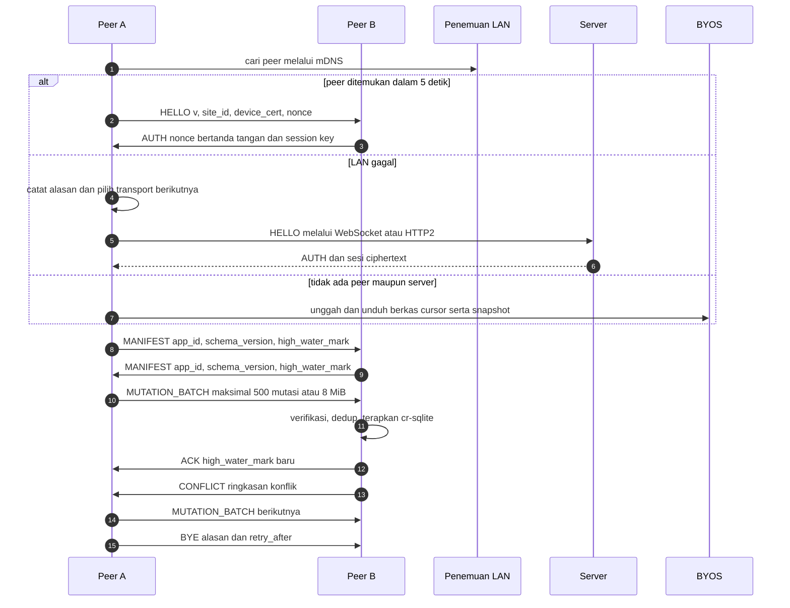

# FLOW-06 Pairing dan Sinkronisasi P2P

Alur ini menjelaskan pertukaran mutasi antar perangkat: pairing dengan QR dan SAS, pemilihan transport deterministik, handshake berversi, pengiriman batch terenkripsi, penyelesaian konflik, dan pencabutan perangkat. Server dan BYOS hanya melihat ciphertext.

## Trigger

- Pengguna memasangkan perangkat baru melalui QR atau SAS.
- Mutation log memiliki entri yang belum di-ack dan peer, server, atau BYOS tersedia.
- Pengguna menekan "Sync sekarang" atau jadwal sync berkala berjalan.
- Koneksi terputus di tengah batch dan perlu dilanjutkan.
- Pengguna mencabut perangkat dari daftar peer.

## Aktor

| Aktor | Peran |
|---|---|
| Host sync worker | Membangun batch, memilih transport, mengelola cursor dan backoff |
| Peer | Perangkat lain yang sudah dipasangkan dan memegang kunci sync |
| Server self-host | Sync hub yang menyimpan ciphertext dan metadata minimum |
| BYOS | WebDAV, S3, Git, atau folder Syncthing sebagai jalur terakhir |
| `microapp-core` | Enkripsi envelope, tanda tangan nonce, HLC, dan deduplikasi |
| Audit lokal | Mencatat transport, alasan fallback, konflik, dan pencabutan |

## Prasyarat

- Local Identity dan Recovery Phrase tersimpan pada kedua perangkat.
- Peer sudah dipasangkan dan fingerprint-nya terverifikasi; atau sesi server aktif.
- Micro-app tujuan terpasang di workspace yang sesuai pada kedua sisi.
- Kunci sync diturunkan dari master key yang sama.
- Schema version diketahui; perbedaan major akan ditangani melalui staging.

## Alur Utama

1. Pemilihan transport MUST deterministik: LAN mDNS+TLS, lalu WebRTC direct, lalu self-host WebSocket/HTTP2, lalu BYOS; BYOS hanya dipakai bila tidak ada peer maupun server (FR-SYNC-008).
2. Bila LAN atau WebRTC gagal dalam 5 detik, client MUST beralih ke self-host tanpa interaksi dan MUST mencatat alasan fallback (FR-SYNC-009).
3. Handshake MUST mengikuti urutan `HELLO`, `AUTH`, `MANIFEST`, `MUTATION_BATCH`, `ACK`, `CONFLICT`, `BYE` dan MUST menolak versi major yang tidak dikenal (FR-SYNC-010); `MANIFEST` MUST menukar `app_id`, `schema_version`, dan `high_water_mark` HLC sehingga kedua pihak sepakat pada titik lanjut.
4. `AUTH` MUST menandatangani nonce sekali pakai; replay MUST ditolak.
5. Batch MUST dibatasi 500 mutasi atau 8 MiB ciphertext, mana yang lebih dulu tercapai (FR-SYNC-011).
6. Setiap batch MUST memiliki `batch_id` dan idempotency key sehingga pengiriman ulang tidak menggandakan mutasi (FR-SYNC-012).
7. Konflik kolom MUST diselesaikan column-level LWW dengan HLC dan `site_id` sebagai tie-breaker; nilai kalah MUST masuk `conflict_history` dan dapat dipulihkan pengguna (FR-SYNC-014).
8. Mutasi dengan schema version lebih baru MUST disimpan di staging dan MUST NOT diterapkan ke tabel aktif (FR-SYNC-015).
9. Reconnect MUST memakai backoff 1/2/5/10/30/60 detik dengan jitter 20% dan MUST berhenti setelah 60 detik sampai ada perubahan jaringan atau aksi pengguna (FR-SYNC-013).
10. Pencabutan perangkat MUST menghentikan sesi, menghapus kunci sesi, dan menolak sync berikutnya (FR-SYNC-017).
11. Status sync MUST menampilkan peer, transport, cursor, antrean, dan error terakhir tanpa isi data (FR-SYNC-018).

## Cabang Gagal

| Kondisi | Deteksi | Kode | Perilaku sistem |
|---|---|---|---|
| Versi protokol peer tidak kompatibel | `HELLO` membawa versi major tak dikenal | E-SYNC-001 | Tutup sesi dengan `BYE`, tampilkan versi yang didukung, jangan menurunkan format |
| Batch ditolak karena cursor atau idempotency | `ACK` menolak `batch_id` atau cursor tidak cocok | E-SYNC-002 | Kirim ulang dari cursor terakhir, verifikasi tidak ada duplikasi |
| Konflik tidak dapat digabung otomatis | Dua mutasi kolom sama dengan nilai berbeda | E-SYNC-003 | Simpan di `conflict_history`, tampilkan UI review dengan opsi pulihkan |
| Perangkat dicabut saat sesi aktif | Sesi mencocokkan daftar pencabutan | E-SYNC-005 | Hentikan sesi, hapus kunci sesi, minta pairing ulang |
| Envelope rusak atau tag GCM tidak cocok | Verifikasi AES-256-GCM gagal | E-CRYPTO-001 | Tolak payload, jangan simpan, catat audit |
| Key ID tidak dikenal | Envelope memuat `key_id` asing | E-CRYPTO-002 | Minta kunci yang benar; jangan mencoba menebak |
| Nonce reuse terdeteksi | Duplikasi nonce pada key yang sama | E-CRYPTO-003 | Hentikan enkripsi dan tandai insiden kritis |
| Peer tidak ditemukan di LAN | mDNS tidak menemukan peer | E-NET-001 | Fallback ke transport berikutnya dan catat alasan |
| TLS pinning gagal | Fingerprint peer tidak cocok | E-NET-002 | Batalkan koneksi, jangan turunkan ke plaintext |
| Server tidak terjangkau | Timeout atau koneksi ditolak | E-NET-003 | Antre dan backoff, tampilkan status offline |
| BYOS menolak kredensial | HTTP 401/403 dari penyimpanan | E-NET-004 | Minta ulang kredensial dari Vault, jangan simpan di config |
| Rate limit atau kuota terlampaui | HTTP 429 atau kuota penyimpanan | E-NET-005 | Backoff, kecilkan batch, catat audit |
| Kunci perangkat tidak cocok dengan sertifikat | Verifikasi sertifikat gagal | E-AUTH-005 | Tolak sesi, minta pairing ulang |
| Mutasi memakai schema lebih baru | `schema_version` melampaui versi lokal | E-DATA-003 | Simpan di staging, tampilkan status perlu update, jangan ubah tabel aktif |

## Data dan State

| Entitas | Field kunci | Invariant |
|---|---|---|
| `sync_peers` | `id`, `peer_site_id`, `device_cert`, `trust_state`, `last_seen_ms` | Satu baris per peer; kunci tidak berubah tanpa pairing ulang |
| `sync_cursors` | `id`, `peer_id`, `transport`, `last_acked_hlc`, `updated_at_ms` | Cursor monoton naik per peer dan transport |
| `crdt_change_log` | `mutation_id`, `app_id`, `table_name`, `hlc`, `site_id`, `synced_at_ms` | `hlc` 24 byte; `synced_at_ms` null sampai di-ack |
| `conflict_history` | `conflict_id`, `app_id`, `table_name`, `row_id`, `column_name`, `losing_value`, `winning_hlc` | Nilai kalah dipertahankan sampai retensi berakhir |
| `crdt_schema_staging` | `mutation_id`, `schema_version`, `payload` | Tidak pernah diterapkan ke tabel aktif |

State sesi: `idle → discovering → handshaking → syncing → idle`, dengan `syncing → backoff → syncing` dan `* → failed`.

- Cursor MUST hanya maju setelah `ACK` diterima.
- Mutation log dipangkas setelah semua peer meng-ack sampai high-water mark, dengan retensi minimum 30 hari.
- Tombstone delete dipertahankan minimal 90 hari agar peer lama tidak menghidupkan kembali baris.

## Izin dan Keamanan

- Seluruh payload MUST dienkripsi di klien sebelum meninggalkan perangkat; server dan BYOS MUST NOT memiliki jalur dekripsi.
- Kunci sync MUST diturunkan dari Recovery Phrase atau passphrase PRF; kunci MUST NOT dikirim ke peer, server, atau BYOS.
- Pairing MUST memakai QR dan SAS 6 digit; ketidakcocokan SAS MUST membatalkan pertukaran kunci.
- Server MUST hanya menyimpan ciphertext, ukuran, dan waktu; metadata MUST NOT memuat isi data.
- Pencabutan perangkat MUST menghapus kunci sesi perangkat tersebut dan menolak percobaan berikutnya.
- Audit MUST mencatat grant sync, alasan fallback, konflik, dan pencabutan tanpa payload (SEC-019).
- Status sync MUST NOT menampilkan isi record, hanya metadata.

## Perilaku Offline

- LAN dan WebRTC MUST berfungsi tanpa internet; server dan BYOS hanya dipakai bila tersedia.
- Mutasi yang belum terkirim MUST tetap di mutation log dan dikirim saat koneksi tersedia; tidak ada kehilangan data diam-diam.
- Backoff MUST berhenti setelah 60 detik dan menunggu perubahan jaringan atau aksi pengguna, bukan berputar tanpa batas.
- Saat offline, UI MUST menampilkan antrean dan status per peer tanpa memblokir pengeditan lokal.
- BYOS MUST NOT dianggap pengganti peer; ia hanya jalur terakhir saat peer dan server tidak ada.

## Acceptance Criteria

- **Given** dua perangkat di LAN dengan peer terpasang **When** sync berjalan **Then** transport LAN dipilih dan tidak ada trafik ke server.
- **Given** LAN dimatikan di tengah penemuan **When** 5 detik berlalu **Then** client beralih ke self-host dan mencatat alasan fallback.
- **Given** 600 mutasi menunggu **When** batch dibangun **Then** batch dipecah menjadi ≤ 500 mutasi tanpa duplikasi.
- **Given** koneksi putus setelah batch terkirim tetapi sebelum `ACK` **When** reconnect **Then** batch yang sama tidak diterapkan dua kali.
- **Given** dua perangkat mengubah kolom sama **When** mutasi bergabung **Then** satu pemenang dipilih deterministik dan nilai kalah tersedia di `conflict_history`.
- **Given** peer mengirim schema version lebih baru **When** perangkat lama menerima **Then** mutasi masuk staging dan tabel aktif tidak berubah.
- **Given** perangkat dicabut **When** mencoba sync **Then** sesi ditolak dengan `E-SYNC-005` dan kunci sesi dihapus.

## Verifikasi

| Bukti | Prosedur |
|---|---|
| Konvergensi | Property test dua site dengan urutan acak dan 10.000 mutasi; bandingkan state akhir |
| Transport | Uji LAN, WebRTC, server, dan BYOS dengan jaringan disimulasikan, termasuk fallback 5 detik |
| Batch | Uji batas 500 mutasi dan 8 MiB, lalu putus koneksi di tengah batch dan reconnect |
| Konflik | Simulasi dua edit kolom sama; pastikan LWW deterministik dan pemulihan nilai kalah |
| Staging | Peer dengan schema lebih baru; pastikan `E-DATA-003` dan tabel aktif tidak berubah |
| Kriptografi | Test vector envelope, deteksi nonce reuse, dan penolakan `key_id` asing |
| Revoke | Cabut peer saat sesi aktif; pastikan sesi berhenti dan sync berikutnya ditolak |

## Referensi

- [README.md](README.md)
- [03-specs/06-sync-backup.md](../03-specs/06-sync-backup.md)
- [03-specs/permissions.md](../03-specs/permissions.md)
- [03-specs/error-codes.md](../03-specs/error-codes.md)
- [01-architecture/sync-crdt.md](../01-architecture/sync-crdt.md)
- [01-architecture/identity-crypto.md](../01-architecture/identity-crypto.md)
- [07-backup-recovery.md](07-backup-recovery.md)
