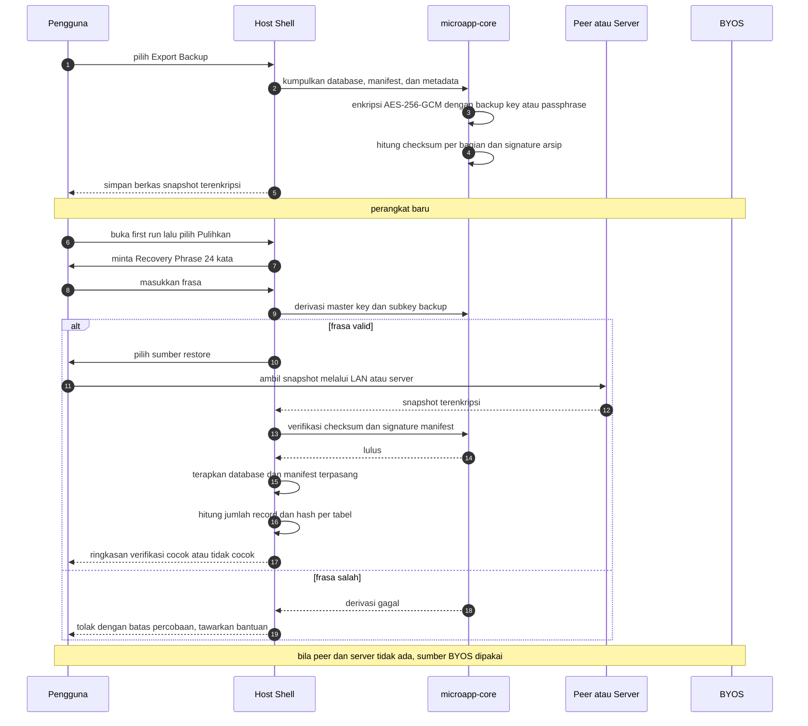

# FLOW-07 Backup dan Recovery

Alur ini menjelaskan ekspor snapshot terenkripsi dan pemulihannya di perangkat baru: derivasi kunci dari Recovery Phrase 24 kata, pengambilan dari peer, server, atau BYOS, verifikasi checksum dan signature, penerapan data, lalu ringkasan verifikasi jumlah record.

## Trigger

- Pengguna memilih "Export Backup" untuk workspace atau seluruh instalasi.
- Pengguna menyiapkan perangkat baru dan memilih "Pulihkan dari backup".
- Restore otomatis ditawarkan setelah first run pada perangkat yang belum memiliki data.
- Pemulihan dipicu setelah kehilangan perangkat, kerusakan database, atau rollback yang gagal.

## Aktor

| Aktor | Peran |
|---|---|
| Pengguna | Menyimpan Recovery Phrase, memilih passphrase, memilih sumber restore |
| Host Shell | Menyusun arsip, memverifikasi, menerapkan data, menampilkan ringkasan |
| `microapp-core` | Derivasi kunci, enkripsi AES-256-GCM, verifikasi signature dan checksum |
| Peer | Sumber snapshot terenkripsi melalui LAN |
| Server atau BYOS | Sumber snapshot saat peer tidak tersedia |
| Audit lokal | Mencatat ekspor, restore, dan kegagalan verifikasi tanpa isi data |

## Prasyarat

- Recovery Phrase 24 kata tersimpan dan dapat dibaca pengguna; frasa MUST NOT disimpan di perangkat.
- Passphrase backup (bila dipakai) diketahui pengguna dan tidak disimpan bersama arsip.
- Ruang penyimpanan tujuan cukup untuk arsip dan hasil restore.
- Pada perangkat baru, Local Identity sudah dibuat atau frasa dimasukkan untuk derivasi kunci yang sama.
- Sumber restore dapat dijangkau: berkas lokal, peer di LAN, server, atau BYOS.

## Alur Utama

1. Arsip backup MUST memuat database, manifest, dan metadata, terenkripsi AES-256-GCM dengan passphrase pengguna atau backup key, serta checksum per bagian (FR-SYNC-021); berkas `.mapp-backup` workspace MUST mengikuti kontrak ekspor Host (FR-HOST-021).
2. Private key MUST NOT pernah masuk arsip dalam bentuk plaintext; Recovery Phrase disimpan terpisah oleh pengguna.
3. Restore MUST memverifikasi checksum setiap bagian dan signature manifest sebelum menerapkan data (FR-SYNC-022).
4. Restore MUST memverifikasi jumlah record dan hash per tabel setelah penerapan, lalu menampilkan ringkasan kepada pengguna (FR-SYNC-023).
5. Restore MUST NOT menghapus data lokal yang lebih baru tanpa konfirmasi; data baru MUST digabung atau disimpan sebagai salinan (FR-SYNC-024).
6. Sumber restore MUST dapat berupa peer, server, atau BYOS; kegagalan satu sumber MUST mengarahkan ke sumber berikutnya, bukan langsung menghapus data lokal.
7. Format snapshot MUST berversi; perubahan format MUST menaikkan versi dan pembaca lama MUST dipertahankan minimal 12 bulan (FR-SYNC-025).
8. Ekspor terbuka SQLite, JSONL, CSV, dan Markdown MUST tetap tersedia untuk mencegah lock-in dan MUST NOT memerlukan micro-app berjalan (FR-SYNC-019, FR-SYNC-020).
9. Percobaan frasa yang salah MUST dibatasi dan MUST NOT membocorkan kata mana yang salah.

## Cabang Gagal

| Kondisi | Deteksi | Kode | Perilaku sistem |
|---|---|---|---|
| Recovery Phrase salah atau tidak lengkap | Derivasi kunci gagal atau checksum mnemonic gagal | E-AUTH-002 | Tolak tanpa menyebut kata salah, batasi percobaan, tawarkan bantuan pemulihan |
| Snapshot tidak dapat didekripsi | Tag AES-256-GCM tidak cocok | E-CRYPTO-004 | Tolak arsip, jangan menerapkan sebagian data, tawarkan sumber lain |
| Signature manifest backup tidak valid | Verifikasi Ed25519 gagal | E-CRYPTO-005 | Tolak arsip dan jangan restore |
| Checksum bagian tidak cocok atau arsip terpotong | Verifikasi checksum gagal | E-SYNC-004 | Batalkan restore, pertahankan data lokal, tampilkan bagian yang gagal |
| Server tidak terjangkau saat restore | Timeout atau koneksi ditolak | E-NET-003 | Tawarkan peer di LAN, berkas lokal, atau BYOS; data lokal tidak berubah |
| BYOS menolak kredensial | HTTP 401/403 | E-NET-004 | Minta ulang kredensial dari Vault, jangan menyimpannya di konfigurasi |
| Secure storage tidak tersedia pada perangkat baru | Keychain/Keystore/WebCrypto gagal | E-HOST-001 | Tawarkan kunci turunan passphrase; blokir data sensitif sampai berhasil |
| Vault terkunci saat arsip memuat item Vault | Unlock gagal atau kedaluwarsa | E-HOST-004 | Tetap terkunci, minta biometrik, PIN, atau passphrase |
| Database gagal dibuka setelah restore | `PRAGMA user_version` atau integritas gagal | E-DATA-001 | Jangan membuat database kosong; tawarkan snapshot lain atau ekspor data |

## Data dan State

| Entitas | Field kunci | Invariant |
|---|---|---|
| Arsip backup | `format_version`, `created_at_ms`, `parts[]`, `checksum`, `signature` | Setiap bagian memiliki checksum; signature mencakup manifest arsip |
| `local_identity` | `id`, `site_id`, `identity_pubkey` | Frasa yang sama menghasilkan kunci yang dapat mendekripsi arsip |
| `installed_microapps` | `app_id`, `version`, `content_hash`, `manifest` | Manifest di arsip identik dengan yang terpasang saat ekspor |
| `app_databases` | `app_install_id`, `schema_version` | Versi skema dipulihkan bersama data |
| Laporan restore | `table_name`, `expected_rows`, `restored_rows`, `hash_match` | Ringkasan ditampilkan dan disimpan lokal |

State backup: `collecting → encrypting → checksumming → written`. State restore: `phrase_entered → key_derived → source_fetched → verified → applied → summarized`.

- Arsip MUST atomic: kegagalan di tengah penulisan MUST menghasilkan berkas tidak valid yang ditolak saat restore, bukan arsip setengah jadi yang dianggap sah.
- Data yang lebih baru di perangkat tujuan MUST dipertahankan sebagai salinan atau entri konflik, bukan ditimpa.
- Snapshot lama MUST tetap dapat dibaca Host baru selama masa kompatibilitas 12 bulan.

## Izin dan Keamanan

- Enkripsi backup MUST dilakukan di klien; tidak ada kunci atau plaintext yang dikirim ke server atau BYOS.
- Recovery Phrase MUST ditampilkan satu kali saat pembuatan identitas dan MUST NOT dapat dibaca ulang dari perangkat.
- Passphrase backup MUST NOT disimpan di arsip, log, atau konfigurasi proyek.
- Restore MUST memverifikasi signature manifest dan checksum sebelum menyentuh database aktif.
- Audit MUST mencatat ekspor, sumber restore, hasil verifikasi, dan penolakan tanpa isi data atau frasa (SEC-019).
- Kunci sync dan backup MUST diturunkan dari Recovery Phrase 24 kata atau passkey PRF; frasa yang sama pada perangkat baru MUST dapat mendekripsi arsip lama (FR-SYNC-002).
- Vault yang ikut diarsipkan MUST tetap terenkripsi dengan kunci turunan master; membukanya tetap memerlukan faktor lokal.

## Perilaku Offline

- Ekspor ke berkas lokal MUST berjalan penuh offline.
- Restore dari berkas lokal atau peer di LAN MUST berjalan offline; server dan BYOS hanya dipakai bila tersedia.
- Bila tidak ada sumber yang terjangkau, Host MUST menampilkan status dan mempertahankan data lokal, bukan mereset workspace.
- Ekspor terbuka SQLite, JSONL, CSV, dan Markdown MUST tersedia offline sebagai jalur pemulihan manual.

## Acceptance Criteria

- **Given** snapshot valid dan passphrase benar **When** restore dijalankan **Then** seluruh tabel dipulihkan dan ringkasan menunjukkan jumlah record serta hash cocok.
- **Given** satu byte snapshot diubah **When** restore dijalankan **Then** `E-SYNC-004` muncul dan data lokal tidak berubah.
- **Given** signature manifest rusak **When** diverifikasi **Then** `E-CRYPTO-005` muncul dan arsip tidak diterapkan.
- **Given** frasa salah **When** dimasukkan **Then** `E-AUTH-002` muncul tanpa menyebut kata salah dan percobaan dibatasi.
- **Given** perangkat tujuan memiliki record lebih baru **When** snapshot lama dipulihkan **Then** record baru dipertahankan sebagai salinan atau konflik.
- **Given** perangkat baru tanpa jaringan **When** restore dari berkas lokal **Then** data pulih sepenuhnya tanpa request keluar.
- **Given** arsip backup diperiksa **When** dicari material kunci **Then** tidak ditemukan private key plaintext maupun Recovery Phrase.

## Verifikasi

| Bukti | Prosedur |
|---|---|
| Enkripsi | Ekspor lalu coba buka tanpa passphrase; pastikan gagal dan tidak ada plaintext |
| Integritas | Ubah satu byte, potong bagian arsip, dan rusak signature; pastikan kode yang sesuai |
| Restore | Restore ke database kosong dan database berisi; bandingkan jumlah record dan hash per tabel |
| Frasa | Uji frasa benar, salah satu kata, dan urutan tertukar; pastikan pembatasan percobaan |
| Kompatibilitas | Baca snapshot versi lama dengan Host versi baru; pastikan pembaca lama dipertahankan |
| Offline | Ekspor dan restore dari berkas lokal dengan jaringan dimatikan |
| Kebocoran | Pindai arsip dan log untuk private key, frasa, dan token |

## Referensi

- [README.md](README.md)
- [03-specs/06-sync-backup.md](../03-specs/06-sync-backup.md)
- [03-specs/01-host-shell.md](../03-specs/01-host-shell.md)
- [03-specs/error-codes.md](../03-specs/error-codes.md)
- [01-architecture/identity-crypto.md](../01-architecture/identity-crypto.md)
- [01-architecture/data-model.md](../01-architecture/data-model.md)
- [06-p2p-sync.md](06-p2p-sync.md)
