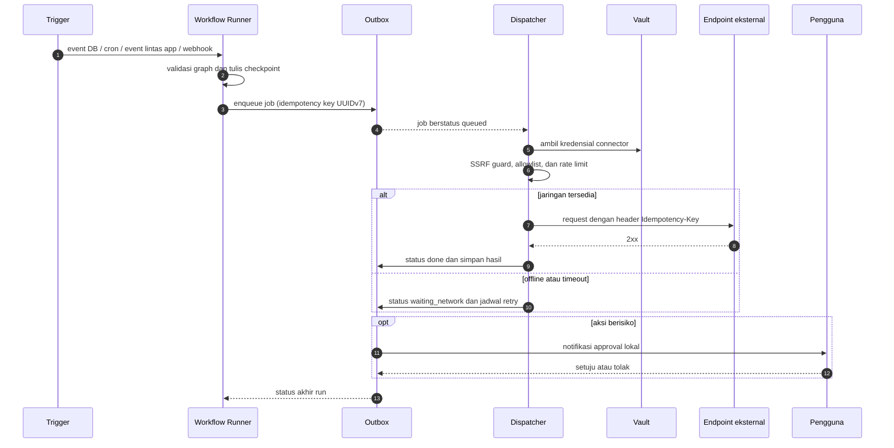

# FLOW-08 Workflow Outbox

Alur ini menjelaskan bagaimana workflow automation menjalankan aksi eksternal secara durable: setiap panggilan keluar melewati Outbox persisten, sehingga restart, offline, dan kegagalan jaringan tidak menggandakan efek maupun menghilangkan job.

## Trigger

- Perubahan database pada tabel yang dipantau workflow (insert, update, delete) setelah commit transaksi.
- Jadwal cron yang dievaluasi oleh workflow runner lokal atau server.
- Event lintas app yang dikirim melalui intent bus setelah consent.
- Webhook masuk, hanya pada profil self-host yang mengaktifkan listener webhook.
- Run manual dari Workflow Editor atau dari panel DevTools.

Trigger MUST dievaluasi paling banyak sekali per kejadian sumber; event duplikat dengan `event_id` sama MUST diabaikan.

## Aktor

| Aktor | Peran |
|---|---|
| Pengguna | Memberi approval human-in-the-loop, mencabut grant, dan melihat status run |
| Workflow Runner | Memvalidasi graph, menulis checkpoint, dan mengeksekusi node non-eksternal |
| Outbox Dispatcher | Mengambil job, menegakkan retry, dan memanggil endpoint eksternal |
| Server Runner | Menjalankan workflow 24/7 dan melanjutkan run setelah restart server |
| Vault | Menyimpan kredensial connector dan kunci BYOK |
| Endpoint eksternal | REST, GraphQL, WebSocket, MQTT, database, storage, atau layanan pesan |

## Prasyarat

- Workflow tervalidasi: tidak ada edge tidak valid dan tidak ada siklus yang tidak sah.
- Setiap node eksternal memiliki connector terpasang dan konfigurasi timeout eksplisit.
- `network.allowlist` pada manifest mencakup domain tujuan, atau Offline Cage tidak aktif; tanpa itu dispatcher MUST menolak job.
- Kredensial connector tersedia di Vault dengan grant per item untuk app pemilik workflow.
- Outbox terbuka dan dimigrasikan ke versi schema saat ini sebelum job pertama diantrekan.

## Alur Utama

1. Runner mengevaluasi trigger, memastikan `event_id` belum pernah diproses, lalu menulis checkpoint sebelum aksi apa pun.
2. Untuk setiap node eksternal, runner membuat job Outbox dengan `idempotency_key` UUIDv7 dan status `queued`.
3. Dispatcher mengambil job sesuai urutan `created_at`, memeriksa allowlist dan SSRF guard, lalu mengambil kredensial dari Vault pada saat eksekusi, bukan saat enqueue.
4. Bila jaringan tersedia, dispatcher mengirim request dengan `Idempotency-Key`; respons 2xx menandai job `done` dan menyimpan ringkasan hasil tanpa payload sensitif.
5. Bila jaringan tidak tersedia atau timeout, job menjadi `waiting_network` dan dijadwalkan ulang dengan backoff eksponensial 1 detik × 2^n (cap 1 jam) ditambah jitter 20%, maksimal 8 attempt.
6. Bila node ditandai berisiko, job berhenti pada status menunggu approval; notifikasi lokal menampilkan setuju/tolak dengan timeout eksplisit.
7. Setelah seluruh node selesai atau gagal permanen, runner menutup run, menulis ringkasan, dan memperbarui indikator antrean di Host.

## Cabang Gagal

| Kondisi | Deteksi | Kode | Perilaku sistem |
|---|---|---|---|
| Endpoint menolak permanen setelah 8 attempt | Respons 4xx non-retryable atau attempt habis | E-DATA-004 | Job `failed`, efek tidak diulang, retry manual tersedia |
| Target mengarah ke CIDR privat atau loopback | SSRF guard pada resolusi DNS dan IP final | E-DATA-005 | Request diblokir sebelum koneksi, target dicatat tanpa payload |
| Server self-host tidak terjangkau | Timeout koneksi atau DNS gagal | E-NET-003 | Job `waiting_network`, backoff berjalan, indikator antrean tampil |
| Endpoint membalas rate limit | Status 429 atau header kuota | E-NET-005 | Backoff diperpanjang, batch dikecilkan, job tidak dianggap gagal permanen |
| Queue server tidak tersedia | Health check dependency gagal | E-SRV-004 | Mode degradasi, job tetap di Outbox lokal sampai queue pulih |
| Node AI tidak menemukan provider | Provider tidak terpasang atau model tidak dimuat | E-STU-002 | Run berhenti terkontrol, pengguna diminta memilih provider secara manual |
| Approval tidak dijawab sebelum timeout | Timer approval habis | E-DATA-004 | Job ditandai `failed` dengan alasan timeout, tanpa eksekusi sebagian |
| Kredensial connector tidak dapat didekripsi | Envelope gagal dibuka | E-CRYPTO-004 | Job `failed`, pengguna diarahkan mengisi ulang kredensial di Vault |

## Data dan State

| Entitas | Field kunci | Invariant |
|---|---|---|
| `workflow_outbox` | `job_id`, `run_id`, `state`, `attempt`, `next_attempt_at`, `idempotency_key` | `idempotency_key` unik; job tidak hilang setelah restart |
| `workflow_runs` | `run_id`, `workflow_id`, `state`, `checkpoint_json`, `started_at`, `finished_at` | Checkpoint ditulis sebelum aksi eksternal |
| `outbox_result` | `job_id`, `status_code`, `summary_json`, `completed_at` | Ringkasan tanpa header otorisasi dan tanpa isi data sensitif |

State machine: `queued → running → done`, `queued → waiting_network → running`, `running → failed`, dan `running → awaiting_approval → running`. Transisi lain MUST ditolak dan dicatat.

- Checkpoint disimpan setelah setiap node selesai dan sebelum setiap aksi eksternal, sehingga restart server melanjutkan dari titik terakhir.
- Job dengan `idempotency_key` yang sudah tercatat `done` MUST dikembalikan sebagai sukses tanpa memanggil endpoint lagi.
- Retensi `workflow_runs` dan `outbox_result` mengikuti kebijakan retensi data lokal; job `failed` disimpan sampai pengguna menutupnya.

## Izin dan Keamanan

- Setiap koneksi keluar tunduk pada `network.allowlist` (SEC-013); domain di luar allowlist MUST ditolak sebelum DNS resolution.
- Server MUST memblokir CIDR privat dan loopback secara default dan hanya membukanya melalui `security.allowPrivateEgress` dengan audit.
- Kredensial connector dan kunci BYOK MUST diambil dari Vault dan MUST NOT disimpan di definisi workflow, log, atau checkpoint.
- Log job MUST memuat `job_id`, `run_id`, `attempt`, dan status, tanpa header, token, atau isi body.
- Setiap grant, penolakan, dan blokir SSRF MUST masuk audit lokal dengan `app_id`, `action`, dan `result`.

## Perilaku Offline

- Outbox bersifat lokal dan persisten: job yang dibuat saat offline tetap ada setelah restart dan dieksekusi saat jaringan kembali.
- Status `waiting_network` MUST terlihat di Host bersama jumlah operasi tertunda; UI MUST NOT menampilkan sukses palsu.
- Trigger webhook tidak tersedia di mode lokal; Workflow Editor MUST menampilkan status tidak tersedia alih-alih membuat node yang tidak dapat berjalan.
- Aksi yang tidak membutuhkan jaringan (transformasi data, penulisan DB, notifikasi lokal) MUST tetap berjalan offline tanpa menunggu Outbox.

## Acceptance Criteria

- **Given** job `queued` saat app dimatikan **When** app dinyalakan kembali **Then** job tetap ada dan dieksekusi tanpa duplikasi.
- **Given** endpoint mengembalikan 429 **When** retry dijadwalkan **Then** interval mengikuti 1/2/4/8/16/32/60 menit dengan jitter 20% dan maksimal 8 attempt.
- **Given** request dengan `idempotency_key` yang sudah `done` **When** dikirim ulang **Then** endpoint tidak dipanggil lagi dan job dilaporkan sukses.
- **Given** node berisiko menunggu approval **When** pengguna menolak **Then** job menjadi `failed` dengan alasan dan tidak ada efek eksternal.
- **Given** server mati di tengah run **When** server menyala **Then** run dilanjutkan dari checkpoint dan selesai tepat sekali.
- **Given** target `10.0.0.5` pada workflow server **When** dieksekusi **Then** request ditolak dengan `E-DATA-005` dan audit tercatat.

## Verifikasi

| Bukti | Prosedur |
|---|---|
| Durabilitas | Matikan proses saat `queued`, restart, periksa job tereksekusi satu kali |
| Backoff | Log 8 attempt dengan interval dan jitter dalam rentang yang dijanjikan |
| Idempotensi | Endpoint uji menghitung request; kirim ulang key sama dan pastikan hitungan tetap satu |
| HITL | Jalankan node berisiko, tolak approval, periksa status `failed` dan audit |
| Resume server | Matikan server saat run aktif, nyalakan, bandingkan jumlah efek eksternal |
| SSRF | Fixture target privat dan metadata endpoint; pastikan ditolak dan tercatat |

## Referensi

- [03-specs/04-data-automation.md](../03-specs/04-data-automation.md)
- [03-specs/07-selfhost.md](../03-specs/07-selfhost.md)
- [03-specs/permissions.md](../03-specs/permissions.md)
- [03-specs/error-codes.md](../03-specs/error-codes.md)
- [01-architecture/ai-workflow.md](../01-architecture/ai-workflow.md)
- [01-architecture/data-model.md](../01-architecture/data-model.md)
