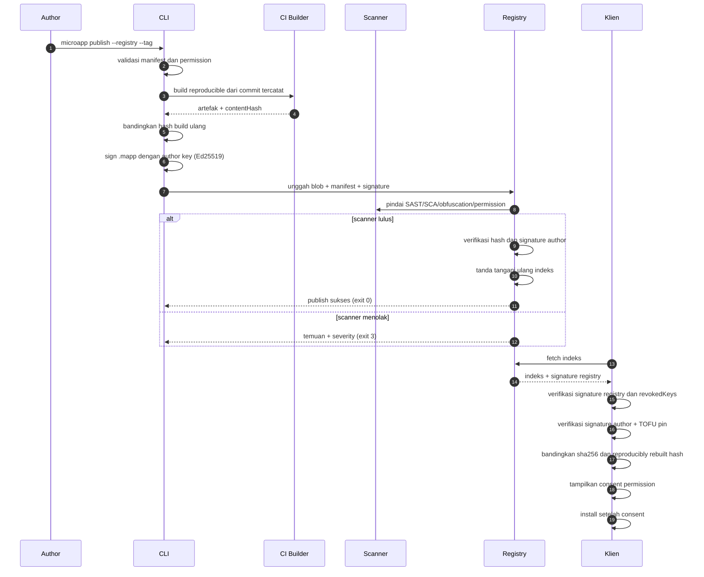

# FLOW-09 Publish dan Verifikasi Registry

Alur ini menjelaskan rantai dari kode sumber sampai micro-app terpasang di perangkat pengguna: pack deterministik, build ulang yang dapat direproduksi, tanda tangan author dan registry, publikasi indeks, lalu verifikasi berlapis di sisi klien.

## Trigger

- Pengembang menjalankan `microapp publish --registry <url|git> --tag` dari repositori micro-app.
- Registry curator menerbitkan ulang indeks setelah menerima artefak baru atau mencabut versi.
- Klien memuat indeks registry karena instalasi baru, pemeriksaan update, atau refresh cache.
- Admin organisasi mendorong paket internal melalui server self-host.

## Aktor

| Aktor | Peran |
|---|---|
| Author | Menandatangani artefak dengan author key dan memilih versi |
| CLI | Memvalidasi manifest, mem-build reproducible, dan menandatangani `.mapp` |
| CI Builder | Menjalankan build dari commit dan builder image yang dicatat |
| Registry | Menyimpan blob, memverifikasi hash, dan menandatangani indeks |
| Scanner | Menjalankan SAST, SCA, deteksi obfuscation, dan audit permission |
| Klien | Memverifikasi signature, TOFU, hash, dan consent sebelum instalasi |

## Prasyarat

- Manifest lolos `manifest-v2.md` dan JSON Schema: `id` sesuai regex, `version` semver, path relatif tanpa `..`.
- Author key tersedia di perangkat penandatangan dan tidak pernah dibagikan dengan registry key.
- `contentHash` dan metadata `reproducibleBuild` (commit, builder image, hash) tersedia di manifest.
- Registry memiliki `publicKey` dan daftar `revokedKeys` pada indeks skema v1.
- Koneksi ke registry tersedia; publikasi offline dilakukan melalui bundle file yang dipindahkan manual.
- Klien menerapkan urutan verifikasi FR-REG-007 sebelum dialog consent dirender, dan author key dipin mengikuti TOFU.

## Alur Utama

1. CLI memvalidasi manifest, permission, ukuran, dan keberadaan entry sebelum menyentuh registry.
2. CLI atau CI melakukan build dengan commit dan builder image yang dicatat, lalu menghitung `contentHash`; build kedua dari input sama MUST menghasilkan hash identik.
3. CLI menandatangani `.mapp` dengan author key Ed25519 dan mengunggah blob, manifest, serta signature detached.
4. Registry memverifikasi `sha256`, signature author, dan hasil scanner; hanya artefak yang lulus yang masuk kandidat indeks.
5. Registry menandatangani indeks dengan registry key dan menaikkan `updatedAt`; registry key MUST berbeda dari author key.
6. Klien memuat indeks, memverifikasi signature registry, memeriksa `revokedKeys`, lalu memverifikasi signature author dan `contentHash`.
7. Klien menerapkan TOFU: author key dipin pada instalasi pertama dan dibandingkan pada setiap update.
8. Setelah verifikasi lulus, klien menampilkan consent permission; instalasi baru dijalankan hanya setelah consent.

## Cabang Gagal

| Kondisi | Deteksi | Kode | Perilaku sistem |
|---|---|---|---|
| Manifest tidak valid saat publish | Validasi schema atau regex `id` gagal | E-CLI-001 | Exit 1, daftar field bermasalah, tidak ada unggahan |
| Jaringan registry tidak tersedia | DNS/timeout saat unggah | E-CLI-002 | Exit 2, artefak tetap lokal, saran `--dry-run` |
| Signature author tidak valid | Verifikasi Ed25519 gagal di registry | E-CLI-003 | Exit 3, publikasi dibatalkan |
| Build ulang menghasilkan hash berbeda | `contentHash` tidak cocok | E-CLI-005 | Exit 1, hash dicetak, artefak tidak diterbitkan |
| Signature registry atau author rusak di klien | Verifikasi gagal pada unduhan | E-REG-001 | Instalasi diblokir, unduhan dihapus |
| Author key berubah dari pin | `author_key_id` berbeda dari TOFU pin | E-REG-002 | Update diblokir sampai persetujuan eksplisit |
| Isi artefak berubah setelah publikasi | `sha256` tidak cocok dengan indeks | E-REG-003 | Artefak ditolak dan dihapus dari cache |
| Scanner menemukan pola berbahaya | SAST/SCA/obfuscation melampaui ambang | E-REG-004 | Instalasi diblokir, temuan dan severity ditampilkan |
| Patch delta gagal diterapkan | Hash hasil patch tidak cocok | E-REG-005 | Unduh penuh ditawarkan, atau update dibatalkan |
| Kredensial Git ditolak saat publish | Push/autentikasi gagal | E-AUTH-004 | Exit 2, kredensial dihapus dari memori, minta ulang |

## Data dan State

| Entitas | Field kunci | Invariant |
|---|---|---|
| `registry_sources` | `id`, `url`, `trust_level`, `priority`, `public_key` | Satu `public_key` aktif per sumber |
| `registry_pins` | `app_id`, `author_key_id`, `first_seen_at`, `approved_at` | Pin unik per app+author dan hanya berubah lewat persetujuan |
| `installed_microapps` | `app_id`, `version`, `content_hash`, `signature_verified_at` | `content_hash` sama dengan indeks saat instalasi |
| `registry_cache` | `source_id`, `fetched_at`, `index_json`, `signature` | Cache kedaluwarsa setelah 24 jam tetapi tetap dipakai offline |

State publikasi: `draft → validated → built → signed → uploaded → scanned → indexed → published`. State klien: `fetched → verified → consented → installed → pinned`.

- Indeks di-cache 24 jam; setelah itu klien melakukan refresh bila jaringan tersedia dan tetap memakai cache bila offline.
- Signature diverifikasi pada setiap pemuatan cache, bukan hanya saat pertama diunduh.
- Versi lama diarsipkan minimal satu versi untuk rollback dan penetapan pin.

## Izin dan Keamanan

- Author key dan registry key MUST terpisah; indeks yang memakai kunci yang sama MUST ditolak.
- Private key penandatangan MUST tinggal di perangkat penandatangan atau signer terisolasi dan MUST NOT diunggah ke registry.
- Kunci yang dicabut pada `revokedKeys` MUST menolak artefak meskipun signature valid.
- Delisting registry MUST menonaktifkan instalasi baru tanpa menghapus data pengguna; data tetap dapat diekspor.
- Setiap operasi fetch, verifikasi, install, update, rollback, dan penolakan MUST tercatat di audit lokal tanpa payload sensitif.
- Kredensial Git dan registry MUST berasal dari Vault dan MUST NOT muncul di output CLI, log, atau berkas konfigurasi proyek.

## Perilaku Offline

- Instalasi dari berkas `.mapp` lokal MUST berjalan penuh offline dengan verifikasi signature dan hash yang sama.
- Katalog registry tetap dapat dibuka dari cache tanpa batas waktu; status "cache" MUST terlihat dan signature tetap diverifikasi.
- Publish offline dilakukan dengan menyerahkan artefak bertanda tangan kepada curator; CLI MUST NOT menandai publish sukses tanpa konfirmasi registry.
- Update otomatis MUST ditunda sampai jaringan kembali; mode `pin` MUST melarang update meski indeks baru tersedia.

## Acceptance Criteria

- **Given** dua kali `microapp pack` dari commit sama **When** hash dibandingkan **Then** hasilnya identik dan `contentHash` cocok.
- **Given** artefak diubah setelah indeks diterbitkan **When** klien mengunduh **Then** instalasi ditolak dengan `E-REG-003`.
- **Given** author key berubah **When** update diperiksa **Then** update diblokir, pin lama dipertahankan sampai persetujuan eksplisit.
- **Given** indeks memakai registry key yang sama dengan author key **When** diverifikasi **Then** registry ditolak.
- **Given** scanner menemukan pola obfuscation **When** pengguna melihat detail **Then** temuan dan severity tampil dan instalasi memerlukan konfirmasi tambahan atau diblokir.
- **Given** mode `pin` aktif **When** versi baru tersedia **Then** versi tidak berubah dan hanya notifikasi yang muncul.
- **Given** rollback dijalankan **When** versi lama dipulihkan **Then** snapshot database dibuat dan signature versi lama diverifikasi.

## Verifikasi

| Bukti | Prosedur |
|---|---|
| Reproducibility | Build dua kali pada builder image yang sama dan bandingkan `contentHash` |
| Signature | Ubah satu byte artefak dan pastikan `E-REG-001` muncul |
| Pemisahan kunci | Fixture indeks dengan kunci author sama dengan registry; pastikan ditolak |
| TOFU | Ganti author key pada update; pastikan blokir dan audit |
| Publish | Jalankan `microapp publish --dry-run --json`; pastikan registry tidak berubah |
| Scanner | Fixture dengan `eval` dan permission high; periksa temuan dan perilaku consent |

## Referensi

- [03-specs/05-registry.md](../03-specs/05-registry.md)
- [03-specs/08-devtools-cli-sdk.md](../03-specs/08-devtools-cli-sdk.md)
- [03-specs/manifest-v2.md](../03-specs/manifest-v2.md)
- [03-specs/error-codes.md](../03-specs/error-codes.md)
- [01-architecture/registry-supply-chain.md](../01-architecture/registry-supply-chain.md)
- [01-architecture/identity-crypto.md](../01-architecture/identity-crypto.md)
