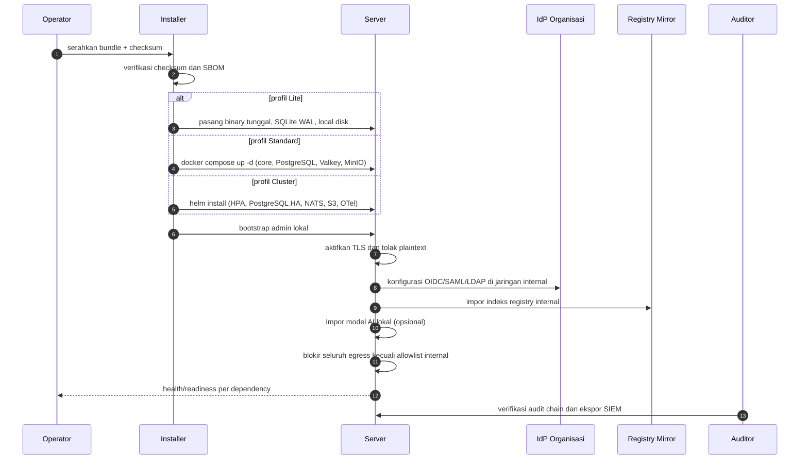

# FLOW-10 Self-Host Air-Gapped

Alur ini menjelaskan pemasangan dan operasi server MicroApp Studio pada jaringan tanpa egress: verifikasi bundle, pemilihan profil Lite/Standard/Cluster, bootstrap admin, TLS lokal, autentikasi organisasi, impor registry dan model AI, serta upgrade offline.

## Trigger

- Operator menerima bundle air-gapped baru dan memulai instalasi pada host tanpa akses internet.
- Operator menjalankan upgrade dari versi sebelumnya menggunakan bundle yang lebih baru.
- Organisasi memindahkan server dari profil Lite ke Standard atau Cluster tanpa egress.
- Terjadi insiden yang memerlukan pemulihan dari bundle dan backup lokal.

## Aktor

| Aktor | Peran |
|---|---|
| Operator | Memindahkan bundle, menjalankan installer, dan memverifikasi health |
| Installer | Memeriksa checksum, SBOM, dan kompatibilitas versi sebelum memasang |
| Server | Menyajikan sync hub, registry internal, workflow, dan API admin |
| IdP Organisasi | Menyediakan OIDC, SAML, atau LDAP di jaringan internal |
| Registry Mirror | Menyajikan indeks dan blob tanpa egress |
| Auditor | Memeriksa audit chain dan ekspor ke SIEM internal |

## Prasyarat

- Bundle air-gapped lengkap: binary atau image multi-arch, font, ikon, Monaco/LSP, mirror registry, model AI opsional, dokumentasi, dan checksum.
- Checksum bundle diverifikasi terhadap sumber tepercaya di luar jalur transfer.
- `microapp.yaml` telah diisi untuk `listen`, `dataDir`, `database.url`, `storage`, `auth`, `registry`, `workflow`, `security.allowPrivateEgress`, `tls`, `branding`, dan `telemetry.optIn`.
- DNS internal, sertifikat TLS, dan metadata IdP tersedia sebelum server menerima trafik.
- Backup database, object storage, dan konfigurasi tersedia sebelum upgrade.
- Bundle memenuhi isi minimum FR-SRV-009 sehingga instalasi tidak memerlukan unduhan tambahan.

## Alur Utama

1. Operator memindahkan bundle melalui media yang disetujui dan memverifikasi checksum serta SBOM sebelum ekstraksi.
2. Installer memilih profil sesuai kapasitas: Lite untuk 1–20 pengguna aktif pada 1 vCPU/512 MB, Standard untuk layanan pendukung, Cluster untuk skala dan HA.
3. Installer menjalankan bootstrap admin lokal dan menghasilkan kredensial awal sekali pakai yang MUST diganti pada login pertama.
4. Server mengaktifkan TLS dari sertifikat internal atau auto-HTTPS dan menolak trafik plaintext.
5. Operator mengonfigurasi IdP internal; mapping klaim ke peran `owner`, `admin`, `maintainer`, `member`, `viewer` diverifikasi dengan login uji.
6. Operator mengimpor indeks registry internal dan, bila diperlukan, model AI lokal ke direktori yang dikonfigurasi.
7. Server menegakkan mode tanpa egress: hanya target internal yang diizinkan, dan setiap penolakan dicatat.
8. Operator memverifikasi health/readiness per dependency dan menjalankan uji sync serta instalasi dari registry internal.
9. Auditor memverifikasi rantai audit dan mengaktifkan ekspor terstruktur ke Loki, Elasticsearch, Wazuh, atau Syslog internal.

## Cabang Gagal

| Kondisi | Deteksi | Kode | Perilaku sistem |
|---|---|---|---|
| Checksum bundle tidak cocok | Verifikasi installer gagal | E-CLI-003 | Instalasi dibatalkan, bundle dikarantina |
| Migrasi database gagal saat upgrade | Langkah migrasi error atau schema tidak kompatibel | E-SRV-001 | Rollback ke versi sebelumnya, server tidak melayani trafik |
| IdP tidak terjangkau | Discovery atau metadata gagal | E-SRV-002 | Status tampil, sesi aktif yang ada tetap berjalan |
| Object storage tidak tersedia | Presigned URL atau health gagal | E-SRV-003 | Mode degradasi, unggahan blob diantrekan |
| Queue NATS atau queue lokal gagal | Health dependency atau publish gagal | E-SRV-004 | Workflow berhenti sementara, retry setelah pulih |
| Audit chain tidak valid | Verifikasi `prev_hash`/`entry_hash` gagal | E-SRV-005 | Aksi sensitif dihentikan sampai investigasi |
| Sertifikat TLS internal tidak tepercaya klien | Pinning atau validasi chain gagal | E-NET-002 | Koneksi klien dibatalkan, petunjuk impor CA ditampilkan |
| Model AI tidak dapat dimuat | Berkas model hilang atau hash berbeda | E-STU-002 | Fitur AI berstatus tidak tersedia, fitur lain tetap jalan |

## Data dan State

| Entitas | Field kunci | Invariant |
|---|---|---|
| `server_config` | `listen`, `data_dir`, `database_url`, `tls`, `telemetry_opt_in` | Konfigurasi tidak valid menolak startup |
| `server_registry_index` | `id`, `name`, `public_key`, `index_json`, `updated_at` | Satu indeks aktif per registry |
| `server_blobs` | `id`, `sha256`, `size`, `path` | Immutable dan unik per hash |
| `audit_log_chain` | `seq_id`, `actor`, `action`, `prev_hash`, `entry_hash` | Append-only dan rantai valid |

State instalasi: `transferred → verified → installed → bootstrapped → tls_active → idp_bound → registry_imported → healthy`. Upgrade: `backed_up → stopped → replaced → migrated → healthy` atau `migrated_gagal → rolled_back → healthy`.

- Versi schema database diperiksa saat startup; versi tidak kompatibel MUST menolak startup alih-alih mencoba migrasi implisit.
- `telemetry.optIn` default `false`; tanpa opt-in tidak ada pengumpulan data keluar.
- Tidak ada tabel billing, subscription, atau seat limit pada skema server.

## Izin dan Keamanan

- Mode air-gap MUST memblokir seluruh egress; `security.allowPrivateEgress` hanya membuka CIDR yang secara eksplisit didaftarkan admin dan setiap penggunaan diaudit.
- RBAC diperiksa per resource dan ABAC policy JSON dievaluasi sebelum aksi; akses di luar izin menghasilkan penolakan tanpa membocorkan keberadaan resource.
- Setiap aksi sensitif masuk audit chain berantai hash; penghapusan atau penyisipan entri MUST terdeteksi.
- Sertifikat, token IdP, dan kredensial storage MUST NOT ditulis ke log atau health endpoint.
- Kredensial bootstrap admin MUST sekali pakai dan MUST diganti sebelum server menerima pengguna lain.
- Ekspor audit ke SIEM MUST memakai format terstruktur dan MUST NOT memuat rahasia atau payload pengguna.

## Perilaku Offline

- Seluruh fungsi inti (sync hub, registry internal, workflow, autentikasi) MUST berjalan tanpa egress; kegagalan egress tidak boleh menjatuhkan server.
- Upgrade offline menggunakan bundle baru dengan urutan backup, stop, replace, migrate, health check; tidak ada unduhan daring saat upgrade.
- Sinkronisasi klien memakai transport self-host ketika LAN dan WebRTC tidak tersedia; klien tetap berfungsi offline bila server mati.
- Font, ikon, dan aset Studio MUST dilayani dari bundle lokal, bukan CDN.

## Acceptance Criteria

- **Given** jaringan tanpa egress **When** bundle dipasang dan dijalankan **Then** seluruh langkah selesai dan health melaporkan semua dependency.
- **Given** checksum bundle diubah **When** installer dijalankan **Then** instalasi dibatalkan dengan `E-CLI-003`.
- **Given** upgrade dengan migrasi rusak **When** startup **Then** rollback berjalan dan server tidak melayani schema yang tidak kompatibel.
- **Given** profil Lite pada 1 vCPU/512 MB **When** 20 pengguna aktif **Then** tidak ada OOM dan deployment dari nol selesai di bawah 2 menit.
- **Given** `telemetry.optIn: false` **When** server berjalan **Then** tidak ada trafik keluar untuk telemetri.
- **Given** satu entri audit dihapus **When** verifikasi rantai dijalankan **Then** kegagalan terdeteksi dan aksi sensitif dihentikan.
- **Given** upgrade offline **When** selesai **Then** data, konfigurasi, dan branding identik dengan sebelum upgrade.

## Verifikasi

| Bukti | Prosedur |
|---|---|
| Air-gap | Jalankan instalasi pada VM tanpa rute keluar dan periksa tidak ada percobaan koneksi eksternal |
| Checksum | Ubah satu byte bundle dan pastikan instalasi berhenti |
| Rollback | Fixture migrasi gagal; pastikan versi dan data kembali |
| Resource | Ukur RSS dan latensi pada 1 vCPU/512 MB dengan 20 pengguna |
| Audit | Hapus satu entri pada salinan database dan jalankan verifikasi rantai |
| Auth | Login uji OIDC, SAML, dan LDAP internal; periksa mapping peran |

## Referensi

- [03-specs/07-selfhost.md](../03-specs/07-selfhost.md)
- [03-specs/06-sync-backup.md](../03-specs/06-sync-backup.md)
- [03-specs/error-codes.md](../03-specs/error-codes.md)
- [01-architecture/selfhost.md](../01-architecture/selfhost.md)
- [01-architecture/threat-model.md](../01-architecture/threat-model.md)
