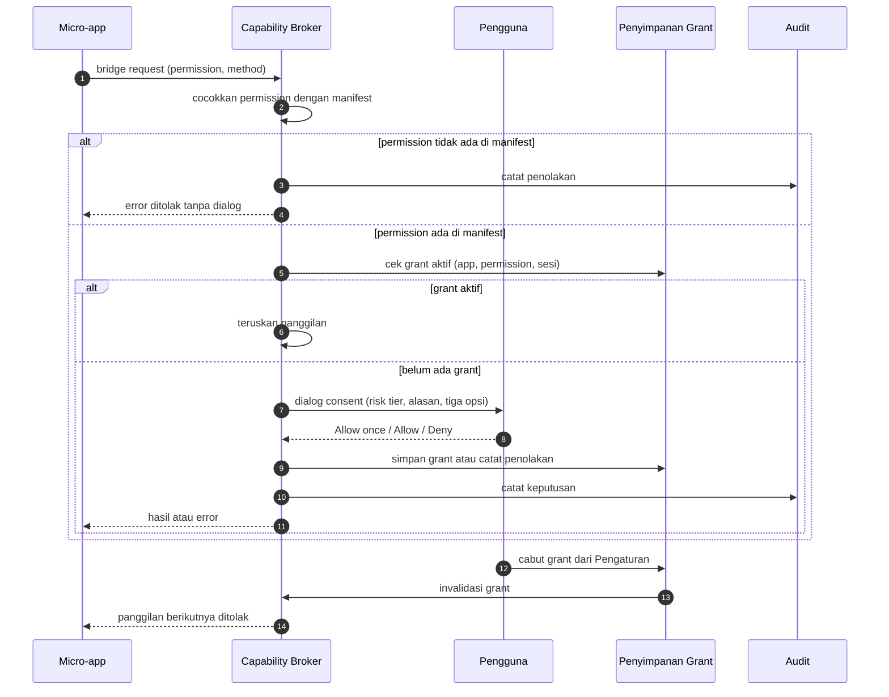

# FLOW-11 Persetujuan Permission

Alur ini menjelaskan bagaimana permintaan capability dari micro-app diubah menjadi keputusan pengguna yang eksplisit: broker memvalidasi manifest, menampilkan risk tier, menyimpan grant, dan menegakkan pencabutan seketika. Tidak ada capability yang diberikan tanpa grant aktif.

## Trigger

- Micro-app memanggil method Host Bridge yang membutuhkan permission dan belum memiliki grant aktif.
- Pengguna membuka detail app atau Pengaturan untuk mencabut grant.
- Update micro-app menambah permission baru atau menaikkan risk tier.
- Pengguna mengaktifkan Offline Cage atau mode mock/spoof untuk app tertentu.

## Aktor

| Aktor | Peran |
|---|---|
| Micro-app | Meminta capability melalui Host Bridge dan menunggu hasil |
| Capability Broker | Memvalidasi manifest, grant, dan risk tier sebelum meneruskan panggilan |
| Pengguna | Memilih `Allow once`, `Allow`, atau `Deny` |
| Pengaturan | Menampilkan dan mencabut grant per app |
| Audit | Mencatat setiap keputusan dan penolakan tanpa payload |

## Prasyarat

- Manifest memuat permission yang diminta beserta alasan; validasi mengikuti FR-SBX-009 sehingga permintaan di luar manifest ditolak sebelum consent.
- App terpasang dan signature-nya sudah diverifikasi pada instalasi.
- Risk tier permission diketahui dari katalog permission.
- Dialog consent dapat dirender pada layar aktif, termasuk saat app berjalan di latar.

## Alur Utama

1. Broker menerima permintaan dan mencocokkan `permission` dengan deklarasi manifest sebelum memvalidasi parameter apa pun.
2. Permission di luar manifest MUST ditolak tanpa dialog dan MUST dicatat sebagai penolakan.
3. Broker memeriksa grant aktif; `Allow once` hanya berlaku untuk sesi berjalan dan tidak dipersistenkan lintas restart.
4. Bila belum ada grant, broker menampilkan dialog consent berisi nama app, permission ID, risk tier, alasan manifest, serta opsi `Allow once`, `Allow`, dan `Deny`.
5. Keputusan `Allow` disimpan sebagai grant sampai dicabut; `Deny` dicatat dan tidak menampilkan dialog berulang pada sesi yang sama kecuali pengguna memintanya.
6. Broker memberi tahu micro-app tentang hasil dan terus memeriksa grant pada setiap panggilan berikutnya, bukan hanya saat mount.
7. Pencabutan dari Pengaturan berlaku seketika; panggilan berikutnya gagal dan app menerima error yang dapat ditangani.
8. Setiap grant, deny, revoke, mock, dan penolakan masuk audit lokal dengan `app_id`, `permission`, `decision`, `actor`, dan timestamp.

## Cabang Gagal

| Kondisi | Deteksi | Kode | Perilaku sistem |
|---|---|---|---|
| App meminta permission di luar manifest | Pencocokan manifest gagal | E-SBX-005 | Penolakan langsung tanpa dialog, audit tercatat |
| Grant dicabut saat app berjalan | Pemeriksaan grant per panggilan gagal | E-SBX-005 | Panggilan ditolak, app menerima error yang dapat ditangani |
| App mencoba akses jaringan di luar allowlist | Broker memeriksa domain tujuan | E-SBX-005 | Koneksi diblokir sebelum keluar, alasan ditampilkan |
| Offline Cage aktif saat app meminta jaringan | Status cage pada sesi | E-SBX-005 | Seluruh koneksi diblokir, badge permanen tampil |
| Plugin meminta capability di luar izin | Deklarasi plugin tidak cocok | E-DEV-004 | Plugin ditolak, capability lain tetap berjalan |
| Vault terkunci saat app meminta item rahasia | Status vault pada broker | E-HOST-004 | Permintaan ditolak, pengguna diarahkan membuka Vault |
| Grant tidak dapat dipersistenkan | Penulisan penyimpanan gagal | E-HOST-005 | Grant hanya berlaku untuk sesi, pengguna diberi tahu |

## Data dan State

| Entitas | Field kunci | Invariant |
|---|---|---|
| `permission_grant` | `app_id`, `permission_id`, `scope`, `granted_at`, `revoked_at` | Grant aktif unik per app+permission |
| `permission_session` | `session_id`, `app_id`, `allow_once` | `Allow once` hilang saat app ditutup |
| `sandbox_audit` | `id`, `app_id`, `action`, `result`, `metadata_json`, `created_at` | Append-only, tanpa payload sensitif |
| `app_policy` | `app_id`, `offline_cage`, `mock_permissions` | Mock hanya untuk permission yang diizinkan katalog |

State grant: `requested → granted → active → revoked`, dan `requested → denied`. `Allow once` berada pada state `session_granted` yang MUST dibuang saat sesi berakhir.

- Perubahan permission saat update memerlukan consent ulang untuk permission baru atau risk tier yang naik.
- Permission yang dihapus dari manifest MUST mencabut grant terkait secara otomatis.
- Mock/spoof mengembalikan data sintetis, menampilkan badge, dan MUST mencatat penandaan mock di audit.

## Izin dan Keamanan

- Zero-privilege default: tanpa grant aktif, seluruh panggilan yang membutuhkan permission ditolak sebelum validasi parameter.
- Broker MUST memeriksa grant pada setiap panggilan; pemeriksaan saat mount saja tidak cukup.
- Dialog consent MUST menampilkan tiga opsi dan MUST NOT menyembunyikan risk tier atau alasan permintaan.
- Pencabutan MUST berlaku tanpa restart dan MUST menghentikan panggilan yang sedang mengantre.
- Audit MUST mencatat keputusan tanpa isi payload, path absolut, atau nilai rahasia.
- `network.allowlist` tetap tunduk pada pemblokiran IP privat dan metadata endpoint; cage mengalahkan allowlist.

## Perilaku Offline

- Dialog consent dan penyimpanan grant MUST berfungsi penuh offline.
- Permission yang membutuhkan layanan eksternal tetap dapat diberikan; kegagalan jaringan ditangani oleh pemanggil, bukan oleh broker.
- Offline Cage dapat diaktifkan kapan saja, termasuk saat offline, dan statusnya persisten.
- Notifikasi lokal untuk permintaan yang tertunda MUST tetap dikirim saat offline.

## Acceptance Criteria

- **Given** app tanpa permission `camera` meminta kamera **When** broker menerima permintaan **Then** permintaan ditolak tanpa dialog.
- **Given** dialog consent tampil **When** pengguna memilih `Allow once` **Then** akses berlaku sampai app ditutup dan tidak bertahan setelah restart.
- **Given** grant `camera` aktif **When** pengguna mencabutnya saat app berjalan **Then** panggilan berikutnya gagal dan audit mencatat pencabutan.
- **Given** `network.allowlist` berisi `api.example.com` **When** Offline Cage aktif **Then** request ke domain tersebut diblokir dan badge tampil.
- **Given** mock kamera aktif **When** app mengambil frame **Then** data sintetis diterima dan audit menandai mock.
- **Given** update menambah permission `location` **When** app diperbarui **Then** consent baru muncul sebelum permission dapat dipakai.
- **Given** seluruh alur consent **When** dijalankan dengan keyboard dan screen reader **Then** fokus masuk ke dialog, judul diumumkan, dan ketiga opsi dapat dipilih.

## Verifikasi

| Bukti | Prosedur |
|---|---|
| Manifest gating | Fixture app tanpa permission; panggil bridge dan pastikan penolakan tanpa prompt |
| Revoke | Cabut grant saat app aktif; panggil method dan periksa error serta audit |
| Allow once | Berikan `Allow once`, restart app, pastikan grant tidak berlaku |
| Cage | Aktifkan cage dengan allowlist terisi; uji request dan badge |
| Audit | Periksa lima jenis kejadian (grant, deny, revoke, mock, penolakan) |
| A11y | Uji dialog dengan NVDA/VoiceOver dan navigasi keyboard penuh |

## Referensi

- [03-specs/permissions.md](../03-specs/permissions.md)
- [03-specs/03-sandbox-runtime.md](../03-specs/03-sandbox-runtime.md)
- [03-specs/host-bridge.md](../03-specs/host-bridge.md)
- [03-specs/error-codes.md](../03-specs/error-codes.md)
- [01-architecture/sandbox-capabilities.md](../01-architecture/sandbox-capabilities.md)
- [01-architecture/threat-model.md](../01-architecture/threat-model.md)
