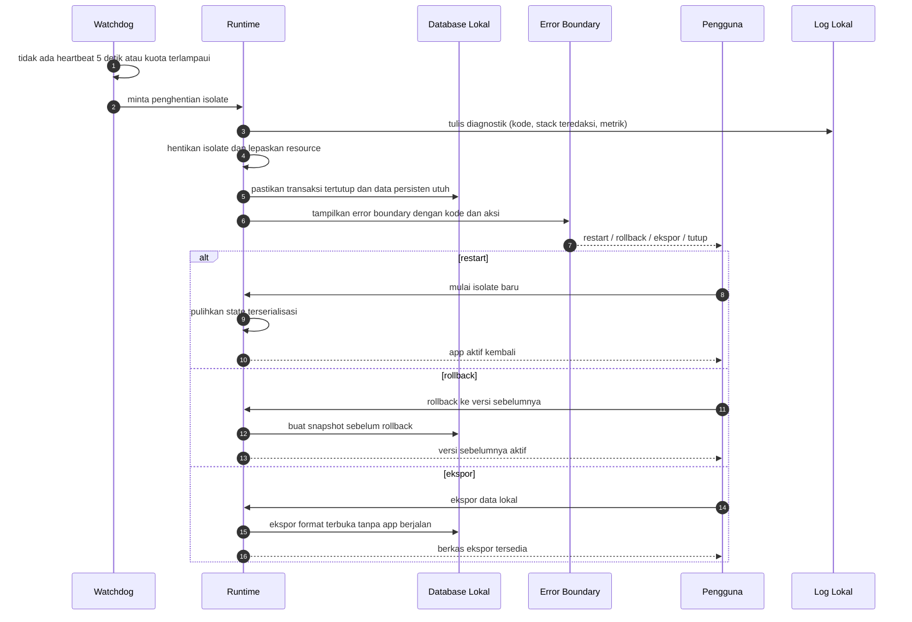

# FLOW-12 Pemulihan Crash

Alur ini menjelaskan penanganan freeze, kehabisan memori, dan crash micro-app: isolasi kegagalan, penghentian isolate, error boundary yang aman, diagnostik teredaksi, serta pilihan restart, rollback, atau ekspor data tanpa kehilangan data persisten.

## Trigger

- Watchdog tidak menerima heartbeat dari isolate selama 5 detik.
- Pemakaian memori mencapai kuota 128 MB di mobile atau 512 MB di desktop.
- Isolate mengirim sinyal crash atau gagal menyelesaikan startup sebelum batas waktu.
- Isolate tidak dapat dibuat pada platform yang tidak mendukung sandbox.

## Aktor

| Aktor | Peran |
|---|---|
| Watchdog | Memantau heartbeat dan kuota memori, memicu penghentian |
| Runtime | Menghentikan isolate, membersihkan resource, dan menyiapkan restart |
| Error Boundary | Menampilkan kode error, ringkasan aman, dan aksi pemulihan |
| Pengguna | Memilih restart, rollback, ekspor, atau menutup |
| DevTools | Menyediakan log teredaksi dan diagnostik lokal |

## Prasyarat

- Kuota memori dan batas watchdog aktif untuk sesi berjalan sesuai FR-SBX-014 dan FR-SBX-016.
- Versi sebelumnya masih tersimpan bila rollback ditawarkan.
- Snapshot database tersedia atau dapat dibuat sebelum rollback.
- Saluran audit lokal dapat ditulis meskipun isolate gagal.

## Alur Utama

1. Watchdog mendeteksi freeze atau pelanggaran kuota dan meminta runtime menghentikan isolate; UI Host MUST tetap responsif.
2. Runtime menulis diagnostik ke log lokal sebelum isolate dilepas, termasuk kode error, metrik memori, dan stack trace yang sudah diredaksi.
3. Runtime memastikan koneksi database micro-app ditutup dengan transaksi yang belum selesai di-rollback, sehingga tidak ada data setengah tertulis.
4. Error boundary tampil dengan kode error, ringkasan aman, dan tombol Restart; detail teknis hanya tersedia melalui Inspect Error Log.
5. Restart membuat isolate baru dan memulihkan state terserialisasi tanpa menyentuh data persisten.
6. Rollback memverifikasi versi sebelumnya masih diarsipkan, membuat snapshot database, lalu mengaktifkan bundle dan skema versi lama.
7. Ekspor data lokal menghasilkan berkas format terbuka meskipun micro-app tidak dapat dijalankan.
8. Runtime mencatat insiden pada audit lokal dan menaikkan penghitung crash per app tanpa menghentikan micro-app lain.

## Cabang Gagal

| Kondisi | Deteksi | Kode | Perilaku sistem |
|---|---|---|---|
| Isolate tidak dapat dibuat | Inisialisasi engine gagal | E-SBX-001 | Fail closed; app tidak dijalankan dan tidak ada eksekusi alternatif |
| Kuota memori terlampaui | Metrik memori melewati batas | E-SBX-002 | Isolate dihentikan, error boundary tampil, Host tetap berjalan |
| Freeze atau infinite loop | Heartbeat hilang 5 detik | E-SBX-003 | Isolate dihentikan, UI tidak membeku |
| Startup melewati batas waktu | Timer mount habis | E-SBX-004 | Mount dibatalkan, opsi restart atau rollback ditawarkan |
| Database tidak dapat dibuka | Pembukaan file atau WAL gagal | E-DATA-001 | Jangan membuat database kosong; tawarkan restore snapshot |
| Migrasi gagal saat pemulihan | Langkah migrasi error | E-DATA-002 | Rollback snapshot dan versi, data lama dipertahankan |
| Log tidak dapat ditulis | Penulisan storage gagal | E-DEV-001 | Diagnostik ditahan di memori sesi dan ditampilkan di DevTools |

## Data dan State

| Entitas | Field kunci | Invariant |
|---|---|---|
| `runtime_session` | `session_id`, `app_id`, `engine`, `state`, `memory_bytes` | Satu sesi aktif per app per workspace |
| `crash_incident` | `id`, `app_id`, `error_code`, `signal`, `created_at`, `resolved_by` | Append-only, tanpa payload pengguna |
| `diagnostic_log` | `incident_id`, `level`, `message`, `stack_redacted` | Tanpa PII, token, atau path absolut |
| `db_snapshot` | `snapshot_id`, `app_id`, `hash`, `created_at`, `reason` | Hash dapat diverifikasi sebelum rollback |

State machine: `active → crashed → restarting → active`, `crashed → rolled_back → active`, dan `crashed → exported → idle`. Transisi ilegal MUST ditolak dan dicatat.

- State terserialisasi disimpan sebelum hibernasi dan dipulihkan saat `onFocus`; crash tidak boleh menghapus state tersebut.
- Data persisten MUST tetap utuh; pemulihan tidak boleh membuat database baru yang kosong.
- Snapshot sebelum rollback diberi `reason: crash_recovery` dan disimpan sampai pengguna membersihkannya.

## Izin dan Keamanan

- Log diagnostik MUST diredaksi: tanpa token, kunci, header otorisasi, isi formulir, atau path absolut pengguna.
- Ekspor data lokal MUST memakai format terbuka dan MUST NOT menyertakan kolom sensitif tanpa pilihan eksplisit pengguna.
- Runtime MUST gagal tertutup bila isolate tidak tersedia dan MUST NOT menjalankan micro-app melalui `eval`, `new Function`, atau WebView tanpa sandbox.
- Penghentian isolate dan pemulihan MUST dicatat di audit dengan `app_id`, `action`, dan `result`.
- Rollback MUST memverifikasi signature versi lama sebelum mengaktifkannya.

## Perilaku Offline

- Seluruh langkah pemulihan berjalan offline; tidak ada laporan crash yang dikirim otomatis.
- Jika crash report dikirim, pengiriman MUST opt-in dan memakai berkas lokal yang dipilih pengguna.
- Pemulihan tidak bergantung pada sinkronisasi; data yang belum tersinkron tetap tersimpan dan masuk antrean setelah app aktif.
- Notifikasi lokal tentang insiden MUST tetap tampil saat offline.

## Acceptance Criteria

- **Given** loop tak terbatas **When** 5 detik berlalu **Then** isolate dihentikan, error boundary tampil, dan UI Host tetap responsif.
- **Given** app mencapai 85% kuota **When** pemakaian naik **Then** `onMemoryWarning` dipanggil tepat sekali per siklus.
- **Given** crash pada satu app **When** app lain berjalan **Then** app lain dan Host tidak terpengaruh.
- **Given** error boundary **When** pengguna memilih Restart **Then** app aktif kembali dan jumlah record database tidak berubah.
- **Given** error boundary **When** pengguna memilih Rollback **Then** snapshot dibuat lebih dulu dan versi lama aktif.
- **Given** isolate mati **When** pengguna memilih Ekspor **Then** berkas ekspor dapat dibuka dengan alat SQLite standar.
- **Given** log diagnostik **When** diperiksa **Then** tidak ada token, kunci, atau path absolut.

## Verifikasi

| Bukti | Prosedur |
|---|---|
| Freeze | Fixture infinite loop; ukur waktu henti dan responsivitas UI |
| Memori | Alokasi melebihi kuota; periksa `E-SBX-002` dan pemanggilan `onMemoryWarning` satu kali |
| Isolasi | Dua app berjalan, satu crash; pastikan app lain tetap aktif |
| Rollback | Simpan dua versi, picu crash, rollback, bandingkan skema dan data |
| Ekspor | Hentikan isolate lalu ekspor; buka hasil dengan `sqlite3` |
| Redaksi | Fixture log berisi token dan path; pastikan tersaring |

## Referensi

- [03-specs/03-sandbox-runtime.md](../03-specs/03-sandbox-runtime.md)
- [03-specs/error-codes.md](../03-specs/error-codes.md)
- [03-specs/04-data-automation.md](../03-specs/04-data-automation.md)
- [01-architecture/sandbox-capabilities.md](../01-architecture/sandbox-capabilities.md)
- [01-architecture/system-overview.md](../01-architecture/system-overview.md)
- [01-architecture/data-model.md](../01-architecture/data-model.md)
