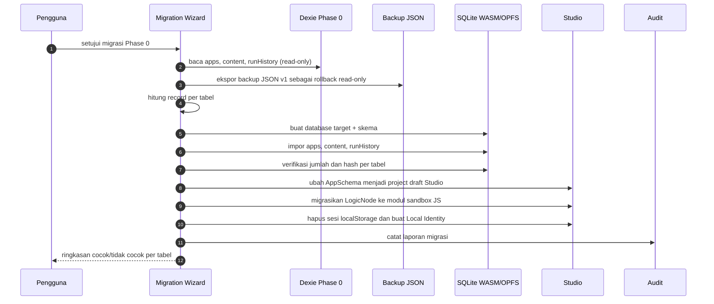

# FLOW-13 Migrasi Phase 0

Alur ini menjelaskan migrasi bertahap dari prototipe Phase 0 (Next.js + Dexie + auth localStorage + evaluator `new Function`) ke arsitektur target (SQLite WASM/OPFS + Local Identity + sandbox). Migrasi bersifat idempoten, dapat diulang, dan tidak menghapus data pengguna.

## Trigger

- Pengguna membuka build Phase 1 pada perangkat yang masih memiliki database Dexie v6 berisi `apps`, `content`, dan `runHistory`.
- Pengguna memilih "Impor data Phase 0" dari Storage Manager atau layar migrasi.
- Operator QA menjalankan migrasi pada fixture Phase 0 untuk verifikasi rilis.

## Aktor

| Aktor | Peran |
|---|---|
| Pengguna | Menyetujui migrasi, memilih ekspor, dan menyelesaikan onboarding identity |
| Migration Wizard | Menjalankan preflight, pemetaan, impor, dan verifikasi jumlah record |
| DB Worker | Membuka SQLite WASM/OPFS dan menerapkan skema target |
| Studio | Menerima `AppSchema` sebagai project draft, bukan instalasi otomatis |
| Rust Core | Memvalidasi manifest, menandatangani artefak, dan menjalankan parser |
| Audit | Mencatat setiap langkah, jumlah record, dan kegagalan |

## Prasyarat

- Build Phase 1 tersedia dan dapat membuka Dexie versi 6 dalam mode baca.
- Ruang penyimpanan cukup untuk salinan Dexie, backup JSON Phase 0, dan database SQLite baru.
- Pengguna telah menyelesaikan pembuatan Local Identity sebelum data sensitif dipindahkan.
- Fixture Phase 0 dengan `apps`, `content`, dan `runHistory` tersedia untuk pengujian.
- Target penyimpanan mengikuti FR-DATA-003 (SQLite WASM di Web Worker dengan OPFS) dan larangan eksekusi alternatif FR-SBX-025.

## Alur Utama

1. Wizard membaca Dexie dalam mode baca dan MUST NOT menulis atau menghapus record sumber selama proses.
2. Wizard mengekspor backup JSON v1 Phase 0, menyimpannya sebagai rollback read-only, dan mencatat baris `migration_backup` dengan checksum SHA-256; berkas dan baris ini tidak pernah ditimpa.
3. Wizard menghitung jumlah record per tabel sumber dan menyimpannya sebagai baseline verifikasi di `migration_report.counts_json`.
4. Wizard membuat database SQLite target melalui DB Worker dengan skema target, memakai OPFS bila tersedia.
5. Wizard mengimpor `apps`, `content`, dan `runHistory` secara idempoten; setiap record diberi UUIDv7 baru sambil mempertahankan `legacy_id`, dan `legacy_record_map` mencegah impor ganda saat migrasi diulang.
6. Wizard memverifikasi jumlah record dan hash per tabel terhadap baseline; ketidakcocokan MUST menghentikan migrasi sebelum data lama disentuh, dan checksum hasil disimpan di `migration_report.checksums_json`.
7. Setiap `AppSchema` Phase 0 menjadi baris `studio_project` dengan `source = 'phase0'` dan `status = 'draft'`; project MUST NOT otomatis menjadi `.mapp` terpasang dan pengguna harus meninjau dan mem-build ulang.
8. Setiap `LogicNode` yang memakai `new Function` dimigrasikan menjadi modul sandbox `dist/functions/logic.js` dengan input/output tervalidasi, lalu diuji ulang di sandbox.
9. Wizard membersihkan `microapp_users` dan `microapp_session` dari localStorage tanpa membaca atau membandingkan password, lalu membuat Local Identity Ed25519/X25519; password Phase 0 MUST NOT dimigrasikan dan pengguna MUST diminta membuat Recovery Phrase.
10. Route lama dipertahankan atau dialihkan ke route baru; tautan lama MUST NOT menghasilkan halaman kosong.
11. Wizard menampilkan ringkasan verifikasi dan menyimpan laporan migrasi di `migration_report` serta audit lokal. Data Dexie MUST NOT dihapus sampai langkah ini selesai dan pengguna menyetujui pembersihan eksplisit.

## Cabang Gagal

| Kondisi | Deteksi | Kode | Perilaku sistem |
|---|---|---|---|
| OPFS tidak tersedia | Probe storage gagal | E-HOST-002 | Mode in-memory + ekspor saja, status degradasi eksplisit, tanpa fallback ke Dexie |
| Database target tidak dapat dibuka | Pembukaan file gagal | E-DATA-001 | Migrasi berhenti, jangan membuat database kosong, data Dexie tetap utuh |
| Impor terputus di tengah jalan | Transaksi gagal atau hash tidak cocok | E-DATA-002 | Rollback transaksi dan ulangi dari baseline, tanpa duplikasi |
| `LogicNode` tidak dapat diparse | Parser Rust menolak sumber | E-STU-001 | Node dikarantina, lokasi ditampilkan, migrasi lain tetap jalan |
| Backup JSON Phase 0 gagal dibuat | Penulisan berkas gagal | E-HOST-005 | Migrasi diblokir sampai backup tersedia |
| Manifest hasil build ulang tidak valid | Validasi schema gagal | E-STU-005 | Project draft tetap tersimpan, build diblokir dengan daftar field |
| Sesi localStorage tidak dapat dihapus | Penulisan storage gagal | E-AUTH-003 | Sesi dicabut di memori, pengguna diminta keluar dan login ulang |

## Data dan State

| Entitas | Field kunci | Invariant |
|---|---|---|
| `migration_report` | `id` (UUIDv7), `source_version`, `counts_json`, `checksums_json`, `status`, `started_at_ms`, `finished_at_ms` | Satu laporan per percobaan; laporan lama tidak ditimpa; `status` ∈ `running/completed/failed` |
| `legacy_record_map` | `legacy_id`, `target_table`, `target_id`, `migration_id` | Unik per (`legacy_id`, `target_table`); mencegah impor ganda |
| `migration_backup` | `id`, `relative_path`, `sha256`, `created_at_ms`, `read_only` | Read-only dan tidak pernah ditimpa; checksum diverifikasi sebelum restore |
| `studio_project` | `id`, `workspace_id`, `source`, `status`, `legacy_app_id`, `revision`, `created_at_ms` | `source = 'phase0'`; status awal `draft`; tidak pernah otomatis menjadi `.mapp` terpasang |

State migrasi: `detected → backed_up → imported → verified → completed`, dan `* → failed → retryable`. `completed` bersifat final; mengulang migrasi hanya menambah laporan baru tanpa menggandakan record.

- `legacy_id` dipertahankan untuk penelusuran dan rekonsiliasi, tetapi kunci utama memakai UUIDv7.
- `runHistory` diimpor sebagai riwayat read-only dan MUST NOT dieksekusi ulang.
- Backup JSON Phase 0 dipertahankan sampai pengguna menghapusnya secara eksplisit.
- Data Dexie MUST NOT dihapus sampai verifikasi jumlah dan hash selesai serta pengguna menyetujui pembersihan; persetujuan dicatat di `migration_report` dan audit.

## Izin dan Keamanan

- Password Phase 0 MUST NOT dimigrasikan, disalin, atau ditampilkan; sesi localStorage dihapus dan diganti Local Identity.
- Private key baru disimpan sebagai non-extractable melalui WebCrypto/Keychain/Keystore dan MUST NOT ditulis ke IndexedDB biasa.
- Evaluator `new Function` MUST dihapus dari jalur runtime; tuganya digantikan modul sandbox dengan verifikasi hash.
- Backup JSON Phase 0 MUST disimpan lokal, diberi tanda read-only, dan MUST NOT diunggah otomatis.
- Setiap langkah migrasi MUST dicatat di audit dengan jumlah record dan hasil, tanpa isi record.
- Data sumber Dexie MUST NOT dihapus sampai verifikasi selesai dan pengguna menyetujui pembersihan.

## Perilaku Offline

- Seluruh migrasi berjalan offline; tidak ada unggahan data ke server atau registry.
- Bila OPFS tidak tersedia, data target berada di memori dan hanya dapat diekspor; status ini MUST terlihat permanen pada sesi tersebut.
- Route lama yang dialihkan MUST tetap dapat dibuka offline setelah aset shell di-cache.
- Pembuatan Local Identity dan Recovery Phrase MUST selesai tanpa jaringan.

## Acceptance Criteria

- **Given** fixture Phase 0 berisi `apps`, `content`, dan `runHistory` **When** migrasi selesai **Then** jumlah record tiap tabel sama dengan baseline dan tidak ada data hilang.
- **Given** migrasi diulang **When** wizard dijalankan lagi **Then** tidak ada record ganda dan laporan baru dibuat.
- **Given** `LogicNode` memakai `new Function` **When** migrasi selesai **Then** modul sandbox dihasilkan, uji ulang lulus, dan tidak ada `new Function` pada artefak.
- **Given** build Phase 1 dijalankan **When** aplikasi dibuka **Then** tidak ada sesi localStorage yang dibaca atau ditulis.
- **Given** `AppSchema` Phase 0 **When** migrasi selesai **Then** project berstatus draft Studio dan tidak ada `.mapp` yang terpasang otomatis.
- **Given** route lama **When** dibuka **Then** halaman baru tampil atau redirect terjadi tanpa error 404.
- **Given** backup JSON Phase 0 **When** diperiksa **Then** berkas read-only dan dapat dipakai sebagai rollback.
- **Given** OPFS tidak tersedia **When** migrasi dijalankan **Then** status degradasi tampil dan ekspor tetap tersedia.
- **Given** migrasi diulang setelah `completed` **When** wizard dijalankan **Then** `legacy_record_map` menolak duplikasi, `migration_report` baru dibuat, dan data Dexie tetap utuh sampai pengguna menyetujui pembersihan.
- **Given** perangkat memiliki `microapp_users` dan `microapp_session` **When** pembersihan berjalan **Then** kedua kunci dihapus tanpa membaca atau membandingkan hash password, dan tidak ada password yang disalin ke database target.
- **Given** `studio_project` hasil migrasi **When** diperiksa **Then** `source = 'phase0'` dan `status = 'draft'`, bukan `.mapp` terpasang.

## Verifikasi

| Bukti | Prosedur |
|---|---|
| Jumlah record | Bandingkan hitungan Dexie dan SQLite per tabel; selisih harus nol |
| Idempotensi | Jalankan migrasi dua kali pada fixture dan periksa `legacy_record_map` |
| Sandbox | Cari `new Function`/`eval` pada hasil build dan jalankan uji modul logic |
| Auth | Pindai storage dan jaringan; pastikan tidak ada token atau sesi localStorage |
| Route | Uji setiap route Phase 0 dan periksa redirect serta status HTTP |
| Backup | Buka backup JSON, verifikasi checksum, dan uji restore ke fixture |
| OPFS | Jalankan pada mode privat tanpa OPFS; pastikan status degradasi dan ekspor |

## Referensi

- [03-specs/04-data-automation.md](../03-specs/04-data-automation.md)
- [03-specs/01-host-shell.md](../03-specs/01-host-shell.md)
- [03-specs/03-sandbox-runtime.md](../03-specs/03-sandbox-runtime.md)
- [03-specs/error-codes.md](../03-specs/error-codes.md)
- [00-foundation/implementation-status.md](../00-foundation/implementation-status.md)
- [01-architecture/monorepo.md](../01-architecture/monorepo.md)
- [01-architecture/data-model.md](../01-architecture/data-model.md)
