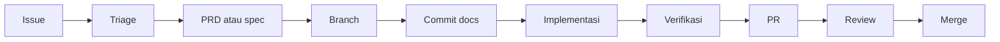

# Alur Kerja Kontribusi

Dokumen ini adalah prosedur dari issue sampai merge. Peran dan batas path ada di [roles.md](roles.md); aturan baca dan invariant ada di [AGENTS.md](AGENTS.md).

## 1. Prinsip

1. **Docs-first.** Commit `docs:` mendahului atau menyertai commit kode dalam setiap PR yang mengubah perilaku.
2. **Satu tujuan per PR.** Satu PR menyelesaikan satu hal yang dapat diuji dan menyentuh satu peran utama.
3. **Spec tertaut.** PR implementasi MUST menyebut path spec dan acceptance yang dipenuhi, atau menyatakan `docs-not-needed` beserta alasan.
4. **Bukti, bukan klaim.** Kolom verifikasi memuat perintah yang dijalankan dan hasil ringkasnya.
5. **Kontrak lewat RFC.** Perubahan manifest, MUIP, host bridge, permission, token clay, dan skema data MUST melalui [rfc-process.md](../10-contributing/rfc-process.md).
6. **Tanpa akun atau cloud.** Build, test, dan pemeriksaan dokumen berjalan lokal. Tidak ada langkah yang membutuhkan pendaftaran akun, kredensial cloud, atau layanan pihak ketiga.
7. **Tidak ada merge tanpa gate.** `npm run docs:check` wajib lulus pada PR yang menyentuh `docs/`.

## 2. Alur End-to-End

| Tahap | Pelaku | Keluaran | Gate |
|---|---|---|---|
| 1. Issue | siapa pun | Deskripsi masalah, path terkait, usulan ruang lingkup | Dapat dipetakan ke PRD `§` |
| 2. Triage | product + architecture | Kelas perubahan: docs, fitur, perbaikan, keamanan | Peran utama dan path disepakati |
| 3. PRD atau spec | product atau architecture | Perubahan PRD, spec, flow, atau acceptance | Tidak ada implementasi sebelum gate ini |
| 4. Branch | penulis | Branch dari `development` | Nama sesuai kelas perubahan |
| 5. Commit docs | penulis | Commit `docs:` | Checker lulus |
| 6. Implementasi | penulis | Kode, test, migrasi | Mengikuti rules bahasa dan token clay |
| 7. Verifikasi | penulis lalu qa | Hasil perintah, evidence | Semua gate relevan lulus |
| 8. PR | penulis | Deskripsi, tautan spec, bukti | Template PR terisi lengkap |
| 9. Review | reviewer peran lain | Approval atau perubahan diminta | Acceptance diperiksa, bukan gaya |
| 10. Merge | maintainer | Riwayat commit bersih | Gate rilis terpenuhi |

## 3. Branch

- Branch dibuat dari `development`, bukan dari branch fitur lain.
- Penamaan: `docs/<topik>`, `feat/<topik>`, `fix/<topik>`, `sec/<topik>`.
- Satu branch melayani satu PR; pekerjaan lanjutan memakai branch baru.
- Jangan menulis ulang riwayat branch bersama. Rebase hanya pada branch pribadi yang belum di-review.
- Bila `development` bergerak, sinkronkan dengan rebase dan jalankan ulang verifikasi.

## 4. Commit

Format: `tipe(lingkup): ringkasan imperatif`, maksimum 72 karakter pada baris pertama.

| Tipe | Kegunaan |
|---|---|
| `docs` | PRD, spec, flow, rules, template, indeks |
| `feat` | Perilaku baru yang sudah punya spec |
| `fix` | Perbaikan perilaku menyimpang dari spec |
| `refactor` | Perubahan struktur tanpa perubahan perilaku |
| `test` | Test baru atau perbaikan test |
| `chore` | Tooling, dependensi, skrip dokumentasi |
| `sec` | Mitigasi keamanan |

Aturan commit:

- Satu commit satu tujuan. Jangan mencampur rename, format ulang, dan perubahan perilaku.
- Commit `docs:` mendahului commit implementasi dalam PR yang sama.
- Pesan commit menyebut ID requirement atau path spec bila relevan.
- Jangan meng-commit artefak build, evidence sementara, atau file lingkungan.

## 5. Pull Request

Deskripsi PR MUST memuat:

1. Ringkasan perubahan dan alasannya.
2. Path spec dan flow yang menjadi dasar.
3. Daftar peran yang terlibat dan reviewer yang diminta.
4. Perintah verifikasi yang dijalankan beserta hasilnya.
5. Dampak keamanan, data, dan aksesibilitas; tulis "tidak ada" bila memang tidak ada.
6. Rencana rollback.

Checklist PR mengikuti template di `.github/pull_request_template.md`. PR tanpa bagian verifikasi dianggap belum siap review.

## 6. Verifikasi

| Perubahan | Perintah minimum |
|---|---|
| Dokumen saja | `npm run docs:check` |
| Kode TypeScript | `npm test`, `npm run typecheck`, `npm run lint` |
| UI atau komponen | Tambah test komponen dan pemeriksaan aksesibilitas |
| Runtime, sandbox, atau package | `npm test`, `npm run build`, test keamanan terkait |
| Data atau migrasi | Test migrasi forward/rollback dan fixture |
| Rilis | `npm run verify:web` dan gate di [release-gates.md](../08-quality/release-gates.md) |

Kegagalan yang tidak diperbaiki MUST dicatat di PR beserta alasannya. Menonaktifkan test, lint, atau typecheck untuk melewati gate tidak diperbolehkan.

## 7. Review

- Reviewer MUST berasal dari peran berbeda dan minimal satu reviewer untuk perubahan kontrak.
- Reviewer memeriksa: acceptance terpenuhi, invariant [AGENTS.md](AGENTS.md) dijaga, token clay dipakai, aksesibilitas tidak menurun, dan tidak ada klaim tanpa bukti.
- Komentar review menunjuk baris atau path, bukan opini umum.
- Perubahan yang diminta harus diselesaikan atau dijawab dengan alasan tertulis sebelum merge.

## 8. Merge dan Rollback

- Merge memakai squash bila riwayat branch berisik, atau merge commit bila setiap commit bermakna. Pilih satu kebijakan per repo dan jangan campur.
- Hapus branch setelah merge.
- Rollback dilakukan dengan `git revert` pada commit yang bermasalah, bukan dengan menulis ulang `development`.
- Bila rollback menyentuh dokumen, urutan revert dibalik: kode lebih dulu, lalu dokumen, agar spec tidak pernah mendahului perilaku yang sudah dicabut.
- Insiden produksi mengikuti [incident-response.md](../09-operations/incident-response.md); perbaikan darurat tetap MUST disusul PR dokumen.
