# Alur Kerja Kontribusi

Dokumen ini adalah prosedur operasional dari issue sampai rilis. Peran dan batas path ada di [roles.md](roles.md); aturan baca dan invariant ada di [AGENTS.md](AGENTS.md).

## 1. Prinsip

1. **Docs-first.** Commit `docs:` mendahului commit kode dalam setiap PR yang mengubah perilaku.
2. **PR kecil.** Satu PR menyelesaikan satu tujuan yang dapat diuji dan menyentuh satu peran utama.
3. **Spec tertaut.** PR implementasi MUST menyebut path spec dan ID requirement, atau menyatakan `docs-not-needed` beserta alasan.
4. **Bukti, bukan klaim.** Kolom verifikasi MUST memuat perintah yang dijalankan dan hasilnya.
5. **Kontrak lewat RFC.** Perubahan manifest, MUIP, host bridge, sync/CRDT, permission, crypto, registry, dan skema DB MUST melalui RFC yang diterima.
6. **Tidak ada merge tanpa docs check.** `npm run docs:check` wajib lulus pada PR yang menyentuh `docs/`.

## 2. Alur End-to-End

```mermaid
flowchart LR
    A[Issue] --> B[Triage dan kelas perubahan]
    B --> C[Spec PR docs:]
    C --> D[Review spec]
    D --> E[Branch feat/fix]
    E --> F[Implementasi]
    F --> G[Test dan verifikasi]
    G --> H[PR feat/fix]
    H --> I[Review]
    I --> J[Merge squash]
    J --> K[Commit docs status]
    K --> L[Release gate]
```



| Tahap | Masuk | Keluar | Penanggung jawab |
|---|---|---|---|
| 1. Issue | Masalah, permintaan fitur, temuan keamanan | Issue dengan kelas perubahan dan peran target | product atau security |
| 2. Spec | Issue yang diterima | PR `docs:` berisi requirement, acceptance, flow, matriks | peran modul |
| 3. Review spec | PR `docs:` | Minimal satu reviewer peran reviewer; dua reviewer untuk kontrak | reviewer |
| 4. Branch | Spec disetujui | Branch dari `development` dengan nama sesuai §3 | penulis |
| 5. Implementasi | Branch dan spec | Kode yang memenuhi acceptance, tanpa API terlarang | penulis |
| 6. Test | Kode | Test deterministik dan hasil perintah | penulis dan qa |
| 7. PR | Implementasi selesai | PR dengan `Spec:`, perubahan, verifikasi, risiko, rollback | penulis |
| 8. Review | PR | Approval; temuan diperbaiki atau PR ditutup | reviewer |
| 9. Merge | Approval + docs check hijau | Squash commit di `development` | reviewer atau docs/release |
| 10. Status dan rilis | Merge | Commit `docs(status):` setelah verifikasi; catatan rilis | peran modul dan docs/release |

Tahap 2 dan 3 MUST selesai sebelum tahap 4 untuk setiap perubahan perilaku. Pekerjaan yang belum punya spec MUST NOT dimulai dengan kode eksploratif yang kemudian dipertahankan.

## 3. Branch

Branch dibuat dari `development`, satu branch per tujuan.

| Pola | Dipakai untuk | Contoh |
|---|---|---|
| `feat/<area>-<slug>` | Fitur atau requirement baru | `feat/host-vault-autolock` |
| `fix/<area>-<slug>` | Perbaikan bug tanpa perubahan kontrak | `fix/sync-reconnect-backoff` |
| `docs/<slug>` | Spec, flow, ADR, perbaikan dokumentasi | `docs/sandbox-watchdog-acceptance` |
| `refactor/<area>-<slug>` | Perubahan struktur tanpa perilaku baru | `refactor/studio-canvas-store` |
| `chore/<slug>` | Tooling, script, dependency non-perilaku | `chore/docs-check-reachability` |
| `security/<slug>` | Perbaikan keamanan sensitif | `security/remove-jwt-secret` |

`<area>` MUST salah satu dari `host`, `studio`, `sandbox`, `data`, `sync`, `registry`, `server`, `cli`, `design`, `docs`, `release`. Slug berupa kebab-case, tanpa nama orang, tanpa tanggal.

Larangan: branch langsung di `main` atau `development`; branch berisi dua tujuan berbeda; force-push ke branch yang sedang direview tanpa memberi tahu reviewer.

## 4. Commit

Format: `type(scope): summary`.

| Tipe | Kapan dipakai |
|---|---|
| `feat` | Menambah perilaku yang sudah ada di spec |
| `fix` | Memperbaiki perilaku agar sesuai spec |
| `docs` | Spec, flow, ADR, RFC, dokumen, komentar kontrak |
| `test` | Menambah atau memperbaiki test tanpa mengubah perilaku |
| `refactor` | Mengubah struktur tanpa mengubah perilaku |
| `perf` | Meningkatkan performa tanpa mengubah perilaku |
| `security` | Memperbaiki kerentanan atau memperkuat kontrol |
| `chore` | Tooling, script, dependency, konfigurasi |

Aturan:

- `scope` adalah area yang sama dengan nama branch, mis. `feat(host): ...`, `docs(spec): ...`.
- Summary imperatif, maksimal 72 karakter, tanpa titik di akhir.
- Satu commit MUST dapat dijelaskan tanpa membaca commit lain.
- Commit MUST NOT memuat secret, artefak build, `node_modules`, atau berkas generated yang tidak disepakati.
- Commit `docs:` yang mengubah kontrak MUST menyebut RFC terkait pada badan commit.

Urutan commit dalam satu PR:

```text
docs(host): tambah acceptance vault auto-lock
feat(host): terapkan auto-lock vault 5 menit
docs(status): tandai FR-HOST vault terverifikasi
```

Larangan urutan: `feat:` sebelum `docs:`; `docs(status):` sebelum verifikasi dijalankan; menggabungkan `docs:` dan `feat:` dalam satu commit.

## 5. Isi PR

PR MUST memakai template di `.github/pull_request_template.md` dan memuat bagian berikut.

| Bagian | Isi wajib | Ditolak bila |
|---|---|---|
| Spec | `Spec: docs/<path>.md` + ID requirement, atau `Spec: docs-not-needed` + alasan | Kosong, hanya tautan tanpa ID, atau alasan tidak dapat diverifikasi |
| Perubahan | Ringkasan perilaku sebelum dan sesudah | Berisi daftar berkas tanpa menjelaskan perilaku |
| Verifikasi | Perintah yang dijalankan dan hasil ringkas | Hanya "tested" atau hasil tanpa perintah |
| Risiko/Rollback | Dampak ke data, keamanan, kompatibilitas; cara membalik | Tidak ada rencana untuk perubahan kontrak atau data |
| Checklist | SDD, docs check, a11y, i18n, keamanan, test | Checklist tidak dicentang dengan bukti |

Aturan tambahan:

- PR yang mengubah perilaku user-facing MUST menyertakan tangkapan keadaan sebelum/sesudah dalam bentuk deskripsi atau wireframe ASCII; gambar bitmap bukan kanonik.
- PR yang mengubah permission, crypto, atau sandbox MUST menautkan baris threat model dan test keamanan yang dijalankan.
- PR yang mengubah string UI MUST menyebut key i18n pada `locales/`.
- PR MUST NOT mencampur perubahan format massal dengan perubahan perilaku.

## 6. Review

Reviewer MUST memeriksa isi, bukan hanya kehadiran bagian. Checklist minimum:

| Item | Kriteria lulus | Alasan penolakan |
|---|---|---|
| Kepatuhan spec | Setiap perubahan perilaku punya dasar requirement dan acceptance | Perilaku baru tanpa spec |
| Acceptance | Acceptance yang terdampak dijalankan dan hasilnya dicatat | Acceptance dilewati atau diubah agar lulus |
| Kontrak | Perubahan kontrak punya RFC dan catatan kompatibilitas | Kontrak berubah tanpa RFC |
| Keamanan | Permission, secret, crypto, dan input boundary diperiksa | Secret di diff, `new Function`, sanitasi hilang |
| Data | Migrasi punya rollback dan snapshot; tidak ada penghapusan data tanpa ekspor | Migrasi destruktif |
| Test | Test deterministik dan menguji acceptance | Test `skip`, snapshot saja, atau bergantung jaringan |
| Dokumentasi | Checker lulus; matriks dan status diperbarui bila perlu | Tautan rusak, ID tak terdefinisi, klaim palsu |
| a11y/i18n | Jalur keyboard, label, dan key i18n tersedia | String hardcoded, fokus hilang |
| Performa | Budget pada [08-quality/performance-budgets.md](../08-quality/performance-budgets.md) tidak dilanggar | Regresi tanpa pengukuran |

Aturan reviewer:

- Reviewer MUST berbeda peran dari penulis; perubahan kontrak MUST direview minimal dua orang, salah satunya architect.
- Reviewer MUST NOT menyetujui PR yang gagal `npm run docs:check`.
- Temuan MUST ditandai sebagai blocking atau non-blocking; hanya blocking yang menghalangi merge.
- Penulis MUST NOT menyelesaikan temuan blocking dengan menghapus test atau melonggarkan acceptance.

## 7. Merge

- Metode: **squash merge**; judul squash mengikuti `type(scope): summary`, badan memuat ringkasan PR dan baris `Spec:`.
- Syarat: minimal satu approval dari reviewer peran, docs check hijau, tidak ada temuan blocking, branch sudah rebase pada `development`.
- Setelah merge: hapus branch, tutup issue terkait, dan jalankan commit `docs(status):` bila status implementasi berubah.
- Larangan: merge oleh penulis sendiri; merge saat checker gagal; merge yang menyertakan perubahan di luar path peran tanpa handoff; merge tanpa mencatat perintah verifikasi.

## 8. Perubahan Docs-Only

Perubahan kelas A (typo, tautan, klarifikasi tanpa mengubah perilaku) MUST:

1. Menyentuh hanya `docs/` atau root policy files.
2. Lulus `node scripts/check-docs.mjs --strict`.
3. Menyebut pada PR bahwa tidak ada perilaku yang berubah.
4. Tidak mencampur perubahan status `implemented` tanpa bukti verifikasi.

Perubahan docs-only yang ternyata mengubah kontrak MUST dipindahkan menjadi RFC dan PR terpisah.

## 9. Hotfix

Hotfix hanya untuk kerentanan aktif atau kehilangan data. Ketentuan:

1. Perbaikan dibatasi pada mitigasi minimal; tidak ada refactor.
2. PR hotfix MUST menautkan insiden dan menyebut risiko residual.
3. Dokumen retro (spec, flow, matriks, catatan insiden) MUST selesai dalam **24 jam**.
4. Bila mitigasi mengubah kontrak, RFC retro MUST diterima dalam **7 hari**.
5. Status `implemented` baru boleh dinaikkan setelah test regresi untuk kerentanan yang sama ada dan lulus.

Hotfix MUST NOT menjadi jalur tetap untuk melewati spec; hotfix berulang pada area yang sama menandakan spec atau desain perlu diperbaiki lebih dulu.

## 10. Rilis

Rilis mengikuti fase PRD §8 dan gate pada [08-quality/release-gates.md](../08-quality/release-gates.md).

| Fase PRD | Fokus | Bukti keluar minimum |
|---|---|---|
| Fase 1 | Host Shell offline, core Rust, sandbox | Host berjalan 100% offline, `.mapp` lokal terpasang terisolasi, audit sandbox escape |
| Fase 2 | Studio IDE, SQLite per app, CLI | Micro-app full-stack offline dibuat dan diekspor, diuji di perangkat tanpa internet |
| Fase 3 | AI lokal/BYOK, workflow, P2P sync | Dua perangkat offline bertukar perubahan dengan E2EE tanpa konflik data |
| Fase 4 | Registry terfederasi, reproducible build | Registry mandiri, verifikasi signature, pasang satu klik |
| Fase 5 | Self-host, air-gap, governance | Instalasi di bawah 2 menit pada VPS 512 MB, air-gap tanpa egress, SBOM lengkap |

Aturan rilis:

- `CHANGELOG.md` hanya diubah pada PR rilis, bukan pada PR fitur.
- Setiap rilis MUST mencatat versi, hash artefak, SBOM, dan hasil gate.
- Tag rilis MUST ditandatangani; artefak MUST diverifikasi terhadap checksum dan SBOM sebelum diumumkan.
- Klaim status pada catatan rilis MUST merujuk [00-foundation/implementation-status.md](../00-foundation/implementation-status.md).
- Rilis MUST NOT menyertakan fitur yang belum punya bukti acceptance.
- Tidak ada edisi berbayar; seluruh fitur yang dirilis tersedia untuk semua pengguna.

## 11. Verifikasi

| Tahap | Perintah atau prosedur | Bukti yang dicatat di PR |
|---|---|---|
| Docs-only | `node scripts/check-docs.mjs --strict` | Exit code 0 dan ringkasan checker |
| Kode TypeScript | `npm run lint`, `npm test`, `npm run build` | Hasil masing-masing perintah |
| Perubahan schema | Validasi `JSON.parse` pada `03-specs/schemas/*.json` | Daftar schema yang valid |
| Perubahan kontrak | RFC tertaut, catatan kompatibilitas, fixture valid/invalid | Tautan RFC dan hasil fixture |
| Perubahan UI | Audit keyboard dan pembacaan screen reader | Daftar tugas keyboard yang lulus |
| Perubahan server | Smoke test pada resource 1 vCPU/512 MB dan uji restore backup | Angka RSS dan hasil restore |
| Rilis | Seluruh gate fase terkait | Daftar gate dan status lulus |
