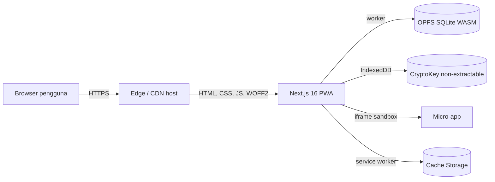

# Deployment Web

Dokumen ini menetapkan cara membangun, menerbitkan, memverifikasi, dan mengembalikan (rollback) MicroApp Studio sebagai satu PWA Next.js 16 di browser desktop, tablet, dan mobile. Deployment **MUST** mengikuti [ADR-0017](../01-architecture/adr/0017-web-only-nextjs-pwa.md): tidak ada backend wajib, tidak ada akun, tidak ada basis data server, dan tidak ada komponen native.

## 1. Tujuan dan Ruang Lingkup

- Menjaga artefak yang diterbitkan identik dengan commit yang lolos [release gates](../08-quality/release-gates.md).
- Menjamin header keamanan (CSP, COOP/COEP, Permissions-Policy) terpasang pada setiap respons HTML.
- Menetapkan strategi cache PWA, alur pembaruan service worker, dan jalur rollback yang deterministik.
- Menetapkan smoke test minimum setelah deploy dan cara menjalankannya.

Di luar cakupan: server aplikasi dengan basis data, orkestrasi container, Kubernetes, self-host, dan pipeline publish paket. Semua itu **tidak ada** pada produk ini; satu-satunya backend opsional adalah host statis yang menyajikan hasil build.

## 2. Topologi



| Target | Kapan dipakai | Catatan |
|---|---|---|
| Vercel | Default produksi | Build `next build`, headers dari `next.config.ts`, preview per PR |
| Node host | Bila organisasi menjalankan `next start` sendiri | Node 20+, satu proses tanpa basis data; header **MUST** dipasang reverse proxy atau `next.config.ts` |
| Static export | Hanya bila seluruh fitur yang dirilis client-side | `output: "export"`; header dipasang host statis; service worker tetap wajib |

Ketiga target menyajikan aset yang sama. Tidak ada perbedaan perilaku produk antar target; perbedaan hanya pada cara header dan cache dikonfigurasi.

## 3. Build

| Langkah | Perintah | Keluaran |
|---|---|---|
| Pasang dependensi | `npm ci` | `node_modules` terkunci lockfile |
| Typecheck | `npm run typecheck` | 0 error |
| Lint | `npm run lint` | 0 error |
| Build | `npm run build` | `.next/` dan manifest service worker |
| Pratinjau lokal | `npm run start` | Origin `http://localhost:3000` |

Aturan build:

- Build **MUST** deterministik terhadap lockfile; `npm ci` wajib, `npm install` tidak dipakai di CI.
- `next.config.ts` **MUST** menetapkan `output` sesuai target dan `poweredByHeader: false`.
- Build **MUST NOT** menyematkan secret, token, atau endpoint AI. Konfigurasi BYOK hidup hanya di vault lokal pengguna.
- Service worker **MUST** diberi versi dari commit SHA agar cache lama tidak menutupi aset baru.
- Static export **MUST** gagal bila ada route yang membutuhkan server runtime.

## 4. Environment Variables

| Variabel | Wajib | Cakupan | Nilai |
|---|---|---|---|
| `DEPLOY_URL` | tidak | Hanya `scripts/verify-deploy.mjs` | Origin produksi; default `https://microapp-studio.vercel.app` |
| `NEXT_TELEMETRY_DISABLED` | tidak | Build | `1` direkomendasikan agar build tidak mengirim telemetri framework |
| `NODE_ENV` | tidak | Build/runtime | Diatur otomatis oleh Next.js |

- Tidak ada variabel untuk basis data, OAuth, akun, atau API key. Ketiadaannya **MUST NOT** menggagalkan build atau boot.
- Kunci BYOK, passphrase backup, dan frasa pemulihan **MUST NOT** pernah menjadi environment variable, build arg, atau berkas `.env` yang ter-commit.
- `.env*` yang memuat nilai lokal **MUST** ada di `.gitignore`; dokumen dan fixture memakai placeholder yang jelas bukan rahasia.

## 5. Header Wajib

Setiap respons HTML **MUST** membawa header berikut. Nilai di bawah adalah nilai produksi; dev boleh melonggarkan `script-src` hanya untuk HMR dan **MUST NOT** ikut ter-deploy.

| Header | Nilai |
|---|---|
| `Content-Security-Policy` | `default-src 'none'; script-src 'self' 'nonce-<per-request>'; style-src 'self'; img-src 'self' data: blob:; font-src 'self'; connect-src 'self'; worker-src 'self' blob:; frame-src 'self' blob:; media-src 'self' blob:; base-uri 'none'; form-action 'none'; frame-ancestors 'none'; object-src 'none'` |
| `Cross-Origin-Opener-Policy` | `same-origin` |
| `Cross-Origin-Embedder-Policy` | `require-corp` |
| `Cross-Origin-Resource-Policy` | `same-origin` |
| `Referrer-Policy` | `no-referrer` |
| `X-Content-Type-Options` | `nosniff` |
| `Permissions-Policy` | `camera=(), microphone=(), geolocation=(), usb=(), serial=(), payment=(), interest-cohort=()` |
| `Strict-Transport-Security` | `max-age=63072000; includeSubDomains; preload` |
| `X-Frame-Options` | `DENY` (host; iframe sandbox memakai origin `blob:`/opaque, bukan route host) |

Aturan turunan:

- CSP **MUST NOT** memuat `'unsafe-inline'`, `'unsafe-eval'`, `*`, atau host pihak ketiga. Font dan gambar dibundel lokal, jadi `font-src 'self'` dan `img-src 'self' data: blob:` cukup.
- COOP/COEP `same-origin` + `require-corp` wajib agar `SharedArrayBuffer` dan isolasi origin terjaga; konsekuensinya semua aset **MUST** same-origin.
- `frame-ancestors 'none'` dan `X-Frame-Options: DENY` mencegah host di-embed; micro-app dirender di iframe dengan `sandbox="allow-scripts"` sesuai [sandbox spec](../03-specs/03-sandbox-runtime.md).
- Static export **MUST** memasang header yang sama di host (mis. `vercel.json` atau konfigurasi CDN). Bila host tidak mendukung nonce per request, gunakan hash skrip build dan buktikan tidak ada inline script liar.
- Perubahan header adalah perubahan keamanan: wajib melewati [security test plan](../08-quality/security-test-plan.md) dan dicatat di PR.

Contoh konfigurasi Next.js:

```ts
const isDev = process.env.NODE_ENV !== 'production';

const csp = [
  "default-src 'none'",
  `script-src 'self'${isDev ? " 'unsafe-eval' 'unsafe-inline'" : " 'nonce-{NONCE}'"}`,
  "style-src 'self'",
  "img-src 'self' data: blob:",
  "font-src 'self'",
  "connect-src 'self'",
  "worker-src 'self' blob:",
  "frame-src 'self' blob:",
  "media-src 'self' blob:",
  "base-uri 'none'",
  "form-action 'none'",
  "frame-ancestors 'none'",
  "object-src 'none'",
].join('; ');

export const securityHeaders = [
  { key: 'Content-Security-Policy', value: csp },
  { key: 'Cross-Origin-Opener-Policy', value: 'same-origin' },
  { key: 'Cross-Origin-Embedder-Policy', value: 'require-corp' },
  { key: 'Cross-Origin-Resource-Policy', value: 'same-origin' },
  { key: 'Referrer-Policy', value: 'no-referrer' },
  { key: 'X-Content-Type-Options', value: 'nosniff' },
  {
    key: 'Permissions-Policy',
    value: 'camera=(), microphone=(), geolocation=(), usb=(), serial=(), payment=(), interest-cohort=()',
  },
  { key: 'Strict-Transport-Security', value: 'max-age=63072000; includeSubDomains; preload' },
  { key: 'X-Frame-Options', value: 'DENY' },
];
```

Nonce **MUST** dibuat per request oleh middleware dan disisipkan ke skrip bootstrap; string `{NONCE}` di atas adalah placeholder dokumen, bukan nilai yang boleh dikirim apa adanya.

## 6. PWA dan Service Worker

| Lapisan cache | Isi | Strategi |
|---|---|---|
| Precache shell | `/`, `/templates`, `/packages`, `/settings`, CSS, font WOFF2, JS shell, `offline.html` | `install` → `addAll`; nama cache memuat versi build |
| Runtime app assets | Bundle `.mapp` terpasang, ikon, aset template | Cache-first dengan revalidasi versi manifest |
| Jaringan | Tidak ada API host | `connect-src 'self'`; permintaan eksternal hanya lewat consent micro-app |

Alur pembaruan:

1. Service worker baru terpasang di latar dan berstatus `waiting`.
2. Host menampilkan toast "Versi baru tersedia" dengan aksi **Muat ulang**; tidak ada reload paksa.
3. Pengguna memilih **Muat ulang** → `skipWaiting` → `clients.claim` → satu reload.
4. Cache versi lama dihapus pada `activate`, kecuali entri yang masih dirujuk package terpasang.
5. Bila aset hilang dari cache dan jaringan gagal, tampilkan `offline.html` dengan tombol coba lagi.

Aturan:

- Service worker **MUST NOT** menyimpan `CryptoKey`, isi vault, passphrase, atau respons yang memuat secret.
- Cache **MUST** diberi versi eksplisit; `cache.addAll` tanpa versi ditolak pada review.
- Update **MUST** tetap berfungsi saat pengguna berada di builder: draft disimpan lebih dulu (autosave), reload hanya setelah status "Tersimpan".

## 7. Rilis

1. Gabungkan PR ke `main` hanya setelah seluruh gate hijau.
2. Build dari commit `main` dan tandai artefak dengan SHA.
3. Deploy ke preview, jalankan smoke test §8.
4. Promosikan artefak yang sama ke produksi (**promote**, bukan build ulang).
5. Umumkan pembaruan di changelog rilis; service worker menawarkan reload.
6. Catat deploy: SHA, waktu, pelaksana, hasil smoke test.

Irama rilis mengikuti [governance](../10-contributing/governance.md): rilis fitur terjadi dua minggu sekali, patch kapan pun dibutuhkan, dan tidak ada hotfix langsung ke produksi tanpa commit di `main`.

## 8. Smoke Test

| Route | Harapan | Pemeriksaan tambahan |
|---|---|---|
| `/` | 200, shell Home tampil | Tidak ada error CSP di console; identity lokal dibuat |
| `/templates` | 200, galeri template tampil | Empty state benar bila katalog kosong |
| `/packages` | 200, daftar package tampil | Tombol impor `.mapp` terlihat |
| `/settings` | 200, halaman pengaturan tampil | Navigasi ke `/settings/permissions` tidak 404 |

Perintah:

```bash
DEPLOY_URL=https://microapp-studio.vercel.app node scripts/verify-deploy.mjs
```

- Skrip melakukan `HEAD`/`GET` pada empat route dan lulus bila status `2xx` atau `3xx`.
- `DEPLOY_URL` menimpa default; tanpa variabel, skrip memakai `https://microapp-studio.vercel.app`.
- Smoke test manual wajib memeriksa: header §5 ada, service worker `active`, Home dapat dimuat offline setelah satu kunjungan, dan tidak ada permintaan jaringan ke host pihak ketiga.
- Smoke test **MUST NOT** memasukkan data pengguna nyata atau kredensial.

## 9. Rollback

| Skenario | Tindakan |
|---|---|
| Rilis baru rusak (shell, CSP, PWA) | Promosikan deployment sebelumnya di dashboard host; jangan build ulang |
| Service worker menahan aset lama | Naikkan versi cache, promosikan artefak sebelumnya, dan verifikasi `activate` menghapus cache rusak |
| Static export rusak | Kembalikan artefak sebelumnya di host statis; pastikan header ikut kembali |
| Regresi keamanan (CSP/COOP/COEP) | Rollback segera, lalu perlakukan sebagai insiden sesuai [incident response](incident-response.md) |

- Rollback **MUST** selesai dalam 15 menit setelah keputusan.
- Rollback tidak mengubah data pengguna: data hidup di OPFS/IndexedDB lokal dan tidak dimigrasi oleh deploy.
- Setelah rollback, jalankan smoke test §8 dan catat penyebab di postmortem.

## 10. Monitoring Tanpa Telemetry

- Tidak ada analytics, RUM, atau beacon pihak ketiga. Ini konsisten dengan SEC-013 dan [NFR](../03-specs/nfr.md).
- Pemantauan hanya uptime check eksternal yang melakukan `HEAD` ke empat route dan memeriksa sertifikat TLS.
- Log host **MUST** dibatasi pada status, path, dan latensi; tidak ada query string sensitif, cookie, atau isi body.
- Kegagalan yang terlihat pengguna dilaporkan lewat tombol diagnostik lokal di [DevTools](../03-specs/08-devtools.md); laporan pengguna bersifat sukarela.

## 11. Verifikasi

| # | Pemeriksaan | Bukti |
|---|---|---|
| 1 | `npm run build` sukses pada commit yang dirilis | Log CI |
| 2 | Empat route smoke test `2xx`/`3xx` | Keluaran `verify-deploy.mjs` |
| 3 | Header §5 ada pada respons `/` | `curl -I` atau tab Network |
| 4 | Service worker `active` dan update flow diuji | Catatan uji manual |
| 5 | Home terbuka offline setelah satu kunjungan | Catatan uji manual |
| 6 | Rollback diuji di preview | Catatan latihan |
| 7 | `node scripts/check-docs.mjs --strict` hijau | Log CI (NFR-MAINT-001) |
