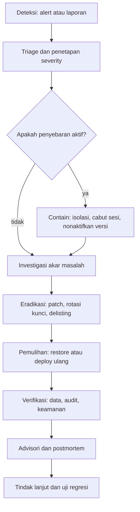

# Respons Insiden

## 1. Tujuan dan Ruang Lingkup

Dokumen ini menetapkan klasifikasi severity, alur respons, playbook, komunikasi, postmortem, dan rotasi kunci untuk insiden keamanan dan keandalan MicroApp Studio. Cakupannya mencakup sandbox escape, kebocoran kunci signing, malware registry, kompromi server self-host, kehilangan data, dan kegagalan layanan.

Ancaman yang dimitigasi dirujuk dari [01-architecture/threat-model.md](../01-architecture/threat-model.md) dan lima risiko PRD §5.1. Prosedur backup ada di [backup-restore.md](backup-restore.md); observability dan alert ada di [observability.md](observability.md).

## 2. Prinsip

| Prinsip | Aturan |
|---|---|
| Keselamatan pengguna lebih dulu | Hentikan penyebaran sebelum mencari akar masalah |
| Jangan menambah kerusakan | Jangan menimpa log, jangan hapus bukti, jangan rotasi kunci tanpa mencatat |
| Bukti terjaga | Salin log, audit chain, artefak, dan memori sebelum pemulihan |
| Rahasia tidak masuk tiket | Frasa, kunci, token, dan payload tidak ditulis di issue, chat, atau commit |
| Satu komandan | Satu incident commander mengambil keputusan; komunikasi lewat satu kanal |
| Transparan setelah aman | Advisori publik diterbitkan setelah mitigasi, tanpa spekulasi |

## 3. Klasifikasi Severity

| Severity | Definisi | Contoh | Waktu respons | Irama pembaruan |
|---|---|---|---|---|
| **SEV-1** | Kebocoran data, kompromi kunci signing, sandbox escape, kegagalan kriptografi | Kunci registry/author bocor; escape dari isolate; nonce reuse; data pengguna terbaca pihak lain | **1 jam** | Setiap 60 menit |
| **SEV-2** | Malware registry aktif, layanan inti mati, atau kehilangan data terbatas | Paket berbahaya lolos scanner; server down; restore gagal | **4 jam** | Setiap 4 jam |
| **SEV-3** | Fitur rusak tanpa dampak keamanan langsung | Sync lambat; UI gagal pada satu layar; workflow gagal sebagian | **1 hari kerja** | Setiap 2 hari kerja |

Waktu respons dihitung dari saat alert atau laporan diverifikasi, bukan dari saat tiket dibuat. Bila keraguan antara dua level, pilih level yang lebih tinggi sampai triage selesai. Penurunan severity **MUST** dicatat dengan alasan.

## 4. Peran dan Kanal

| Peran | Tanggung jawab |
|---|---|
| Incident commander | Memimpin triage, menetapkan severity, memutuskan containment |
| Security lead | Menyelidiki akar masalah keamanan, menentukan cakupan dan rotasi kunci |
| Scribe | Mencatat timeline UTC, keputusan, dan bukti |
| Communications lead | Menyusun advisori, menyelaraskan pesan, menjawab pengguna |
| Recovery owner | Menjalankan restore, rollback, atau pemulihan layanan |

- Kanal insiden **MUST** privat dan terekam; kerentanan **MUST NOT** dilaporkan lewat issue publik.
- Akses kanal dibatasi pada responden dan pihak yang dibutuhkan.
- Log dan artefak **MUST** disimpan dengan hash dan waktu salin untuk menjaga rantai bukti.

## 5. Alur Respons

| Tahap | Keluaran wajib |
|---|---|
| Deteksi | Tiket, severity awal, bukti pertama |
| Triage | Cakupan, dampak, severity final, incident commander |
| Containment | Tindakan yang menghentikan penyebaran dan waktu eksekusi |
| Eradikasi | Perbaikan akar masalah, kunci baru, versi aman |
| Pemulihan | Layanan dan data kembali; RTO tercatat |
| Verifikasi | Data utuh, audit chain valid, tidak ada jalur serangan tersisa |
| Penutupan | Advisori, postmortem, action item dengan pemilik |

## 6. Playbook: Kompromi Kunci Signing

Berlaku untuk kunci registry, kunci author, kunci identitas, dan kunci perangkat.

| Langkah | Tindakan |
|---|---|
| 1 | Identifikasi jenis kunci, fingerprint, dan waktu kompromi yang mungkin |
| 2 | Hentikan penggunaan kunci: blokir publish, tandatangani ulang artefak yang belum terbit |
| 3 | Terbitkan revocation list bertanda tangan yang memuat fingerprint terdampak (`FR-REG-023`) |
| 4 | Untuk kunci author: tandai semua versi setelah waktu kompromi; klien menolak tanpa opsi menerima |
| 5 | Untuk kunci registry: terbitkan indeks baru dengan kunci baru dan distribusikan melalui rilis Host; klien menolak indeks bertanda tangan kunci lama |
| 6 | Untuk kunci perangkat: cabut sesi dan sertifikat perangkat; minta pairing ulang (`E-AUTH-001`, `E-AUTH-005`) |
| 7 | Publikasikan fingerprint baru dan instruksi verifikasi; jangan pernah meminta pengguna menonaktifkan verifikasi |
| 8 | Audit seluruh artefak yang ditandatangani kunci terdampak dan tarik bila perlu |
| 9 | Postmortem wajib; rotasi kunci berikutnya dipercepat |

- Rotasi **MUST** memakai kunci baru yang dibuat pada perangkat atau HSM terpisah dari kunci lama.
- Transisi **MUST** ditandatangani kunci lama dan baru bila kunci lama masih dianggap valid untuk penandatanganan transisi; bila tidak, gunakan pengumuman rilis bertanda tangan.
- Klien **MUST NOT** menerima instruksi pencabutan dari sumber tanpa signature.

## 7. Playbook: Malware Registry

| Langkah | Tindakan |
|---|---|
| 1 | Verifikasi temuan: hash artefak, signature, perilaku, dan cakupan unduhan |
| 2 | Delisting sementara dalam **24 jam** sejak verifikasi untuk malware aktif |
| 3 | Nonaktifkan instalasi baru dan tandai versi terdampak; data pengguna tidak dihapus (`FR-REG-024`) |
| 4 | Beri tahu pengguna yang sudah memasang, dengan langkah pencabutan dan pemeriksaan |
| 5 | Simpan artefak, hasil scanner, dan log unduhan sebagai bukti |
| 6 | Koordinasikan dengan curator registry dan pemilik kunci author |
| 7 | Terbitkan perbaikan scanner atau aturan deteksi; jalankan ulang pemindaian seluruh indeks |
| 8 | Buka jalur banding 7 hari bagi author sesuai [registry-policy.md](../10-contributing/registry-policy.md) |

Malware yang mengeksploitasi sandbox **MUST** dieskalasi ke SEV-1 karena berpotensi menjadi sandbox escape.

## 8. Playbook: Kompromi Server Self-Host

| Langkah | Tindakan |
|---|---|
| 1 | Isolasi instance dari jaringan; pertahankan snapshot disk dan memori untuk forensik |
| 2 | Cabut seluruh sesi refresh dan token aktif (`FR-SRV-029`); putuskan perangkat yang tidak dikenal |
| 3 | Rotasi kredensial: OIDC client secret, kunci sesi, database, MinIO/S3, TLS, dan webhook |
| 4 | Verifikasi audit chain; bila rusak, buka `E-SRV-005` dan SEV-1 |
| 5 | Periksa log SSRF, workflow, plugin, dan egress (`FR-SRV-030`) untuk pergerakan lateral |
| 6 | Konfirmasi bahwa data pengguna tetap ciphertext; server tidak memiliki kunci E2EE |
| 7 | Pulihkan dari backup terverifikasi atau bangun ulang instance; jangan memulihkan artefak yang tidak tepercaya |
| 8 | Beri tahu pengguna bila metadata, sesi, atau audit terpapar, meskipun payload E2EE aman |

- Bila penyerang sempat mengubah audit, anggap seluruh periode terpengaruh dan gunakan salinan audit eksternal.
- Server **MUST NOT** dihidupkan kembali sebelum jalur masuk ditutup dan patch diterapkan.

## 9. Playbook: Sandbox Escape

| Langkah | Tindakan |
|---|---|
| 1 | Hentikan isolate dan nonaktifkan versi micro-app yang terlibat |
| 2 | Simpan `.mapp`, log sandbox, dan bukti bridge untuk analisis |
| 3 | Tentukan apakah akses keluar terjadi: filesystem, network, bridge, atau memori Host |
| 4 | Bila ada akses data di luar `app_id`, eskalasi ke SEV-1 dan perlakukan sebagai kebocoran data |
| 5 | Patch runtime web atau native; tambahkan regresi pada test sandbox escape |
| 6 | Delisting atau pin versi terdampak; paksa update bila patch tersedia |
| 7 | Verifikasi bahwa `new Function`, `eval`, dan akses ambient tetap dilarang di runtime produksi |
| 8 | Postmortem dan pembaruan threat model |

Kode error terkait: `E-SBX-001`, `E-SBX-002`, `E-SBX-003`, `E-SBX-004`, `E-SBX-005`. Freeze/watchdog 5 detik dan kuota memori 128 MB mobile/512 MB desktop **MUST** tetap berlaku selama investigasi.

## 10. Playbook: Kehilangan Data

| Langkah | Tindakan |
|---|---|
| 1 | Hentikan penulisan pada sumber terdampak untuk mencegah timpa |
| 2 | Tentukan cakupan: perangkat, tabel, workspace, atau server |
| 3 | Pilih snapshot terverifikasi terbaru; verifikasi checksum dan signature sebelum restore |
| 4 | Restore ke instance terpisah bila memungkinkan, lalu verifikasi jumlah record dan hash (`FR-SYNC-023`) |
| 5 | Jangan hapus data lokal yang lebih baru; gabungkan atau simpan sebagai salinan (`FR-SYNC-024`) |
| 6 | Hitung kehilangan dalam rentang RPO dan komunikasikan secara jujur |
| 7 | Verifikasi audit chain dan log restore |
| 8 | Perbaiki penyebab: migrasi, backup, retensi, atau kesalahan operator |

Bila checksum atau signature gagal, restore **MUST** dibatalkan (`E-SYNC-004`) dan snapshot lain dipilih.

## 11. Komunikasi

| Tahap | Isi | Batas |
|---|---|---|
| Internal awal | Severity, dampak sementara, pemilik tindakan | Tanpa spekulasi akar masalah |
| Update berkala | Status containment, layanan terdampak, ETA | Sesuai irama severity |
| Advisori pengguna | Versi terdampak, dampak, tindakan yang harus dilakukan, mitigasi | Tanpa detail eksploit yang belum diperbaiki |
| Penutupan | Ringkasan, perbaikan, kredit peneliti bila disetujui | Tanpa data pribadi pengguna |

Advisori **MUST** mencantumkan: ID advisori, severity, versi terdampak dan versi aman, dampak, tindakan mitigasi, dan kanal dukungan. Bila relevan, ajukan CVE setelah perbaikan tersedia. Kredit peneliti hanya dengan persetujuan peneliti.

Laporan kerentanan dari pihak luar **MUST** ditangani melalui kanal privat; acknowledgment dalam **48 jam**, perbaikan critical dalam **7 hari**, high dalam **30 hari**. Kerentanan **MUST NOT** dibahas di issue publik sebelum perbaikan dirilis.

## 12. Postmortem

- Postmortem **MUST** dibuat untuk setiap SEV-1 dan SEV-2.
- Tenggat: draf SEV-1 dalam **5 hari kerja**, SEV-2 dalam **10 hari kerja**.
- Sifat wajib: blameless; fokus pada sistem, deteksi, dan proses, bukan menyalahkan individu.
- Isi wajib: ringkasan, timeline UTC, dampak terukur, akar masalah, faktor kontribusi, celah deteksi, tindakan perbaikan dengan pemilik dan tenggat, serta uji regresi.
- Tindakan perbaikan **MUST** dilacak sampai selesai; postmortem tanpa action item tertutup dianggap belum selesai.
- Ringkasan **SHOULD** dipublikasikan bila tidak membuka risiko baru.

## 13. Rotasi Kunci

| Kunci | Pemicu | Tindakan | Propagasi |
|---|---|---|---|
| Registry key | Kompromi atau rotasi terjadwal | Indeks baru ditandatangani kunci baru; kunci lama dicabut | Rilis Host membawa kunci publik baru |
| Author key | Kompromi atau rotasi | Fingerprint baru, transisi ditandatangani, TOFU diperbarui | Index dan advisori |
| Identity key | Frasa atau perangkat identitas bocor | Identitas baru, perangkat dipasangkan ulang, data dienkripsi ulang | Peer dan server menerima sertifikat baru |
| Device key | Perangkat hilang atau dicurigai | Sertifikat dicabut, sesi dihentikan | Server menolak sync perangkat (`E-SYNC-005`) |
| Session signing key | Kompromi server | Kunci baru, seluruh refresh token dicabut | Semua pengguna login ulang |
| TLS key | Kompromi atau kedaluwarsa | Sertifikat baru dari CA | Klien internal menerima chain baru |
| Backup key | Kecurigaan akses | Snapshot baru dengan kunci baru; snapshot lama dianggap berisiko | Operator dan pengguna diberi tahu |

Setiap rotasi **MUST** dicatat di audit dengan alasan, waktu, dan fingerprint lama/baru. Kunci privat lama **MUST** dihapus setelah masa transisi berakhir.

## 14. Bukti dan Audit

- Salinan log, audit chain, artefak `.mapp`, dan konfigurasi **MUST** disimpan dengan hash SHA-256 dan waktu salin.
- Audit **MUST NOT** diedit atau dihapus selama investigasi; ekspor dilakukan ke media terpisah.
- Akses ke bukti dibatasi pada responden dan security lead.
- Setelah insiden ditutup, bukti disimpan sesuai kebijakan retensi organisasi dan dihapus dengan aman setelahnya.

## 15. Verifikasi

| Bukti | Prosedur |
|---|---|
| Severity | Simulasi empat kelas insiden; waktu respons tercatat sesuai tabel |
| Playbook kunci | Rotasi kunci author pada lingkungan uji; klien memblokir fingerprint lama |
| Malware registry | Delisting simulasi dalam 24 jam; instalasi baru diblokir; data pengguna utuh |
| Server breach | Cabut sesi, rotasi kredensial, verifikasi audit, pulihkan dari backup |
| Sandbox escape | Uji regresi escape gagal menembus isolate setelah patch |
| Kehilangan data | Restore snapshot; jumlah record cocok; data baru tidak terhapus |
| Komunikasi | Advisori memuat versi, dampak, dan mitigasi tanpa detail eksploit |
| Postmortem | Draf tersedia dalam tenggat; action item memiliki pemilik |

## 16. Referensi

- [03-specs/03-sandbox-runtime.md](../03-specs/03-sandbox-runtime.md), [03-specs/permissions.md](../03-specs/permissions.md)
- [03-specs/05-registry.md](../03-specs/05-registry.md), [03-specs/07-selfhost.md](../03-specs/07-selfhost.md)
- [03-specs/06-sync-backup.md](../03-specs/06-sync-backup.md), [03-specs/error-codes.md](../03-specs/error-codes.md)
- [01-architecture/threat-model.md](../01-architecture/threat-model.md), [01-architecture/identity-crypto.md](../01-architecture/identity-crypto.md)
- [observability.md](observability.md), [backup-restore.md](backup-restore.md), [selfhost-runbook.md](selfhost-runbook.md)
