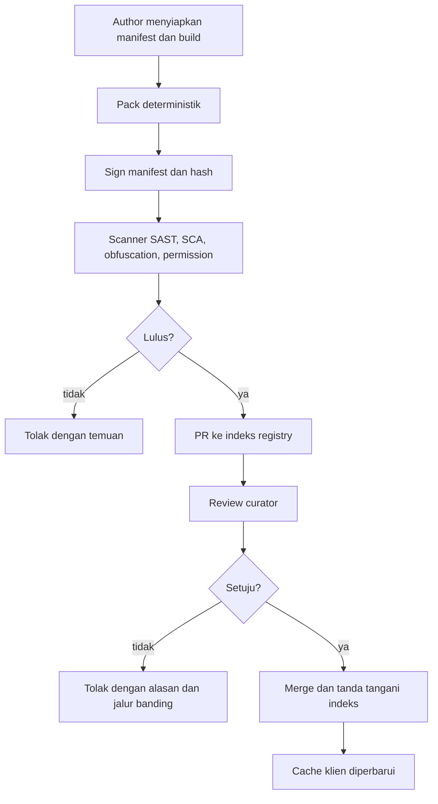

# Kebijakan Registry

## 1. Tujuan dan Ruang Lingkup

Dokumen ini menetapkan kebijakan konten, persyaratan teknis, proses publish, kurasi, delisting, banding, lisensi, privasi, dan audit untuk registry MicroApp Studio. Kebijakan berlaku untuk registry `official`, `community`, `internal`, dan `local` yang tunduk pada kurasi.

Kontrak instalasi dan signature ada di [03-specs/05-registry.md](../03-specs/05-registry.md); arsitektur supply chain ada di [01-architecture/registry-supply-chain.md](../01-architecture/registry-supply-chain.md); proses perubahan kontrak ada di [rfc-process.md](rfc-process.md).

## 2. Trust Level dan Kewenangan

| Level | Sumber kunci | Kurasi | Kewenangan delisting |
|---|---|---|---|
| `official` | Kunci registry resmi yang dibundel | Tim inti | Maintainer council |
| `community` | Kunci author dengan TOFU | Curator publik | Curator dengan review kedua |
| `internal` | Kunci registry internal organisasi | Admin organisasi | Admin organisasi |
| `local` | Kunci author lokal pengguna | Tidak ada | Pengguna sendiri |

Trust level **MUST NOT** dinaikkan otomatis karena jumlah unduhan, popularitas, atau pembayaran. Promosi ke `official` memerlukan keputusan maintainer dan review keamanan.

## 3. Kebijakan Konten

### 3.1 Dilarang

| Kategori | Contoh | Tindakan |
|---|---|---|
| Malware | Pencuri data, backdoor, loader, dropper | Delisting segera, blokir hash, investigasi |
| Spyware dan stalkerware | Pengumpulan lokasi/kontak tanpa consent jelas | Delisting, larangan author |
| Phishing dan penipuan | Formulir kredensial palsu, impersonasi | Delisting, larangan |
| Cryptojacking | Penambangan tanpa izin dan tanpa indikator | Delisting |
| Obfuscation mencurigakan | String terenkripsi, loader dinamis tanpa sumber | Tinjauan manual, tolak bila tidak dapat dijelaskan |
| Pelanggaran hak cipta | Aset atau kode tanpa lisensi | Delisting sampai lisensi dibuktikan |
| Konten ilegal | Materi yang melanggar hukum | Delisting, eskalasi hukum |
| Dark pattern | Menyembunyikan consent, menolak uninstall, mengunci data | Delisting |
| Paywall tersembunyi | Fitur inti dikunci di balik pembayaran pihak ketiga | Tolak |
| Telemetry tersembunyi | Pengiriman data tanpa opt-in eksplisit | Tolak, delisting bila ditemukan |

### 3.2 Diizinkan dengan Syarat

- Iklan atau tautan dukungan **MAY** ada bila tidak mengganggu fungsi inti dan tidak menyamar sebagai UI Host.
- Layanan jaringan **MUST** dideklarasikan melalui `network.allowlist` dan dijelaskan di deskripsi.
- Data sensitif **MUST** dijelaskan penggunaannya dan tidak boleh dikirim keluar tanpa consent.
- AI lokal **MUST** berjalan dengan model yang tersedia di perangkat; BYOK **MUST** menyimpan kunci di Vault.

## 4. Persyaratan Teknis

| Persyaratan | Aturan | Rujukan |
|---|---|---|
| Manifest valid | Sesuai JSON Schema dan aturan manifest v2, termasuk regex `id`, semver, path relatif tanpa `..` | `FR-REG-011` |
| Signature terpisah | Kunci registry dan kunci author berbeda; keduanya diverifikasi | `FR-REG-012` |
| Hash konten | `sha256` pada indeks merujuk byte `.mapp` final | `FR-REG-007` |
| Permission cocok | Permission di indeks sama dengan manifest | `FR-REG-004` |
| Versi host | `minHostVersion` dihormati | `FR-REG-007` |
| Reproducible | Commit, builder image, dan hash dicatat | `FR-REG-014` |
| Offline | Paket dapat dipasang dari `.mapp` tanpa jaringan | `FR-REG-009` |
| Sandbox | micro-app berjalan zero privilege; tidak ada akses ambient | `SEC-014` |
| Tanpa obfuscation | Kode dapat dibaca dan diaudit; minifikasi wajar diperbolehkan | `FR-REG-015` |

Paket yang gagal salah satu persyaratan **MUST** ditolak sebelum masuk indeks.

## 5. Reproducible Build

1. Author menandai commit dan versi yang dipublikasikan.
2. Builder image didokumentasikan dengan digest immutable.
3. Build dijalankan tanpa timestamp dan dengan urutan berkas deterministik.
4. `.mapp` dihasilkan sebagai ZIP deterministik: entry terurut, timestamp `1980-01-01`, deflate level 9, tanpa extra field.
5. SHA-256 dihitung dan dicatat pada indeks.
6. Signature Ed25519 dibuat atas manifest dan hash konten.
7. Registry memverifikasi signature dan hash sebelum menerima publish.
8. Klien dapat membangun ulang dan membandingkan hash.

Bila hash hasil build ulang berbeda, paket **MUST** ditandai tidak terverifikasi dan pengguna diberi peringatan. Wrapper Zstd hanya untuk transport dan tidak mengubah format kanonik.

## 6. Scanner Supply Chain

| Scanner | Yang diperiksa | Tindakan bila gagal |
|---|---|---|
| SAST | `eval`, akses ambient, pola eksekusi berbahaya | Tolak publish |
| SCA | Dependency rentan dan lisensi tidak kompatibel | Tolak atau minta perbaikan |
| Obfuscation | Minifikasi ekstrem, string terenkripsi, loader dinamis | Tinjauan manual |
| Permission | Permission melebihi fungsi yang dinyatakan | Tolak atau minta justifikasi |
| CVE | Kecocokan basis data kerentanan | Blokir versi terdampak |
| Signature | Validitas kunci dan rantai kepercayaan | Tolak |

Hasil scanner **MUST** disimpan bersama versi dan **SHOULD** dapat dilihat pengguna sebelum instalasi. Scanner bukan pengganti sandbox; micro-app tetap dijalankan dengan zero privilege.

## 7. Signature, Kunci, dan Rotasi

- Kunci author **MUST** menandatangani manifest dan seluruh konten yang dieksekusi.
- Kunci registry **MUST** menandatangani indeks dan tidak boleh menandatangani paket individual.
- Client menerapkan TOFU: fingerprint author dipin pada instalasi pertama dan dibandingkan pada setiap update (`FR-REG-013`).
- Perubahan fingerprint **MUST** memblokir update dan meminta keputusan eksplisit pengguna; tidak ada penyelesaian otomatis oleh update latar belakang.
- Fingerprint yang dicabut **MUST** ditolak tanpa opsi menerima (`FR-REG-023`).
- Kunci yang hilang **MUST** diganti melalui rotasi bertanda tangan; author tidak boleh meminta pengguna mematikan verifikasi.
- Kunci privat **MUST NOT** disimpan di repositori, CI log, atau artefak.

## 8. Proses Publish

| Tahap | SLA |
|---|---|
| Respons awal curator | 5 hari kerja |
| Keputusan publish normal | 10 hari kerja |
| Delisting malware aktif | 24 jam sejak verifikasi |
| Keputusan banding | 7 hari |

Publish **MUST** melalui PR publik untuk registry `official` dan `community`; registry `internal` mengikuti kebijakan organisasi tetapi tetap memverifikasi signature dan hash.

## 9. Review Curator

| Pemeriksaan | Kriteria |
|---|---|
| Identitas | Author dan fingerprint kunci konsisten dengan riwayat |
| Manifest | Field wajib, enum, dan path valid |
| Permission | Setiap permission memiliki justifikasi yang dapat dipahami pengguna |
| Kode | Tidak ada obfuscation yang tidak dapat dijelaskan |
| Reproducible | Commit dan builder image tersedia |
| Lisensi | Lisensi OSI disertakan dan kompatibel |
| Privasi | Tidak ada telemetry atau pengumpulan data tersembunyi |
| Keamanan | Tidak ada pola eksploitasi atau akses ambient |

Curator **MUST NOT** menyetujui paket yang ia tulis, ia danai, atau ia miliki. Paket tersebut memerlukan curator kedua.

## 10. Delisting dan Pencabutan

| Jenis | Pemicu | Durasi | Dampak |
|---|---|---|---|
| Delisting sementara | Malware aktif, dugaan kuat, laporan keamanan | Sampai investigasi selesai | Instalasi baru dan update diblokir; data pengguna tetap |
| Delisting permanen | Pelanggaran berulang atau berat | Permanen | Versi dihapus dari indeks; arsip lokal pengguna tetap |
| Pencabutan kunci | Kunci bocor atau disalahgunakan | Sampai rotasi selesai | Semua artefak bertanda tangan kunci itu ditolak |
| Pin versi | Masalah pada versi tertentu | Sampai patch | Update otomatis ditahan; pengguna diberi tahu |

Aturan:

- Delisting malware aktif **MUST** dilakukan dalam **24 jam** sejak verifikasi.
- Delisting **MUST NOT** menghapus data pengguna atau mematikan micro-app yang sudah terpasang tanpa peringatan (`FR-REG-024`).
- Klien yang menerima sinyal delisting **MUST** menonaktifkan instalasi baru dan menampilkan peringatan.
- Pencabutan **MUST** dipropagasikan melalui indeks atau revocation list bertanda tangan; klien menolak instruksi tanpa signature.
- Setiap delisting **MUST** mencatat alasan, bukti, waktu, dan curator yang memutuskan.

## 11. Banding

1. Author mengajukan banding tertulis dalam **7 hari** sejak notifikasi delisting.
2. Banding **MUST** memuat bukti perbaikan, penjelasan temuan, atau ketidaksesuaian penilaian.
3. Curator yang tidak terlibat memutuskan; bila tidak tersedia, maintainer council menunjuk peninjau.
4. Keputusan diberikan dalam **7 hari** dan dapat berupa pemulihan, pemulihan bersyarat, atau penolakan.
5. Penolakan **MUST** menyertakan alasan dan langkah yang dapat dilakukan untuk mengajukan ulang.
6. Banding **MUST NOT** menunda delisting sementara untuk malware aktif.

## 12. Lisensi dan Privasi

### 12.1 Lisensi

- Setiap paket **MUST** mencantumkan lisensi OSI-approved pada field `license` di manifest.
- Kode sumber **MUST** tersedia untuk paket `official` dan `community` agar reproducible build dapat diverifikasi.
- Lisensi proprietary atau EULA yang membatasi penggunaan ulang **MUST NOT** diterima di registry publik.
- Aset pihak ketiga **MUST** memiliki lisensi yang kompatibel dan dicatat.

### 12.2 Privasi

- micro-app **MUST NOT** mengirim telemetry tanpa opt-in eksplisit dan tanpa penjelasan tujuan.
- Permission **MUST** minimal; permintaan harus sesuai fungsi yang dinyatakan.
- Data pengguna **MUST NOT** dikirim ke server author kecuali dinyatakan jelas dan disetujui pengguna.
- Tidak ada fingerprinting perangkat atau identitas lintas app.
- Kebijakan privasi author **MUST** dapat diakses tanpa jaringan bila paket menyatakan pengumpulan data.

## 13. Audit Curator

- Audit acak **MUST** dilakukan setiap kuartal pada minimal 5% paket aktif, ditambah seluruh keputusan delisting.
- Audit memeriksa konsistensi keputusan, konflik kepentingan, dan kelengkapan bukti.
- Hasil audit **MUST** dicatat pada log publik tanpa data pribadi author.
- Curator dengan konflik kepentingan **MUST** mundur dari keputusan terkait.
- Kebijakan ini **SHOULD** ditinjau setiap tahun atau setelah insiden besar.

## 14. Sanksi

| Pelanggaran | Sanksi |
|---|---|
| Temuan ringan pertama | Peringatan dan tenggat perbaikan |
| Pelanggaran berulang | Delisting sementara dan review wajib sebelum publish berikutnya |
| Malware atau penipuan | Delisting permanen dan larangan author |
| Pelanggaran hukum | Delisting permanen, pelaporan ke pihak berwenang bila diperlukan |

Sanksi **MUST** disertai bukti dan jalur banding, kecuali untuk malware aktif yang memerlukan tindakan segera.

## 15. Verifikasi

| Bukti | Prosedur |
|---|---|
| Manifest | Uji paket valid dan tidak valid terhadap schema |
| Signature | Uji kunci author berbeda dari kunci registry; keduanya diverifikasi |
| TOFU | Ubah fingerprint pada update uji; klien memblokir dan meminta keputusan |
| Reproducible | Build ulang dari commit; hash dibandingkan dengan indeks |
| Scanner | Kirim paket dengan `eval` dan permission berlebih; publish ditolak |
| Malware | Simulasi delisting; instalasi baru diblokir dalam 24 jam; data pengguna tetap |
| Banding | Ajukan banding; keputusan dalam 7 hari dengan alasan |
| Lisensi | Audit paket; semua memiliki lisensi OSI dan sumber tersedia |
| Privasi | Periksa paket tanpa telemetry tersembunyi dan permission minimal |

## 16. Referensi

- [03-specs/05-registry.md](../03-specs/05-registry.md), [03-specs/manifest-v2.md](../03-specs/manifest-v2.md)
- [03-specs/permissions.md](../03-specs/permissions.md), [03-specs/error-codes.md](../03-specs/error-codes.md)
- [01-architecture/registry-supply-chain.md](../01-architecture/registry-supply-chain.md), [01-architecture/threat-model.md](../01-architecture/threat-model.md)
- [governance.md](governance.md), [rfc-process.md](rfc-process.md)
- [incident-response.md](../09-operations/incident-response.md)
