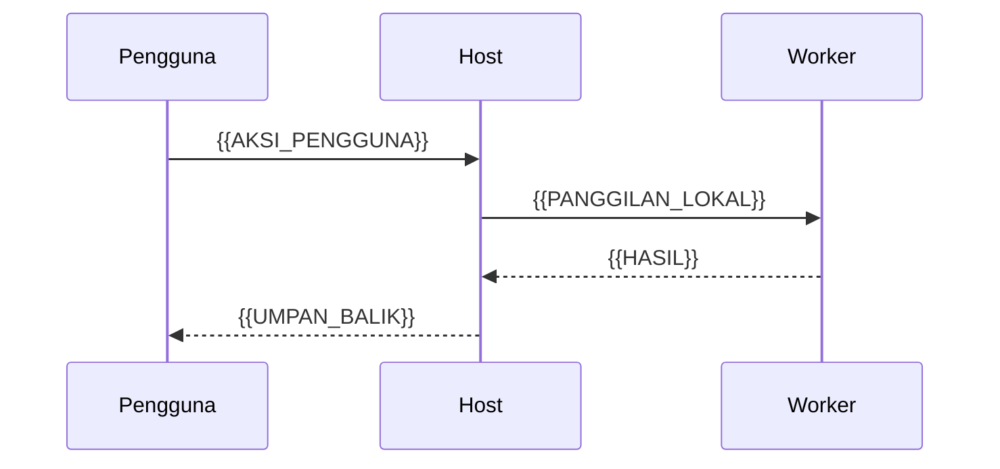

# {{TITLE}}

Ganti setiap placeholder `{{...}}` dan hapus baris panduan ini. `id` berbentuk `FLOW-{{NN}}`, sedangkan `title` dan H1 memakai label manusia tanpa nomor (mis. "Create App"). Heading wajib tetap `## Alur Utama`, `## Cabang Gagal`, `## Acceptance Criteria`, `## Verifikasi`, dan `## Referensi` tanpa nomor agar checker lolos.

## Tujuan

{{Satu paragraf: hasil yang dicapai pengguna dan requirement yang memayunginya, mis. `FR-{{DOMAIN}}-{{NNN}}` atau `SEC-{{NNN}}`.}}

## Aktor dan Prasyarat

| Aktor | Peran | Prasyarat |
|---|---|---|
| {{AKTOR}} | {{peran}} | {{state awal yang harus benar}} |

## Alur Utama

1. {{Langkah satu, dengan route atau elemen yang terlihat.}}
2. {{Langkah dua, tanpa wizard tambahan dan tanpa langkah yang dapat dihapus.}}
3. {{Langkah tiga, berakhir pada state yang dapat diperiksa.}}

## Cabang Gagal

| Kondisi | Kode | Perilaku | Pemulihan |
|---|---|---|---|
| {{KONDISI}} | E-{{DOMAIN}}-{{NNN}} | {{pesan dan state yang dipertahankan}} | {{retry / fallback / kembali ke Home}} |

Aturan: kegagalan tidak boleh menghapus draft, memblokir Home, atau memaksa reload penuh. Bila sandbox tidak tersedia, perilaku fail-closed.

## Data dan State

{{Data yang ditulis, tabel SQLite/OPFS yang berubah, dan invariant. Sebutkan bila data tetap lokal dan tidak diunggah.}}

## Acceptance Criteria

- **Given** {{konteks}} **When** {{aksi}} **Then** {{hasil}}, dalam maksimal {{KLIK}} klik dan {{DETIK}} detik pada perangkat referensi.
- **Given** {{konteks offline}} **When** {{aksi}} **Then** {{hasil tanpa jaringan}}.
- Keyboard-only: seluruh langkah dapat diselesaikan tanpa mouse; `Esc` menutup lapisan teratas.

## Verifikasi

| Perintah / Artefak | Bukti |
|---|---|
| `npx playwright test {{spec}}` | {{skenario E2E yang menutup flow}} |
| `npm test -- {{filter}}` | {{test unit yang memeriksa state}} |
| `node scripts/check-docs.mjs --strict` | flow ini beserta referensi `FR-{{DOMAIN}}-{{NNN}}` |

## Referensi

- `docs/04-flows/README.md` — indeks flow dan notasi.
- `docs/03-specs/{{SPEC}}.md` — requirement `FR-{{DOMAIN}}-{{NNN}}`.
- `docs/02-design/screen-specs.md` — layar `SCR-{{NN}}`.
