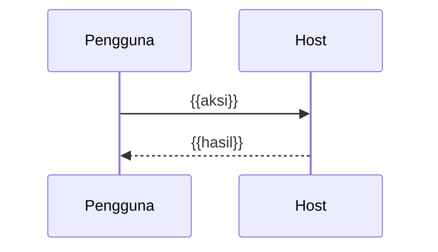

# FLOW-{{NN}} {{judul flow}}

## Trigger

{{kejadian pemicu}}.

## Aktor

{{aktor dan sistem yang terlibat}}.

## Prasyarat

{{state awal yang harus benar}}.

## Alur Utama

## Cabang Gagal

| Kondisi | Kode | Perilaku |
|---|---|---|
| {{kondisi}} | E-{{DOMAIN}}-{{NNN}} | {{recovery}} |

## Data dan State

{{tabel/field yang berubah, invariant}}.

## Izin dan Keamanan

{{permission dan audit}}.

## Perilaku Offline

{{perilaku saat tanpa jaringan}}.

## Acceptance Criteria

- **Given** {{konteks}} **When** {{aksi}} **Then** {{hasil}}.

## Verifikasi

{{perintah dan bukti}}.

## Referensi

- [04-flows/README.md](../04-flows/README.md)
- {{FR/SEC terkait}}
